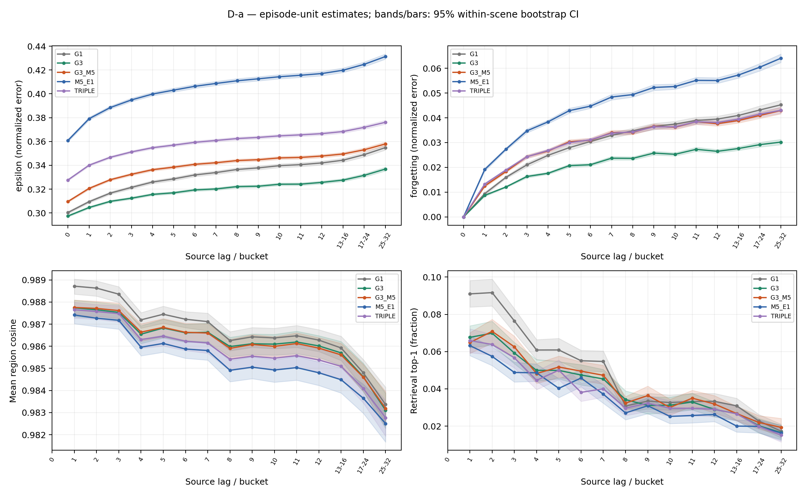
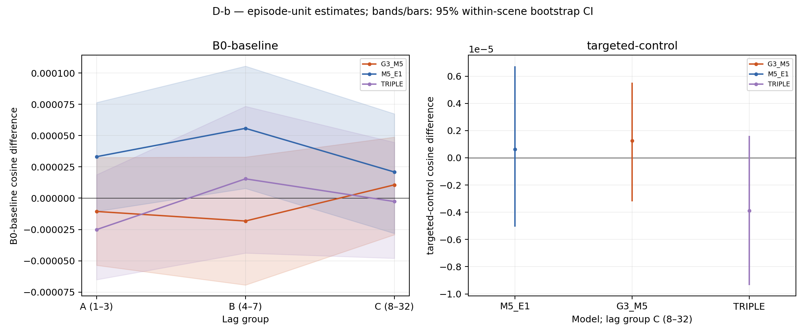
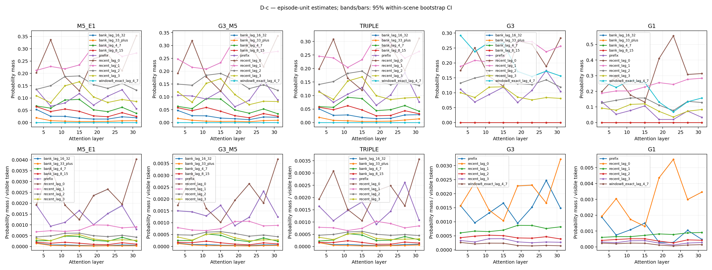
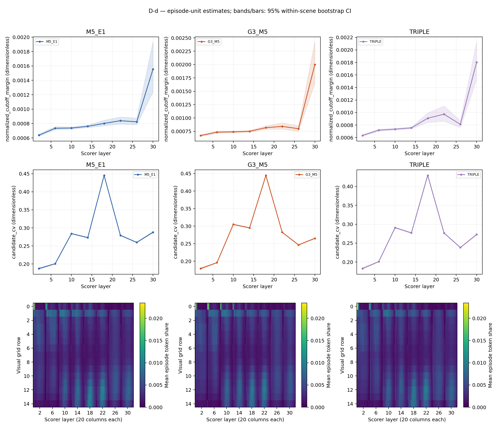
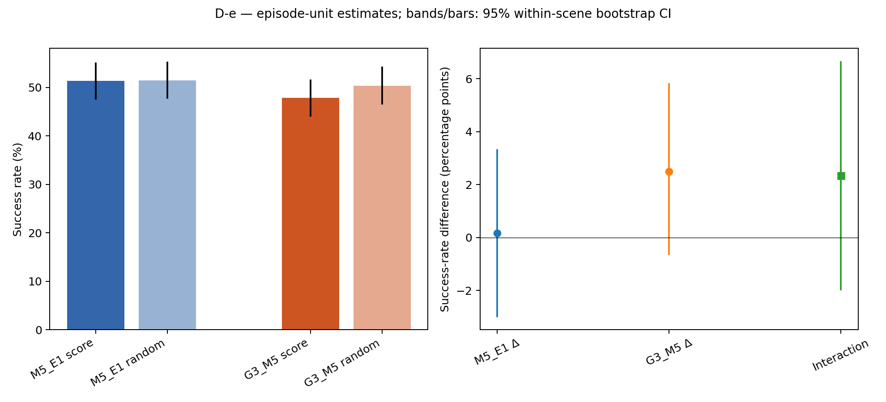
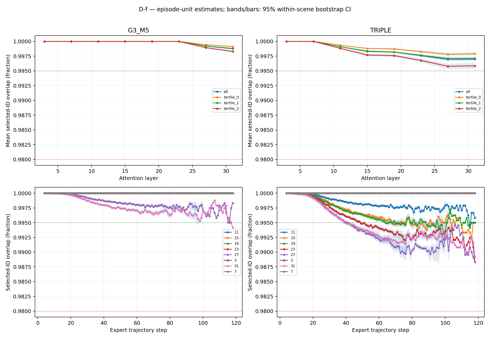

# G3 + M5 diagnostic report

## 1. Executive summary

| Hypothesis | Decision | Primary evidence (estimate [95% CI]) |
|---|---|---|
| R1 | Refuted | r1_b: -0.013088 [-0.0134393, -0.0127354]; n=240 episodes; left_pairs=25072, left_token_visits=7521600, right_pairs=25072, right_token_visits=7521600; r1_c: -0.0177358 [-0.0182316, -0.0172378]; n=240 episodes; left_pairs=54548, left_token_visits=16364400, right_pairs=54548, right_token_visits=16364400; r1_probe_b: 0.00073741 [0.000582013, 0.00090075]; n=240 episodes; left_pairs=25072, left_candidate_frame_visits=1547972, right_pairs=25072, right_candidate_frame_visits=1547972; r1_probe_c: 0.00101479 [0.000877851, 0.00115027]; n=240 episodes; left_pairs=54548, left_candidate_frame_visits=3426103, right_pairs=54548, right_candidate_frame_visits=3426103 |
| R2 | Refuted | r2_target: 1.26313e-06 [-3.19161e-06, 5.51511e-06]; n=240 episodes; , pairs=1153; r2_attention: -3.90546e-06 [-4.30203e-06, -3.52697e-06]; n=240 episodes; left_queries=2741706, left_query_heads=43867296, left_defined_query_heads=37784736, left_visible_tokens=1795681140, left_token_head_visits=28730898240, left_undefined_queries=380160, right_queries=2741706, right_query_heads=43867296, right_defined_query_heads=37784736, right_visible_tokens=1786187667, right_token_head_visits=28579002672, right_undefined_queries=380160 |
| R3 | Inconclusive | r3_margins/2: 3.32256e-05 [1.41722e-05, 5.16121e-05]; n=240 episodes; left_steps=13847, left_candidate_token_visits=18610500, left_selected_token_visits=15032400, left_defined_steps=11927, left_undefined_steps=1920, right_steps=13847, right_candidate_token_visits=18610500, right_selected_token_visits=15032400, right_defined_steps=11927, right_undefined_steps=1920; r3_margins/6: -2.4385e-07 [-2.75479e-05, 2.82226e-05]; n=240 episodes; left_steps=13847, left_candidate_token_visits=18610500, left_selected_token_visits=15032400, left_defined_steps=11927, left_undefined_steps=1920, right_steps=13847, right_candidate_token_visits=18610500, right_selected_token_visits=15032400, right_defined_steps=11927, right_undefined_steps=1920; r3_margins/10: 2.56892e-06 [-1.93727e-05, 2.47535e-05]; n=240 episodes; left_steps=13847, left_candidate_token_visits=18610500, left_selected_token_visits=15032400, left_defined_steps=11927, left_undefined_steps=1920, right_steps=13847, right_candidate_token_visits=18610500, right_selected_token_visits=15032400, right_defined_steps=11927, right_undefined_steps=1920; r3_margins/14: -1.11001e-05 [-3.22606e-05, 1.13256e-05]; n=240 episodes; left_steps=13847, left_candidate_token_visits=18610500, left_selected_token_visits=15032400, left_defined_steps=11927, left_undefined_steps=1920, right_steps=13847, right_candidate_token_visits=18610500, right_selected_token_visits=15032400, right_defined_steps=11927, right_undefined_steps=1920; r3_margins/18: 1.65904e-05 [-3.57468e-05, 6.49246e-05]; n=240 episodes; left_steps=13847, left_candidate_token_visits=18610500, left_selected_token_visits=15032400, left_defined_steps=11927, left_undefined_steps=1920, right_steps=13847, right_candidate_token_visits=18610500, right_selected_token_visits=15032400, right_defined_steps=11927, right_undefined_steps=1920; r3_margins/22: 3.09861e-06 [-7.07808e-05, 8.38596e-05]; n=240 episodes; left_steps=13847, left_candidate_token_visits=18610500, left_selected_token_visits=15032400, left_defined_steps=11927, left_undefined_steps=1920, right_steps=13847, right_candidate_token_visits=18610500, right_selected_token_visits=15032400, right_defined_steps=11927, right_undefined_steps=1920; r3_interaction: 0.0233333 [-0.02, 0.0666667]; n=600 episodes |
| R4 | Supported | r4_mass: -0.00697944 [-0.00740379, -0.00656394]; n=240 episodes |
| R5 | Refuted | r5_overlap/G3_M5:3: 1 [1, 1]; n=240 episodes; nonempty_steps=12887, empty_steps=960, selected_token_visits=15032400; r5_overlap/G3_M5:7: 1 [1, 1]; n=240 episodes; nonempty_steps=12887, empty_steps=960, selected_token_visits=15032400; r5_overlap/G3_M5:11: 1 [1, 1]; n=240 episodes; nonempty_steps=12887, empty_steps=960, selected_token_visits=15032400; r5_overlap/G3_M5:15: 1 [1, 1]; n=240 episodes; nonempty_steps=12887, empty_steps=960, selected_token_visits=15032400; r5_overlap/G3_M5:19: 1 [1, 1]; n=240 episodes; nonempty_steps=12887, empty_steps=960, selected_token_visits=15032400; r5_overlap/G3_M5:23: 1 [1, 1]; n=240 episodes; nonempty_steps=12887, empty_steps=960, selected_token_visits=15032400; r5_overlap/G3_M5:27: 0.999209 [0.99916, 0.999259]; n=240 episodes; nonempty_steps=12887, empty_steps=960, selected_token_visits=15032400; r5_overlap/G3_M5:31: 0.998756 [0.998661, 0.998848]; n=240 episodes; nonempty_steps=12887, empty_steps=960, selected_token_visits=15032400; r5_overlap/TRIPLE:3: 1 [1, 1]; n=240 episodes; nonempty_steps=12887, empty_steps=960, selected_token_visits=15032400; r5_overlap/TRIPLE:7: 1 [1, 1]; n=240 episodes; nonempty_steps=12887, empty_steps=960, selected_token_visits=15032400; r5_overlap/TRIPLE:11: 0.999098 [0.999044, 0.999154]; n=240 episodes; nonempty_steps=12887, empty_steps=960, selected_token_visits=15032400; r5_overlap/TRIPLE:15: 0.998304 [0.998192, 0.998412]; n=240 episodes; nonempty_steps=12887, empty_steps=960, selected_token_visits=15032400; r5_overlap/TRIPLE:19: 0.998193 [0.99807, 0.998311]; n=240 episodes; nonempty_steps=12887, empty_steps=960, selected_token_visits=15032400; r5_overlap/TRIPLE:23: 0.997582 [0.997421, 0.997742]; n=240 episodes; nonempty_steps=12887, empty_steps=960, selected_token_visits=15032400; r5_overlap/TRIPLE:27: 0.996936 [0.996719, 0.997142]; n=240 episodes; nonempty_steps=12887, empty_steps=960, selected_token_visits=15032400; r5_overlap/TRIPLE:31: 0.996995 [0.996753, 0.997228]; n=240 episodes; nonempty_steps=12887, empty_steps=960, selected_token_visits=15032400 |

Original full-run results to explain (archived observations):

| Model | Successes / episodes | SR (%) | SPL | Inference |
|---|---|---|---|---|
| M5_E1 | 950 / 1839 | 51.6585 | 0.48401 | Original full-run point estimate; no new CI inferred |
| G3_M5 | 917 / 1839 | 49.8641 | 0.461409 | Original full-run point estimate; no new CI inferred |
| TRIPLE | 916 / 1839 | 49.8097 | 0.462657 | Original full-run point estimate; no new CI inferred |
| G3 | 956 / 1839 | 51.9848 | 0.480959 | Original full-run point estimate; no new CI inferred |
| G1 | 914 / 1839 | 49.7009 | 0.460721 | Original full-run point estimate; no new CI inferred |

The measurements support R4 as candidate mechanisms, while teacher-forced evidence alone does not establish the cause or size of the closed-loop regression.

Keep G3 with Window8 rather than combining these redundant memories.

D-g was removed by user instruction; no objective-interference finding is made.
Study completion: **True**. Scientific decisions can remain Inconclusive after a completed study.

## 2. Provenance

All hashes, checkpoint identities, teacher/data identity and runtime versions are recorded verbatim in `results.json#/provenance` and the exported prerequisite file.

```json
{
  "branch": "diag/g3m5-failure-20261019",
  "scientific_commit": "f4d1c2f216e68a960a5a691d21cbf1f08ea4a901",
  "diagnostic_commit": "178b27fd4e9f3269b22f4d1701c427d09024425b",
  "checkpoints": [
    {
      "model": "M5_E1",
      "checkpoint": "/data14t/anhdh35/diag_g3m5_20261019_assets/checkpoints/M5_E1/epoch-1",
      "weights_sha256": "92089fa16096f5fb581a7fb85a670b539a887278d7f66bacd20b4d0424d70ea6"
    },
    {
      "model": "G3_M5",
      "checkpoint": "/data14t/anhdh35/simplememvln_g3_m5_combined_eval/checkpoints/G3_M5/epoch-1",
      "weights_sha256": "4e2d2095325fa779dcdece278f52213013d6889e72705ff860ab2eba1b13194f"
    },
    {
      "model": "TRIPLE",
      "checkpoint": "/data14t/anhdh35/diag_g3m5_20261019_assets/checkpoints/G3_M5_L8_L16_L24/epoch-1",
      "weights_sha256": "c206e32e4bbe884ae6ac5dbcd1a46ac7589d9218b7bc8f27a70e29a821b295ce"
    },
    {
      "model": "G3",
      "checkpoint": "/data14t/anhdh35/simplememvln_g3_m5_eval/checkpoints/G3/G3/epoch-1",
      "weights_sha256": "a71be6b5291b6acddbeb389318befaded5818c5b1438d5d44cf351c64248333b"
    },
    {
      "model": "G1",
      "checkpoint": "/data14t/anhdh35/simplememvln_g1_eval/checkpoints/G1/epoch-1",
      "weights_sha256": "a620ab17b1c0cbec6f7c5f95d67177a4b078ae53e83ea08c6696c5c4797a63ae"
    }
  ],
  "teacher": {
    "passed": true,
    "device": "cpu",
    "identity": {
      "base": {
        "weights_sha256": "c02da418b18bb01d0392598d3f6147366bcde1bb70fd08a5e3bf7925b0667934",
        "source_sha256": "b0e8d9d7ca0ee3ac8f819621a3d1c2ab5523bc57cbbc93e995aadfc5260a97cb",
        "preprocessing": "omega-balanced512-rgb640x480-bicubic448x592-v1",
        "position": "g1-center-sincos2048-rms1-scale0.5-v1",
        "adapter_sha256": "86a343a553147c5c15c10c24289e9b46392a6ef51fd720eb8c83cb7141282a60",
        "preprocessing_code_sha256": "f97798ae5770a06a7133d537a84724c903df56a96d2b83f46062a185e58ec5e6",
        "teacher_layer": 23,
        "patch_offset": 17,
        "teacher_dim": 2048,
        "compute_dtype": "float32",
        "pooling": "adaptive-average-15x20-LN2048-eps1e-6",
        "position_sha256": "dfee8e96d744f224ab3e8032096a468146a6df91b0d4397c2d30112a272c2ea7"
      },
      "target": "g3-unpositioned-LN2048-regions-v1",
      "adapter_sha256": "91fab33372f42c22de5991bc7bcfb85480193eb00d3c94b7c3df563419c5fb5e",
      "regions_sha256": "09b914e04440459cd7a5e2c35b68e01b2744935b00f9bb40fffe0060ec846839"
    },
    "constructor_seconds": 23.876269673986826,
    "requires_grad_any": false,
    "training": false,
    "source": "/data14t/anhdh35/diag_g3m5_20261019_assets/vggt-omega",
    "weights": "/data14t/anhdh35/diag_g3m5_20261019_assets/teacher_weights/vggt_omega_1b_512.pt"
  },
  "dataset": {
    "algorithm": "Premeasurement panel selection; standard library only, no model imports.\n\nAlgorithm v1: scene quotas use constrained Hamilton apportionment. Fix scenes\nwhose proportional ideal is below the minimum at that minimum, recompute ideals\non the remaining population, floor ideals, then give remaining seats in descending\nfractional-remainder order (lexicographic scene key breaks ties). Capacity is never\nexceeded. Within each scene, apportion its quota proportionally over the population's\nthree GLOBAL rank tertiles. Rank by (continuous GT length, string episode ID),\nassign tertile min(2, floor(3*rank/N)); equal lengths may cross a boundary, with\nlexicographic episode IDs breaking ties. No model outputs inform these choices.\n\nSelection: separate random.Random(seed) streams for shared, D-e and determinism\npanels; canonical sorted scene/stratum/ID order before shuffle. Within each fixed\nshared-panel stratum shuffle >=34-action and shorter candidates separately, then\ntake long candidates first. D-e has scene quotas only and no length preference.\nThe 60 determinism episodes are scene-proportional within the selected 600.\nAction count includes terminal STOP; continuous path length is the sum of 3D\nEuclidean distances between successive GT locations, not reference-path length\nor action count. Missing/malformed GT fails closed instead of silently excluding\nepisodes. Missing instruction_id defaults to episode_id (VLN-CE convention).\n",
    "dataset_matches_spec": true,
    "measurements_performed": false,
    "panel_file_sha256": {
      "de_panel_ids.json": "475d192008a0ef5ab0d0c249aff4769d345cf9cc1879ee720c9ba98e014a3cb1",
      "panel_ids.json": "dd90cd04ce78ef4182598c7fe3801f433153bc7fe280dd45e41bf0b2a243e22e"
    },
    "population": {
      "long_episodes": 1767,
      "scene_counts": {
        "2azQ1b91cZZ": 252,
        "8194nk5LbLH": 39,
        "EU6Fwq7SyZv": 132,
        "QUCTc6BB5sX": 255,
        "TbHJrupSAjP": 264,
        "X7HyMhZNoso": 141,
        "Z6MFQCViBuw": 159,
        "oLBMNvg9in8": 177,
        "pLe4wQe7qrG": 18,
        "x8F5xyUWy9e": 102,
        "zsNo4HB9uLZ": 300
      },
      "stratum_counts": {
        "2azQ1b91cZZ:0": 99,
        "2azQ1b91cZZ:1": 81,
        "2azQ1b91cZZ:2": 72,
        "8194nk5LbLH:0": 12,
        "8194nk5LbLH:1": 12,
        "8194nk5LbLH:2": 15,
        "EU6Fwq7SyZv:0": 60,
        "EU6Fwq7SyZv:1": 48,
        "EU6Fwq7SyZv:2": 24,
        "QUCTc6BB5sX:0": 40,
        "QUCTc6BB5sX:1": 71,
        "QUCTc6BB5sX:2": 144,
        "TbHJrupSAjP:0": 78,
        "TbHJrupSAjP:1": 119,
        "TbHJrupSAjP:2": 67,
        "X7HyMhZNoso:0": 60,
        "X7HyMhZNoso:1": 45,
        "X7HyMhZNoso:2": 36,
        "Z6MFQCViBuw:0": 27,
        "Z6MFQCViBuw:1": 33,
        "Z6MFQCViBuw:2": 99,
        "oLBMNvg9in8:0": 75,
        "oLBMNvg9in8:1": 75,
        "oLBMNvg9in8:2": 27,
        "pLe4wQe7qrG:0": 18,
        "x8F5xyUWy9e:0": 60,
        "x8F5xyUWy9e:1": 30,
        "x8F5xyUWy9e:2": 12,
        "zsNo4HB9uLZ:0": 84,
        "zsNo4HB9uLZ:1": 99,
        "zsNo4HB9uLZ:2": 117
      }
    },
    "population_episodes": 1839,
    "scope": "D-a through D-f only; no D-g panel",
    "seed": 20261019,
    "selector_source_sha256": "0d7a1723c7fd5465727b6452dff1c35929e838787bbf0232be79e9fe2e1090c3",
    "source_bytes_unchanged": true,
    "source_gzip_sha256": {
      "/storage/anhdh35/JanusVLN/data/datasets/r2r/val_unseen/val_unseen.json.gz": "1767a407e2c8a011fbb7abece76cd64c5b39ff9fa0e9e340ebdce5a490d167c3",
      "/storage/anhdh35/JanusVLN/data/datasets/r2r/val_unseen/val_unseen_gt.json.gz": "46a2e02c4a5e3b9d3d3c936009cbe1a4e9ea8f34156589f1e69ff1ff7080c044"
    }
  },
  "environment": {
    "policy_python": "3.12.13 (main, Aug  7 2026, 02:25:39) [Clang 22.1.3 ]",
    "platform": "Linux-6.8.0-138-generic-x86_64-with-glibc2.35",
    "torch": "2.10.0+cu129",
    "transformers": "5.11.0",
    "cuda_runtime": "12.9",
    "gpu": "NVIDIA RTX PRO 6000 Blackwell Max-Q Workstation Edition",
    "capability": [
      12,
      0
    ],
    "float32_matmul_precision": "highest",
    "cuda_matmul_allow_tf32": false,
    "packages": {
      "flash-attn": "2.8.3+cu.12.9.torch.2.10",
      "flash-linear-attention": "0.5.2",
      "fla-core": "0.5.2",
      "triton": "3.6.0",
      "numpy": "2.4.4",
      "pillow": "12.2.0",
      "scipy": null,
      "matplotlib": null
    },
    "simulator": {
      "python": "3.10.20 (main, Jun 11 2026, 15:17:37) [GCC 14.3.0]",
      "habitat": "0.2.4",
      "habitat_sim": "0.2.4"
    },
    "nvidia_smi": "NVIDIA RTX PRO 6000 Blackwell Max-Q Workstation Edition, GPU-fa3af837-308e-d118-d6bf-9312fcc4c25f, 580.178.04, 97887 MiB"
  },
  "baseline_results": {
    "M5_E1": {
      "episodes": 1839,
      "successes": 950,
      "sr": 0.5165851005981512,
      "spl": 0.48401033739315247,
      "failures": 0,
      "root": "/data14t/anhdh35/diag_g3m5_20261019_assets/remote_evaluation/m5_e1_epoch1_20261019/full"
    },
    "G3_M5": {
      "episodes": 1839,
      "successes": 917,
      "sr": 0.49864056552474173,
      "spl": 0.46140868733034324,
      "failures": 0,
      "root": "/data14t/anhdh35/diag_g3m5_20261019_assets/remote_evaluation/g3_m5_epoch1_20261017/full"
    },
    "TRIPLE": {
      "episodes": 1839,
      "successes": 916,
      "sr": 0.4980967917346384,
      "spl": 0.462657412500402,
      "failures": 0,
      "root": "/data14t/anhdh35/diag_g3m5_20261019_assets/remote_evaluation/g3_m5_l8_l16_l24_epoch1_20261018/full"
    },
    "G3": {
      "episodes": 1839,
      "successes": 956,
      "sr": 0.519847743338771,
      "spl": 0.48095940511038254,
      "failures": 0,
      "root": "/data14t/anhdh35/diag_g3m5_20261019_assets/remote_evaluation/g3_epoch1_20261018/full"
    },
    "G1": {
      "episodes": 1839,
      "successes": 914,
      "sr": 0.49700924415443176,
      "spl": 0.46072124712845913,
      "failures": 0,
      "root": "/data14t/anhdh35/simplememvln_g1_eval/results/full/G1"
    }
  },
  "rendering_gate": {
    "status": "failed_rendering_parity_stop",
    "passed": false,
    "episodes": [
      {
        "episode_id": "4991",
        "scene_id": "/storage/anhdh35/JanusVLN/data/scene_datasets_full/mp3d/JeFG25nYj2p/JeFG25nYj2p.glb",
        "frame_count": 64,
        "pixels_per_channel": 19660800,
        "mae_per_channel": [
          0.07888792130214715,
          0.08460123059640523,
          0.0953920068678513
        ],
        "mean_absolute_error": 0.08629371958880123,
        "max_abs_pixel": 255,
        "nonidentical_channel_values": 55681694,
        "frame_mae_percentiles_per_channel": {
          "0": [
            0.034768752553104576,
            0.03597552849264706,
            0.04311012816584967
          ],
          "50": [
            0.07305570874183007,
            0.07591935380923204,
            0.08578749872344771
          ],
          "90": [
            0.118897163500817,
            0.13281984528186275,
            0.1482143714256536
          ],
          "95": [
            0.12503036471098855,
            0.14174473932802287,
            0.1638268586601307
          ],
          "99": [
            0.19983471341401143,
            0.20504325482536762,
            0.20862053130106206
          ],
          "100": [
            0.20360174121732025,
            0.20878848805147057,
            0.2118926291870915
          ]
        },
        "passed": false,
        "frames": [
          {
            "mae_per_channel": [
              0.19762233200571896,
              0.20284367340686274,
              0.20669882301879083
            ],
            "mean_absolute_error": 0.20238827614379085,
            "max_abs_pixel": 255,
            "absolute_error_sum_per_channel": [
              15480943,
              15889962,
              16191959
            ],
            "nonidentical_channel_values": 884038,
            "step": 0,
            "action_id": 3,
            "action_name": "TURN_RIGHT",
            "reference": "/data14t/anhdh35/diag_g3m5_20261019_assets/training_reference/R2R-CE-640x480/train/4991/step_0000_TURN_RIGHT.png",
            "rendered": "/data14t/anhdh35/diag_g3m5_20261019_assets/rendering_gate/train/4991/step_0000_TURN_RIGHT.png",
            "rendered_sha256": "b4e21dc1f4d1b8c3f89493751fb2a29ad81c66f5e4bc33c3854b4bf63c0b2735"
          },
          {
            "mae_per_channel": [
              0.20360174121732025,
              0.20878848805147057,
              0.2118926291870915
            ],
            "mean_absolute_error": 0.2080942861519608,
            "max_abs_pixel": 255,
            "absolute_error_sum_per_channel": [
              15949346,
              16355655,
              16598821
            ],
            "nonidentical_channel_values": 883031,
            "step": 1,
            "action_id": 3,
            "action_name": "TURN_RIGHT",
            "reference": "/data14t/anhdh35/diag_g3m5_20261019_assets/training_reference/R2R-CE-640x480/train/4991/step_0001_TURN_RIGHT.png",
            "rendered": "/data14t/anhdh35/diag_g3m5_20261019_assets/rendering_gate/train/4991/step_0001_TURN_RIGHT.png",
            "rendered_sha256": "e5c34cba19012aac85c4ec2965034dd4cd2e02e3bc860ad20e708a57ed4e520c"
          },
          {
            "mae_per_channel": [
              0.11904704095179738,
              0.12716468801062092,
              0.13562080014297387
            ],
            "mean_absolute_error": 0.12727750970179738,
            "max_abs_pixel": 248,
            "absolute_error_sum_per_channel": [
              9325669,
              9961573,
              10623991
            ],
            "nonidentical_channel_values": 888277,
            "step": 2,
            "action_id": 3,
            "action_name": "TURN_RIGHT",
            "reference": "/data14t/anhdh35/diag_g3m5_20261019_assets/training_reference/R2R-CE-640x480/train/4991/step_0002_TURN_RIGHT.png",
            "rendered": "/data14t/anhdh35/diag_g3m5_20261019_assets/rendering_gate/train/4991/step_0002_TURN_RIGHT.png",
            "rendered_sha256": "a0a0e66c288601842e35a9bd3f30147526bdf9aa173bbaf3fe148c53911c9a37"
          },
          {
            "mae_per_channel": [
              0.08722035845588236,
              0.09207677185457516,
              0.09878497753267974
            ],
            "mean_absolute_error": 0.09269403594771242,
            "max_abs_pixel": 205,
            "absolute_error_sum_per_channel": [
              6832494,
              7212926,
              7738420
            ],
            "nonidentical_channel_values": 881938,
            "step": 3,
            "action_id": 3,
            "action_name": "TURN_RIGHT",
            "reference": "/data14t/anhdh35/diag_g3m5_20261019_assets/training_reference/R2R-CE-640x480/train/4991/step_0003_TURN_RIGHT.png",
            "rendered": "/data14t/anhdh35/diag_g3m5_20261019_assets/rendering_gate/train/4991/step_0003_TURN_RIGHT.png",
            "rendered_sha256": "86b66078276d78a17aa867a0ad979bd4af7e7c9a81110716e766e44c78512fa6"
          },
          {
            "mae_per_channel": [
              0.11096772875816993,
              0.1145815078635621,
              0.1200091273488562
            ],
            "mean_absolute_error": 0.11518612132352941,
            "max_abs_pixel": 254,
            "absolute_error_sum_per_channel": [
              8692768,
              8975857,
              9401035
            ],
            "nonidentical_channel_values": 884244,
            "step": 4,
            "action_id": 3,
            "action_name": "TURN_RIGHT",
            "reference": "/data14t/anhdh35/diag_g3m5_20261019_assets/training_reference/R2R-CE-640x480/train/4991/step_0004_TURN_RIGHT.png",
            "rendered": "/data14t/anhdh35/diag_g3m5_20261019_assets/rendering_gate/train/4991/step_0004_TURN_RIGHT.png",
            "rendered_sha256": "aa4b4efe60b80c39b482fe715a925801b9e3800e11c0f0da58fd0e0715bf3242"
          },
          {
            "mae_per_channel": [
              0.1255431347017974,
              0.13000243821486926,
              0.13778229677287582
            ],
            "mean_absolute_error": 0.13110928989651416,
            "max_abs_pixel": 255,
            "absolute_error_sum_per_channel": [
              9834547,
              10183871,
              10793314
            ],
            "nonidentical_channel_values": 885194,
            "step": 5,
            "action_id": 3,
            "action_name": "TURN_RIGHT",
            "reference": "/data14t/anhdh35/diag_g3m5_20261019_assets/training_reference/R2R-CE-640x480/train/4991/step_0005_TURN_RIGHT.png",
            "rendered": "/data14t/anhdh35/diag_g3m5_20261019_assets/rendering_gate/train/4991/step_0005_TURN_RIGHT.png",
            "rendered_sha256": "645f6dbf1f204e4c1ac87b0f1f0e90ab5d54b981da6cacae0aac24b6d1b5c879"
          },
          {
            "mae_per_channel": [
              0.11978819444444445,
              0.12109921364379085,
              0.1274663756127451
            ],
            "mean_absolute_error": 0.12278459456699346,
            "max_abs_pixel": 255,
            "absolute_error_sum_per_channel": [
              9383728,
              9486428,
              9985206
            ],
            "nonidentical_channel_values": 885861,
            "step": 6,
            "action_id": 3,
            "action_name": "TURN_RIGHT",
            "reference": "/data14t/anhdh35/diag_g3m5_20261019_assets/training_reference/R2R-CE-640x480/train/4991/step_0006_TURN_RIGHT.png",
            "rendered": "/data14t/anhdh35/diag_g3m5_20261019_assets/rendering_gate/train/4991/step_0006_TURN_RIGHT.png",
            "rendered_sha256": "10e095fb80a6ccf38a56bf334a64dbeda8bb43fae2d9bb1b3a15c1ed02f955e1"
          },
          {
            "mae_per_channel": [
              0.10076159109477123,
              0.10248710682189544,
              0.10608175040849672
            ],
            "mean_absolute_error": 0.10311014944172113,
            "max_abs_pixel": 254,
            "absolute_error_sum_per_channel": [
              7893260,
              8028430,
              8310020
            ],
            "nonidentical_channel_values": 880882,
            "step": 7,
            "action_id": 3,
            "action_name": "TURN_RIGHT",
            "reference": "/data14t/anhdh35/diag_g3m5_20261019_assets/training_reference/R2R-CE-640x480/train/4991/step_0007_TURN_RIGHT.png",
            "rendered": "/data14t/anhdh35/diag_g3m5_20261019_assets/rendering_gate/train/4991/step_0007_TURN_RIGHT.png",
            "rendered_sha256": "3c3a5e6bcc0de5e0aa7fe91036dfd7aa3dde3cd3661a9109099806860ca3893f"
          },
          {
            "mae_per_channel": [
              0.10804147518382354,
              0.10796943933823529,
              0.10871733302696078
            ],
            "mean_absolute_error": 0.10824274918300654,
            "max_abs_pixel": 255,
            "absolute_error_sum_per_channel": [
              8463537,
              8457894,
              8516481
            ],
            "nonidentical_channel_values": 888435,
            "step": 8,
            "action_id": 3,
            "action_name": "TURN_RIGHT",
            "reference": "/data14t/anhdh35/diag_g3m5_20261019_assets/training_reference/R2R-CE-640x480/train/4991/step_0008_TURN_RIGHT.png",
            "rendered": "/data14t/anhdh35/diag_g3m5_20261019_assets/rendering_gate/train/4991/step_0008_TURN_RIGHT.png",
            "rendered_sha256": "db9bd53e475d7b64baacbe4ea3a4c3f472035ac8e66628819f4c746020c1fc67"
          },
          {
            "mae_per_channel": [
              0.1338961141748366,
              0.1409403339460784,
              0.1496476970996732
            ],
            "mean_absolute_error": 0.1414947150735294,
            "max_abs_pixel": 255,
            "absolute_error_sum_per_channel": [
              10488886,
              11040702,
              11722802
            ],
            "nonidentical_channel_values": 903069,
            "step": 9,
            "action_id": 3,
            "action_name": "TURN_RIGHT",
            "reference": "/data14t/anhdh35/diag_g3m5_20261019_assets/training_reference/R2R-CE-640x480/train/4991/step_0009_TURN_RIGHT.png",
            "rendered": "/data14t/anhdh35/diag_g3m5_20261019_assets/rendering_gate/train/4991/step_0009_TURN_RIGHT.png",
            "rendered_sha256": "744767e50b153a37e8390457f41664d13f7cb1843a1294647f8d74c4e0ef29f2"
          },
          {
            "mae_per_channel": [
              0.09954088796977123,
              0.1032175372753268,
              0.11185017105800653
            ],
            "mean_absolute_error": 0.10486953210103485,
            "max_abs_pixel": 252,
            "absolute_error_sum_per_channel": [
              7797635,
              8085649,
              8761895
            ],
            "nonidentical_channel_values": 877676,
            "step": 10,
            "action_id": 1,
            "action_name": "MOVE_FORWARD",
            "reference": "/data14t/anhdh35/diag_g3m5_20261019_assets/training_reference/R2R-CE-640x480/train/4991/step_0010_MOVE_FORWARD.png",
            "rendered": "/data14t/anhdh35/diag_g3m5_20261019_assets/rendering_gate/train/4991/step_0010_MOVE_FORWARD.png",
            "rendered_sha256": "3913026defd3c1d8da48dd902e448783d7bc6f2c3acc8712b7a62454cc84df49"
          },
          {
            "mae_per_channel": [
              0.09646719260620915,
              0.10029858558006537,
              0.10921269914215685
            ],
            "mean_absolute_error": 0.10199282577614378,
            "max_abs_pixel": 252,
            "absolute_error_sum_per_channel": [
              7556854,
              7856990,
              8555286
            ],
            "nonidentical_channel_values": 882850,
            "step": 11,
            "action_id": 1,
            "action_name": "MOVE_FORWARD",
            "reference": "/data14t/anhdh35/diag_g3m5_20261019_assets/training_reference/R2R-CE-640x480/train/4991/step_0011_MOVE_FORWARD.png",
            "rendered": "/data14t/anhdh35/diag_g3m5_20261019_assets/rendering_gate/train/4991/step_0011_MOVE_FORWARD.png",
            "rendered_sha256": "d01fdbb42b3b8a3284b652855e08eb5c2af3d876978110290295510ab7c0a8b0"
          },
          {
            "mae_per_channel": [
              0.10137262561274508,
              0.10550619127859477,
              0.1149807878880719
            ],
            "mean_absolute_error": 0.1072865349264706,
            "max_abs_pixel": 252,
            "absolute_error_sum_per_channel": [
              7941126,
              8264933,
              9007135
            ],
            "nonidentical_channel_values": 890739,
            "step": 12,
            "action_id": 3,
            "action_name": "TURN_RIGHT",
            "reference": "/data14t/anhdh35/diag_g3m5_20261019_assets/training_reference/R2R-CE-640x480/train/4991/step_0012_TURN_RIGHT.png",
            "rendered": "/data14t/anhdh35/diag_g3m5_20261019_assets/rendering_gate/train/4991/step_0012_TURN_RIGHT.png",
            "rendered_sha256": "acc7d9febaf1c7a05d9506a80d8ecb72df0cc79e05165e00c9d73ea067f07a82"
          },
          {
            "mae_per_channel": [
              0.07713364225898692,
              0.08067478553921568,
              0.09192897263071895
            ],
            "mean_absolute_error": 0.08324580014297385,
            "max_abs_pixel": 252,
            "absolute_error_sum_per_channel": [
              6042341,
              6319740,
              7201348
            ],
            "nonidentical_channel_values": 864397,
            "step": 13,
            "action_id": 1,
            "action_name": "MOVE_FORWARD",
            "reference": "/data14t/anhdh35/diag_g3m5_20261019_assets/training_reference/R2R-CE-640x480/train/4991/step_0013_MOVE_FORWARD.png",
            "rendered": "/data14t/anhdh35/diag_g3m5_20261019_assets/rendering_gate/train/4991/step_0013_MOVE_FORWARD.png",
            "rendered_sha256": "f03409ebd80f6d8e5dc826b9765541dc1de83fd6c8a2c100fe7977aa9cd4e6da"
          },
          {
            "mae_per_channel": [
              0.07720572916666667,
              0.07946934997957517,
              0.08851933976715685
            ],
            "mean_absolute_error": 0.08173147297113291,
            "max_abs_pixel": 249,
            "absolute_error_sum_per_channel": [
              6047988,
              6225311,
              6934251
            ],
            "nonidentical_channel_values": 860899,
            "step": 14,
            "action_id": 1,
            "action_name": "MOVE_FORWARD",
            "reference": "/data14t/anhdh35/diag_g3m5_20261019_assets/training_reference/R2R-CE-640x480/train/4991/step_0014_MOVE_FORWARD.png",
            "rendered": "/data14t/anhdh35/diag_g3m5_20261019_assets/rendering_gate/train/4991/step_0014_MOVE_FORWARD.png",
            "rendered_sha256": "fb02a5e74cab4134bdc47eef0394bc3ebefb7269adb5a40f21b50afe6ac677d6"
          },
          {
            "mae_per_channel": [
              0.08112996578839869,
              0.08411672794117647,
              0.09361689389297385
            ],
            "mean_absolute_error": 0.08628786254084968,
            "max_abs_pixel": 248,
            "absolute_error_sum_per_channel": [
              6355397,
              6589368,
              7333573
            ],
            "nonidentical_channel_values": 862232,
            "step": 15,
            "action_id": 3,
            "action_name": "TURN_RIGHT",
            "reference": "/data14t/anhdh35/diag_g3m5_20261019_assets/training_reference/R2R-CE-640x480/train/4991/step_0015_TURN_RIGHT.png",
            "rendered": "/data14t/anhdh35/diag_g3m5_20261019_assets/rendering_gate/train/4991/step_0015_TURN_RIGHT.png",
            "rendered_sha256": "90b8a5c1c0b7052c5732cedcf6df7f8d2850d676d8182b66177123fa08801676"
          },
          {
            "mae_per_channel": [
              0.07741030943627451,
              0.08493250868055556,
              0.10187969771241831
            ],
            "mean_absolute_error": 0.0880741719430828,
            "max_abs_pixel": 232,
            "absolute_error_sum_per_channel": [
              6064014,
              6653273,
              7980848
            ],
            "nonidentical_channel_values": 854858,
            "step": 16,
            "action_id": 1,
            "action_name": "MOVE_FORWARD",
            "reference": "/data14t/anhdh35/diag_g3m5_20261019_assets/training_reference/R2R-CE-640x480/train/4991/step_0016_MOVE_FORWARD.png",
            "rendered": "/data14t/anhdh35/diag_g3m5_20261019_assets/rendering_gate/train/4991/step_0016_MOVE_FORWARD.png",
            "rendered_sha256": "7a70f2f4b37f8d8fefdbddc18deb92d2b42791753a55c84010b6e8088bb795cb"
          },
          {
            "mae_per_channel": [
              0.07141627093545752,
              0.0745133527369281,
              0.08379102839052287
            ],
            "mean_absolute_error": 0.07657355068763616,
            "max_abs_pixel": 236,
            "absolute_error_sum_per_channel": [
              5594465,
              5837078,
              6563854
            ],
            "nonidentical_channel_values": 840353,
            "step": 17,
            "action_id": 1,
            "action_name": "MOVE_FORWARD",
            "reference": "/data14t/anhdh35/diag_g3m5_20261019_assets/training_reference/R2R-CE-640x480/train/4991/step_0017_MOVE_FORWARD.png",
            "rendered": "/data14t/anhdh35/diag_g3m5_20261019_assets/rendering_gate/train/4991/step_0017_MOVE_FORWARD.png",
            "rendered_sha256": "743b8e06a7fa81c30338c3e5e192e8e74e708f4f5850e76c10e3dc79603971bd"
          },
          {
            "mae_per_channel": [
              0.07469514654820261,
              0.07732535488153595,
              0.0859047691993464
            ],
            "mean_absolute_error": 0.07930842354302832,
            "max_abs_pixel": 232,
            "absolute_error_sum_per_channel": [
              5851319,
              6057359,
              6729436
            ],
            "nonidentical_channel_values": 829597,
            "step": 18,
            "action_id": 1,
            "action_name": "MOVE_FORWARD",
            "reference": "/data14t/anhdh35/diag_g3m5_20261019_assets/training_reference/R2R-CE-640x480/train/4991/step_0018_MOVE_FORWARD.png",
            "rendered": "/data14t/anhdh35/diag_g3m5_20261019_assets/rendering_gate/train/4991/step_0018_MOVE_FORWARD.png",
            "rendered_sha256": "bb63b6848885b99edbd104d395d06d631ef2a483d4c246f7aef9304ad051f35b"
          },
          {
            "mae_per_channel": [
              0.08084756689133987,
              0.08458390778186274,
              0.09469790390114378
            ],
            "mean_absolute_error": 0.08670979285811548,
            "max_abs_pixel": 234,
            "absolute_error_sum_per_channel": [
              6333275,
              6625965,
              7418255
            ],
            "nonidentical_channel_values": 816856,
            "step": 19,
            "action_id": 1,
            "action_name": "MOVE_FORWARD",
            "reference": "/data14t/anhdh35/diag_g3m5_20261019_assets/training_reference/R2R-CE-640x480/train/4991/step_0019_MOVE_FORWARD.png",
            "rendered": "/data14t/anhdh35/diag_g3m5_20261019_assets/rendering_gate/train/4991/step_0019_MOVE_FORWARD.png",
            "rendered_sha256": "50a1cdd9d5c80e8adda0035269493c7e1638800a8d8ed8c306c94b971d39ba4b"
          },
          {
            "mae_per_channel": [
              0.08255439389297385,
              0.0888584686478758,
              0.10202480341094772
            ],
            "mean_absolute_error": 0.09114588865059912,
            "max_abs_pixel": 235,
            "absolute_error_sum_per_channel": [
              6466981,
              6960817,
              7992215
            ],
            "nonidentical_channel_values": 824570,
            "step": 20,
            "action_id": 1,
            "action_name": "MOVE_FORWARD",
            "reference": "/data14t/anhdh35/diag_g3m5_20261019_assets/training_reference/R2R-CE-640x480/train/4991/step_0020_MOVE_FORWARD.png",
            "rendered": "/data14t/anhdh35/diag_g3m5_20261019_assets/rendering_gate/train/4991/step_0020_MOVE_FORWARD.png",
            "rendered_sha256": "6077555dff4fe32b69dac25830fe2abef7be0668a2ebfb73d6083101f22e988c"
          },
          {
            "mae_per_channel": [
              0.0837909645629085,
              0.09183439287173202,
              0.10633796721813726
            ],
            "mean_absolute_error": 0.09398777488425926,
            "max_abs_pixel": 244,
            "absolute_error_sum_per_channel": [
              6563849,
              7193939,
              8330091
            ],
            "nonidentical_channel_values": 836621,
            "step": 21,
            "action_id": 1,
            "action_name": "MOVE_FORWARD",
            "reference": "/data14t/anhdh35/diag_g3m5_20261019_assets/training_reference/R2R-CE-640x480/train/4991/step_0021_MOVE_FORWARD.png",
            "rendered": "/data14t/anhdh35/diag_g3m5_20261019_assets/rendering_gate/train/4991/step_0021_MOVE_FORWARD.png",
            "rendered_sha256": "f9accf358456e2cdd3770b027e1ddd40a899c159ffd55366241e3f383d7e08a7"
          },
          {
            "mae_per_channel": [
              0.08677826286764706,
              0.09657509957107843,
              0.11111598754084967
            ],
            "mean_absolute_error": 0.09815644999319173,
            "max_abs_pixel": 245,
            "absolute_error_sum_per_channel": [
              6797862,
              7565307,
              8704382
            ],
            "nonidentical_channel_values": 850424,
            "step": 22,
            "action_id": 2,
            "action_name": "TURN_LEFT",
            "reference": "/data14t/anhdh35/diag_g3m5_20261019_assets/training_reference/R2R-CE-640x480/train/4991/step_0022_TURN_LEFT.png",
            "rendered": "/data14t/anhdh35/diag_g3m5_20261019_assets/rendering_gate/train/4991/step_0022_TURN_LEFT.png",
            "rendered_sha256": "c7b9a276907b489a36ef42b510758b8b53a4d0066faaf6e78027d87c3f8259f4"
          },
          {
            "mae_per_channel": [
              0.09134553717320262,
              0.10097514552696078,
              0.11853930504493464
            ],
            "mean_absolute_error": 0.10361999591503268,
            "max_abs_pixel": 229,
            "absolute_error_sum_per_channel": [
              7155644,
              7909989,
              9285895
            ],
            "nonidentical_channel_values": 895628,
            "step": 23,
            "action_id": 1,
            "action_name": "MOVE_FORWARD",
            "reference": "/data14t/anhdh35/diag_g3m5_20261019_assets/training_reference/R2R-CE-640x480/train/4991/step_0023_MOVE_FORWARD.png",
            "rendered": "/data14t/anhdh35/diag_g3m5_20261019_assets/rendering_gate/train/4991/step_0023_MOVE_FORWARD.png",
            "rendered_sha256": "6b95221084aba7802cb3c0162a9e9cad2328ceb8ec7299ca5595d234f5e38070"
          },
          {
            "mae_per_channel": [
              0.12212466809640522,
              0.14013844209558823,
              0.15939209303513072
            ],
            "mean_absolute_error": 0.14055173440904137,
            "max_abs_pixel": 244,
            "absolute_error_sum_per_channel": [
              9566758,
              10977885,
              12486139
            ],
            "nonidentical_channel_values": 899829,
            "step": 24,
            "action_id": 3,
            "action_name": "TURN_RIGHT",
            "reference": "/data14t/anhdh35/diag_g3m5_20261019_assets/training_reference/R2R-CE-640x480/train/4991/step_0024_TURN_RIGHT.png",
            "rendered": "/data14t/anhdh35/diag_g3m5_20261019_assets/rendering_gate/train/4991/step_0024_TURN_RIGHT.png",
            "rendered_sha256": "53da945fd8e1bf4d22464f26fc2fa28e97b2404e2c1cbdf5c36020e750d85784"
          },
          {
            "mae_per_channel": [
              0.10829863664215686,
              0.12442101970996731,
              0.1429754008374183
            ],
            "mean_absolute_error": 0.12523168572984747,
            "max_abs_pixel": 230,
            "absolute_error_sum_per_channel": [
              8483682,
              9746645,
              11200121
            ],
            "nonidentical_channel_values": 883061,
            "step": 25,
            "action_id": 1,
            "action_name": "MOVE_FORWARD",
            "reference": "/data14t/anhdh35/diag_g3m5_20261019_assets/training_reference/R2R-CE-640x480/train/4991/step_0025_MOVE_FORWARD.png",
            "rendered": "/data14t/anhdh35/diag_g3m5_20261019_assets/rendering_gate/train/4991/step_0025_MOVE_FORWARD.png",
            "rendered_sha256": "aa1488f2ab78d3ebb4704ba6ee160182628df3064a63576bb63720d1c7c84852"
          },
          {
            "mae_per_channel": [
              0.11854744944852941,
              0.14240171823937908,
              0.1654074627246732
            ],
            "mean_absolute_error": 0.14211887680419388,
            "max_abs_pixel": 217,
            "absolute_error_sum_per_channel": [
              9286533,
              11155181,
              12957359
            ],
            "nonidentical_channel_values": 901121,
            "step": 26,
            "action_id": 1,
            "action_name": "MOVE_FORWARD",
            "reference": "/data14t/anhdh35/diag_g3m5_20261019_assets/training_reference/R2R-CE-640x480/train/4991/step_0026_MOVE_FORWARD.png",
            "rendered": "/data14t/anhdh35/diag_g3m5_20261019_assets/rendering_gate/train/4991/step_0026_MOVE_FORWARD.png",
            "rendered_sha256": "84384481c921e47aeeaf6b07e2439025f1b9bba4ff4889b4eba13d1bb07a770c"
          },
          {
            "mae_per_channel": [
              0.11185563470179738,
              0.13402730545343136,
              0.15432064440359478
            ],
            "mean_absolute_error": 0.1334011948529412,
            "max_abs_pixel": 205,
            "absolute_error_sum_per_channel": [
              8762323,
              10499163,
              12088862
            ],
            "nonidentical_channel_values": 899468,
            "step": 27,
            "action_id": 1,
            "action_name": "MOVE_FORWARD",
            "reference": "/data14t/anhdh35/diag_g3m5_20261019_assets/training_reference/R2R-CE-640x480/train/4991/step_0027_MOVE_FORWARD.png",
            "rendered": "/data14t/anhdh35/diag_g3m5_20261019_assets/rendering_gate/train/4991/step_0027_MOVE_FORWARD.png",
            "rendered_sha256": "441e3d92d1bf29337964aaa99c26802e654ef9780ca1544edf23bd3bad34e457"
          },
          {
            "mae_per_channel": [
              0.11736611519607842,
              0.14188669321895425,
              0.16460946435866014
            ],
            "mean_absolute_error": 0.14128742425789761,
            "max_abs_pixel": 196,
            "absolute_error_sum_per_channel": [
              9193992,
              11114836,
              12894847
            ],
            "nonidentical_channel_values": 896019,
            "step": 28,
            "action_id": 3,
            "action_name": "TURN_RIGHT",
            "reference": "/data14t/anhdh35/diag_g3m5_20261019_assets/training_reference/R2R-CE-640x480/train/4991/step_0028_TURN_RIGHT.png",
            "rendered": "/data14t/anhdh35/diag_g3m5_20261019_assets/rendering_gate/train/4991/step_0028_TURN_RIGHT.png",
            "rendered_sha256": "3eadebe5c6c4b30a8a9a878f5ef00bcd115ee609cdbdd0fa0eb8184cb91cbf9a"
          },
          {
            "mae_per_channel": [
              0.09849463848039215,
              0.11887023845996732,
              0.13536311529820264
            ],
            "mean_absolute_error": 0.11757599741285403,
            "max_abs_pixel": 205,
            "absolute_error_sum_per_channel": [
              7715676,
              9311819,
              10603805
            ],
            "nonidentical_channel_values": 893375,
            "step": 29,
            "action_id": 1,
            "action_name": "MOVE_FORWARD",
            "reference": "/data14t/anhdh35/diag_g3m5_20261019_assets/training_reference/R2R-CE-640x480/train/4991/step_0029_MOVE_FORWARD.png",
            "rendered": "/data14t/anhdh35/diag_g3m5_20261019_assets/rendering_gate/train/4991/step_0029_MOVE_FORWARD.png",
            "rendered_sha256": "6a01c7ba64f052a000d3cc79f6eb576560893d7e42ffea245b97177d5c4be2cf"
          },
          {
            "mae_per_channel": [
              0.09050769761029412,
              0.10855546619689543,
              0.12386847681781046
            ],
            "mean_absolute_error": 0.10764388020833333,
            "max_abs_pixel": 225,
            "absolute_error_sum_per_channel": [
              7090011,
              8503801,
              9703361
            ],
            "nonidentical_channel_values": 890122,
            "step": 30,
            "action_id": 1,
            "action_name": "MOVE_FORWARD",
            "reference": "/data14t/anhdh35/diag_g3m5_20261019_assets/training_reference/R2R-CE-640x480/train/4991/step_0030_MOVE_FORWARD.png",
            "rendered": "/data14t/anhdh35/diag_g3m5_20261019_assets/rendering_gate/train/4991/step_0030_MOVE_FORWARD.png",
            "rendered_sha256": "a52f77e9d37b58180d7ce32a179a444d351cb0a968a455db5b5de4f0faebddb4"
          },
          {
            "mae_per_channel": [
              0.10399499591503268,
              0.12697547743055557,
              0.1448699448529412
            ],
            "mean_absolute_error": 0.1252801393995098,
            "max_abs_pixel": 213,
            "absolute_error_sum_per_channel": [
              8146552,
              9946751,
              11348532
            ],
            "nonidentical_channel_values": 892650,
            "step": 31,
            "action_id": 1,
            "action_name": "MOVE_FORWARD",
            "reference": "/data14t/anhdh35/diag_g3m5_20261019_assets/training_reference/R2R-CE-640x480/train/4991/step_0031_MOVE_FORWARD.png",
            "rendered": "/data14t/anhdh35/diag_g3m5_20261019_assets/rendering_gate/train/4991/step_0031_MOVE_FORWARD.png",
            "rendered_sha256": "cc901101f4e2434728bab0289365a1ed55bcf206a4bfd66339132ef14dbfcf31"
          },
          {
            "mae_per_channel": [
              0.07870915032679739,
              0.08686465992647058,
              0.09768308312908497
            ],
            "mean_absolute_error": 0.08775229779411764,
            "max_abs_pixel": 203,
            "absolute_error_sum_per_channel": [
              6165760,
              6804630,
              7652102
            ],
            "nonidentical_channel_values": 884723,
            "step": 32,
            "action_id": 1,
            "action_name": "MOVE_FORWARD",
            "reference": "/data14t/anhdh35/diag_g3m5_20261019_assets/training_reference/R2R-CE-640x480/train/4991/step_0032_MOVE_FORWARD.png",
            "rendered": "/data14t/anhdh35/diag_g3m5_20261019_assets/rendering_gate/train/4991/step_0032_MOVE_FORWARD.png",
            "rendered_sha256": "2d28453b1aee6cdc9224972bd66870c68ca51a4eebf4fa1c409e85c44e885180"
          },
          {
            "mae_per_channel": [
              0.05979516441993464,
              0.0647261922998366,
              0.07681436376633986
            ],
            "mean_absolute_error": 0.0671119068287037,
            "max_abs_pixel": 216,
            "absolute_error_sum_per_channel": [
              4684114,
              5070391,
              6017330
            ],
            "nonidentical_channel_values": 875387,
            "step": 33,
            "action_id": 3,
            "action_name": "TURN_RIGHT",
            "reference": "/data14t/anhdh35/diag_g3m5_20261019_assets/training_reference/R2R-CE-640x480/train/4991/step_0033_TURN_RIGHT.png",
            "rendered": "/data14t/anhdh35/diag_g3m5_20261019_assets/rendering_gate/train/4991/step_0033_TURN_RIGHT.png",
            "rendered_sha256": "478b336dea29d274bac0d25a46b9e041e8af5eb2d77e07ece3c7e9fa9bb94544"
          },
          {
            "mae_per_channel": [
              0.06126101664624183,
              0.06553030535130719,
              0.07670980136846405
            ],
            "mean_absolute_error": 0.06783370778867102,
            "max_abs_pixel": 208,
            "absolute_error_sum_per_channel": [
              4798943,
              5133382,
              6009139
            ],
            "nonidentical_channel_values": 881923,
            "step": 34,
            "action_id": 1,
            "action_name": "MOVE_FORWARD",
            "reference": "/data14t/anhdh35/diag_g3m5_20261019_assets/training_reference/R2R-CE-640x480/train/4991/step_0034_MOVE_FORWARD.png",
            "rendered": "/data14t/anhdh35/diag_g3m5_20261019_assets/rendering_gate/train/4991/step_0034_MOVE_FORWARD.png",
            "rendered_sha256": "0eb5b3e264a2c6760545d7b2ffc8ac8ea8fd09bfceb9f272b5d398d6e034b1f2"
          },
          {
            "mae_per_channel": [
              0.0618137637867647,
              0.06662327665441176,
              0.07861121323529412
            ],
            "mean_absolute_error": 0.06901608455882352,
            "max_abs_pixel": 202,
            "absolute_error_sum_per_channel": [
              4842243,
              5219001,
              6158088
            ],
            "nonidentical_channel_values": 880597,
            "step": 35,
            "action_id": 1,
            "action_name": "MOVE_FORWARD",
            "reference": "/data14t/anhdh35/diag_g3m5_20261019_assets/training_reference/R2R-CE-640x480/train/4991/step_0035_MOVE_FORWARD.png",
            "rendered": "/data14t/anhdh35/diag_g3m5_20261019_assets/rendering_gate/train/4991/step_0035_MOVE_FORWARD.png",
            "rendered_sha256": "8800effa46d6a1458dcdadc862aba693c052bb0e80a9d83c2ee4c6f689138abb"
          },
          {
            "mae_per_channel": [
              0.061517590890522875,
              0.06794498059640523,
              0.08169476358251633
            ],
            "mean_absolute_error": 0.07038577835648148,
            "max_abs_pixel": 204,
            "absolute_error_sum_per_channel": [
              4819042,
              5322538,
              6399641
            ],
            "nonidentical_channel_values": 875807,
            "step": 36,
            "action_id": 1,
            "action_name": "MOVE_FORWARD",
            "reference": "/data14t/anhdh35/diag_g3m5_20261019_assets/training_reference/R2R-CE-640x480/train/4991/step_0036_MOVE_FORWARD.png",
            "rendered": "/data14t/anhdh35/diag_g3m5_20261019_assets/rendering_gate/train/4991/step_0036_MOVE_FORWARD.png",
            "rendered_sha256": "27b2d263f02822f1bfcbe90e1405db2898af49a2dfb5da08c0815ae743e9ce3e"
          },
          {
            "mae_per_channel": [
              0.0630540492238562,
              0.07009954554738562,
              0.08567022824754901
            ],
            "mean_absolute_error": 0.07294127433959695,
            "max_abs_pixel": 217,
            "absolute_error_sum_per_channel": [
              4939402,
              5491318,
              6711063
            ],
            "nonidentical_channel_values": 863721,
            "step": 37,
            "action_id": 2,
            "action_name": "TURN_LEFT",
            "reference": "/data14t/anhdh35/diag_g3m5_20261019_assets/training_reference/R2R-CE-640x480/train/4991/step_0037_TURN_LEFT.png",
            "rendered": "/data14t/anhdh35/diag_g3m5_20261019_assets/rendering_gate/train/4991/step_0037_TURN_LEFT.png",
            "rendered_sha256": "69a63a96ff352aac746633f89014aee8fa8e23bd402ec6ee31df27b174b37e92"
          },
          {
            "mae_per_channel": [
              0.05907647824754902,
              0.06487708078022876,
              0.08080600234885621
            ],
            "mean_absolute_error": 0.06825318712554466,
            "max_abs_pixel": 200,
            "absolute_error_sum_per_channel": [
              4627815,
              5082211,
              6330019
            ],
            "nonidentical_channel_values": 885689,
            "step": 38,
            "action_id": 1,
            "action_name": "MOVE_FORWARD",
            "reference": "/data14t/anhdh35/diag_g3m5_20261019_assets/training_reference/R2R-CE-640x480/train/4991/step_0038_MOVE_FORWARD.png",
            "rendered": "/data14t/anhdh35/diag_g3m5_20261019_assets/rendering_gate/train/4991/step_0038_MOVE_FORWARD.png",
            "rendered_sha256": "6b4648ac64ab9f4e16904529fae6d0736cc4e7c1deab8832ab0fdf8a89c002cb"
          },
          {
            "mae_per_channel": [
              0.060918262357026146,
              0.06335460069444444,
              0.07436468545751634
            ],
            "mean_absolute_error": 0.06621251616966231,
            "max_abs_pixel": 206,
            "absolute_error_sum_per_channel": [
              4772093,
              4962946,
              5825432
            ],
            "nonidentical_channel_values": 876284,
            "step": 39,
            "action_id": 1,
            "action_name": "MOVE_FORWARD",
            "reference": "/data14t/anhdh35/diag_g3m5_20261019_assets/training_reference/R2R-CE-640x480/train/4991/step_0039_MOVE_FORWARD.png",
            "rendered": "/data14t/anhdh35/diag_g3m5_20261019_assets/rendering_gate/train/4991/step_0039_MOVE_FORWARD.png",
            "rendered_sha256": "c0a6e9328116fb73d7e698040940445b05fb09274ef09a2248f4c6144ff25b44"
          },
          {
            "mae_per_channel": [
              0.049925206801470584,
              0.05306401909722222,
              0.06627509701797386
            ],
            "mean_absolute_error": 0.056421440972222216,
            "max_abs_pixel": 222,
            "absolute_error_sum_per_channel": [
              3910941,
              4156823,
              5191726
            ],
            "nonidentical_channel_values": 869125,
            "step": 40,
            "action_id": 1,
            "action_name": "MOVE_FORWARD",
            "reference": "/data14t/anhdh35/diag_g3m5_20261019_assets/training_reference/R2R-CE-640x480/train/4991/step_0040_MOVE_FORWARD.png",
            "rendered": "/data14t/anhdh35/diag_g3m5_20261019_assets/rendering_gate/train/4991/step_0040_MOVE_FORWARD.png",
            "rendered_sha256": "fd36f4a513e5948952d07ff2a2fe527d7020a2dd6ae931f2c070c4cd30a4bd62"
          },
          {
            "mae_per_channel": [
              0.04766796875,
              0.05156953380310457,
              0.06536533649918301
            ],
            "mean_absolute_error": 0.054867613017429186,
            "max_abs_pixel": 201,
            "absolute_error_sum_per_channel": [
              3734118,
              4039751,
              5120459
            ],
            "nonidentical_channel_values": 859690,
            "step": 41,
            "action_id": 2,
            "action_name": "TURN_LEFT",
            "reference": "/data14t/anhdh35/diag_g3m5_20261019_assets/training_reference/R2R-CE-640x480/train/4991/step_0041_TURN_LEFT.png",
            "rendered": "/data14t/anhdh35/diag_g3m5_20261019_assets/rendering_gate/train/4991/step_0041_TURN_LEFT.png",
            "rendered_sha256": "34d5a059be5d51f2dd4ad23150701d0c5b3ac18fc81361840d19bf1c6099c910"
          },
          {
            "mae_per_channel": [
              0.03888902930964052,
              0.03948803870506536,
              0.04813361672794118
            ],
            "mean_absolute_error": 0.04217022824754902,
            "max_abs_pixel": 217,
            "absolute_error_sum_per_channel": [
              3046411,
              3093335,
              3770595
            ],
            "nonidentical_channel_values": 837901,
            "step": 42,
            "action_id": 1,
            "action_name": "MOVE_FORWARD",
            "reference": "/data14t/anhdh35/diag_g3m5_20261019_assets/training_reference/R2R-CE-640x480/train/4991/step_0042_MOVE_FORWARD.png",
            "rendered": "/data14t/anhdh35/diag_g3m5_20261019_assets/rendering_gate/train/4991/step_0042_MOVE_FORWARD.png",
            "rendered_sha256": "dd1bf6e6c547d0aeef67a3a4b48cb27657e22ae677d5f4455e763835e9d172e3"
          },
          {
            "mae_per_channel": [
              0.03766033496732026,
              0.037095601000817,
              0.04487355749591503
            ],
            "mean_absolute_error": 0.03987649782135077,
            "max_abs_pixel": 219,
            "absolute_error_sum_per_channel": [
              2950160,
              2905921,
              3515215
            ],
            "nonidentical_channel_values": 807355,
            "step": 43,
            "action_id": 1,
            "action_name": "MOVE_FORWARD",
            "reference": "/data14t/anhdh35/diag_g3m5_20261019_assets/training_reference/R2R-CE-640x480/train/4991/step_0043_MOVE_FORWARD.png",
            "rendered": "/data14t/anhdh35/diag_g3m5_20261019_assets/rendering_gate/train/4991/step_0043_MOVE_FORWARD.png",
            "rendered_sha256": "bba652868d4ee2def868e559f7258291a3736f7963d104a8bf801d6ed3081932"
          },
          {
            "mae_per_channel": [
              0.04689767156862745,
              0.0483203635620915,
              0.05686827256944444
            ],
            "mean_absolute_error": 0.050695435900054465,
            "max_abs_pixel": 233,
            "absolute_error_sum_per_channel": [
              3673776,
              3785224,
              4454833
            ],
            "nonidentical_channel_values": 835056,
            "step": 44,
            "action_id": 1,
            "action_name": "MOVE_FORWARD",
            "reference": "/data14t/anhdh35/diag_g3m5_20261019_assets/training_reference/R2R-CE-640x480/train/4991/step_0044_MOVE_FORWARD.png",
            "rendered": "/data14t/anhdh35/diag_g3m5_20261019_assets/rendering_gate/train/4991/step_0044_MOVE_FORWARD.png",
            "rendered_sha256": "b1281fb34afb2bbf1019ff22df05ffb56b43a1c1d0e38dcff7488d311c720c4c"
          },
          {
            "mae_per_channel": [
              0.06071079707924837,
              0.0624300577001634,
              0.06891550500408497
            ],
            "mean_absolute_error": 0.0640187865944989,
            "max_abs_pixel": 234,
            "absolute_error_sum_per_channel": [
              4755841,
              4890521,
              5398565
            ],
            "nonidentical_channel_values": 877045,
            "step": 45,
            "action_id": 1,
            "action_name": "MOVE_FORWARD",
            "reference": "/data14t/anhdh35/diag_g3m5_20261019_assets/training_reference/R2R-CE-640x480/train/4991/step_0045_MOVE_FORWARD.png",
            "rendered": "/data14t/anhdh35/diag_g3m5_20261019_assets/rendering_gate/train/4991/step_0045_MOVE_FORWARD.png",
            "rendered_sha256": "fa124318b540f6ebc8f7bd492ff6913c2494ff98053963198f9181e72380a510"
          },
          {
            "mae_per_channel": [
              0.06326494842728758,
              0.06512999131944444,
              0.07193284058415032
            ],
            "mean_absolute_error": 0.06677592677696077,
            "max_abs_pixel": 221,
            "absolute_error_sum_per_channel": [
              4955923,
              5102023,
              5634931
            ],
            "nonidentical_channel_values": 873581,
            "step": 46,
            "action_id": 1,
            "action_name": "MOVE_FORWARD",
            "reference": "/data14t/anhdh35/diag_g3m5_20261019_assets/training_reference/R2R-CE-640x480/train/4991/step_0046_MOVE_FORWARD.png",
            "rendered": "/data14t/anhdh35/diag_g3m5_20261019_assets/rendering_gate/train/4991/step_0046_MOVE_FORWARD.png",
            "rendered_sha256": "c50fc6713e1d181546afcc30c08010192b43f46a0332ba18d3c7f5cc92e799db"
          },
          {
            "mae_per_channel": [
              0.06144127859477124,
              0.06338052747140523,
              0.07041454758986929
            ],
            "mean_absolute_error": 0.06507878455201525,
            "max_abs_pixel": 218,
            "absolute_error_sum_per_channel": [
              4813064,
              4964977,
              5515994
            ],
            "nonidentical_channel_values": 873755,
            "step": 47,
            "action_id": 1,
            "action_name": "MOVE_FORWARD",
            "reference": "/data14t/anhdh35/diag_g3m5_20261019_assets/training_reference/R2R-CE-640x480/train/4991/step_0047_MOVE_FORWARD.png",
            "rendered": "/data14t/anhdh35/diag_g3m5_20261019_assets/rendering_gate/train/4991/step_0047_MOVE_FORWARD.png",
            "rendered_sha256": "f3e2b72fb0c1d5e4159b5f7a0e45e1653a3bb21a74213c128d2b525f88d00596"
          },
          {
            "mae_per_channel": [
              0.05775965073529412,
              0.05863809742647059,
              0.06550099571078431
            ],
            "mean_absolute_error": 0.060632914624183,
            "max_abs_pixel": 216,
            "absolute_error_sum_per_channel": [
              4524660,
              4593474,
              5131086
            ],
            "nonidentical_channel_values": 871591,
            "step": 48,
            "action_id": 1,
            "action_name": "MOVE_FORWARD",
            "reference": "/data14t/anhdh35/diag_g3m5_20261019_assets/training_reference/R2R-CE-640x480/train/4991/step_0048_MOVE_FORWARD.png",
            "rendered": "/data14t/anhdh35/diag_g3m5_20261019_assets/rendering_gate/train/4991/step_0048_MOVE_FORWARD.png",
            "rendered_sha256": "1b34294dc9a0045f73c5f69aa701efe469a99f5cf33aa7582dad619643d8477f"
          },
          {
            "mae_per_channel": [
              0.06095249948937908,
              0.06202906709558824,
              0.07114624183006535
            ],
            "mean_absolute_error": 0.06470926947167756,
            "max_abs_pixel": 235,
            "absolute_error_sum_per_channel": [
              4774775,
              4859109,
              5573312
            ],
            "nonidentical_channel_values": 872226,
            "step": 49,
            "action_id": 2,
            "action_name": "TURN_LEFT",
            "reference": "/data14t/anhdh35/diag_g3m5_20261019_assets/training_reference/R2R-CE-640x480/train/4991/step_0049_TURN_LEFT.png",
            "rendered": "/data14t/anhdh35/diag_g3m5_20261019_assets/rendering_gate/train/4991/step_0049_TURN_LEFT.png",
            "rendered_sha256": "23276b49d3330ab0fd5d83f02ebb9deed9156652b034a6b01d8efa174fd3b110"
          },
          {
            "mae_per_channel": [
              0.0590073912377451,
              0.060960580065359475,
              0.07282798457924837
            ],
            "mean_absolute_error": 0.06426531862745098,
            "max_abs_pixel": 217,
            "absolute_error_sum_per_channel": [
              4622403,
              4775408,
              5705053
            ],
            "nonidentical_channel_values": 859418,
            "step": 50,
            "action_id": 2,
            "action_name": "TURN_LEFT",
            "reference": "/data14t/anhdh35/diag_g3m5_20261019_assets/training_reference/R2R-CE-640x480/train/4991/step_0050_TURN_LEFT.png",
            "rendered": "/data14t/anhdh35/diag_g3m5_20261019_assets/rendering_gate/train/4991/step_0050_TURN_LEFT.png",
            "rendered_sha256": "8e299fea6f4499ca37a4c09cb5642093fe997dd62f8150adb2f4333fef7db25b"
          },
          {
            "mae_per_channel": [
              0.04851230596405229,
              0.05062568933823529,
              0.06140405433006536
            ],
            "mean_absolute_error": 0.053514016544117644,
            "max_abs_pixel": 214,
            "absolute_error_sum_per_channel": [
              3800260,
              3965814,
              4810148
            ],
            "nonidentical_channel_values": 870750,
            "step": 51,
            "action_id": 2,
            "action_name": "TURN_LEFT",
            "reference": "/data14t/anhdh35/diag_g3m5_20261019_assets/training_reference/R2R-CE-640x480/train/4991/step_0051_TURN_LEFT.png",
            "rendered": "/data14t/anhdh35/diag_g3m5_20261019_assets/rendering_gate/train/4991/step_0051_TURN_LEFT.png",
            "rendered_sha256": "3d1eeb234c6edcecb86560cb25d5b4e0e5a15f3f6b5cde0f13db3f8a14dc6547"
          },
          {
            "mae_per_channel": [
              0.04709614991830065,
              0.05027270986519607,
              0.056222771139705884
            ],
            "mean_absolute_error": 0.0511972103077342,
            "max_abs_pixel": 147,
            "absolute_error_sum_per_channel": [
              3689324,
              3938163,
              4404267
            ],
            "nonidentical_channel_values": 870652,
            "step": 52,
            "action_id": 1,
            "action_name": "MOVE_FORWARD",
            "reference": "/data14t/anhdh35/diag_g3m5_20261019_assets/training_reference/R2R-CE-640x480/train/4991/step_0052_MOVE_FORWARD.png",
            "rendered": "/data14t/anhdh35/diag_g3m5_20261019_assets/rendering_gate/train/4991/step_0052_MOVE_FORWARD.png",
            "rendered_sha256": "656ebe8553af2e7b794805363bffa61c5c4eb6ab0ea0e4a55fbf1550d596fde8"
          },
          {
            "mae_per_channel": [
              0.034768752553104576,
              0.03597552849264706,
              0.04311012816584967
            ],
            "mean_absolute_error": 0.037951469737200434,
            "max_abs_pixel": 187,
            "absolute_error_sum_per_channel": [
              2723645,
              2818179,
              3377075
            ],
            "nonidentical_channel_values": 867351,
            "step": 53,
            "action_id": 3,
            "action_name": "TURN_RIGHT",
            "reference": "/data14t/anhdh35/diag_g3m5_20261019_assets/training_reference/R2R-CE-640x480/train/4991/step_0053_TURN_RIGHT.png",
            "rendered": "/data14t/anhdh35/diag_g3m5_20261019_assets/rendering_gate/train/4991/step_0053_TURN_RIGHT.png",
            "rendered_sha256": "85ddd80407d5b33226dfa1ae4d3b8e6095ff22dea400e0e56140c7751f5c6185"
          },
          {
            "mae_per_channel": [
              0.041082158905228754,
              0.0428350949754902,
              0.05150970179738562
            ],
            "mean_absolute_error": 0.0451423185593682,
            "max_abs_pixel": 179,
            "absolute_error_sum_per_channel": [
              3218212,
              3355530,
              4035064
            ],
            "nonidentical_channel_values": 859118,
            "step": 54,
            "action_id": 1,
            "action_name": "MOVE_FORWARD",
            "reference": "/data14t/anhdh35/diag_g3m5_20261019_assets/training_reference/R2R-CE-640x480/train/4991/step_0054_MOVE_FORWARD.png",
            "rendered": "/data14t/anhdh35/diag_g3m5_20261019_assets/rendering_gate/train/4991/step_0054_MOVE_FORWARD.png",
            "rendered_sha256": "0608f60b3e43041718a19d0d870907be6ac108f1e11e9b3d8e1ccb15db2de234"
          },
          {
            "mae_per_channel": [
              0.03922589869281046,
              0.04121072048611111,
              0.052112106821895425
            ],
            "mean_absolute_error": 0.044182908666939,
            "max_abs_pixel": 186,
            "absolute_error_sum_per_channel": [
              3072800,
              3228283,
              4082254
            ],
            "nonidentical_channel_values": 860374,
            "step": 55,
            "action_id": 2,
            "action_name": "TURN_LEFT",
            "reference": "/data14t/anhdh35/diag_g3m5_20261019_assets/training_reference/R2R-CE-640x480/train/4991/step_0055_TURN_LEFT.png",
            "rendered": "/data14t/anhdh35/diag_g3m5_20261019_assets/rendering_gate/train/4991/step_0055_TURN_LEFT.png",
            "rendered_sha256": "54f751ea707c6d39356bca1b55486fe205e87b4347ac7bc15dbc5eaf46699ccd"
          },
          {
            "mae_per_channel": [
              0.04144398488562091,
              0.04334912428513072,
              0.04922190308415033
            ],
            "mean_absolute_error": 0.044671670751633995,
            "max_abs_pixel": 187,
            "absolute_error_sum_per_channel": [
              3246556,
              3395797,
              3855847
            ],
            "nonidentical_channel_values": 852886,
            "step": 56,
            "action_id": 1,
            "action_name": "MOVE_FORWARD",
            "reference": "/data14t/anhdh35/diag_g3m5_20261019_assets/training_reference/R2R-CE-640x480/train/4991/step_0056_MOVE_FORWARD.png",
            "rendered": "/data14t/anhdh35/diag_g3m5_20261019_assets/rendering_gate/train/4991/step_0056_MOVE_FORWARD.png",
            "rendered_sha256": "edd618efa98e413aa610ae26750a7740285dc59e97bc491fe7b6abb8a6d53708"
          },
          {
            "mae_per_channel": [
              0.040826746323529416,
              0.042604600694444446,
              0.05140895629084967
            ],
            "mean_absolute_error": 0.04494676776960784,
            "max_abs_pixel": 192,
            "absolute_error_sum_per_channel": [
              3198204,
              3337474,
              4027172
            ],
            "nonidentical_channel_values": 836775,
            "step": 57,
            "action_id": 1,
            "action_name": "MOVE_FORWARD",
            "reference": "/data14t/anhdh35/diag_g3m5_20261019_assets/training_reference/R2R-CE-640x480/train/4991/step_0057_MOVE_FORWARD.png",
            "rendered": "/data14t/anhdh35/diag_g3m5_20261019_assets/rendering_gate/train/4991/step_0057_MOVE_FORWARD.png",
            "rendered_sha256": "226ace517331086db843909c2394e8445b56846bb7f3657dc3133ddd57045ca5"
          },
          {
            "mae_per_channel": [
              0.062010097528594765,
              0.06665798611111111,
              0.07972052440767974
            ],
            "mean_absolute_error": 0.06946286934912854,
            "max_abs_pixel": 181,
            "absolute_error_sum_per_channel": [
              4857623,
              5221720,
              6244987
            ],
            "nonidentical_channel_values": 867236,
            "step": 58,
            "action_id": 2,
            "action_name": "TURN_LEFT",
            "reference": "/data14t/anhdh35/diag_g3m5_20261019_assets/training_reference/R2R-CE-640x480/train/4991/step_0058_TURN_LEFT.png",
            "rendered": "/data14t/anhdh35/diag_g3m5_20261019_assets/rendering_gate/train/4991/step_0058_TURN_LEFT.png",
            "rendered_sha256": "abe8d0f4b7b7df8c1f1b4e963b18b0d393236ed90590d78ff64c7c0484736884"
          },
          {
            "mae_per_channel": [
              0.03709210324754902,
              0.03876171874999999,
              0.048815793504901964
            ],
            "mean_absolute_error": 0.04155653850081699,
            "max_abs_pixel": 173,
            "absolute_error_sum_per_channel": [
              2905647,
              3036438,
              3824034
            ],
            "nonidentical_channel_values": 857842,
            "step": 59,
            "action_id": 1,
            "action_name": "MOVE_FORWARD",
            "reference": "/data14t/anhdh35/diag_g3m5_20261019_assets/training_reference/R2R-CE-640x480/train/4991/step_0059_MOVE_FORWARD.png",
            "rendered": "/data14t/anhdh35/diag_g3m5_20261019_assets/rendering_gate/train/4991/step_0059_MOVE_FORWARD.png",
            "rendered_sha256": "f2d34a25c5a322c59ad622a85b54dfc60ff83e077af228356e514886cdf79de4"
          },
          {
            "mae_per_channel": [
              0.051206980187908493,
              0.056925194035947715,
              0.0695318882761438
            ],
            "mean_absolute_error": 0.05922135416666666,
            "max_abs_pixel": 176,
            "absolute_error_sum_per_channel": [
              4011350,
              4459292,
              5446850
            ],
            "nonidentical_channel_values": 872876,
            "step": 60,
            "action_id": 1,
            "action_name": "MOVE_FORWARD",
            "reference": "/data14t/anhdh35/diag_g3m5_20261019_assets/training_reference/R2R-CE-640x480/train/4991/step_0060_MOVE_FORWARD.png",
            "rendered": "/data14t/anhdh35/diag_g3m5_20261019_assets/rendering_gate/train/4991/step_0060_MOVE_FORWARD.png",
            "rendered_sha256": "fda812694395d8898a31b868925754f1a939de4a56dd7eb9e2db04622bd85793"
          },
          {
            "mae_per_channel": [
              0.04438731872957516,
              0.046662939133986926,
              0.056268101511437914
            ],
            "mean_absolute_error": 0.04910611979166666,
            "max_abs_pixel": 174,
            "absolute_error_sum_per_channel": [
              3477125,
              3655388,
              4407818
            ],
            "nonidentical_channel_values": 867614,
            "step": 61,
            "action_id": 2,
            "action_name": "TURN_LEFT",
            "reference": "/data14t/anhdh35/diag_g3m5_20261019_assets/training_reference/R2R-CE-640x480/train/4991/step_0061_TURN_LEFT.png",
            "rendered": "/data14t/anhdh35/diag_g3m5_20261019_assets/rendering_gate/train/4991/step_0061_TURN_LEFT.png",
            "rendered_sha256": "dc2d5cb7ff15dd6e3779aac76d2c714dc90473a2c8f388ccb235169def3c5e78"
          },
          {
            "mae_per_channel": [
              0.06123576644199347,
              0.05908648641748366,
              0.06538999948937908
            ],
            "mean_absolute_error": 0.061904084116285396,
            "max_abs_pixel": 172,
            "absolute_error_sum_per_channel": [
              4796965,
              4628599,
              5122391
            ],
            "nonidentical_channel_values": 869887,
            "step": 62,
            "action_id": 1,
            "action_name": "MOVE_FORWARD",
            "reference": "/data14t/anhdh35/diag_g3m5_20261019_assets/training_reference/R2R-CE-640x480/train/4991/step_0062_MOVE_FORWARD.png",
            "rendered": "/data14t/anhdh35/diag_g3m5_20261019_assets/rendering_gate/train/4991/step_0062_MOVE_FORWARD.png",
            "rendered_sha256": "b8fc590fb694bb8462fca2219cb7ee4e02ce2818859e2de5782df7d3d5100941"
          },
          {
            "mae_per_channel": [
              0.05024840430964052,
              0.0492730162377451,
              0.05785563470179739
            ],
            "mean_absolute_error": 0.05245901841639433,
            "max_abs_pixel": 177,
            "absolute_error_sum_per_channel": [
              3936259,
              3859851,
              4532179
            ],
            "nonidentical_channel_values": 859145,
            "step": 63,
            "action_id": 0,
            "action_name": "STOP",
            "reference": "/data14t/anhdh35/diag_g3m5_20261019_assets/training_reference/R2R-CE-640x480/train/4991/step_0063_STOP.png",
            "rendered": "/data14t/anhdh35/diag_g3m5_20261019_assets/rendering_gate/train/4991/step_0063_STOP.png",
            "rendered_sha256": "d8f8687688b1198a61e8c4dd8ceaf27ec6710a5a5e7c972f24bd2563a8556210"
          }
        ]
      },
      {
        "episode_id": "7880",
        "scene_id": "/storage/anhdh35/JanusVLN/data/scene_datasets_full/mp3d/JeFG25nYj2p/JeFG25nYj2p.glb",
        "frame_count": 58,
        "pixels_per_channel": 17817600,
        "mae_per_channel": [
          0.07494611210594151,
          0.0820290017273073,
          0.0986603602782708
        ],
        "mean_absolute_error": 0.08521182470383987,
        "max_abs_pixel": 255,
        "nonidentical_channel_values": 50056415,
        "frame_mae_percentiles_per_channel": {
          "0": [
            0.04578081597222222,
            0.04732544424019608,
            0.05700455729166667
          ],
          "50": [
            0.06906673815359476,
            0.0769071435866013,
            0.09166202001633986
          ],
          "90": [
            0.10641494842728759,
            0.11885446537990196,
            0.14203320440155232
          ],
          "95": [
            0.11187874987234477,
            0.1291357434640523,
            0.15485272607741013
          ],
          "99": [
            0.12258794002757353,
            0.14282202435661767,
            0.17148048534517973
          ],
          "100": [
            0.12452278645833333,
            0.14560646446078432,
            0.17395815461601305
          ]
        },
        "passed": false,
        "frames": [
          {
            "mae_per_channel": [
              0.10674394914215686,
              0.10255919372957517,
              0.10761326848447712
            ],
            "mean_absolute_error": 0.10563880378540304,
            "max_abs_pixel": 253,
            "absolute_error_sum_per_channel": [
              8361894,
              8034077,
              8429993
            ],
            "nonidentical_channel_values": 889249,
            "step": 0,
            "action_id": 3,
            "action_name": "TURN_RIGHT",
            "reference": "/data14t/anhdh35/diag_g3m5_20261019_assets/training_reference/R2R-CE-640x480/train/7880/step_0000_TURN_RIGHT.png",
            "rendered": "/data14t/anhdh35/diag_g3m5_20261019_assets/rendering_gate/train/7880/step_0000_TURN_RIGHT.png",
            "rendered_sha256": "3bb79d193655c075382381e2738ec78c7ad2c27904201f9e8612c0cc9b7c5487"
          },
          {
            "mae_per_channel": [
              0.08126170598447713,
              0.07837697865604575,
              0.09168202359068627
            ],
            "mean_absolute_error": 0.08377356941040305,
            "max_abs_pixel": 234,
            "absolute_error_sum_per_channel": [
              6365717,
              6139739,
              7182003
            ],
            "nonidentical_channel_values": 883217,
            "step": 1,
            "action_id": 3,
            "action_name": "TURN_RIGHT",
            "reference": "/data14t/anhdh35/diag_g3m5_20261019_assets/training_reference/R2R-CE-640x480/train/7880/step_0001_TURN_RIGHT.png",
            "rendered": "/data14t/anhdh35/diag_g3m5_20261019_assets/rendering_gate/train/7880/step_0001_TURN_RIGHT.png",
            "rendered_sha256": "71e10aec1808c46981f8e83c4caab8f7d7654086fed268dc58956d98ba46cabd"
          },
          {
            "mae_per_channel": [
              0.0657141544117647,
              0.06553764552696079,
              0.07813562091503268
            ],
            "mean_absolute_error": 0.06979580695125272,
            "max_abs_pixel": 232,
            "absolute_error_sum_per_channel": [
              5147784,
              5133957,
              6120832
            ],
            "nonidentical_channel_values": 874899,
            "step": 2,
            "action_id": 3,
            "action_name": "TURN_RIGHT",
            "reference": "/data14t/anhdh35/diag_g3m5_20261019_assets/training_reference/R2R-CE-640x480/train/7880/step_0002_TURN_RIGHT.png",
            "rendered": "/data14t/anhdh35/diag_g3m5_20261019_assets/rendering_gate/train/7880/step_0002_TURN_RIGHT.png",
            "rendered_sha256": "0110698ca9e92cc4da8c5f120dc60c245eab3850f1ef5e15900213809715b129"
          },
          {
            "mae_per_channel": [
              0.06855461090686274,
              0.06784075010212419,
              0.07931710835375817
            ],
            "mean_absolute_error": 0.07190415645424836,
            "max_abs_pixel": 225,
            "absolute_error_sum_per_channel": [
              5370294,
              5314373,
              6213385
            ],
            "nonidentical_channel_values": 872722,
            "step": 3,
            "action_id": 1,
            "action_name": "MOVE_FORWARD",
            "reference": "/data14t/anhdh35/diag_g3m5_20261019_assets/training_reference/R2R-CE-640x480/train/7880/step_0003_MOVE_FORWARD.png",
            "rendered": "/data14t/anhdh35/diag_g3m5_20261019_assets/rendering_gate/train/7880/step_0003_MOVE_FORWARD.png",
            "rendered_sha256": "40826aff4e27a115fbce9d0d94968a3494bdfe78a3f1253738e02bd7b70a052c"
          },
          {
            "mae_per_channel": [
              0.06456359783496733,
              0.0646085324754902,
              0.07630458537581698
            ],
            "mean_absolute_error": 0.06849223856209151,
            "max_abs_pixel": 236,
            "absolute_error_sum_per_channel": [
              5057654,
              5061174,
              5977396
            ],
            "nonidentical_channel_values": 868226,
            "step": 4,
            "action_id": 3,
            "action_name": "TURN_RIGHT",
            "reference": "/data14t/anhdh35/diag_g3m5_20261019_assets/training_reference/R2R-CE-640x480/train/7880/step_0004_TURN_RIGHT.png",
            "rendered": "/data14t/anhdh35/diag_g3m5_20261019_assets/rendering_gate/train/7880/step_0004_TURN_RIGHT.png",
            "rendered_sha256": "8fe72d2a20196fdaf59875c467ca68f87bb0ced51d5936ec4c673ce1b1abb488"
          },
          {
            "mae_per_channel": [
              0.06320705678104575,
              0.06402090992647058,
              0.07852779054330065
            ],
            "mean_absolute_error": 0.06858525241693901,
            "max_abs_pixel": 219,
            "absolute_error_sum_per_channel": [
              4951388,
              5015142,
              6151553
            ],
            "nonidentical_channel_values": 835923,
            "step": 5,
            "action_id": 1,
            "action_name": "MOVE_FORWARD",
            "reference": "/data14t/anhdh35/diag_g3m5_20261019_assets/training_reference/R2R-CE-640x480/train/7880/step_0005_MOVE_FORWARD.png",
            "rendered": "/data14t/anhdh35/diag_g3m5_20261019_assets/rendering_gate/train/7880/step_0005_MOVE_FORWARD.png",
            "rendered_sha256": "ba5bf333f895f2d510c16749c9c9ea0a40ab0c5abb8431043f8b34b6d30a285d"
          },
          {
            "mae_per_channel": [
              0.05573349417892157,
              0.05887863817401961,
              0.07650859119689542
            ],
            "mean_absolute_error": 0.06370690784994554,
            "max_abs_pixel": 214,
            "absolute_error_sum_per_channel": [
              4365939,
              4612317,
              5993377
            ],
            "nonidentical_channel_values": 830208,
            "step": 6,
            "action_id": 1,
            "action_name": "MOVE_FORWARD",
            "reference": "/data14t/anhdh35/diag_g3m5_20261019_assets/training_reference/R2R-CE-640x480/train/7880/step_0006_MOVE_FORWARD.png",
            "rendered": "/data14t/anhdh35/diag_g3m5_20261019_assets/rendering_gate/train/7880/step_0006_MOVE_FORWARD.png",
            "rendered_sha256": "b7fe6ce138946019728461112c57384759b178794555dcfd1e7c5af268347060"
          },
          {
            "mae_per_channel": [
              0.05052436938316994,
              0.05378700725081699,
              0.07189127604166666
            ],
            "mean_absolute_error": 0.058734217558551204,
            "max_abs_pixel": 216,
            "absolute_error_sum_per_channel": [
              3957877,
              4213459,
              5631675
            ],
            "nonidentical_channel_values": 825828,
            "step": 7,
            "action_id": 1,
            "action_name": "MOVE_FORWARD",
            "reference": "/data14t/anhdh35/diag_g3m5_20261019_assets/training_reference/R2R-CE-640x480/train/7880/step_0007_MOVE_FORWARD.png",
            "rendered": "/data14t/anhdh35/diag_g3m5_20261019_assets/rendering_gate/train/7880/step_0007_MOVE_FORWARD.png",
            "rendered_sha256": "3fac33b11bcf8d0a8c14a58a4052a2a0d8bb1cef4c50e3c9ebb58aac60807b53"
          },
          {
            "mae_per_channel": [
              0.04924522569444444,
              0.05170474622140523,
              0.0681006689133987
            ],
            "mean_absolute_error": 0.056350213609749455,
            "max_abs_pixel": 232,
            "absolute_error_sum_per_channel": [
              3857674,
              4050343,
              5334734
            ],
            "nonidentical_channel_values": 821168,
            "step": 8,
            "action_id": 1,
            "action_name": "MOVE_FORWARD",
            "reference": "/data14t/anhdh35/diag_g3m5_20261019_assets/training_reference/R2R-CE-640x480/train/7880/step_0008_MOVE_FORWARD.png",
            "rendered": "/data14t/anhdh35/diag_g3m5_20261019_assets/rendering_gate/train/7880/step_0008_MOVE_FORWARD.png",
            "rendered_sha256": "6808a18ea4b57bcaa83c04178abec31defc9c600077d5a60f97ec28f5d698c8a"
          },
          {
            "mae_per_channel": [
              0.04578081597222222,
              0.04732544424019608,
              0.06235152420343137
            ],
            "mean_absolute_error": 0.051819261471949894,
            "max_abs_pixel": 214,
            "absolute_error_sum_per_channel": [
              3586286,
              3707286,
              4884369
            ],
            "nonidentical_channel_values": 823386,
            "step": 9,
            "action_id": 1,
            "action_name": "MOVE_FORWARD",
            "reference": "/data14t/anhdh35/diag_g3m5_20261019_assets/training_reference/R2R-CE-640x480/train/7880/step_0009_MOVE_FORWARD.png",
            "rendered": "/data14t/anhdh35/diag_g3m5_20261019_assets/rendering_gate/train/7880/step_0009_MOVE_FORWARD.png",
            "rendered_sha256": "9648de33e8fcad1fa407e8f3cacb39d335a96c26bf73aabfa517569f53b70bfd"
          },
          {
            "mae_per_channel": [
              0.04608065257352941,
              0.04769366574754902,
              0.06282065716911764
            ],
            "mean_absolute_error": 0.052198325163398694,
            "max_abs_pixel": 222,
            "absolute_error_sum_per_channel": [
              3609774,
              3736131,
              4921119
            ],
            "nonidentical_channel_values": 823933,
            "step": 10,
            "action_id": 1,
            "action_name": "MOVE_FORWARD",
            "reference": "/data14t/anhdh35/diag_g3m5_20261019_assets/training_reference/R2R-CE-640x480/train/7880/step_0010_MOVE_FORWARD.png",
            "rendered": "/data14t/anhdh35/diag_g3m5_20261019_assets/rendering_gate/train/7880/step_0010_MOVE_FORWARD.png",
            "rendered_sha256": "20ab60cfdb23852300f09a17a092ed48db4aec3fab9a08f6d2d55d992433e283"
          },
          {
            "mae_per_channel": [
              0.04747375408496732,
              0.0492269837622549,
              0.0635476154003268
            ],
            "mean_absolute_error": 0.053416117749183006,
            "max_abs_pixel": 224,
            "absolute_error_sum_per_channel": [
              3718904,
              3856245,
              4978066
            ],
            "nonidentical_channel_values": 826393,
            "step": 11,
            "action_id": 1,
            "action_name": "MOVE_FORWARD",
            "reference": "/data14t/anhdh35/diag_g3m5_20261019_assets/training_reference/R2R-CE-640x480/train/7880/step_0011_MOVE_FORWARD.png",
            "rendered": "/data14t/anhdh35/diag_g3m5_20261019_assets/rendering_gate/train/7880/step_0011_MOVE_FORWARD.png",
            "rendered_sha256": "edbf12d3e3ba404c83e1ccb5e152776fd3860dcc86f469e24ce639c5a4ca3f72"
          },
          {
            "mae_per_channel": [
              0.04916007965686275,
              0.05157441023284314,
              0.06637205116421568
            ],
            "mean_absolute_error": 0.055702180351307196,
            "max_abs_pixel": 228,
            "absolute_error_sum_per_channel": [
              3851004,
              4040133,
              5199321
            ],
            "nonidentical_channel_values": 814158,
            "step": 12,
            "action_id": 1,
            "action_name": "MOVE_FORWARD",
            "reference": "/data14t/anhdh35/diag_g3m5_20261019_assets/training_reference/R2R-CE-640x480/train/7880/step_0012_MOVE_FORWARD.png",
            "rendered": "/data14t/anhdh35/diag_g3m5_20261019_assets/rendering_gate/train/7880/step_0012_MOVE_FORWARD.png",
            "rendered_sha256": "976010d24b3508f35b14b8d0536f00a7fb3513cd1b378042b04cbb4864e2e8f6"
          },
          {
            "mae_per_channel": [
              0.05004960682189542,
              0.05253760723039216,
              0.06604040287990197
            ],
            "mean_absolute_error": 0.056209205644063176,
            "max_abs_pixel": 223,
            "absolute_error_sum_per_channel": [
              3920686,
              4115586,
              5173341
            ],
            "nonidentical_channel_values": 810550,
            "step": 13,
            "action_id": 2,
            "action_name": "TURN_LEFT",
            "reference": "/data14t/anhdh35/diag_g3m5_20261019_assets/training_reference/R2R-CE-640x480/train/7880/step_0013_TURN_LEFT.png",
            "rendered": "/data14t/anhdh35/diag_g3m5_20261019_assets/rendering_gate/train/7880/step_0013_TURN_LEFT.png",
            "rendered_sha256": "9c43252b47d0e331aeb4254b0b3cbc719271fa883808c330e0d94884adee31db"
          },
          {
            "mae_per_channel": [
              0.048614493974673205,
              0.04922538807189543,
              0.0631244127859477
            ],
            "mean_absolute_error": 0.053654764944172116,
            "max_abs_pixel": 255,
            "absolute_error_sum_per_channel": [
              3808265,
              3856120,
              4944914
            ],
            "nonidentical_channel_values": 845336,
            "step": 14,
            "action_id": 1,
            "action_name": "MOVE_FORWARD",
            "reference": "/data14t/anhdh35/diag_g3m5_20261019_assets/training_reference/R2R-CE-640x480/train/7880/step_0014_MOVE_FORWARD.png",
            "rendered": "/data14t/anhdh35/diag_g3m5_20261019_assets/rendering_gate/train/7880/step_0014_MOVE_FORWARD.png",
            "rendered_sha256": "96a385446015d19f3a74c144ed215ae7e9c1e00a824140354b7c2e759b4fd945"
          },
          {
            "mae_per_channel": [
              0.05262091503267974,
              0.0531796875,
              0.06734428615196078
            ],
            "mean_absolute_error": 0.05771496289488017,
            "max_abs_pixel": 249,
            "absolute_error_sum_per_channel": [
              4122112,
              4165884,
              5275482
            ],
            "nonidentical_channel_values": 840800,
            "step": 15,
            "action_id": 1,
            "action_name": "MOVE_FORWARD",
            "reference": "/data14t/anhdh35/diag_g3m5_20261019_assets/training_reference/R2R-CE-640x480/train/7880/step_0015_MOVE_FORWARD.png",
            "rendered": "/data14t/anhdh35/diag_g3m5_20261019_assets/rendering_gate/train/7880/step_0015_MOVE_FORWARD.png",
            "rendered_sha256": "08dc17aaf9ad0945e7a303234efad33f3460271a6680a4a02f02f806cafcfb0d"
          },
          {
            "mae_per_channel": [
              0.056897390727124186,
              0.05752713950163398,
              0.07145634191176471
            ],
            "mean_absolute_error": 0.061960290713507636,
            "max_abs_pixel": 235,
            "absolute_error_sum_per_channel": [
              4457114,
              4506446,
              5597604
            ],
            "nonidentical_channel_values": 842697,
            "step": 16,
            "action_id": 1,
            "action_name": "MOVE_FORWARD",
            "reference": "/data14t/anhdh35/diag_g3m5_20261019_assets/training_reference/R2R-CE-640x480/train/7880/step_0016_MOVE_FORWARD.png",
            "rendered": "/data14t/anhdh35/diag_g3m5_20261019_assets/rendering_gate/train/7880/step_0016_MOVE_FORWARD.png",
            "rendered_sha256": "bf02a3bfe0220f78730082869da94c638c89b79bde1f8e6d0b6d9c35b647a100"
          },
          {
            "mae_per_channel": [
              0.056672564338235296,
              0.05715866268382353,
              0.06866619434232026
            ],
            "mean_absolute_error": 0.06083247378812636,
            "max_abs_pixel": 226,
            "absolute_error_sum_per_channel": [
              4439502,
              4477581,
              5379035
            ],
            "nonidentical_channel_values": 843058,
            "step": 17,
            "action_id": 1,
            "action_name": "MOVE_FORWARD",
            "reference": "/data14t/anhdh35/diag_g3m5_20261019_assets/training_reference/R2R-CE-640x480/train/7880/step_0017_MOVE_FORWARD.png",
            "rendered": "/data14t/anhdh35/diag_g3m5_20261019_assets/rendering_gate/train/7880/step_0017_MOVE_FORWARD.png",
            "rendered_sha256": "e2518620c91c2a170389e03185b8b6b7ad70796e85caac51b2383bb8fd5079e0"
          },
          {
            "mae_per_channel": [
              0.05981786151960784,
              0.06111007710375817,
              0.07047176266339869
            ],
            "mean_absolute_error": 0.06379990042892157,
            "max_abs_pixel": 245,
            "absolute_error_sum_per_channel": [
              4685892,
              4787119,
              5520476
            ],
            "nonidentical_channel_values": 826544,
            "step": 18,
            "action_id": 1,
            "action_name": "MOVE_FORWARD",
            "reference": "/data14t/anhdh35/diag_g3m5_20261019_assets/training_reference/R2R-CE-640x480/train/7880/step_0018_MOVE_FORWARD.png",
            "rendered": "/data14t/anhdh35/diag_g3m5_20261019_assets/rendering_gate/train/7880/step_0018_MOVE_FORWARD.png",
            "rendered_sha256": "58f5742fc05aa9be55685ea8afaef42de3bb67266f780d0fb7a6c4b1d1082fdc"
          },
          {
            "mae_per_channel": [
              0.063177734375,
              0.06564453125,
              0.07509029054330066
            ],
            "mean_absolute_error": 0.06797085205610022,
            "max_abs_pixel": 222,
            "absolute_error_sum_per_channel": [
              4949091,
              5142330,
              5882273
            ],
            "nonidentical_channel_values": 832137,
            "step": 19,
            "action_id": 2,
            "action_name": "TURN_LEFT",
            "reference": "/data14t/anhdh35/diag_g3m5_20261019_assets/training_reference/R2R-CE-640x480/train/7880/step_0019_TURN_LEFT.png",
            "rendered": "/data14t/anhdh35/diag_g3m5_20261019_assets/rendering_gate/train/7880/step_0019_TURN_LEFT.png",
            "rendered_sha256": "a536fb8e0117f5ca774ec81a55572ce589fd6bffb96dd9ea76813800908f11d4"
          },
          {
            "mae_per_channel": [
              0.06976168045343137,
              0.07195526960784314,
              0.08185474111519608
            ],
            "mean_absolute_error": 0.07452389705882352,
            "max_abs_pixel": 255,
            "absolute_error_sum_per_channel": [
              5464851,
              5636688,
              6412173
            ],
            "nonidentical_channel_values": 849699,
            "step": 20,
            "action_id": 1,
            "action_name": "MOVE_FORWARD",
            "reference": "/data14t/anhdh35/diag_g3m5_20261019_assets/training_reference/R2R-CE-640x480/train/7880/step_0020_MOVE_FORWARD.png",
            "rendered": "/data14t/anhdh35/diag_g3m5_20261019_assets/rendering_gate/train/7880/step_0020_MOVE_FORWARD.png",
            "rendered_sha256": "c7e98cfa7ba63e3b76e9f787c749bef48b299a2bb64e122e3a946aba55a22eb7"
          },
          {
            "mae_per_channel": [
              0.0730657807393791,
              0.07543730851715685,
              0.08597880923202614
            ],
            "mean_absolute_error": 0.0781606328295207,
            "max_abs_pixel": 253,
            "absolute_error_sum_per_channel": [
              5723681,
              5909457,
              6735236
            ],
            "nonidentical_channel_values": 860387,
            "step": 21,
            "action_id": 1,
            "action_name": "MOVE_FORWARD",
            "reference": "/data14t/anhdh35/diag_g3m5_20261019_assets/training_reference/R2R-CE-640x480/train/7880/step_0021_MOVE_FORWARD.png",
            "rendered": "/data14t/anhdh35/diag_g3m5_20261019_assets/rendering_gate/train/7880/step_0021_MOVE_FORWARD.png",
            "rendered_sha256": "4881ab73c55dafa2a13d4d39a5de5a8ba34a5e7c29d15798ee89c6208e085572"
          },
          {
            "mae_per_channel": [
              0.07903086703431372,
              0.08167750459558824,
              0.09347192861519607
            ],
            "mean_absolute_error": 0.08472676674836603,
            "max_abs_pixel": 248,
            "absolute_error_sum_per_channel": [
              6190962,
              6398289,
              7322217
            ],
            "nonidentical_channel_values": 866533,
            "step": 22,
            "action_id": 1,
            "action_name": "MOVE_FORWARD",
            "reference": "/data14t/anhdh35/diag_g3m5_20261019_assets/training_reference/R2R-CE-640x480/train/7880/step_0022_MOVE_FORWARD.png",
            "rendered": "/data14t/anhdh35/diag_g3m5_20261019_assets/rendering_gate/train/7880/step_0022_MOVE_FORWARD.png",
            "rendered_sha256": "08405991d67c7ec6dc9da7c35d633ee17802b3e9327eb7cec2af99fad999712d"
          },
          {
            "mae_per_channel": [
              0.08274126838235295,
              0.08796259701797386,
              0.10039730136846405
            ],
            "mean_absolute_error": 0.09036705558959696,
            "max_abs_pixel": 255,
            "absolute_error_sum_per_channel": [
              6481620,
              6890638,
              7864723
            ],
            "nonidentical_channel_values": 860879,
            "step": 23,
            "action_id": 1,
            "action_name": "MOVE_FORWARD",
            "reference": "/data14t/anhdh35/diag_g3m5_20261019_assets/training_reference/R2R-CE-640x480/train/7880/step_0023_MOVE_FORWARD.png",
            "rendered": "/data14t/anhdh35/diag_g3m5_20261019_assets/rendering_gate/train/7880/step_0023_MOVE_FORWARD.png",
            "rendered_sha256": "c96a96216b8485704ca51b691c5be47311eecf10fee4e4f73e756c261d436fd3"
          },
          {
            "mae_per_channel": [
              0.09247649867238562,
              0.10043358098447712,
              0.11450473600898692
            ],
            "mean_absolute_error": 0.10247160522194988,
            "max_abs_pixel": 246,
            "absolute_error_sum_per_channel": [
              7244239,
              7867565,
              8969843
            ],
            "nonidentical_channel_values": 865546,
            "step": 24,
            "action_id": 3,
            "action_name": "TURN_RIGHT",
            "reference": "/data14t/anhdh35/diag_g3m5_20261019_assets/training_reference/R2R-CE-640x480/train/7880/step_0024_TURN_RIGHT.png",
            "rendered": "/data14t/anhdh35/diag_g3m5_20261019_assets/rendering_gate/train/7880/step_0024_TURN_RIGHT.png",
            "rendered_sha256": "5cfcf1e1e8b8fd0583324b82795d3e355574eddb55a87e1f2bdbd7e847169395"
          },
          {
            "mae_per_channel": [
              0.08508560559640523,
              0.09345486111111112,
              0.1076253191380719
            ],
            "mean_absolute_error": 0.09538859528186273,
            "max_abs_pixel": 221,
            "absolute_error_sum_per_channel": [
              6665266,
              7320880,
              8430937
            ],
            "nonidentical_channel_values": 860051,
            "step": 25,
            "action_id": 1,
            "action_name": "MOVE_FORWARD",
            "reference": "/data14t/anhdh35/diag_g3m5_20261019_assets/training_reference/R2R-CE-640x480/train/7880/step_0025_MOVE_FORWARD.png",
            "rendered": "/data14t/anhdh35/diag_g3m5_20261019_assets/rendering_gate/train/7880/step_0025_MOVE_FORWARD.png",
            "rendered_sha256": "8a6675de47f7d57ca41485b8efa79ec1b7e1aed69a02398857a10940281836a9"
          },
          {
            "mae_per_channel": [
              0.0878742595996732,
              0.09584811580882353,
              0.10983580984477125
            ],
            "mean_absolute_error": 0.097852728417756,
            "max_abs_pixel": 226,
            "absolute_error_sum_per_channel": [
              6883718,
              7508358,
              8604098
            ],
            "nonidentical_channel_values": 843446,
            "step": 26,
            "action_id": 1,
            "action_name": "MOVE_FORWARD",
            "reference": "/data14t/anhdh35/diag_g3m5_20261019_assets/training_reference/R2R-CE-640x480/train/7880/step_0026_MOVE_FORWARD.png",
            "rendered": "/data14t/anhdh35/diag_g3m5_20261019_assets/rendering_gate/train/7880/step_0026_MOVE_FORWARD.png",
            "rendered_sha256": "ddae4c3345814e0ae8a230c8a5f3b38ffbedce45ebb87f54b6a98c00b34ebe37"
          },
          {
            "mae_per_channel": [
              0.09161620455473857,
              0.10163828890931373,
              0.1173511412377451
            ],
            "mean_absolute_error": 0.10353521156726579,
            "max_abs_pixel": 242,
            "absolute_error_sum_per_channel": [
              7176847,
              7961937,
              9192819
            ],
            "nonidentical_channel_values": 845727,
            "step": 27,
            "action_id": 2,
            "action_name": "TURN_LEFT",
            "reference": "/data14t/anhdh35/diag_g3m5_20261019_assets/training_reference/R2R-CE-640x480/train/7880/step_0027_TURN_LEFT.png",
            "rendered": "/data14t/anhdh35/diag_g3m5_20261019_assets/rendering_gate/train/7880/step_0027_TURN_LEFT.png",
            "rendered_sha256": "662a87e2bd9683f6c1a95b8598b7db077c359fea1eb081c0ddc2b3aa97fba898"
          },
          {
            "mae_per_channel": [
              0.10627394812091503,
              0.11865372242647058,
              0.136158203125
            ],
            "mean_absolute_error": 0.1203619578907952,
            "max_abs_pixel": 236,
            "absolute_error_sum_per_channel": [
              8325076,
              9294858,
              10666089
            ],
            "nonidentical_channel_values": 879554,
            "step": 28,
            "action_id": 2,
            "action_name": "TURN_LEFT",
            "reference": "/data14t/anhdh35/diag_g3m5_20261019_assets/training_reference/R2R-CE-640x480/train/7880/step_0028_TURN_LEFT.png",
            "rendered": "/data14t/anhdh35/diag_g3m5_20261019_assets/rendering_gate/train/7880/step_0028_TURN_LEFT.png",
            "rendered_sha256": "155be309a45d711fa14e3af905432545d684766e2db7c02f8c257a77d1f8f33e"
          },
          {
            "mae_per_channel": [
              0.10617012612336602,
              0.11932286560457517,
              0.140197469873366
            ],
            "mean_absolute_error": 0.12189682053376906,
            "max_abs_pixel": 239,
            "absolute_error_sum_per_channel": [
              8316943,
              9347276,
              10982509
            ],
            "nonidentical_channel_values": 887813,
            "step": 29,
            "action_id": 1,
            "action_name": "MOVE_FORWARD",
            "reference": "/data14t/anhdh35/diag_g3m5_20261019_assets/training_reference/R2R-CE-640x480/train/7880/step_0029_MOVE_FORWARD.png",
            "rendered": "/data14t/anhdh35/diag_g3m5_20261019_assets/rendering_gate/train/7880/step_0029_MOVE_FORWARD.png",
            "rendered_sha256": "bc086b9735896f85dde4969524ad4b6e78839c264e0bb9788c8f9741c42927bb"
          },
          {
            "mae_per_channel": [
              0.1030079656862745,
              0.11512346813725491,
              0.13609685202205882
            ],
            "mean_absolute_error": 0.11807609528186273,
            "max_abs_pixel": 242,
            "absolute_error_sum_per_channel": [
              8069232,
              9018312,
              10661283
            ],
            "nonidentical_channel_values": 889096,
            "step": 30,
            "action_id": 1,
            "action_name": "MOVE_FORWARD",
            "reference": "/data14t/anhdh35/diag_g3m5_20261019_assets/training_reference/R2R-CE-640x480/train/7880/step_0030_MOVE_FORWARD.png",
            "rendered": "/data14t/anhdh35/diag_g3m5_20261019_assets/rendering_gate/train/7880/step_0030_MOVE_FORWARD.png",
            "rendered_sha256": "8bf475a1f9f677f95fb078b3712893cbc4086cc9756957d8090d02588887abde"
          },
          {
            "mae_per_channel": [
              0.1009994766135621,
              0.11394845281862745,
              0.1372042866625817
            ],
            "mean_absolute_error": 0.1173840720315904,
            "max_abs_pixel": 243,
            "absolute_error_sum_per_channel": [
              7911895,
              8926266,
              10748035
            ],
            "nonidentical_channel_values": 888957,
            "step": 31,
            "action_id": 3,
            "action_name": "TURN_RIGHT",
            "reference": "/data14t/anhdh35/diag_g3m5_20261019_assets/training_reference/R2R-CE-640x480/train/7880/step_0031_TURN_RIGHT.png",
            "rendered": "/data14t/anhdh35/diag_g3m5_20261019_assets/rendering_gate/train/7880/step_0031_TURN_RIGHT.png",
            "rendered_sha256": "11b1d17803250e455472b8b1b73ba21d8e511826aea24395dbbf6db7dd6ac6f2"
          },
          {
            "mae_per_channel": [
              0.11419043607026143,
              0.128341694750817,
              0.1507879646650327
            ],
            "mean_absolute_error": 0.13110669849537038,
            "max_abs_pixel": 255,
            "absolute_error_sum_per_channel": [
              8945222,
              10053775,
              11812126
            ],
            "nonidentical_channel_values": 890340,
            "step": 32,
            "action_id": 1,
            "action_name": "MOVE_FORWARD",
            "reference": "/data14t/anhdh35/diag_g3m5_20261019_assets/training_reference/R2R-CE-640x480/train/7880/step_0032_MOVE_FORWARD.png",
            "rendered": "/data14t/anhdh35/diag_g3m5_20261019_assets/rendering_gate/train/7880/step_0032_MOVE_FORWARD.png",
            "rendered_sha256": "bb7d2c946487a026b6414a0905910fa6b436eab4af0f6733f46c17236e9d2d3b"
          },
          {
            "mae_per_channel": [
              0.11147080524918301,
              0.127421670751634,
              0.15309387765522878
            ],
            "mean_absolute_error": 0.1306621178853486,
            "max_abs_pixel": 241,
            "absolute_error_sum_per_channel": [
              8732177,
              9981704,
              11992762
            ],
            "nonidentical_channel_values": 892215,
            "step": 33,
            "action_id": 2,
            "action_name": "TURN_LEFT",
            "reference": "/data14t/anhdh35/diag_g3m5_20261019_assets/training_reference/R2R-CE-640x480/train/7880/step_0033_TURN_LEFT.png",
            "rendered": "/data14t/anhdh35/diag_g3m5_20261019_assets/rendering_gate/train/7880/step_0033_TURN_LEFT.png",
            "rendered_sha256": "f7d67c26d7ec4056e09b27e15cc2d21a0eccb8ff79907b9d69b8ddc271f99f24"
          },
          {
            "mae_per_channel": [
              0.10021599264705883,
              0.11353372651143791,
              0.13974765114379087
            ],
            "mean_absolute_error": 0.11783245676742919,
            "max_abs_pixel": 241,
            "absolute_error_sum_per_channel": [
              7850520,
              8893778,
              10947272
            ],
            "nonidentical_channel_values": 890119,
            "step": 34,
            "action_id": 1,
            "action_name": "MOVE_FORWARD",
            "reference": "/data14t/anhdh35/diag_g3m5_20261019_assets/training_reference/R2R-CE-640x480/train/7880/step_0034_MOVE_FORWARD.png",
            "rendered": "/data14t/anhdh35/diag_g3m5_20261019_assets/rendering_gate/train/7880/step_0034_MOVE_FORWARD.png",
            "rendered_sha256": "4cd4a36e527aef50513dfd7c40181464e212887407a86b90c3e23dc6e3d7ff48"
          },
          {
            "mae_per_channel": [
              0.10148717064950981,
              0.11748221762663398,
              0.14631658496732028
            ],
            "mean_absolute_error": 0.1217619910811547,
            "max_abs_pixel": 245,
            "absolute_error_sum_per_channel": [
              7950099,
              9203087,
              11461856
            ],
            "nonidentical_channel_values": 891828,
            "step": 35,
            "action_id": 3,
            "action_name": "TURN_RIGHT",
            "reference": "/data14t/anhdh35/diag_g3m5_20261019_assets/training_reference/R2R-CE-640x480/train/7880/step_0035_TURN_RIGHT.png",
            "rendered": "/data14t/anhdh35/diag_g3m5_20261019_assets/rendering_gate/train/7880/step_0035_TURN_RIGHT.png",
            "rendered_sha256": "5321d40a5678063fc80775b00c59a63ddcbe7f7d5ce47bd2d6761ab72d3546f6"
          },
          {
            "mae_per_channel": [
              0.12112831903594772,
              0.14072148182189545,
              0.16961136642156863
            ],
            "mean_absolute_error": 0.14382038909313724,
            "max_abs_pixel": 255,
            "absolute_error_sum_per_channel": [
              9488708,
              11023558,
              13286676
            ],
            "nonidentical_channel_values": 897247,
            "step": 36,
            "action_id": 1,
            "action_name": "MOVE_FORWARD",
            "reference": "/data14t/anhdh35/diag_g3m5_20261019_assets/training_reference/R2R-CE-640x480/train/7880/step_0036_MOVE_FORWARD.png",
            "rendered": "/data14t/anhdh35/diag_g3m5_20261019_assets/rendering_gate/train/7880/step_0036_MOVE_FORWARD.png",
            "rendered_sha256": "81656ce991140018325741312253683f110da46e1c08cdfe662778d2ac3e73a6"
          },
          {
            "mae_per_channel": [
              0.12452278645833333,
              0.14560646446078432,
              0.17395815461601305
            ],
            "mean_absolute_error": 0.1480291351783769,
            "max_abs_pixel": 253,
            "absolute_error_sum_per_channel": [
              9754617,
              11406228,
              13627186
            ],
            "nonidentical_channel_values": 898859,
            "step": 37,
            "action_id": 1,
            "action_name": "MOVE_FORWARD",
            "reference": "/data14t/anhdh35/diag_g3m5_20261019_assets/training_reference/R2R-CE-640x480/train/7880/step_0037_MOVE_FORWARD.png",
            "rendered": "/data14t/anhdh35/diag_g3m5_20261019_assets/rendering_gate/train/7880/step_0037_MOVE_FORWARD.png",
            "rendered_sha256": "4c7a8b4b7345be503772ae9ae967cc8f085685e15d8e0bcc1be4b98687376876"
          },
          {
            "mae_per_channel": [
              0.11091750919117646,
              0.13363535283905228,
              0.16481953380310457
            ],
            "mean_absolute_error": 0.13645746527777777,
            "max_abs_pixel": 235,
            "absolute_error_sum_per_channel": [
              8688834,
              10468459,
              12911303
            ],
            "nonidentical_channel_values": 897377,
            "step": 38,
            "action_id": 1,
            "action_name": "MOVE_FORWARD",
            "reference": "/data14t/anhdh35/diag_g3m5_20261019_assets/training_reference/R2R-CE-640x480/train/7880/step_0038_MOVE_FORWARD.png",
            "rendered": "/data14t/anhdh35/diag_g3m5_20261019_assets/rendering_gate/train/7880/step_0038_MOVE_FORWARD.png",
            "rendered_sha256": "68cd304264a3e0c55dad939465c90645291ca073d8d06d665b7f27994c26adf0"
          },
          {
            "mae_per_channel": [
              0.09493007046568627,
              0.11270218035130719,
              0.1386696027369281
            ],
            "mean_absolute_error": 0.11543395118464052,
            "max_abs_pixel": 255,
            "absolute_error_sum_per_channel": [
              7436442,
              8828638,
              10862822
            ],
            "nonidentical_channel_values": 891659,
            "step": 39,
            "action_id": 1,
            "action_name": "MOVE_FORWARD",
            "reference": "/data14t/anhdh35/diag_g3m5_20261019_assets/training_reference/R2R-CE-640x480/train/7880/step_0039_MOVE_FORWARD.png",
            "rendered": "/data14t/anhdh35/diag_g3m5_20261019_assets/rendering_gate/train/7880/step_0039_MOVE_FORWARD.png",
            "rendered_sha256": "6cae2c989c6773407836b216313cdbe12973799c7c7e68bca0dd2ba6199d2eeb"
          },
          {
            "mae_per_channel": [
              0.08743231719771243,
              0.10188817401960784,
              0.1235146165236928
            ],
            "mean_absolute_error": 0.10427836924700436,
            "max_abs_pixel": 253,
            "absolute_error_sum_per_channel": [
              6849098,
              7981512,
              9675641
            ],
            "nonidentical_channel_values": 885689,
            "step": 40,
            "action_id": 1,
            "action_name": "MOVE_FORWARD",
            "reference": "/data14t/anhdh35/diag_g3m5_20261019_assets/training_reference/R2R-CE-640x480/train/7880/step_0040_MOVE_FORWARD.png",
            "rendered": "/data14t/anhdh35/diag_g3m5_20261019_assets/rendering_gate/train/7880/step_0040_MOVE_FORWARD.png",
            "rendered_sha256": "11abfeacb2ff1aa7709a09ce322ab822b67007c5e04f14b1f38d54429c862bc9"
          },
          {
            "mae_per_channel": [
              0.09339556525735294,
              0.10900725081699346,
              0.13153135212418302
            ],
            "mean_absolute_error": 0.1113113893995098,
            "max_abs_pixel": 242,
            "absolute_error_sum_per_channel": [
              7316235,
              8539192,
              10303640
            ],
            "nonidentical_channel_values": 884334,
            "step": 41,
            "action_id": 1,
            "action_name": "MOVE_FORWARD",
            "reference": "/data14t/anhdh35/diag_g3m5_20261019_assets/training_reference/R2R-CE-640x480/train/7880/step_0041_MOVE_FORWARD.png",
            "rendered": "/data14t/anhdh35/diag_g3m5_20261019_assets/rendering_gate/train/7880/step_0041_MOVE_FORWARD.png",
            "rendered_sha256": "5936bfaa434ad0149f8123cba6ab92b491f5455c92b0abec72036a7438e7527e"
          },
          {
            "mae_per_channel": [
              0.07549632352941175,
              0.07990521599264705,
              0.09476553564133987
            ],
            "mean_absolute_error": 0.08338902505446623,
            "max_abs_pixel": 253,
            "absolute_error_sum_per_channel": [
              5914080,
              6259455,
              7423553
            ],
            "nonidentical_channel_values": 882603,
            "step": 42,
            "action_id": 1,
            "action_name": "MOVE_FORWARD",
            "reference": "/data14t/anhdh35/diag_g3m5_20261019_assets/training_reference/R2R-CE-640x480/train/7880/step_0042_MOVE_FORWARD.png",
            "rendered": "/data14t/anhdh35/diag_g3m5_20261019_assets/rendering_gate/train/7880/step_0042_MOVE_FORWARD.png",
            "rendered_sha256": "d9372fa6126e96949d7b390e1b23df615a7c79d03ac8c6be01cea9b1963bbee2"
          },
          {
            "mae_per_channel": [
              0.056278530943627454,
              0.057670726102941175,
              0.07212848498774509
            ],
            "mean_absolute_error": 0.0620259140114379,
            "max_abs_pixel": 255,
            "absolute_error_sum_per_channel": [
              4408635,
              4517694,
              5650257
            ],
            "nonidentical_channel_values": 876512,
            "step": 43,
            "action_id": 1,
            "action_name": "MOVE_FORWARD",
            "reference": "/data14t/anhdh35/diag_g3m5_20261019_assets/training_reference/R2R-CE-640x480/train/7880/step_0043_MOVE_FORWARD.png",
            "rendered": "/data14t/anhdh35/diag_g3m5_20261019_assets/rendering_gate/train/7880/step_0043_MOVE_FORWARD.png",
            "rendered_sha256": "ad5a67315491df8a712aeb0a804421974210e12ac30e59dca178df191d3f432f"
          },
          {
            "mae_per_channel": [
              0.05526408037173203,
              0.05621193321078431,
              0.07082243157679738
            ],
            "mean_absolute_error": 0.0607661483864379,
            "max_abs_pixel": 247,
            "absolute_error_sum_per_channel": [
              4329167,
              4403418,
              5547946
            ],
            "nonidentical_channel_values": 867607,
            "step": 44,
            "action_id": 3,
            "action_name": "TURN_RIGHT",
            "reference": "/data14t/anhdh35/diag_g3m5_20261019_assets/training_reference/R2R-CE-640x480/train/7880/step_0044_TURN_RIGHT.png",
            "rendered": "/data14t/anhdh35/diag_g3m5_20261019_assets/rendering_gate/train/7880/step_0044_TURN_RIGHT.png",
            "rendered_sha256": "4a5b8314fb304f25eac9df8a03f8806c6d623eff0bbc5ac8f664262add758baa"
          },
          {
            "mae_per_channel": [
              0.059312206392973854,
              0.06473787275326798,
              0.08240613511029411
            ],
            "mean_absolute_error": 0.06881873808551198,
            "max_abs_pixel": 255,
            "absolute_error_sum_per_channel": [
              4646281,
              5071306,
              6455367
            ],
            "nonidentical_channel_values": 866918,
            "step": 45,
            "action_id": 3,
            "action_name": "TURN_RIGHT",
            "reference": "/data14t/anhdh35/diag_g3m5_20261019_assets/training_reference/R2R-CE-640x480/train/7880/step_0045_TURN_RIGHT.png",
            "rendered": "/data14t/anhdh35/diag_g3m5_20261019_assets/rendering_gate/train/7880/step_0045_TURN_RIGHT.png",
            "rendered_sha256": "d1d1136ecf6dc0715c7d7174e36cfe65bf77399da8bc6ac8aff734908f797c68"
          },
          {
            "mae_per_channel": [
              0.07767109630310456,
              0.09404617289624183,
              0.11970252502042483
            ],
            "mean_absolute_error": 0.0971399314065904,
            "max_abs_pixel": 240,
            "absolute_error_sum_per_channel": [
              6084443,
              7367201,
              9377017
            ],
            "nonidentical_channel_values": 881304,
            "step": 46,
            "action_id": 3,
            "action_name": "TURN_RIGHT",
            "reference": "/data14t/anhdh35/diag_g3m5_20261019_assets/training_reference/R2R-CE-640x480/train/7880/step_0046_TURN_RIGHT.png",
            "rendered": "/data14t/anhdh35/diag_g3m5_20261019_assets/rendering_gate/train/7880/step_0046_TURN_RIGHT.png",
            "rendered_sha256": "b7580176bd4bfa84c8ff42aeb979b1d1f2ce17749a3c1cbd5f824b56ec22bcfe"
          },
          {
            "mae_per_channel": [
              0.06145298457924836,
              0.07472569444444445,
              0.09998588133169933
            ],
            "mean_absolute_error": 0.07872152011846405,
            "max_abs_pixel": 213,
            "absolute_error_sum_per_channel": [
              4813981,
              5853712,
              7832494
            ],
            "nonidentical_channel_values": 877314,
            "step": 47,
            "action_id": 1,
            "action_name": "MOVE_FORWARD",
            "reference": "/data14t/anhdh35/diag_g3m5_20261019_assets/training_reference/R2R-CE-640x480/train/7880/step_0047_MOVE_FORWARD.png",
            "rendered": "/data14t/anhdh35/diag_g3m5_20261019_assets/rendering_gate/train/7880/step_0047_MOVE_FORWARD.png",
            "rendered_sha256": "95cfe2b32d5a64232984e82977cb94293f270186964dc3fe9ed3ae4812592fff"
          },
          {
            "mae_per_channel": [
              0.06410532832924837,
              0.08105555555555555,
              0.10835097528594771
            ],
            "mean_absolute_error": 0.08450395305691721,
            "max_abs_pixel": 205,
            "absolute_error_sum_per_channel": [
              5021755,
              6349568,
              8487782
            ],
            "nonidentical_channel_values": 879531,
            "step": 48,
            "action_id": 1,
            "action_name": "MOVE_FORWARD",
            "reference": "/data14t/anhdh35/diag_g3m5_20261019_assets/training_reference/R2R-CE-640x480/train/7880/step_0048_MOVE_FORWARD.png",
            "rendered": "/data14t/anhdh35/diag_g3m5_20261019_assets/rendering_gate/train/7880/step_0048_MOVE_FORWARD.png",
            "rendered_sha256": "0fd5c9a8757a5e28f12cb2dc42d851165ca3aa8db6c67e2c9702d8b3194c8919"
          },
          {
            "mae_per_channel": [
              0.0695788654003268,
              0.08102661611519607,
              0.09739325469771243
            ],
            "mean_absolute_error": 0.08266624540441177,
            "max_abs_pixel": 204,
            "absolute_error_sum_per_channel": [
              5450530,
              6347301,
              7629398
            ],
            "nonidentical_channel_values": 873014,
            "step": 49,
            "action_id": 3,
            "action_name": "TURN_RIGHT",
            "reference": "/data14t/anhdh35/diag_g3m5_20261019_assets/training_reference/R2R-CE-640x480/train/7880/step_0049_TURN_RIGHT.png",
            "rendered": "/data14t/anhdh35/diag_g3m5_20261019_assets/rendering_gate/train/7880/step_0049_TURN_RIGHT.png",
            "rendered_sha256": "86329de56719c5ff765992d7dc3d4f0bc68bcd27727f6b9f58ae1984f6f998ae"
          },
          {
            "mae_per_channel": [
              0.06647811989379085,
              0.0819733966503268,
              0.10552283752042484
            ],
            "mean_absolute_error": 0.08465811802151417,
            "max_abs_pixel": 187,
            "absolute_error_sum_per_channel": [
              5207630,
              6421468,
              8266237
            ],
            "nonidentical_channel_values": 878455,
            "step": 50,
            "action_id": 1,
            "action_name": "MOVE_FORWARD",
            "reference": "/data14t/anhdh35/diag_g3m5_20261019_assets/training_reference/R2R-CE-640x480/train/7880/step_0050_MOVE_FORWARD.png",
            "rendered": "/data14t/anhdh35/diag_g3m5_20261019_assets/rendering_gate/train/7880/step_0050_MOVE_FORWARD.png",
            "rendered_sha256": "26b8dcd096e20ca386590616e6e227472fb4b812e158a029628268fd8d1ba10d"
          },
          {
            "mae_per_channel": [
              0.06028806678921569,
              0.06619278492647059,
              0.07632312091503267
            ],
            "mean_absolute_error": 0.06760132421023964,
            "max_abs_pixel": 199,
            "absolute_error_sum_per_channel": [
              4722726,
              5185278,
              5978848
            ],
            "nonidentical_channel_values": 862215,
            "step": 51,
            "action_id": 1,
            "action_name": "MOVE_FORWARD",
            "reference": "/data14t/anhdh35/diag_g3m5_20261019_assets/training_reference/R2R-CE-640x480/train/7880/step_0051_MOVE_FORWARD.png",
            "rendered": "/data14t/anhdh35/diag_g3m5_20261019_assets/rendering_gate/train/7880/step_0051_MOVE_FORWARD.png",
            "rendered_sha256": "8ccabfc2491dbb26593a257bdd9d0522210c55210d8b35de099cc29ee89e7def"
          },
          {
            "mae_per_channel": [
              0.07192315155228758,
              0.07899913194444445,
              0.09164201644199346
            ],
            "mean_absolute_error": 0.08085476664624183,
            "max_abs_pixel": 197,
            "absolute_error_sum_per_channel": [
              5634172,
              6188476,
              7178869
            ],
            "nonidentical_channel_values": 888804,
            "step": 52,
            "action_id": 3,
            "action_name": "TURN_RIGHT",
            "reference": "/data14t/anhdh35/diag_g3m5_20261019_assets/training_reference/R2R-CE-640x480/train/7880/step_0052_TURN_RIGHT.png",
            "rendered": "/data14t/anhdh35/diag_g3m5_20261019_assets/rendering_gate/train/7880/step_0052_TURN_RIGHT.png",
            "rendered_sha256": "99d2fb76944d427d041a228a9f8a04aad52a632d379ec648f6158fa016904810"
          },
          {
            "mae_per_channel": [
              0.06313262101715686,
              0.06719064031862745,
              0.07952020782271242
            ],
            "mean_absolute_error": 0.06994782305283224,
            "max_abs_pixel": 211,
            "absolute_error_sum_per_channel": [
              4945557,
              5263446,
              6229295
            ],
            "nonidentical_channel_values": 854900,
            "step": 53,
            "action_id": 3,
            "action_name": "TURN_RIGHT",
            "reference": "/data14t/anhdh35/diag_g3m5_20261019_assets/training_reference/R2R-CE-640x480/train/7880/step_0053_TURN_RIGHT.png",
            "rendered": "/data14t/anhdh35/diag_g3m5_20261019_assets/rendering_gate/train/7880/step_0053_TURN_RIGHT.png",
            "rendered_sha256": "08ce92e6dea83d2e913c3414937290f75e6d74a96e33e0679ca0b846558f7600"
          },
          {
            "mae_per_channel": [
              0.04875174887663399,
              0.05164677798202614,
              0.05700455729166667
            ],
            "mean_absolute_error": 0.0524676947167756,
            "max_abs_pixel": 184,
            "absolute_error_sum_per_channel": [
              3819017,
              4045802,
              4465509
            ],
            "nonidentical_channel_values": 833519,
            "step": 54,
            "action_id": 1,
            "action_name": "MOVE_FORWARD",
            "reference": "/data14t/anhdh35/diag_g3m5_20261019_assets/training_reference/R2R-CE-640x480/train/7880/step_0054_MOVE_FORWARD.png",
            "rendered": "/data14t/anhdh35/diag_g3m5_20261019_assets/rendering_gate/train/7880/step_0054_MOVE_FORWARD.png",
            "rendered_sha256": "c4b460755c1a1bd4b40c7fa6a73d9326bb10a1e30e9f85e46a3a02253b2c2178"
          },
          {
            "mae_per_channel": [
              0.05215233098447712,
              0.05784304789624183,
              0.06378147977941176
            ],
            "mean_absolute_error": 0.057925619553376904,
            "max_abs_pixel": 187,
            "absolute_error_sum_per_channel": [
              4085405,
              4531193,
              4996386
            ],
            "nonidentical_channel_values": 845412,
            "step": 55,
            "action_id": 2,
            "action_name": "TURN_LEFT",
            "reference": "/data14t/anhdh35/diag_g3m5_20261019_assets/training_reference/R2R-CE-640x480/train/7880/step_0055_TURN_LEFT.png",
            "rendered": "/data14t/anhdh35/diag_g3m5_20261019_assets/rendering_gate/train/7880/step_0055_TURN_LEFT.png",
            "rendered_sha256": "60a78e213c12995d324395dbe65d82707bd0ea181a7a7107e765374371033b52"
          },
          {
            "mae_per_channel": [
              0.06806200214460784,
              0.07425967626633988,
              0.0874048713235294
            ],
            "mean_absolute_error": 0.07657551657815904,
            "max_abs_pixel": 204,
            "absolute_error_sum_per_channel": [
              5331705,
              5817206,
              6846948
            ],
            "nonidentical_channel_values": 862660,
            "step": 56,
            "action_id": 1,
            "action_name": "MOVE_FORWARD",
            "reference": "/data14t/anhdh35/diag_g3m5_20261019_assets/training_reference/R2R-CE-640x480/train/7880/step_0056_MOVE_FORWARD.png",
            "rendered": "/data14t/anhdh35/diag_g3m5_20261019_assets/rendering_gate/train/7880/step_0056_MOVE_FORWARD.png",
            "rendered_sha256": "0dcddd745dc79d6a383341f36197cecbc481af7a62127edbc057d3969bb76b7d"
          },
          {
            "mae_per_channel": [
              0.07723835784313725,
              0.08488260825163398,
              0.0974528058619281
            ],
            "mean_absolute_error": 0.08652459065223311,
            "max_abs_pixel": 232,
            "absolute_error_sum_per_channel": [
              6050544,
              6649364,
              7634063
            ],
            "nonidentical_channel_values": 877860,
            "step": 57,
            "action_id": 0,
            "action_name": "STOP",
            "reference": "/data14t/anhdh35/diag_g3m5_20261019_assets/training_reference/R2R-CE-640x480/train/7880/step_0057_STOP.png",
            "rendered": "/data14t/anhdh35/diag_g3m5_20261019_assets/rendering_gate/train/7880/step_0057_STOP.png",
            "rendered_sha256": "fcfe52574f4299ae9e02e99cf2508f34639edb9a79e2ce4805812c9a4185874e"
          }
        ]
      },
      {
        "episode_id": "3871",
        "scene_id": "/storage/anhdh35/JanusVLN/data/scene_datasets_full/mp3d/JeFG25nYj2p/JeFG25nYj2p.glb",
        "frame_count": 53,
        "pixels_per_channel": 16281600,
        "mae_per_channel": [
          0.0799242308411179,
          0.08234413609685226,
          0.09333209555933222
        ],
        "mean_absolute_error": 0.08520015416576747,
        "max_abs_pixel": 255,
        "nonidentical_channel_values": 45637547,
        "frame_mae_percentiles_per_channel": {
          "0": [
            0.04493612132352941,
            0.04502286305147059,
            0.05698644301470588
          ],
          "50": [
            0.07844849111519608,
            0.07915543300653595,
            0.08813822508169934
          ],
          "90": [
            0.10472000612745098,
            0.10856741727941177,
            0.11798513071895425
          ],
          "95": [
            0.10664311683006536,
            0.11049960937499999,
            0.1205130335988562
          ],
          "99": [
            0.10951595486111111,
            0.11487391544117645,
            0.12687119791666662
          ],
          "100": [
            0.10963864634395425,
            0.11708504391339869,
            0.13271663092320263
          ]
        },
        "passed": false,
        "frames": [
          {
            "mae_per_channel": [
              0.08879988766339869,
              0.09795372497957516,
              0.11637332771650326
            ],
            "mean_absolute_error": 0.10104231345315905,
            "max_abs_pixel": 236,
            "absolute_error_sum_per_channel": [
              6956228,
              7673303,
              9116221
            ],
            "nonidentical_channel_values": 870051,
            "step": 0,
            "action_id": 1,
            "action_name": "MOVE_FORWARD",
            "reference": "/data14t/anhdh35/diag_g3m5_20261019_assets/training_reference/R2R-CE-640x480/train/3871/step_0000_MOVE_FORWARD.png",
            "rendered": "/data14t/anhdh35/diag_g3m5_20261019_assets/rendering_gate/train/3871/step_0000_MOVE_FORWARD.png",
            "rendered_sha256": "a965d4e0788207ec128d1b0da54fcdd2d9207d88272b651b1b737e62fa1851e4"
          },
          {
            "mae_per_channel": [
              0.09008274611928105,
              0.09773117085375817,
              0.11509895833333333
            ],
            "mean_absolute_error": 0.10097095843545752,
            "max_abs_pixel": 236,
            "absolute_error_sum_per_channel": [
              7056722,
              7655869,
              9016392
            ],
            "nonidentical_channel_values": 867864,
            "step": 1,
            "action_id": 1,
            "action_name": "MOVE_FORWARD",
            "reference": "/data14t/anhdh35/diag_g3m5_20261019_assets/training_reference/R2R-CE-640x480/train/3871/step_0001_MOVE_FORWARD.png",
            "rendered": "/data14t/anhdh35/diag_g3m5_20261019_assets/rendering_gate/train/3871/step_0001_MOVE_FORWARD.png",
            "rendered_sha256": "baf95cc66b65a98de294503f217c1c143df96866a7d1a10ba47565b67aaa2327"
          },
          {
            "mae_per_channel": [
              0.08970200163398694,
              0.09718821486928104,
              0.11413576133578432
            ],
            "mean_absolute_error": 0.10034199261301742,
            "max_abs_pixel": 235,
            "absolute_error_sum_per_channel": [
              7026896,
              7613336,
              8940939
            ],
            "nonidentical_channel_values": 868181,
            "step": 2,
            "action_id": 1,
            "action_name": "MOVE_FORWARD",
            "reference": "/data14t/anhdh35/diag_g3m5_20261019_assets/training_reference/R2R-CE-640x480/train/3871/step_0002_MOVE_FORWARD.png",
            "rendered": "/data14t/anhdh35/diag_g3m5_20261019_assets/rendering_gate/train/3871/step_0002_MOVE_FORWARD.png",
            "rendered_sha256": "52572add775cc3eb1415c11b69551ecad9f68fb36a1de90bea70dee4b6e7a732"
          },
          {
            "mae_per_channel": [
              0.08359154156454247,
              0.09057668249591504,
              0.10731801470588236
            ],
            "mean_absolute_error": 0.09382874625544663,
            "max_abs_pixel": 237,
            "absolute_error_sum_per_channel": [
              6548227,
              7095415,
              8406864
            ],
            "nonidentical_channel_values": 866972,
            "step": 3,
            "action_id": 2,
            "action_name": "TURN_LEFT",
            "reference": "/data14t/anhdh35/diag_g3m5_20261019_assets/training_reference/R2R-CE-640x480/train/3871/step_0003_TURN_LEFT.png",
            "rendered": "/data14t/anhdh35/diag_g3m5_20261019_assets/rendering_gate/train/3871/step_0003_TURN_LEFT.png",
            "rendered_sha256": "f28b2ad43d2b45f8c147fa951d3d4a94ea8ff10e5cd4d449bc398fe9b08ac598"
          },
          {
            "mae_per_channel": [
              0.07161361315359477,
              0.07257889093137254,
              0.08214522058823528
            ],
            "mean_absolute_error": 0.07544590822440086,
            "max_abs_pixel": 228,
            "absolute_error_sum_per_channel": [
              5609924,
              5685540,
              6434928
            ],
            "nonidentical_channel_values": 861346,
            "step": 4,
            "action_id": 1,
            "action_name": "MOVE_FORWARD",
            "reference": "/data14t/anhdh35/diag_g3m5_20261019_assets/training_reference/R2R-CE-640x480/train/3871/step_0004_MOVE_FORWARD.png",
            "rendered": "/data14t/anhdh35/diag_g3m5_20261019_assets/rendering_gate/train/3871/step_0004_MOVE_FORWARD.png",
            "rendered_sha256": "fa1b626154b4018d132e2f152dd9a44546292a4279390f2b3b6fc31cac08ee39"
          },
          {
            "mae_per_channel": [
              0.06973163041258171,
              0.07189694393382352,
              0.0820250204248366
            ],
            "mean_absolute_error": 0.07455119825708062,
            "max_abs_pixel": 237,
            "absolute_error_sum_per_channel": [
              5462497,
              5632119,
              6425512
            ],
            "nonidentical_channel_values": 866381,
            "step": 5,
            "action_id": 1,
            "action_name": "MOVE_FORWARD",
            "reference": "/data14t/anhdh35/diag_g3m5_20261019_assets/training_reference/R2R-CE-640x480/train/3871/step_0005_MOVE_FORWARD.png",
            "rendered": "/data14t/anhdh35/diag_g3m5_20261019_assets/rendering_gate/train/3871/step_0005_MOVE_FORWARD.png",
            "rendered_sha256": "0d966022d345deb2a5208983586f95434f147ea692529d8b6d9894c85f19e34a"
          },
          {
            "mae_per_channel": [
              0.06316771343954249,
              0.0658055300245098,
              0.07796905637254901
            ],
            "mean_absolute_error": 0.06898076661220043,
            "max_abs_pixel": 229,
            "absolute_error_sum_per_channel": [
              4948306,
              5154942,
              6107784
            ],
            "nonidentical_channel_values": 869959,
            "step": 6,
            "action_id": 1,
            "action_name": "MOVE_FORWARD",
            "reference": "/data14t/anhdh35/diag_g3m5_20261019_assets/training_reference/R2R-CE-640x480/train/3871/step_0006_MOVE_FORWARD.png",
            "rendered": "/data14t/anhdh35/diag_g3m5_20261019_assets/rendering_gate/train/3871/step_0006_MOVE_FORWARD.png",
            "rendered_sha256": "f1e6aba69a895a529d8d42927e8b441b4298b8e37cfcbdae7f1048f2f07b17ad"
          },
          {
            "mae_per_channel": [
              0.0622019633374183,
              0.06550574448529412,
              0.07915954350490195
            ],
            "mean_absolute_error": 0.06895575044253811,
            "max_abs_pixel": 229,
            "absolute_error_sum_per_channel": [
              4872653,
              5131458,
              6201042
            ],
            "nonidentical_channel_values": 870349,
            "step": 7,
            "action_id": 1,
            "action_name": "MOVE_FORWARD",
            "reference": "/data14t/anhdh35/diag_g3m5_20261019_assets/training_reference/R2R-CE-640x480/train/3871/step_0007_MOVE_FORWARD.png",
            "rendered": "/data14t/anhdh35/diag_g3m5_20261019_assets/rendering_gate/train/3871/step_0007_MOVE_FORWARD.png",
            "rendered_sha256": "665cfbbd11c8a31443156a748f638e548be247c030094c76aff69b57d9847a64"
          },
          {
            "mae_per_channel": [
              0.06475422538807189,
              0.06915227992238562,
              0.08426183363970588
            ],
            "mean_absolute_error": 0.07272277965005446,
            "max_abs_pixel": 239,
            "absolute_error_sum_per_channel": [
              5072587,
              5417113,
              6600735
            ],
            "nonidentical_channel_values": 871741,
            "step": 8,
            "action_id": 1,
            "action_name": "MOVE_FORWARD",
            "reference": "/data14t/anhdh35/diag_g3m5_20261019_assets/training_reference/R2R-CE-640x480/train/3871/step_0008_MOVE_FORWARD.png",
            "rendered": "/data14t/anhdh35/diag_g3m5_20261019_assets/rendering_gate/train/3871/step_0008_MOVE_FORWARD.png",
            "rendered_sha256": "8d38afe28805f2691f219cac1a1007d1fa4e9ba4a2a3e464f77c89a12a607d12"
          },
          {
            "mae_per_channel": [
              0.07139483762254901,
              0.0752298304738562,
              0.09243235549428105
            ],
            "mean_absolute_error": 0.07968567453022876,
            "max_abs_pixel": 230,
            "absolute_error_sum_per_channel": [
              5592786,
              5893204,
              7240781
            ],
            "nonidentical_channel_values": 877461,
            "step": 9,
            "action_id": 1,
            "action_name": "MOVE_FORWARD",
            "reference": "/data14t/anhdh35/diag_g3m5_20261019_assets/training_reference/R2R-CE-640x480/train/3871/step_0009_MOVE_FORWARD.png",
            "rendered": "/data14t/anhdh35/diag_g3m5_20261019_assets/rendering_gate/train/3871/step_0009_MOVE_FORWARD.png",
            "rendered_sha256": "de8b202c8c5e9f1363242adaa271a8b3d95d4971a19ca965557ffaf75863fb2e"
          },
          {
            "mae_per_channel": [
              0.0860053359885621,
              0.09036730238970588,
              0.10682304432189543
            ],
            "mean_absolute_error": 0.09439856090005445,
            "max_abs_pixel": 237,
            "absolute_error_sum_per_channel": [
              6737314,
              7079013,
              8368090
            ],
            "nonidentical_channel_values": 881996,
            "step": 10,
            "action_id": 1,
            "action_name": "MOVE_FORWARD",
            "reference": "/data14t/anhdh35/diag_g3m5_20261019_assets/training_reference/R2R-CE-640x480/train/3871/step_0010_MOVE_FORWARD.png",
            "rendered": "/data14t/anhdh35/diag_g3m5_20261019_assets/rendering_gate/train/3871/step_0010_MOVE_FORWARD.png",
            "rendered_sha256": "5189d58260abebba493da64d7599e7524712976c030bbd03387148360a96bfd8"
          },
          {
            "mae_per_channel": [
              0.09201122089460785,
              0.09516367953431372,
              0.10790233098447712
            ],
            "mean_absolute_error": 0.09835907713779957,
            "max_abs_pixel": 236,
            "absolute_error_sum_per_channel": [
              7207791,
              7454742,
              8452637
            ],
            "nonidentical_channel_values": 882466,
            "step": 11,
            "action_id": 1,
            "action_name": "MOVE_FORWARD",
            "reference": "/data14t/anhdh35/diag_g3m5_20261019_assets/training_reference/R2R-CE-640x480/train/3871/step_0011_MOVE_FORWARD.png",
            "rendered": "/data14t/anhdh35/diag_g3m5_20261019_assets/rendering_gate/train/3871/step_0011_MOVE_FORWARD.png",
            "rendered_sha256": "5ecec91e3e4e2c8f5a4ffb73f9f5779ea2429379fc92391dfcfc97477b71ac94"
          },
          {
            "mae_per_channel": [
              0.09132813776552287,
              0.09516239021650327,
              0.10921900531045751
            ],
            "mean_absolute_error": 0.09856984443082789,
            "max_abs_pixel": 235,
            "absolute_error_sum_per_channel": [
              7154281,
              7454641,
              8555780
            ],
            "nonidentical_channel_values": 879520,
            "step": 12,
            "action_id": 2,
            "action_name": "TURN_LEFT",
            "reference": "/data14t/anhdh35/diag_g3m5_20261019_assets/training_reference/R2R-CE-640x480/train/3871/step_0012_TURN_LEFT.png",
            "rendered": "/data14t/anhdh35/diag_g3m5_20261019_assets/rendering_gate/train/3871/step_0012_TURN_LEFT.png",
            "rendered_sha256": "01d20ded51a0eb120c54576cb217be56a2a9d6adf4ee41d43b434bb77d805526"
          },
          {
            "mae_per_channel": [
              0.10429661968954249,
              0.10653068831699347,
              0.11811039624183006
            ],
            "mean_absolute_error": 0.109645901416122,
            "max_abs_pixel": 233,
            "absolute_error_sum_per_channel": [
              8170180,
              8345188,
              9252296
            ],
            "nonidentical_channel_values": 875816,
            "step": 13,
            "action_id": 1,
            "action_name": "MOVE_FORWARD",
            "reference": "/data14t/anhdh35/diag_g3m5_20261019_assets/training_reference/R2R-CE-640x480/train/3871/step_0013_MOVE_FORWARD.png",
            "rendered": "/data14t/anhdh35/diag_g3m5_20261019_assets/rendering_gate/train/3871/step_0013_MOVE_FORWARD.png",
            "rendered_sha256": "f1dc969ec4ea275ef52f72b9137c5f81f4475dc6a9aed230b1d63bc3bce4add1"
          },
          {
            "mae_per_channel": [
              0.10740991370506536,
              0.10944371680964052,
              0.12002156096813725
            ],
            "mean_absolute_error": 0.11229173049428104,
            "max_abs_pixel": 233,
            "absolute_error_sum_per_channel": [
              8414063,
              8573383,
              9402009
            ],
            "nonidentical_channel_values": 871841,
            "step": 14,
            "action_id": 1,
            "action_name": "MOVE_FORWARD",
            "reference": "/data14t/anhdh35/diag_g3m5_20261019_assets/training_reference/R2R-CE-640x480/train/3871/step_0014_MOVE_FORWARD.png",
            "rendered": "/data14t/anhdh35/diag_g3m5_20261019_assets/rendering_gate/train/3871/step_0014_MOVE_FORWARD.png",
            "rendered_sha256": "9305d591465257d39eb4e6cbcd6245f11baaf4daa1d0729735a529cc5fa152e2"
          },
          {
            "mae_per_channel": [
              0.09776950571895425,
              0.09538562091503268,
              0.09837008527369281
            ],
            "mean_absolute_error": 0.09717507063589326,
            "max_abs_pixel": 237,
            "absolute_error_sum_per_channel": [
              7658872,
              7472128,
              7705919
            ],
            "nonidentical_channel_values": 865007,
            "step": 15,
            "action_id": 1,
            "action_name": "MOVE_FORWARD",
            "reference": "/data14t/anhdh35/diag_g3m5_20261019_assets/training_reference/R2R-CE-640x480/train/3871/step_0015_MOVE_FORWARD.png",
            "rendered": "/data14t/anhdh35/diag_g3m5_20261019_assets/rendering_gate/train/3871/step_0015_MOVE_FORWARD.png",
            "rendered_sha256": "fb2dac5ac8626a52fa32b62e9fe260e8ca236f288d09abaf5d35193f8260f587"
          },
          {
            "mae_per_channel": [
              0.08740147569444445,
              0.082935648999183,
              0.08308838848039216
            ],
            "mean_absolute_error": 0.08447517105800655,
            "max_abs_pixel": 239,
            "absolute_error_sum_per_channel": [
              6846682,
              6496847,
              6508812
            ],
            "nonidentical_channel_values": 857469,
            "step": 16,
            "action_id": 1,
            "action_name": "MOVE_FORWARD",
            "reference": "/data14t/anhdh35/diag_g3m5_20261019_assets/training_reference/R2R-CE-640x480/train/3871/step_0016_MOVE_FORWARD.png",
            "rendered": "/data14t/anhdh35/diag_g3m5_20261019_assets/rendering_gate/train/3871/step_0016_MOVE_FORWARD.png",
            "rendered_sha256": "62ab411173bb7b8276af86a7b023faebf19d303423bfea3d5406daba25a29306"
          },
          {
            "mae_per_channel": [
              0.09259920087826798,
              0.08693018535539215,
              0.08519226154003268
            ],
            "mean_absolute_error": 0.0882405492578976,
            "max_abs_pixel": 238,
            "absolute_error_sum_per_channel": [
              7253851,
              6809763,
              6673621
            ],
            "nonidentical_channel_values": 861406,
            "step": 17,
            "action_id": 3,
            "action_name": "TURN_RIGHT",
            "reference": "/data14t/anhdh35/diag_g3m5_20261019_assets/training_reference/R2R-CE-640x480/train/3871/step_0017_TURN_RIGHT.png",
            "rendered": "/data14t/anhdh35/diag_g3m5_20261019_assets/rendering_gate/train/3871/step_0017_TURN_RIGHT.png",
            "rendered_sha256": "db3bef168b268cfce9149ad8bc5c76fc545e51d0fec6dbe0d953e142b4da732f"
          },
          {
            "mae_per_channel": [
              0.0747554381127451,
              0.07335600490196079,
              0.08197398386437908
            ],
            "mean_absolute_error": 0.07669514229302832,
            "max_abs_pixel": 238,
            "absolute_error_sum_per_channel": [
              5856042,
              5746416,
              6421514
            ],
            "nonidentical_channel_values": 866060,
            "step": 18,
            "action_id": 1,
            "action_name": "MOVE_FORWARD",
            "reference": "/data14t/anhdh35/diag_g3m5_20261019_assets/training_reference/R2R-CE-640x480/train/3871/step_0018_MOVE_FORWARD.png",
            "rendered": "/data14t/anhdh35/diag_g3m5_20261019_assets/rendering_gate/train/3871/step_0018_MOVE_FORWARD.png",
            "rendered_sha256": "4543312e391f1f54321471bf9eca9d41adb80698d98b1b377af6105ef628baa5"
          },
          {
            "mae_per_channel": [
              0.06862534466911765,
              0.06718720639297385,
              0.07512143841911764
            ],
            "mean_absolute_error": 0.07031132982706971,
            "max_abs_pixel": 238,
            "absolute_error_sum_per_channel": [
              5375835,
              5263177,
              5884713
            ],
            "nonidentical_channel_values": 860176,
            "step": 19,
            "action_id": 2,
            "action_name": "TURN_LEFT",
            "reference": "/data14t/anhdh35/diag_g3m5_20261019_assets/training_reference/R2R-CE-640x480/train/3871/step_0019_TURN_LEFT.png",
            "rendered": "/data14t/anhdh35/diag_g3m5_20261019_assets/rendering_gate/train/3871/step_0019_TURN_LEFT.png",
            "rendered_sha256": "c48d4fc749ce7e08792c5e7e61b8e5aaf6d5e02e37f9275c962d2ae5ba80cde2"
          },
          {
            "mae_per_channel": [
              0.09365515216503269,
              0.08780476409313726,
              0.08608829912173203
            ],
            "mean_absolute_error": 0.08918273845996733,
            "max_abs_pixel": 238,
            "absolute_error_sum_per_channel": [
              7336570,
              6878274,
              6743813
            ],
            "nonidentical_channel_values": 857190,
            "step": 20,
            "action_id": 2,
            "action_name": "TURN_LEFT",
            "reference": "/data14t/anhdh35/diag_g3m5_20261019_assets/training_reference/R2R-CE-640x480/train/3871/step_0020_TURN_LEFT.png",
            "rendered": "/data14t/anhdh35/diag_g3m5_20261019_assets/rendering_gate/train/3871/step_0020_TURN_LEFT.png",
            "rendered_sha256": "5a5d381dc870917ab076df27204059e13af34c1ee76cd3f5e6dd453599cc26e5"
          },
          {
            "mae_per_channel": [
              0.09105117698120915,
              0.08565639042075164,
              0.08654295598447713
            ],
            "mean_absolute_error": 0.08775017446214599,
            "max_abs_pixel": 239,
            "absolute_error_sum_per_channel": [
              7132585,
              6709979,
              6779429
            ],
            "nonidentical_channel_values": 837445,
            "step": 21,
            "action_id": 1,
            "action_name": "MOVE_FORWARD",
            "reference": "/data14t/anhdh35/diag_g3m5_20261019_assets/training_reference/R2R-CE-640x480/train/3871/step_0021_MOVE_FORWARD.png",
            "rendered": "/data14t/anhdh35/diag_g3m5_20261019_assets/rendering_gate/train/3871/step_0021_MOVE_FORWARD.png",
            "rendered_sha256": "3f19700a08c2c19d34ae2f8df05154ae17c022de361437cdd18e110b986ce490"
          },
          {
            "mae_per_channel": [
              0.08212442555147059,
              0.07924337469362745,
              0.08287941687091503
            ],
            "mean_absolute_error": 0.08141573903867104,
            "max_abs_pixel": 239,
            "absolute_error_sum_per_channel": [
              6433299,
              6207609,
              6492442
            ],
            "nonidentical_channel_values": 833005,
            "step": 22,
            "action_id": 1,
            "action_name": "MOVE_FORWARD",
            "reference": "/data14t/anhdh35/diag_g3m5_20261019_assets/training_reference/R2R-CE-640x480/train/3871/step_0022_MOVE_FORWARD.png",
            "rendered": "/data14t/anhdh35/diag_g3m5_20261019_assets/rendering_gate/train/3871/step_0022_MOVE_FORWARD.png",
            "rendered_sha256": "73626d87fe5daa1b537823a0c44829ed75e0df039e416bc135823b4a405ba3bb"
          },
          {
            "mae_per_channel": [
              0.07731475949754903,
              0.07474752348856209,
              0.07968734681372548
            ],
            "mean_absolute_error": 0.07724987659994553,
            "max_abs_pixel": 239,
            "absolute_error_sum_per_channel": [
              6056529,
              5855422,
              6242388
            ],
            "nonidentical_channel_values": 830420,
            "step": 23,
            "action_id": 1,
            "action_name": "MOVE_FORWARD",
            "reference": "/data14t/anhdh35/diag_g3m5_20261019_assets/training_reference/R2R-CE-640x480/train/3871/step_0023_MOVE_FORWARD.png",
            "rendered": "/data14t/anhdh35/diag_g3m5_20261019_assets/rendering_gate/train/3871/step_0023_MOVE_FORWARD.png",
            "rendered_sha256": "d4524c113c5448ed61aef1d1bf1aa506e1eece5ff666d843b14bc1ba51b79327"
          },
          {
            "mae_per_channel": [
              0.07752715226715685,
              0.07462754033905228,
              0.08046258425245098
            ],
            "mean_absolute_error": 0.07753909228622004,
            "max_abs_pixel": 234,
            "absolute_error_sum_per_channel": [
              6073167,
              5846023,
              6303117
            ],
            "nonidentical_channel_values": 825558,
            "step": 24,
            "action_id": 1,
            "action_name": "MOVE_FORWARD",
            "reference": "/data14t/anhdh35/diag_g3m5_20261019_assets/training_reference/R2R-CE-640x480/train/3871/step_0024_MOVE_FORWARD.png",
            "rendered": "/data14t/anhdh35/diag_g3m5_20261019_assets/rendering_gate/train/3871/step_0024_MOVE_FORWARD.png",
            "rendered_sha256": "5ae5388b08b9f53d81155c405c8d5ef91535dd7c09016c0867b4f631ac7742c9"
          },
          {
            "mae_per_channel": [
              0.07763902930964052,
              0.07597486468545751,
              0.08344199346405229
            ],
            "mean_absolute_error": 0.07901862915305011,
            "max_abs_pixel": 235,
            "absolute_error_sum_per_channel": [
              6081931,
              5951567,
              6536512
            ],
            "nonidentical_channel_values": 833135,
            "step": 25,
            "action_id": 1,
            "action_name": "MOVE_FORWARD",
            "reference": "/data14t/anhdh35/diag_g3m5_20261019_assets/training_reference/R2R-CE-640x480/train/3871/step_0025_MOVE_FORWARD.png",
            "rendered": "/data14t/anhdh35/diag_g3m5_20261019_assets/rendering_gate/train/3871/step_0025_MOVE_FORWARD.png",
            "rendered_sha256": "3afe3f6312df427b5d3d054e743dbaffd25461c82e9b5fd3775fc359448798cd"
          },
          {
            "mae_per_channel": [
              0.05795483558006536,
              0.057543300653594774,
              0.06534025224673203
            ],
            "mean_absolute_error": 0.060279462826797386,
            "max_abs_pixel": 195,
            "absolute_error_sum_per_channel": [
              4539950,
              4507712,
              5118494
            ],
            "nonidentical_channel_values": 807626,
            "step": 26,
            "action_id": 1,
            "action_name": "MOVE_FORWARD",
            "reference": "/data14t/anhdh35/diag_g3m5_20261019_assets/training_reference/R2R-CE-640x480/train/3871/step_0026_MOVE_FORWARD.png",
            "rendered": "/data14t/anhdh35/diag_g3m5_20261019_assets/rendering_gate/train/3871/step_0026_MOVE_FORWARD.png",
            "rendered_sha256": "c34748b70c5944fe66643988ea118caf30ea1bf1c445643eb9feffc9ef2078c9"
          },
          {
            "mae_per_channel": [
              0.04510871119281046,
              0.04502286305147059,
              0.05698644301470588
            ],
            "mean_absolute_error": 0.04903933908632898,
            "max_abs_pixel": 197,
            "absolute_error_sum_per_channel": [
              3533636,
              3526911,
              4464090
            ],
            "nonidentical_channel_values": 803965,
            "step": 27,
            "action_id": 1,
            "action_name": "MOVE_FORWARD",
            "reference": "/data14t/anhdh35/diag_g3m5_20261019_assets/training_reference/R2R-CE-640x480/train/3871/step_0027_MOVE_FORWARD.png",
            "rendered": "/data14t/anhdh35/diag_g3m5_20261019_assets/rendering_gate/train/3871/step_0027_MOVE_FORWARD.png",
            "rendered_sha256": "28abcd4e251511fc13565fa316e01d7b54d030b6484a837b18138284914ea933"
          },
          {
            "mae_per_channel": [
              0.04493612132352941,
              0.045389054840686276,
              0.06055755974264706
            ],
            "mean_absolute_error": 0.05029424530228758,
            "max_abs_pixel": 224,
            "absolute_error_sum_per_channel": [
              3520116,
              3555597,
              4743837
            ],
            "nonidentical_channel_values": 814696,
            "step": 28,
            "action_id": 2,
            "action_name": "TURN_LEFT",
            "reference": "/data14t/anhdh35/diag_g3m5_20261019_assets/training_reference/R2R-CE-640x480/train/3871/step_0028_TURN_LEFT.png",
            "rendered": "/data14t/anhdh35/diag_g3m5_20261019_assets/rendering_gate/train/3871/step_0028_TURN_LEFT.png",
            "rendered_sha256": "bd57230818ea15b7fce4c992c60f596ddd04c1081f526821abe0fb0d970e401e"
          },
          {
            "mae_per_channel": [
              0.07654030075571897,
              0.07592999387254902,
              0.08915109272875818
            ],
            "mean_absolute_error": 0.08054046245234206,
            "max_abs_pixel": 222,
            "absolute_error_sum_per_channel": [
              5995861,
              5948052,
              6983740
            ],
            "nonidentical_channel_values": 879312,
            "step": 29,
            "action_id": 1,
            "action_name": "MOVE_FORWARD",
            "reference": "/data14t/anhdh35/diag_g3m5_20261019_assets/training_reference/R2R-CE-640x480/train/3871/step_0029_MOVE_FORWARD.png",
            "rendered": "/data14t/anhdh35/diag_g3m5_20261019_assets/rendering_gate/train/3871/step_0029_MOVE_FORWARD.png",
            "rendered_sha256": "7f20aa4a133c83f85dcbe6b9bff7ca5cebe070190c787e866d9fe2c0654cb6d8"
          },
          {
            "mae_per_channel": [
              0.07844849111519608,
              0.07915543300653595,
              0.08942012612336601
            ],
            "mean_absolute_error": 0.08234135008169935,
            "max_abs_pixel": 226,
            "absolute_error_sum_per_channel": [
              6145341,
              6200720,
              7004815
            ],
            "nonidentical_channel_values": 873475,
            "step": 30,
            "action_id": 1,
            "action_name": "MOVE_FORWARD",
            "reference": "/data14t/anhdh35/diag_g3m5_20261019_assets/training_reference/R2R-CE-640x480/train/3871/step_0030_MOVE_FORWARD.png",
            "rendered": "/data14t/anhdh35/diag_g3m5_20261019_assets/rendering_gate/train/3871/step_0030_MOVE_FORWARD.png",
            "rendered_sha256": "fe901be017918dacc9a3c264f8d21800511f16ea94bd8ad649b81190f439536e"
          },
          {
            "mae_per_channel": [
              0.07185484323937909,
              0.07370243566176471,
              0.08963685917075163
            ],
            "mean_absolute_error": 0.07839804602396515,
            "max_abs_pixel": 255,
            "absolute_error_sum_per_channel": [
              5628821,
              5773554,
              7021793
            ],
            "nonidentical_channel_values": 887095,
            "step": 31,
            "action_id": 1,
            "action_name": "MOVE_FORWARD",
            "reference": "/data14t/anhdh35/diag_g3m5_20261019_assets/training_reference/R2R-CE-640x480/train/3871/step_0031_MOVE_FORWARD.png",
            "rendered": "/data14t/anhdh35/diag_g3m5_20261019_assets/rendering_gate/train/3871/step_0031_MOVE_FORWARD.png",
            "rendered_sha256": "a1eac32d458e58ce64b4bc93d0b0fbbc32118281e041fea2bfb0b3c61212d5b7"
          },
          {
            "mae_per_channel": [
              0.1003831316380719,
              0.10752936070261437,
              0.13271663092320263
            ],
            "mean_absolute_error": 0.11354304108796297,
            "max_abs_pixel": 255,
            "absolute_error_sum_per_channel": [
              7863613,
              8423420,
              10396490
            ],
            "nonidentical_channel_values": 891855,
            "step": 32,
            "action_id": 2,
            "action_name": "TURN_LEFT",
            "reference": "/data14t/anhdh35/diag_g3m5_20261019_assets/training_reference/R2R-CE-640x480/train/3871/step_0032_TURN_LEFT.png",
            "rendered": "/data14t/anhdh35/diag_g3m5_20261019_assets/rendering_gate/train/3871/step_0032_TURN_LEFT.png",
            "rendered_sha256": "2432bc5f74f2de6f169c7b3d4026f6ac93270ad5cb8826ff7f4ce59e77b1a0af"
          },
          {
            "mae_per_channel": [
              0.0861476970996732,
              0.08898277930964053,
              0.10596058006535948
            ],
            "mean_absolute_error": 0.09369701882489107,
            "max_abs_pixel": 255,
            "absolute_error_sum_per_channel": [
              6748466,
              6970555,
              8300528
            ],
            "nonidentical_channel_values": 882776,
            "step": 33,
            "action_id": 1,
            "action_name": "MOVE_FORWARD",
            "reference": "/data14t/anhdh35/diag_g3m5_20261019_assets/training_reference/R2R-CE-640x480/train/3871/step_0033_MOVE_FORWARD.png",
            "rendered": "/data14t/anhdh35/diag_g3m5_20261019_assets/rendering_gate/train/3871/step_0033_MOVE_FORWARD.png",
            "rendered_sha256": "e09d4e5eb631d7b1edb43ba253e05ecfa0af184234e5e90105f367f029cf0b93"
          },
          {
            "mae_per_channel": [
              0.06256004901960785,
              0.06828122446895425,
              0.08813822508169934
            ],
            "mean_absolute_error": 0.07299316619008715,
            "max_abs_pixel": 255,
            "absolute_error_sum_per_channel": [
              4900704,
              5348878,
              6904396
            ],
            "nonidentical_channel_values": 864513,
            "step": 34,
            "action_id": 2,
            "action_name": "TURN_LEFT",
            "reference": "/data14t/anhdh35/diag_g3m5_20261019_assets/training_reference/R2R-CE-640x480/train/3871/step_0034_TURN_LEFT.png",
            "rendered": "/data14t/anhdh35/diag_g3m5_20261019_assets/rendering_gate/train/3871/step_0034_TURN_LEFT.png",
            "rendered_sha256": "b3100c7f4b7bdc196acd88762aa2b8332add651babf8acd74d974f81759b365f"
          },
          {
            "mae_per_channel": [
              0.06814973958333333,
              0.0724092626633987,
              0.09244621885212419
            ],
            "mean_absolute_error": 0.07766840703295207,
            "max_abs_pixel": 255,
            "absolute_error_sum_per_channel": [
              5338578,
              5672252,
              7241867
            ],
            "nonidentical_channel_values": 832119,
            "step": 35,
            "action_id": 1,
            "action_name": "MOVE_FORWARD",
            "reference": "/data14t/anhdh35/diag_g3m5_20261019_assets/training_reference/R2R-CE-640x480/train/3871/step_0035_MOVE_FORWARD.png",
            "rendered": "/data14t/anhdh35/diag_g3m5_20261019_assets/rendering_gate/train/3871/step_0035_MOVE_FORWARD.png",
            "rendered_sha256": "5a5f0608c96e21f0a779fff276a81be82b3e12f2bd43c6e378d9b1bcad75b172"
          },
          {
            "mae_per_channel": [
              0.05578717320261438,
              0.058046772875817,
              0.07217459405637255
            ],
            "mean_absolute_error": 0.06200284671160131,
            "max_abs_pixel": 255,
            "absolute_error_sum_per_channel": [
              4370144,
              4547152,
              5653869
            ],
            "nonidentical_channel_values": 845386,
            "step": 36,
            "action_id": 3,
            "action_name": "TURN_RIGHT",
            "reference": "/data14t/anhdh35/diag_g3m5_20261019_assets/training_reference/R2R-CE-640x480/train/3871/step_0036_TURN_RIGHT.png",
            "rendered": "/data14t/anhdh35/diag_g3m5_20261019_assets/rendering_gate/train/3871/step_0036_TURN_RIGHT.png",
            "rendered_sha256": "805565a8818912f24fcfe33dd41c802ac81a7e09f756c7f0dec146f601e93ad0"
          },
          {
            "mae_per_channel": [
              0.05617654718137255,
              0.05734377553104575,
              0.06609529462826798
            ],
            "mean_absolute_error": 0.05987187244689542,
            "max_abs_pixel": 255,
            "absolute_error_sum_per_channel": [
              4400646,
              4492082,
              5177641
            ],
            "nonidentical_channel_values": 877351,
            "step": 37,
            "action_id": 1,
            "action_name": "MOVE_FORWARD",
            "reference": "/data14t/anhdh35/diag_g3m5_20261019_assets/training_reference/R2R-CE-640x480/train/3871/step_0037_MOVE_FORWARD.png",
            "rendered": "/data14t/anhdh35/diag_g3m5_20261019_assets/rendering_gate/train/3871/step_0037_MOVE_FORWARD.png",
            "rendered_sha256": "5a5248a0eb83b244f590b62b96540d9c5018c0b1fac36fb80db58c4740385b82"
          },
          {
            "mae_per_channel": [
              0.06088391033496732,
              0.06186328125,
              0.07104944087009804
            ],
            "mean_absolute_error": 0.06459887748502179,
            "max_abs_pixel": 255,
            "absolute_error_sum_per_channel": [
              4769402,
              4846122,
              5565729
            ],
            "nonidentical_channel_values": 873079,
            "step": 38,
            "action_id": 1,
            "action_name": "MOVE_FORWARD",
            "reference": "/data14t/anhdh35/diag_g3m5_20261019_assets/training_reference/R2R-CE-640x480/train/3871/step_0038_MOVE_FORWARD.png",
            "rendered": "/data14t/anhdh35/diag_g3m5_20261019_assets/rendering_gate/train/3871/step_0038_MOVE_FORWARD.png",
            "rendered_sha256": "c64f1561da1a57235e86016f66a46cfe5b0d0e28c63aec4e241f6a9e3567e442"
          },
          {
            "mae_per_channel": [
              0.06717154309640522,
              0.06887736162173203,
              0.07896149918300653
            ],
            "mean_absolute_error": 0.07167013463371459,
            "max_abs_pixel": 255,
            "absolute_error_sum_per_channel": [
              5261950,
              5395577,
              6185528
            ],
            "nonidentical_channel_values": 854535,
            "step": 39,
            "action_id": 3,
            "action_name": "TURN_RIGHT",
            "reference": "/data14t/anhdh35/diag_g3m5_20261019_assets/training_reference/R2R-CE-640x480/train/3871/step_0039_TURN_RIGHT.png",
            "rendered": "/data14t/anhdh35/diag_g3m5_20261019_assets/rendering_gate/train/3871/step_0039_TURN_RIGHT.png",
            "rendered_sha256": "575d97caac4c4748cfbdd804d36db8111a270b1cfca778a4f91c1f17295aa35f"
          },
          {
            "mae_per_channel": [
              0.07181558925653594,
              0.07533109936683006,
              0.08597834967320261
            ],
            "mean_absolute_error": 0.0777083460988562,
            "max_abs_pixel": 255,
            "absolute_error_sum_per_channel": [
              5625746,
              5901137,
              6735200
            ],
            "nonidentical_channel_values": 843524,
            "step": 40,
            "action_id": 1,
            "action_name": "MOVE_FORWARD",
            "reference": "/data14t/anhdh35/diag_g3m5_20261019_assets/training_reference/R2R-CE-640x480/train/3871/step_0040_MOVE_FORWARD.png",
            "rendered": "/data14t/anhdh35/diag_g3m5_20261019_assets/rendering_gate/train/3871/step_0040_MOVE_FORWARD.png",
            "rendered_sha256": "37fd4c471ae17b5f9ef7304c32ac658f9f426822b6f4109289bec852825a13a1"
          },
          {
            "mae_per_channel": [
              0.08911190257352941,
              0.09292105800653594,
              0.10223082618464052
            ],
            "mean_absolute_error": 0.09475459558823529,
            "max_abs_pixel": 255,
            "absolute_error_sum_per_channel": [
              6980670,
              7279064,
              8008354
            ],
            "nonidentical_channel_values": 880666,
            "step": 41,
            "action_id": 1,
            "action_name": "MOVE_FORWARD",
            "reference": "/data14t/anhdh35/diag_g3m5_20261019_assets/training_reference/R2R-CE-640x480/train/3871/step_0041_MOVE_FORWARD.png",
            "rendered": "/data14t/anhdh35/diag_g3m5_20261019_assets/rendering_gate/train/3871/step_0041_MOVE_FORWARD.png",
            "rendered_sha256": "225da510a04a70ff984e7a6d1e09fea82f128e58451552f92bac845fcfcc96da"
          },
          {
            "mae_per_channel": [
              0.1061319189133987,
              0.10930073018790849,
              0.11660903033088235
            ],
            "mean_absolute_error": 0.11068055981072984,
            "max_abs_pixel": 255,
            "absolute_error_sum_per_channel": [
              8313950,
              8562182,
              9134685
            ],
            "nonidentical_channel_values": 881810,
            "step": 42,
            "action_id": 2,
            "action_name": "TURN_LEFT",
            "reference": "/data14t/anhdh35/diag_g3m5_20261019_assets/training_reference/R2R-CE-640x480/train/3871/step_0042_TURN_LEFT.png",
            "rendered": "/data14t/anhdh35/diag_g3m5_20261019_assets/rendering_gate/train/3871/step_0042_TURN_LEFT.png",
            "rendered_sha256": "3598ab5f134580e14b664d039ebffe416c6b970b513af6dd9e3a6ab54afa0708"
          },
          {
            "mae_per_channel": [
              0.1039404616013072,
              0.10865710529003268,
              0.12125024254493465
            ],
            "mean_absolute_error": 0.11128260314542483,
            "max_abs_pixel": 255,
            "absolute_error_sum_per_channel": [
              8142280,
              8511763,
              9498259
            ],
            "nonidentical_channel_values": 883085,
            "step": 43,
            "action_id": 1,
            "action_name": "MOVE_FORWARD",
            "reference": "/data14t/anhdh35/diag_g3m5_20261019_assets/training_reference/R2R-CE-640x480/train/3871/step_0043_MOVE_FORWARD.png",
            "rendered": "/data14t/anhdh35/diag_g3m5_20261019_assets/rendering_gate/train/3871/step_0043_MOVE_FORWARD.png",
            "rendered_sha256": "8ba0a9ee68e5514eb85928fa1505e1310f0bb27f1372781d0a643f4406fc06db"
          },
          {
            "mae_per_channel": [
              0.1048258527369281,
              0.10820866523692811,
              0.11238203380310458
            ],
            "mean_absolute_error": 0.1084721839256536,
            "max_abs_pixel": 255,
            "absolute_error_sum_per_channel": [
              8211638,
              8476634,
              8803559
            ],
            "nonidentical_channel_values": 881172,
            "step": 44,
            "action_id": 3,
            "action_name": "TURN_RIGHT",
            "reference": "/data14t/anhdh35/diag_g3m5_20261019_assets/training_reference/R2R-CE-640x480/train/3871/step_0044_TURN_RIGHT.png",
            "rendered": "/data14t/anhdh35/diag_g3m5_20261019_assets/rendering_gate/train/3871/step_0044_TURN_RIGHT.png",
            "rendered_sha256": "bfe328daa98b36e5f0eb60c409993a88fe4f2b24c3d6cb27028d275a9a08e360"
          },
          {
            "mae_per_channel": [
              0.10940270118464053,
              0.1128328737745098,
              0.11969948682598039
            ],
            "mean_absolute_error": 0.11397835392837691,
            "max_abs_pixel": 255,
            "absolute_error_sum_per_channel": [
              8570170,
              8838876,
              9376779
            ],
            "nonidentical_channel_values": 885257,
            "step": 45,
            "action_id": 1,
            "action_name": "MOVE_FORWARD",
            "reference": "/data14t/anhdh35/diag_g3m5_20261019_assets/training_reference/R2R-CE-640x480/train/3871/step_0045_MOVE_FORWARD.png",
            "rendered": "/data14t/anhdh35/diag_g3m5_20261019_assets/rendering_gate/train/3871/step_0045_MOVE_FORWARD.png",
            "rendered_sha256": "9067454f48564ef664450811c282ff95d48fbe1b088f5b0849c2059bfffe56ec"
          },
          {
            "mae_per_channel": [
              0.10393706597222221,
              0.10778788807189543,
              0.1141743004493464
            ],
            "mean_absolute_error": 0.10863308483115468,
            "max_abs_pixel": 255,
            "absolute_error_sum_per_channel": [
              8142014,
              8443672,
              8943958
            ],
            "nonidentical_channel_values": 884691,
            "step": 46,
            "action_id": 1,
            "action_name": "MOVE_FORWARD",
            "reference": "/data14t/anhdh35/diag_g3m5_20261019_assets/training_reference/R2R-CE-640x480/train/3871/step_0046_MOVE_FORWARD.png",
            "rendered": "/data14t/anhdh35/diag_g3m5_20261019_assets/rendering_gate/train/3871/step_0046_MOVE_FORWARD.png",
            "rendered_sha256": "774c4299297754e22ae7f3cfe60d59bc3a5f17180fca44dd1902f50639cc9587"
          },
          {
            "mae_per_channel": [
              0.10963864634395425,
              0.11708504391339869,
              0.12147541360294117
            ],
            "mean_absolute_error": 0.11606636795343138,
            "max_abs_pixel": 255,
            "absolute_error_sum_per_channel": [
              8588653,
              9171974,
              9515898
            ],
            "nonidentical_channel_values": 887407,
            "step": 47,
            "action_id": 1,
            "action_name": "MOVE_FORWARD",
            "reference": "/data14t/anhdh35/diag_g3m5_20261019_assets/training_reference/R2R-CE-640x480/train/3871/step_0047_MOVE_FORWARD.png",
            "rendered": "/data14t/anhdh35/diag_g3m5_20261019_assets/rendering_gate/train/3871/step_0047_MOVE_FORWARD.png",
            "rendered_sha256": "a0a15bf5e1499964b76dfed23b031cf759d3bd47b0b04a01921d90814d5384d8"
          },
          {
            "mae_per_channel": [
              0.10534274152369281,
              0.11208344822303921,
              0.11748406862745098
            ],
            "mean_absolute_error": 0.11163675279139433,
            "max_abs_pixel": 255,
            "absolute_error_sum_per_channel": [
              8252129,
              8780169,
              9203232
            ],
            "nonidentical_channel_values": 867669,
            "step": 48,
            "action_id": 3,
            "action_name": "TURN_RIGHT",
            "reference": "/data14t/anhdh35/diag_g3m5_20261019_assets/training_reference/R2R-CE-640x480/train/3871/step_0048_TURN_RIGHT.png",
            "rendered": "/data14t/anhdh35/diag_g3m5_20261019_assets/rendering_gate/train/3871/step_0048_TURN_RIGHT.png",
            "rendered_sha256": "185469be06651cb475d0cf08f94605ad1cccb78f7e7c7c01f3d9ec722885f2e4"
          },
          {
            "mae_per_channel": [
              0.08599373212826798,
              0.09426738664215686,
              0.10315511386846406
            ],
            "mean_absolute_error": 0.09447207754629629,
            "max_abs_pixel": 255,
            "absolute_error_sum_per_channel": [
              6736405,
              7384530,
              8080759
            ],
            "nonidentical_channel_values": 855824,
            "step": 49,
            "action_id": 3,
            "action_name": "TURN_RIGHT",
            "reference": "/data14t/anhdh35/diag_g3m5_20261019_assets/training_reference/R2R-CE-640x480/train/3871/step_0049_TURN_RIGHT.png",
            "rendered": "/data14t/anhdh35/diag_g3m5_20261019_assets/rendering_gate/train/3871/step_0049_TURN_RIGHT.png",
            "rendered_sha256": "2daddcaa5ae290a9f87164340ce2987d86a4bd2930dcb3bfc0726f6331f7de91"
          },
          {
            "mae_per_channel": [
              0.05723029003267974,
              0.06697602634803922,
              0.08521138429330066
            ],
            "mean_absolute_error": 0.0698059002246732,
            "max_abs_pixel": 221,
            "absolute_error_sum_per_channel": [
              4483192,
              5246634,
              6675119
            ],
            "nonidentical_channel_values": 836547,
            "step": 50,
            "action_id": 3,
            "action_name": "TURN_RIGHT",
            "reference": "/data14t/anhdh35/diag_g3m5_20261019_assets/training_reference/R2R-CE-640x480/train/3871/step_0050_TURN_RIGHT.png",
            "rendered": "/data14t/anhdh35/diag_g3m5_20261019_assets/rendering_gate/train/3871/step_0050_TURN_RIGHT.png",
            "rendered_sha256": "c838a42e8c1fa0d476bd6fa31a8093557d7baebe04464455a013734eeac0e498"
          },
          {
            "mae_per_channel": [
              0.050999374489379086,
              0.05686421313316994,
              0.07472310304330065
            ],
            "mean_absolute_error": 0.06086223022194989,
            "max_abs_pixel": 221,
            "absolute_error_sum_per_channel": [
              3995087,
              4454515,
              5853509
            ],
            "nonidentical_channel_values": 833095,
            "step": 51,
            "action_id": 1,
            "action_name": "MOVE_FORWARD",
            "reference": "/data14t/anhdh35/diag_g3m5_20261019_assets/training_reference/R2R-CE-640x480/train/3871/step_0051_MOVE_FORWARD.png",
            "rendered": "/data14t/anhdh35/diag_g3m5_20261019_assets/rendering_gate/train/3871/step_0051_MOVE_FORWARD.png",
            "rendered_sha256": "2e830ef47e8c0e1b64ba9c7b4b8b3efebc701b3c21b94da90fa4e6e568d43562"
          },
          {
            "mae_per_channel": [
              0.04895681423611111,
              0.05771086090686274,
              0.07774871068218954
            ],
            "mean_absolute_error": 0.0614721286083878,
            "max_abs_pixel": 224,
            "absolute_error_sum_per_channel": [
              3835081,
              4520838,
              6090523
            ],
            "nonidentical_channel_values": 820202,
            "step": 52,
            "action_id": 0,
            "action_name": "STOP",
            "reference": "/data14t/anhdh35/diag_g3m5_20261019_assets/training_reference/R2R-CE-640x480/train/3871/step_0052_STOP.png",
            "rendered": "/data14t/anhdh35/diag_g3m5_20261019_assets/rendering_gate/train/3871/step_0052_STOP.png",
            "rendered_sha256": "b13b5f967c9b5bb578c91efd0756b00826d07ef5a1adea25b53fa8661d52225e"
          }
        ]
      }
    ],
    "threshold_per_channel": 0.00392156862745098,
    "definition": "Mean absolute difference /255 over every pixel and frame separately for R,G,B; all channels in all 3 episodes must pass",
    "sequencing": "Compare observation before its labeled action; include STOP frame and then execute STOP",
    "reproduction_command": [
      "/storage/anhdh35/miniconda3/envs/spatialstack_dagger/bin/python",
      "-m",
      "scripts.diag.render_panel"
    ],
    "environment_selection": "janusvln_host has no habitat; use spatialstack_dagger as recorded in prior combined evaluation campaign.py",
    "alternate_definitions_or_camera_tuning": false,
    "environment": {
      "python": "/storage/anhdh35/miniconda3/envs/spatialstack_dagger/bin/python",
      "python_version": "3.10.20",
      "habitat_lab": "0.2.4",
      "habitat_sim": "0.2.4"
    },
    "provenance": {
      "dataset": {
        "path": "/storage/anhdh35/JanusVLN/data/datasets/r2r/train/train.json.gz",
        "sha256": "340a80133b2157520354ab055a91d98feb2f42e4bbda17b200c911f8788492ea"
      },
      "ground_truth": {
        "path": "/storage/anhdh35/JanusVLN/data/datasets/r2r/train/train_gt.json.gz",
        "sha256": "b63fa10e5c57d1b80b241c49bdeddc3d481bbe54b41ca0d59f9584c10da7bd5d"
      },
      "reference_recovery": {
        "path": "/data14t/anhdh35/simplememvln_diag_g3m5_20261019/reports/diagnostics/g3m5_failure_20261019/TRAINING_REFERENCE_RECOVERY.json",
        "sha256": "88cab91945006366ce247da8c6c76dc2d99ef1bedc039225e977d38ebcb885da"
      },
      "habitat_config": {
        "path": "/data14t/anhdh35/simplememvln_diag_g3m5_20261019/configs/eval/vln_r2r.yaml",
        "sha256": "dd20dd0e43e6dff3e552b63e9bc70c74062170c39352564758835c313bcf468f"
      },
      "resolved_config": {
        "path": "/data14t/anhdh35/diag_g3m5_20261019_assets/rendering_gate/resolved_config.yaml",
        "sha256": "b8cdfed0a5aebd325f652dbeb2a156015a630b5e6e6f62f2b873343c9b3f53b9"
      },
      "evaluation_source": {
        "path": "/data14t/anhdh35/simplememvln_diag_g3m5_20261019/src/qwen_vl/eval/habitat_r2r.py",
        "sha256": "3494770ee7080f6e49df8f6bf1a2137ed5a66a595eb530675ebacd972a32f19d"
      },
      "renderer": {
        "path": "/data14t/anhdh35/simplememvln_diag_g3m5_20261019/scripts/diag/render_panel.py",
        "sha256": "beae599da75277e8c74a97f69dbfb44226fc583fc6899b44a71932b580d930a2"
      }
    },
    "camera_action_contract": {
      "width": 640,
      "height": 480,
      "hfov": 79,
      "sensor_position": [
        0.0,
        1.25,
        0.0
      ],
      "agent_height": 1.5,
      "agent_radius": 0.1,
      "forward_step_size": 0.25,
      "turn_angle": 15,
      "seed": 42
    },
    "scene_assets": [
      {
        "path": "/storage/anhdh35/JanusVLN/data/scene_datasets_full/mp3d/JeFG25nYj2p/JeFG25nYj2p.glb",
        "sha256": "e774f630a73b9b1e823975a2c89c987998f03b88429dc99a45cf1728ab34bc3f",
        "navmesh_sha256": "0edba8ae055399926d883fb2388d378b042bfb7a1e47d6a5636e82d4e484f527"
      }
    ],
    "cpu_tests": {
      "command": "/storage/anhdh35/miniconda3/envs/janusvln_host/bin/python -m unittest scripts.diag.test_render_panel -v",
      "passed": true,
      "count": 7,
      "log": "/data14t/anhdh35/diag_g3m5_20261019_assets/rendering_gate/cpu_tests.log",
      "log_sha256": "fc5b7fd67f0c14af7cfe97df81f8c0d161d0ebdb9aaf9f6680de5c325f5ce249",
      "red_phase": "Before implementation, the new test module failed import because scripts.diag.render_panel did not exist."
    },
    "execution_log": "/data14t/anhdh35/diag_g3m5_20261019_assets/training_reference/render_gate.log",
    "required_next_action": "STOP dependent diagnostics; report failed fixed rendering parity without alternative definitions or camera tuning."
  },
  "d_e": {
    "selector_results_sha256": "0b85d4d0ce7c415a1a88868a612584a1cd0eae22952910542794961eb5ad873b",
    "panel_sha256": "475d192008a0ef5ab0d0c249aff4769d345cf9cc1879ee720c9ba98e014a3cb1",
    "random_panel_episodes": 600,
    "score_selector_repeat_episodes": 60,
    "all_success_metric_action_agreement": true,
    "aggregation_independently_reproduced_byte_identically": true,
    "qualified": false
  }
}
```

## 3. Parity gates

```json
{
  "M5_E1": {
    "g1": {
      "passed": true,
      "max_abs": 0.0,
      "rms": 0.0,
      "argmax_flips": 0,
      "episodes": [
        "1007",
        "1013"
      ]
    },
    "g2": {
      "passed": true,
      "atol": 0.75,
      "rtol": 0.03,
      "rms_limit": 0.15,
      "rms": 0.0,
      "max_abs": 0.0,
      "argmax_flips": 0,
      "decisions": 383,
      "elements": 95106560,
      "shape": [
        383,
        248320
      ],
      "outside_tolerance": 0,
      "bank_selection": {
        "applicable": true,
        "exact": true,
        "per_layer": {
          "3": {
            "per_step": [
              {
                "step": 4,
                "selected": 300,
                "intersection": 300,
                "selected_overlap": 1.0,
                "jaccard": 1.0
              },
              {
                "step": 5,
                "selected": 600,
                "intersection": 600,
                "selected_overlap": 1.0,
                "jaccard": 1.0
              },
              {
                "step": 6,
                "selected": 900,
                "intersection": 900,
                "selected_overlap": 1.0,
                "jaccard": 1.0
              },
              {
                "step": 7,
                "selected": 1200,
                "intersection": 1200,
                "selected_overlap": 1.0,
                "jaccard": 1.0
              },
              {
                "step": 8,
                "selected": 1200,
                "intersection": 1200,
                "selected_overlap": 1.0,
                "jaccard": 1.0
              },
              {
                "step": 9,
                "selected": 1200,
                "intersection": 1200,
                "selected_overlap": 1.0,
                "jaccard": 1.0
              },
              {
                "step": 10,
                "selected": 1200,
                "intersection": 1200,
                "selected_overlap": 1.0,
                "jaccard": 1.0
              },
              {
                "step": 11,
                "selected": 1200,
                "intersection": 1200,
                "selected_overlap": 1.0,
                "jaccard": 1.0
              },
              {
                "step": 12,
                "selected": 1200,
                "intersection": 1200,
                "selected_overlap": 1.0,
                "jaccard": 1.0
              },
              {
                "step": 13,
                "selected": 1200,
                "intersection": 1200,
                "selected_overlap": 1.0,
                "jaccard": 1.0
              },
              {
                "step": 14,
                "selected": 1200,
                "intersection": 1200,
                "selected_overlap": 1.0,
                "jaccard": 1.0
              },
              {
                "step": 15,
                "selected": 1200,
                "intersection": 1200,
                "selected_overlap": 1.0,
                "jaccard": 1.0
              },
              {
                "step": 16,
                "selected": 1200,
                "intersection": 1200,
                "selected_overlap": 1.0,
                "jaccard": 1.0
              },
              {
                "step": 17,
                "selected": 1200,
                "intersection": 1200,
                "selected_overlap": 1.0,
                "jaccard": 1.0
              },
              {
                "step": 18,
                "selected": 1200,
                "intersection": 1200,
                "selected_overlap": 1.0,
                "jaccard": 1.0
              },
              {
                "step": 19,
                "selected": 1200,
                "intersection": 1200,
                "selected_overlap": 1.0,
                "jaccard": 1.0
              },
              {
                "step": 20,
                "selected": 1200,
                "intersection": 1200,
                "selected_overlap": 1.0,
                "jaccard": 1.0
              },
              {
                "step": 21,
                "selected": 1200,
                "intersection": 1200,
                "selected_overlap": 1.0,
                "jaccard": 1.0
              },
              {
                "step": 22,
                "selected": 1200,
                "intersection": 1200,
                "selected_overlap": 1.0,
                "jaccard": 1.0
              },
              {
                "step": 23,
                "selected": 1200,
                "intersection": 1200,
                "selected_overlap": 1.0,
                "jaccard": 1.0
              },
              {
                "step": 24,
                "selected": 1200,
                "intersection": 1200,
                "selected_overlap": 1.0,
                "jaccard": 1.0
              },
              {
                "step": 25,
                "selected": 1200,
                "intersection": 1200,
                "selected_overlap": 1.0,
                "jaccard": 1.0
              },
              {
                "step": 26,
                "selected": 1200,
                "intersection": 1200,
                "selected_overlap": 1.0,
                "jaccard": 1.0
              },
              {
                "step": 27,
                "selected": 1200,
                "intersection": 1200,
                "selected_overlap": 1.0,
                "jaccard": 1.0
              },
              {
                "step": 28,
                "selected": 1200,
                "intersection": 1200,
                "selected_overlap": 1.0,
                "jaccard": 1.0
              },
              {
                "step": 29,
                "selected": 1200,
                "intersection": 1200,
                "selected_overlap": 1.0,
                "jaccard": 1.0
              },
              {
                "step": 30,
                "selected": 1200,
                "intersection": 1200,
                "selected_overlap": 1.0,
                "jaccard": 1.0
              },
              {
                "step": 31,
                "selected": 1200,
                "intersection": 1200,
                "selected_overlap": 1.0,
                "jaccard": 1.0
              },
              {
                "step": 32,
                "selected": 1200,
                "intersection": 1200,
                "selected_overlap": 1.0,
                "jaccard": 1.0
              },
              {
                "step": 33,
                "selected": 1200,
                "intersection": 1200,
                "selected_overlap": 1.0,
                "jaccard": 1.0
              },
              {
                "step": 34,
                "selected": 1200,
                "intersection": 1200,
                "selected_overlap": 1.0,
                "jaccard": 1.0
              },
              {
                "step": 35,
                "selected": 1200,
                "intersection": 1200,
                "selected_overlap": 1.0,
                "jaccard": 1.0
              },
              {
                "step": 36,
                "selected": 1200,
                "intersection": 1200,
                "selected_overlap": 1.0,
                "jaccard": 1.0
              },
              {
                "step": 37,
                "selected": 1200,
                "intersection": 1200,
                "selected_overlap": 1.0,
                "jaccard": 1.0
              },
              {
                "step": 38,
                "selected": 1200,
                "intersection": 1200,
                "selected_overlap": 1.0,
                "jaccard": 1.0
              },
              {
                "step": 39,
                "selected": 1200,
                "intersection": 1200,
                "selected_overlap": 1.0,
                "jaccard": 1.0
              },
              {
                "step": 40,
                "selected": 1200,
                "intersection": 1200,
                "selected_overlap": 1.0,
                "jaccard": 1.0
              },
              {
                "step": 41,
                "selected": 1200,
                "intersection": 1200,
                "selected_overlap": 1.0,
                "jaccard": 1.0
              },
              {
                "step": 42,
                "selected": 1200,
                "intersection": 1200,
                "selected_overlap": 1.0,
                "jaccard": 1.0
              },
              {
                "step": 43,
                "selected": 1200,
                "intersection": 1200,
                "selected_overlap": 1.0,
                "jaccard": 1.0
              },
              {
                "step": 44,
                "selected": 1200,
                "intersection": 1200,
                "selected_overlap": 1.0,
                "jaccard": 1.0
              },
              {
                "step": 45,
                "selected": 1200,
                "intersection": 1200,
                "selected_overlap": 1.0,
                "jaccard": 1.0
              },
              {
                "step": 46,
                "selected": 1200,
                "intersection": 1200,
                "selected_overlap": 1.0,
                "jaccard": 1.0
              },
              {
                "step": 47,
                "selected": 1200,
                "intersection": 1200,
                "selected_overlap": 1.0,
                "jaccard": 1.0
              },
              {
                "step": 48,
                "selected": 1200,
                "intersection": 1200,
                "selected_overlap": 1.0,
                "jaccard": 1.0
              },
              {
                "step": 49,
                "selected": 1200,
                "intersection": 1200,
                "selected_overlap": 1.0,
                "jaccard": 1.0
              },
              {
                "step": 50,
                "selected": 1200,
                "intersection": 1200,
                "selected_overlap": 1.0,
                "jaccard": 1.0
              },
              {
                "step": 51,
                "selected": 1200,
                "intersection": 1200,
                "selected_overlap": 1.0,
                "jaccard": 1.0
              },
              {
                "step": 52,
                "selected": 1200,
                "intersection": 1200,
                "selected_overlap": 1.0,
                "jaccard": 1.0
              },
              {
                "step": 53,
                "selected": 1200,
                "intersection": 1200,
                "selected_overlap": 1.0,
                "jaccard": 1.0
              },
              {
                "step": 54,
                "selected": 1200,
                "intersection": 1200,
                "selected_overlap": 1.0,
                "jaccard": 1.0
              },
              {
                "step": 55,
                "selected": 1200,
                "intersection": 1200,
                "selected_overlap": 1.0,
                "jaccard": 1.0
              },
              {
                "step": 56,
                "selected": 1200,
                "intersection": 1200,
                "selected_overlap": 1.0,
                "jaccard": 1.0
              },
              {
                "step": 57,
                "selected": 1200,
                "intersection": 1200,
                "selected_overlap": 1.0,
                "jaccard": 1.0
              },
              {
                "step": 58,
                "selected": 1200,
                "intersection": 1200,
                "selected_overlap": 1.0,
                "jaccard": 1.0
              },
              {
                "step": 59,
                "selected": 1200,
                "intersection": 1200,
                "selected_overlap": 1.0,
                "jaccard": 1.0
              },
              {
                "step": 60,
                "selected": 1200,
                "intersection": 1200,
                "selected_overlap": 1.0,
                "jaccard": 1.0
              },
              {
                "step": 61,
                "selected": 1200,
                "intersection": 1200,
                "selected_overlap": 1.0,
                "jaccard": 1.0
              },
              {
                "step": 62,
                "selected": 1200,
                "intersection": 1200,
                "selected_overlap": 1.0,
                "jaccard": 1.0
              },
              {
                "step": 63,
                "selected": 1200,
                "intersection": 1200,
                "selected_overlap": 1.0,
                "jaccard": 1.0
              },
              {
                "step": 64,
                "selected": 1200,
                "intersection": 1200,
                "selected_overlap": 1.0,
                "jaccard": 1.0
              },
              {
                "step": 65,
                "selected": 1200,
                "intersection": 1200,
                "selected_overlap": 1.0,
                "jaccard": 1.0
              },
              {
                "step": 66,
                "selected": 1200,
                "intersection": 1200,
                "selected_overlap": 1.0,
                "jaccard": 1.0
              },
              {
                "step": 67,
                "selected": 1200,
                "intersection": 1200,
                "selected_overlap": 1.0,
                "jaccard": 1.0
              },
              {
                "step": 68,
                "selected": 1200,
                "intersection": 1200,
                "selected_overlap": 1.0,
                "jaccard": 1.0
              },
              {
                "step": 69,
                "selected": 1200,
                "intersection": 1200,
                "selected_overlap": 1.0,
                "jaccard": 1.0
              },
              {
                "step": 70,
                "selected": 1200,
                "intersection": 1200,
                "selected_overlap": 1.0,
                "jaccard": 1.0
              },
              {
                "step": 71,
                "selected": 1200,
                "intersection": 1200,
                "selected_overlap": 1.0,
                "jaccard": 1.0
              },
              {
                "step": 72,
                "selected": 1200,
                "intersection": 1200,
                "selected_overlap": 1.0,
                "jaccard": 1.0
              },
              {
                "step": 73,
                "selected": 1200,
                "intersection": 1200,
                "selected_overlap": 1.0,
                "jaccard": 1.0
              },
              {
                "step": 74,
                "selected": 1200,
                "intersection": 1200,
                "selected_overlap": 1.0,
                "jaccard": 1.0
              },
              {
                "step": 75,
                "selected": 1200,
                "intersection": 1200,
                "selected_overlap": 1.0,
                "jaccard": 1.0
              },
              {
                "step": 76,
                "selected": 1200,
                "intersection": 1200,
                "selected_overlap": 1.0,
                "jaccard": 1.0
              },
              {
                "step": 77,
                "selected": 1200,
                "intersection": 1200,
                "selected_overlap": 1.0,
                "jaccard": 1.0
              },
              {
                "step": 78,
                "selected": 1200,
                "intersection": 1200,
                "selected_overlap": 1.0,
                "jaccard": 1.0
              },
              {
                "step": 79,
                "selected": 1200,
                "intersection": 1200,
                "selected_overlap": 1.0,
                "jaccard": 1.0
              },
              {
                "step": 80,
                "selected": 1200,
                "intersection": 1200,
                "selected_overlap": 1.0,
                "jaccard": 1.0
              },
              {
                "step": 81,
                "selected": 1200,
                "intersection": 1200,
                "selected_overlap": 1.0,
                "jaccard": 1.0
              },
              {
                "step": 82,
                "selected": 1200,
                "intersection": 1200,
                "selected_overlap": 1.0,
                "jaccard": 1.0
              },
              {
                "step": 83,
                "selected": 1200,
                "intersection": 1200,
                "selected_overlap": 1.0,
                "jaccard": 1.0
              },
              {
                "step": 84,
                "selected": 1200,
                "intersection": 1200,
                "selected_overlap": 1.0,
                "jaccard": 1.0
              },
              {
                "step": 85,
                "selected": 1200,
                "intersection": 1200,
                "selected_overlap": 1.0,
                "jaccard": 1.0
              },
              {
                "step": 86,
                "selected": 1200,
                "intersection": 1200,
                "selected_overlap": 1.0,
                "jaccard": 1.0
              },
              {
                "step": 87,
                "selected": 1200,
                "intersection": 1200,
                "selected_overlap": 1.0,
                "jaccard": 1.0
              },
              {
                "step": 88,
                "selected": 1200,
                "intersection": 1200,
                "selected_overlap": 1.0,
                "jaccard": 1.0
              },
              {
                "step": 89,
                "selected": 1200,
                "intersection": 1200,
                "selected_overlap": 1.0,
                "jaccard": 1.0
              },
              {
                "step": 90,
                "selected": 1200,
                "intersection": 1200,
                "selected_overlap": 1.0,
                "jaccard": 1.0
              },
              {
                "step": 91,
                "selected": 1200,
                "intersection": 1200,
                "selected_overlap": 1.0,
                "jaccard": 1.0
              },
              {
                "step": 92,
                "selected": 1200,
                "intersection": 1200,
                "selected_overlap": 1.0,
                "jaccard": 1.0
              },
              {
                "step": 93,
                "selected": 1200,
                "intersection": 1200,
                "selected_overlap": 1.0,
                "jaccard": 1.0
              },
              {
                "step": 94,
                "selected": 1200,
                "intersection": 1200,
                "selected_overlap": 1.0,
                "jaccard": 1.0
              },
              {
                "step": 95,
                "selected": 1200,
                "intersection": 1200,
                "selected_overlap": 1.0,
                "jaccard": 1.0
              },
              {
                "step": 96,
                "selected": 1200,
                "intersection": 1200,
                "selected_overlap": 1.0,
                "jaccard": 1.0
              },
              {
                "step": 97,
                "selected": 1200,
                "intersection": 1200,
                "selected_overlap": 1.0,
                "jaccard": 1.0
              },
              {
                "step": 98,
                "selected": 1200,
                "intersection": 1200,
                "selected_overlap": 1.0,
                "jaccard": 1.0
              },
              {
                "step": 99,
                "selected": 1200,
                "intersection": 1200,
                "selected_overlap": 1.0,
                "jaccard": 1.0
              },
              {
                "step": 100,
                "selected": 1200,
                "intersection": 1200,
                "selected_overlap": 1.0,
                "jaccard": 1.0
              },
              {
                "step": 101,
                "selected": 1200,
                "intersection": 1200,
                "selected_overlap": 1.0,
                "jaccard": 1.0
              },
              {
                "step": 102,
                "selected": 1200,
                "intersection": 1200,
                "selected_overlap": 1.0,
                "jaccard": 1.0
              },
              {
                "step": 103,
                "selected": 1200,
                "intersection": 1200,
                "selected_overlap": 1.0,
                "jaccard": 1.0
              },
              {
                "step": 104,
                "selected": 1200,
                "intersection": 1200,
                "selected_overlap": 1.0,
                "jaccard": 1.0
              },
              {
                "step": 105,
                "selected": 1200,
                "intersection": 1200,
                "selected_overlap": 1.0,
                "jaccard": 1.0
              },
              {
                "step": 106,
                "selected": 1200,
                "intersection": 1200,
                "selected_overlap": 1.0,
                "jaccard": 1.0
              },
              {
                "step": 107,
                "selected": 1200,
                "intersection": 1200,
                "selected_overlap": 1.0,
                "jaccard": 1.0
              },
              {
                "step": 108,
                "selected": 1200,
                "intersection": 1200,
                "selected_overlap": 1.0,
                "jaccard": 1.0
              },
              {
                "step": 109,
                "selected": 1200,
                "intersection": 1200,
                "selected_overlap": 1.0,
                "jaccard": 1.0
              },
              {
                "step": 110,
                "selected": 1200,
                "intersection": 1200,
                "selected_overlap": 1.0,
                "jaccard": 1.0
              },
              {
                "step": 111,
                "selected": 1200,
                "intersection": 1200,
                "selected_overlap": 1.0,
                "jaccard": 1.0
              },
              {
                "step": 112,
                "selected": 1200,
                "intersection": 1200,
                "selected_overlap": 1.0,
                "jaccard": 1.0
              },
              {
                "step": 113,
                "selected": 1200,
                "intersection": 1200,
                "selected_overlap": 1.0,
                "jaccard": 1.0
              },
              {
                "step": 114,
                "selected": 1200,
                "intersection": 1200,
                "selected_overlap": 1.0,
                "jaccard": 1.0
              },
              {
                "step": 115,
                "selected": 1200,
                "intersection": 1200,
                "selected_overlap": 1.0,
                "jaccard": 1.0
              },
              {
                "step": 116,
                "selected": 1200,
                "intersection": 1200,
                "selected_overlap": 1.0,
                "jaccard": 1.0
              },
              {
                "step": 117,
                "selected": 1200,
                "intersection": 1200,
                "selected_overlap": 1.0,
                "jaccard": 1.0
              },
              {
                "step": 118,
                "selected": 1200,
                "intersection": 1200,
                "selected_overlap": 1.0,
                "jaccard": 1.0
              },
              {
                "step": 119,
                "selected": 1200,
                "intersection": 1200,
                "selected_overlap": 1.0,
                "jaccard": 1.0
              },
              {
                "step": 120,
                "selected": 1200,
                "intersection": 1200,
                "selected_overlap": 1.0,
                "jaccard": 1.0
              },
              {
                "step": 121,
                "selected": 1200,
                "intersection": 1200,
                "selected_overlap": 1.0,
                "jaccard": 1.0
              },
              {
                "step": 122,
                "selected": 1200,
                "intersection": 1200,
                "selected_overlap": 1.0,
                "jaccard": 1.0
              },
              {
                "step": 123,
                "selected": 1200,
                "intersection": 1200,
                "selected_overlap": 1.0,
                "jaccard": 1.0
              },
              {
                "step": 124,
                "selected": 1200,
                "intersection": 1200,
                "selected_overlap": 1.0,
                "jaccard": 1.0
              },
              {
                "step": 125,
                "selected": 1200,
                "intersection": 1200,
                "selected_overlap": 1.0,
                "jaccard": 1.0
              },
              {
                "step": 126,
                "selected": 1200,
                "intersection": 1200,
                "selected_overlap": 1.0,
                "jaccard": 1.0
              },
              {
                "step": 127,
                "selected": 1200,
                "intersection": 1200,
                "selected_overlap": 1.0,
                "jaccard": 1.0
              }
            ],
            "nonempty_steps": 124,
            "empty_steps": 4,
            "mean_selected_overlap": 1.0,
            "min_selected_overlap": 1.0
          },
          "7": {
            "per_step": [
              {
                "step": 4,
                "selected": 300,
                "intersection": 300,
                "selected_overlap": 1.0,
                "jaccard": 1.0
              },
              {
                "step": 5,
                "selected": 600,
                "intersection": 600,
                "selected_overlap": 1.0,
                "jaccard": 1.0
              },
              {
                "step": 6,
                "selected": 900,
                "intersection": 900,
                "selected_overlap": 1.0,
                "jaccard": 1.0
              },
              {
                "step": 7,
                "selected": 1200,
                "intersection": 1200,
                "selected_overlap": 1.0,
                "jaccard": 1.0
              },
              {
                "step": 8,
                "selected": 1200,
                "intersection": 1200,
                "selected_overlap": 1.0,
                "jaccard": 1.0
              },
              {
                "step": 9,
                "selected": 1200,
                "intersection": 1200,
                "selected_overlap": 1.0,
                "jaccard": 1.0
              },
              {
                "step": 10,
                "selected": 1200,
                "intersection": 1200,
                "selected_overlap": 1.0,
                "jaccard": 1.0
              },
              {
                "step": 11,
                "selected": 1200,
                "intersection": 1200,
                "selected_overlap": 1.0,
                "jaccard": 1.0
              },
              {
                "step": 12,
                "selected": 1200,
                "intersection": 1200,
                "selected_overlap": 1.0,
                "jaccard": 1.0
              },
              {
                "step": 13,
                "selected": 1200,
                "intersection": 1200,
                "selected_overlap": 1.0,
                "jaccard": 1.0
              },
              {
                "step": 14,
                "selected": 1200,
                "intersection": 1200,
                "selected_overlap": 1.0,
                "jaccard": 1.0
              },
              {
                "step": 15,
                "selected": 1200,
                "intersection": 1200,
                "selected_overlap": 1.0,
                "jaccard": 1.0
              },
              {
                "step": 16,
                "selected": 1200,
                "intersection": 1200,
                "selected_overlap": 1.0,
                "jaccard": 1.0
              },
              {
                "step": 17,
                "selected": 1200,
                "intersection": 1200,
                "selected_overlap": 1.0,
                "jaccard": 1.0
              },
              {
                "step": 18,
                "selected": 1200,
                "intersection": 1200,
                "selected_overlap": 1.0,
                "jaccard": 1.0
              },
              {
                "step": 19,
                "selected": 1200,
                "intersection": 1200,
                "selected_overlap": 1.0,
                "jaccard": 1.0
              },
              {
                "step": 20,
                "selected": 1200,
                "intersection": 1200,
                "selected_overlap": 1.0,
                "jaccard": 1.0
              },
              {
                "step": 21,
                "selected": 1200,
                "intersection": 1200,
                "selected_overlap": 1.0,
                "jaccard": 1.0
              },
              {
                "step": 22,
                "selected": 1200,
                "intersection": 1200,
                "selected_overlap": 1.0,
                "jaccard": 1.0
              },
              {
                "step": 23,
                "selected": 1200,
                "intersection": 1200,
                "selected_overlap": 1.0,
                "jaccard": 1.0
              },
              {
                "step": 24,
                "selected": 1200,
                "intersection": 1200,
                "selected_overlap": 1.0,
                "jaccard": 1.0
              },
              {
                "step": 25,
                "selected": 1200,
                "intersection": 1200,
                "selected_overlap": 1.0,
                "jaccard": 1.0
              },
              {
                "step": 26,
                "selected": 1200,
                "intersection": 1200,
                "selected_overlap": 1.0,
                "jaccard": 1.0
              },
              {
                "step": 27,
                "selected": 1200,
                "intersection": 1200,
                "selected_overlap": 1.0,
                "jaccard": 1.0
              },
              {
                "step": 28,
                "selected": 1200,
                "intersection": 1200,
                "selected_overlap": 1.0,
                "jaccard": 1.0
              },
              {
                "step": 29,
                "selected": 1200,
                "intersection": 1200,
                "selected_overlap": 1.0,
                "jaccard": 1.0
              },
              {
                "step": 30,
                "selected": 1200,
                "intersection": 1200,
                "selected_overlap": 1.0,
                "jaccard": 1.0
              },
              {
                "step": 31,
                "selected": 1200,
                "intersection": 1200,
                "selected_overlap": 1.0,
                "jaccard": 1.0
              },
              {
                "step": 32,
                "selected": 1200,
                "intersection": 1200,
                "selected_overlap": 1.0,
                "jaccard": 1.0
              },
              {
                "step": 33,
                "selected": 1200,
                "intersection": 1200,
                "selected_overlap": 1.0,
                "jaccard": 1.0
              },
              {
                "step": 34,
                "selected": 1200,
                "intersection": 1200,
                "selected_overlap": 1.0,
                "jaccard": 1.0
              },
              {
                "step": 35,
                "selected": 1200,
                "intersection": 1200,
                "selected_overlap": 1.0,
                "jaccard": 1.0
              },
              {
                "step": 36,
                "selected": 1200,
                "intersection": 1200,
                "selected_overlap": 1.0,
                "jaccard": 1.0
              },
              {
                "step": 37,
                "selected": 1200,
                "intersection": 1200,
                "selected_overlap": 1.0,
                "jaccard": 1.0
              },
              {
                "step": 38,
                "selected": 1200,
                "intersection": 1200,
                "selected_overlap": 1.0,
                "jaccard": 1.0
              },
              {
                "step": 39,
                "selected": 1200,
                "intersection": 1200,
                "selected_overlap": 1.0,
                "jaccard": 1.0
              },
              {
                "step": 40,
                "selected": 1200,
                "intersection": 1200,
                "selected_overlap": 1.0,
                "jaccard": 1.0
              },
              {
                "step": 41,
                "selected": 1200,
                "intersection": 1200,
                "selected_overlap": 1.0,
                "jaccard": 1.0
              },
              {
                "step": 42,
                "selected": 1200,
                "intersection": 1200,
                "selected_overlap": 1.0,
                "jaccard": 1.0
              },
              {
                "step": 43,
                "selected": 1200,
                "intersection": 1200,
                "selected_overlap": 1.0,
                "jaccard": 1.0
              },
              {
                "step": 44,
                "selected": 1200,
                "intersection": 1200,
                "selected_overlap": 1.0,
                "jaccard": 1.0
              },
              {
                "step": 45,
                "selected": 1200,
                "intersection": 1200,
                "selected_overlap": 1.0,
                "jaccard": 1.0
              },
              {
                "step": 46,
                "selected": 1200,
                "intersection": 1200,
                "selected_overlap": 1.0,
                "jaccard": 1.0
              },
              {
                "step": 47,
                "selected": 1200,
                "intersection": 1200,
                "selected_overlap": 1.0,
                "jaccard": 1.0
              },
              {
                "step": 48,
                "selected": 1200,
                "intersection": 1200,
                "selected_overlap": 1.0,
                "jaccard": 1.0
              },
              {
                "step": 49,
                "selected": 1200,
                "intersection": 1200,
                "selected_overlap": 1.0,
                "jaccard": 1.0
              },
              {
                "step": 50,
                "selected": 1200,
                "intersection": 1200,
                "selected_overlap": 1.0,
                "jaccard": 1.0
              },
              {
                "step": 51,
                "selected": 1200,
                "intersection": 1200,
                "selected_overlap": 1.0,
                "jaccard": 1.0
              },
              {
                "step": 52,
                "selected": 1200,
                "intersection": 1200,
                "selected_overlap": 1.0,
                "jaccard": 1.0
              },
              {
                "step": 53,
                "selected": 1200,
                "intersection": 1200,
                "selected_overlap": 1.0,
                "jaccard": 1.0
              },
              {
                "step": 54,
                "selected": 1200,
                "intersection": 1200,
                "selected_overlap": 1.0,
                "jaccard": 1.0
              },
              {
                "step": 55,
                "selected": 1200,
                "intersection": 1200,
                "selected_overlap": 1.0,
                "jaccard": 1.0
              },
              {
                "step": 56,
                "selected": 1200,
                "intersection": 1200,
                "selected_overlap": 1.0,
                "jaccard": 1.0
              },
              {
                "step": 57,
                "selected": 1200,
                "intersection": 1200,
                "selected_overlap": 1.0,
                "jaccard": 1.0
              },
              {
                "step": 58,
                "selected": 1200,
                "intersection": 1200,
                "selected_overlap": 1.0,
                "jaccard": 1.0
              },
              {
                "step": 59,
                "selected": 1200,
                "intersection": 1200,
                "selected_overlap": 1.0,
                "jaccard": 1.0
              },
              {
                "step": 60,
                "selected": 1200,
                "intersection": 1200,
                "selected_overlap": 1.0,
                "jaccard": 1.0
              },
              {
                "step": 61,
                "selected": 1200,
                "intersection": 1200,
                "selected_overlap": 1.0,
                "jaccard": 1.0
              },
              {
                "step": 62,
                "selected": 1200,
                "intersection": 1200,
                "selected_overlap": 1.0,
                "jaccard": 1.0
              },
              {
                "step": 63,
                "selected": 1200,
                "intersection": 1200,
                "selected_overlap": 1.0,
                "jaccard": 1.0
              },
              {
                "step": 64,
                "selected": 1200,
                "intersection": 1200,
                "selected_overlap": 1.0,
                "jaccard": 1.0
              },
              {
                "step": 65,
                "selected": 1200,
                "intersection": 1200,
                "selected_overlap": 1.0,
                "jaccard": 1.0
              },
              {
                "step": 66,
                "selected": 1200,
                "intersection": 1200,
                "selected_overlap": 1.0,
                "jaccard": 1.0
              },
              {
                "step": 67,
                "selected": 1200,
                "intersection": 1200,
                "selected_overlap": 1.0,
                "jaccard": 1.0
              },
              {
                "step": 68,
                "selected": 1200,
                "intersection": 1200,
                "selected_overlap": 1.0,
                "jaccard": 1.0
              },
              {
                "step": 69,
                "selected": 1200,
                "intersection": 1200,
                "selected_overlap": 1.0,
                "jaccard": 1.0
              },
              {
                "step": 70,
                "selected": 1200,
                "intersection": 1200,
                "selected_overlap": 1.0,
                "jaccard": 1.0
              },
              {
                "step": 71,
                "selected": 1200,
                "intersection": 1200,
                "selected_overlap": 1.0,
                "jaccard": 1.0
              },
              {
                "step": 72,
                "selected": 1200,
                "intersection": 1200,
                "selected_overlap": 1.0,
                "jaccard": 1.0
              },
              {
                "step": 73,
                "selected": 1200,
                "intersection": 1200,
                "selected_overlap": 1.0,
                "jaccard": 1.0
              },
              {
                "step": 74,
                "selected": 1200,
                "intersection": 1200,
                "selected_overlap": 1.0,
                "jaccard": 1.0
              },
              {
                "step": 75,
                "selected": 1200,
                "intersection": 1200,
                "selected_overlap": 1.0,
                "jaccard": 1.0
              },
              {
                "step": 76,
                "selected": 1200,
                "intersection": 1200,
                "selected_overlap": 1.0,
                "jaccard": 1.0
              },
              {
                "step": 77,
                "selected": 1200,
                "intersection": 1200,
                "selected_overlap": 1.0,
                "jaccard": 1.0
              },
              {
                "step": 78,
                "selected": 1200,
                "intersection": 1200,
                "selected_overlap": 1.0,
                "jaccard": 1.0
              },
              {
                "step": 79,
                "selected": 1200,
                "intersection": 1200,
                "selected_overlap": 1.0,
                "jaccard": 1.0
              },
              {
                "step": 80,
                "selected": 1200,
                "intersection": 1200,
                "selected_overlap": 1.0,
                "jaccard": 1.0
              },
              {
                "step": 81,
                "selected": 1200,
                "intersection": 1200,
                "selected_overlap": 1.0,
                "jaccard": 1.0
              },
              {
                "step": 82,
                "selected": 1200,
                "intersection": 1200,
                "selected_overlap": 1.0,
                "jaccard": 1.0
              },
              {
                "step": 83,
                "selected": 1200,
                "intersection": 1200,
                "selected_overlap": 1.0,
                "jaccard": 1.0
              },
              {
                "step": 84,
                "selected": 1200,
                "intersection": 1200,
                "selected_overlap": 1.0,
                "jaccard": 1.0
              },
              {
                "step": 85,
                "selected": 1200,
                "intersection": 1200,
                "selected_overlap": 1.0,
                "jaccard": 1.0
              },
              {
                "step": 86,
                "selected": 1200,
                "intersection": 1200,
                "selected_overlap": 1.0,
                "jaccard": 1.0
              },
              {
                "step": 87,
                "selected": 1200,
                "intersection": 1200,
                "selected_overlap": 1.0,
                "jaccard": 1.0
              },
              {
                "step": 88,
                "selected": 1200,
                "intersection": 1200,
                "selected_overlap": 1.0,
                "jaccard": 1.0
              },
              {
                "step": 89,
                "selected": 1200,
                "intersection": 1200,
                "selected_overlap": 1.0,
                "jaccard": 1.0
              },
              {
                "step": 90,
                "selected": 1200,
                "intersection": 1200,
                "selected_overlap": 1.0,
                "jaccard": 1.0
              },
              {
                "step": 91,
                "selected": 1200,
                "intersection": 1200,
                "selected_overlap": 1.0,
                "jaccard": 1.0
              },
              {
                "step": 92,
                "selected": 1200,
                "intersection": 1200,
                "selected_overlap": 1.0,
                "jaccard": 1.0
              },
              {
                "step": 93,
                "selected": 1200,
                "intersection": 1200,
                "selected_overlap": 1.0,
                "jaccard": 1.0
              },
              {
                "step": 94,
                "selected": 1200,
                "intersection": 1200,
                "selected_overlap": 1.0,
                "jaccard": 1.0
              },
              {
                "step": 95,
                "selected": 1200,
                "intersection": 1200,
                "selected_overlap": 1.0,
                "jaccard": 1.0
              },
              {
                "step": 96,
                "selected": 1200,
                "intersection": 1200,
                "selected_overlap": 1.0,
                "jaccard": 1.0
              },
              {
                "step": 97,
                "selected": 1200,
                "intersection": 1200,
                "selected_overlap": 1.0,
                "jaccard": 1.0
              },
              {
                "step": 98,
                "selected": 1200,
                "intersection": 1200,
                "selected_overlap": 1.0,
                "jaccard": 1.0
              },
              {
                "step": 99,
                "selected": 1200,
                "intersection": 1200,
                "selected_overlap": 1.0,
                "jaccard": 1.0
              },
              {
                "step": 100,
                "selected": 1200,
                "intersection": 1200,
                "selected_overlap": 1.0,
                "jaccard": 1.0
              },
              {
                "step": 101,
                "selected": 1200,
                "intersection": 1200,
                "selected_overlap": 1.0,
                "jaccard": 1.0
              },
              {
                "step": 102,
                "selected": 1200,
                "intersection": 1200,
                "selected_overlap": 1.0,
                "jaccard": 1.0
              },
              {
                "step": 103,
                "selected": 1200,
                "intersection": 1200,
                "selected_overlap": 1.0,
                "jaccard": 1.0
              },
              {
                "step": 104,
                "selected": 1200,
                "intersection": 1200,
                "selected_overlap": 1.0,
                "jaccard": 1.0
              },
              {
                "step": 105,
                "selected": 1200,
                "intersection": 1200,
                "selected_overlap": 1.0,
                "jaccard": 1.0
              },
              {
                "step": 106,
                "selected": 1200,
                "intersection": 1200,
                "selected_overlap": 1.0,
                "jaccard": 1.0
              },
              {
                "step": 107,
                "selected": 1200,
                "intersection": 1200,
                "selected_overlap": 1.0,
                "jaccard": 1.0
              },
              {
                "step": 108,
                "selected": 1200,
                "intersection": 1200,
                "selected_overlap": 1.0,
                "jaccard": 1.0
              },
              {
                "step": 109,
                "selected": 1200,
                "intersection": 1200,
                "selected_overlap": 1.0,
                "jaccard": 1.0
              },
              {
                "step": 110,
                "selected": 1200,
                "intersection": 1200,
                "selected_overlap": 1.0,
                "jaccard": 1.0
              },
              {
                "step": 111,
                "selected": 1200,
                "intersection": 1200,
                "selected_overlap": 1.0,
                "jaccard": 1.0
              },
              {
                "step": 112,
                "selected": 1200,
                "intersection": 1200,
                "selected_overlap": 1.0,
                "jaccard": 1.0
              },
              {
                "step": 113,
                "selected": 1200,
                "intersection": 1200,
                "selected_overlap": 1.0,
                "jaccard": 1.0
              },
              {
                "step": 114,
                "selected": 1200,
                "intersection": 1200,
                "selected_overlap": 1.0,
                "jaccard": 1.0
              },
              {
                "step": 115,
                "selected": 1200,
                "intersection": 1200,
                "selected_overlap": 1.0,
                "jaccard": 1.0
              },
              {
                "step": 116,
                "selected": 1200,
                "intersection": 1200,
                "selected_overlap": 1.0,
                "jaccard": 1.0
              },
              {
                "step": 117,
                "selected": 1200,
                "intersection": 1200,
                "selected_overlap": 1.0,
                "jaccard": 1.0
              },
              {
                "step": 118,
                "selected": 1200,
                "intersection": 1200,
                "selected_overlap": 1.0,
                "jaccard": 1.0
              },
              {
                "step": 119,
                "selected": 1200,
                "intersection": 1200,
                "selected_overlap": 1.0,
                "jaccard": 1.0
              },
              {
                "step": 120,
                "selected": 1200,
                "intersection": 1200,
                "selected_overlap": 1.0,
                "jaccard": 1.0
              },
              {
                "step": 121,
                "selected": 1200,
                "intersection": 1200,
                "selected_overlap": 1.0,
                "jaccard": 1.0
              },
              {
                "step": 122,
                "selected": 1200,
                "intersection": 1200,
                "selected_overlap": 1.0,
                "jaccard": 1.0
              },
              {
                "step": 123,
                "selected": 1200,
                "intersection": 1200,
                "selected_overlap": 1.0,
                "jaccard": 1.0
              },
              {
                "step": 124,
                "selected": 1200,
                "intersection": 1200,
                "selected_overlap": 1.0,
                "jaccard": 1.0
              },
              {
                "step": 125,
                "selected": 1200,
                "intersection": 1200,
                "selected_overlap": 1.0,
                "jaccard": 1.0
              },
              {
                "step": 126,
                "selected": 1200,
                "intersection": 1200,
                "selected_overlap": 1.0,
                "jaccard": 1.0
              },
              {
                "step": 127,
                "selected": 1200,
                "intersection": 1200,
                "selected_overlap": 1.0,
                "jaccard": 1.0
              }
            ],
            "nonempty_steps": 124,
            "empty_steps": 4,
            "mean_selected_overlap": 1.0,
            "min_selected_overlap": 1.0
          },
          "11": {
            "per_step": [
              {
                "step": 4,
                "selected": 300,
                "intersection": 300,
                "selected_overlap": 1.0,
                "jaccard": 1.0
              },
              {
                "step": 5,
                "selected": 600,
                "intersection": 600,
                "selected_overlap": 1.0,
                "jaccard": 1.0
              },
              {
                "step": 6,
                "selected": 900,
                "intersection": 900,
                "selected_overlap": 1.0,
                "jaccard": 1.0
              },
              {
                "step": 7,
                "selected": 1200,
                "intersection": 1200,
                "selected_overlap": 1.0,
                "jaccard": 1.0
              },
              {
                "step": 8,
                "selected": 1200,
                "intersection": 1200,
                "selected_overlap": 1.0,
                "jaccard": 1.0
              },
              {
                "step": 9,
                "selected": 1200,
                "intersection": 1200,
                "selected_overlap": 1.0,
                "jaccard": 1.0
              },
              {
                "step": 10,
                "selected": 1200,
                "intersection": 1200,
                "selected_overlap": 1.0,
                "jaccard": 1.0
              },
              {
                "step": 11,
                "selected": 1200,
                "intersection": 1200,
                "selected_overlap": 1.0,
                "jaccard": 1.0
              },
              {
                "step": 12,
                "selected": 1200,
                "intersection": 1200,
                "selected_overlap": 1.0,
                "jaccard": 1.0
              },
              {
                "step": 13,
                "selected": 1200,
                "intersection": 1200,
                "selected_overlap": 1.0,
                "jaccard": 1.0
              },
              {
                "step": 14,
                "selected": 1200,
                "intersection": 1200,
                "selected_overlap": 1.0,
                "jaccard": 1.0
              },
              {
                "step": 15,
                "selected": 1200,
                "intersection": 1200,
                "selected_overlap": 1.0,
                "jaccard": 1.0
              },
              {
                "step": 16,
                "selected": 1200,
                "intersection": 1200,
                "selected_overlap": 1.0,
                "jaccard": 1.0
              },
              {
                "step": 17,
                "selected": 1200,
                "intersection": 1200,
                "selected_overlap": 1.0,
                "jaccard": 1.0
              },
              {
                "step": 18,
                "selected": 1200,
                "intersection": 1200,
                "selected_overlap": 1.0,
                "jaccard": 1.0
              },
              {
                "step": 19,
                "selected": 1200,
                "intersection": 1200,
                "selected_overlap": 1.0,
                "jaccard": 1.0
              },
              {
                "step": 20,
                "selected": 1200,
                "intersection": 1200,
                "selected_overlap": 1.0,
                "jaccard": 1.0
              },
              {
                "step": 21,
                "selected": 1200,
                "intersection": 1200,
                "selected_overlap": 1.0,
                "jaccard": 1.0
              },
              {
                "step": 22,
                "selected": 1200,
                "intersection": 1200,
                "selected_overlap": 1.0,
                "jaccard": 1.0
              },
              {
                "step": 23,
                "selected": 1200,
                "intersection": 1200,
                "selected_overlap": 1.0,
                "jaccard": 1.0
              },
              {
                "step": 24,
                "selected": 1200,
                "intersection": 1200,
                "selected_overlap": 1.0,
                "jaccard": 1.0
              },
              {
                "step": 25,
                "selected": 1200,
                "intersection": 1200,
                "selected_overlap": 1.0,
                "jaccard": 1.0
              },
              {
                "step": 26,
                "selected": 1200,
                "intersection": 1200,
                "selected_overlap": 1.0,
                "jaccard": 1.0
              },
              {
                "step": 27,
                "selected": 1200,
                "intersection": 1200,
                "selected_overlap": 1.0,
                "jaccard": 1.0
              },
              {
                "step": 28,
                "selected": 1200,
                "intersection": 1200,
                "selected_overlap": 1.0,
                "jaccard": 1.0
              },
              {
                "step": 29,
                "selected": 1200,
                "intersection": 1200,
                "selected_overlap": 1.0,
                "jaccard": 1.0
              },
              {
                "step": 30,
                "selected": 1200,
                "intersection": 1200,
                "selected_overlap": 1.0,
                "jaccard": 1.0
              },
              {
                "step": 31,
                "selected": 1200,
                "intersection": 1200,
                "selected_overlap": 1.0,
                "jaccard": 1.0
              },
              {
                "step": 32,
                "selected": 1200,
                "intersection": 1200,
                "selected_overlap": 1.0,
                "jaccard": 1.0
              },
              {
                "step": 33,
                "selected": 1200,
                "intersection": 1200,
                "selected_overlap": 1.0,
                "jaccard": 1.0
              },
              {
                "step": 34,
                "selected": 1200,
                "intersection": 1200,
                "selected_overlap": 1.0,
                "jaccard": 1.0
              },
              {
                "step": 35,
                "selected": 1200,
                "intersection": 1200,
                "selected_overlap": 1.0,
                "jaccard": 1.0
              },
              {
                "step": 36,
                "selected": 1200,
                "intersection": 1200,
                "selected_overlap": 1.0,
                "jaccard": 1.0
              },
              {
                "step": 37,
                "selected": 1200,
                "intersection": 1200,
                "selected_overlap": 1.0,
                "jaccard": 1.0
              },
              {
                "step": 38,
                "selected": 1200,
                "intersection": 1200,
                "selected_overlap": 1.0,
                "jaccard": 1.0
              },
              {
                "step": 39,
                "selected": 1200,
                "intersection": 1200,
                "selected_overlap": 1.0,
                "jaccard": 1.0
              },
              {
                "step": 40,
                "selected": 1200,
                "intersection": 1200,
                "selected_overlap": 1.0,
                "jaccard": 1.0
              },
              {
                "step": 41,
                "selected": 1200,
                "intersection": 1200,
                "selected_overlap": 1.0,
                "jaccard": 1.0
              },
              {
                "step": 42,
                "selected": 1200,
                "intersection": 1200,
                "selected_overlap": 1.0,
                "jaccard": 1.0
              },
              {
                "step": 43,
                "selected": 1200,
                "intersection": 1200,
                "selected_overlap": 1.0,
                "jaccard": 1.0
              },
              {
                "step": 44,
                "selected": 1200,
                "intersection": 1200,
                "selected_overlap": 1.0,
                "jaccard": 1.0
              },
              {
                "step": 45,
                "selected": 1200,
                "intersection": 1200,
                "selected_overlap": 1.0,
                "jaccard": 1.0
              },
              {
                "step": 46,
                "selected": 1200,
                "intersection": 1200,
                "selected_overlap": 1.0,
                "jaccard": 1.0
              },
              {
                "step": 47,
                "selected": 1200,
                "intersection": 1200,
                "selected_overlap": 1.0,
                "jaccard": 1.0
              },
              {
                "step": 48,
                "selected": 1200,
                "intersection": 1200,
                "selected_overlap": 1.0,
                "jaccard": 1.0
              },
              {
                "step": 49,
                "selected": 1200,
                "intersection": 1200,
                "selected_overlap": 1.0,
                "jaccard": 1.0
              },
              {
                "step": 50,
                "selected": 1200,
                "intersection": 1200,
                "selected_overlap": 1.0,
                "jaccard": 1.0
              },
              {
                "step": 51,
                "selected": 1200,
                "intersection": 1200,
                "selected_overlap": 1.0,
                "jaccard": 1.0
              },
              {
                "step": 52,
                "selected": 1200,
                "intersection": 1200,
                "selected_overlap": 1.0,
                "jaccard": 1.0
              },
              {
                "step": 53,
                "selected": 1200,
                "intersection": 1200,
                "selected_overlap": 1.0,
                "jaccard": 1.0
              },
              {
                "step": 54,
                "selected": 1200,
                "intersection": 1200,
                "selected_overlap": 1.0,
                "jaccard": 1.0
              },
              {
                "step": 55,
                "selected": 1200,
                "intersection": 1200,
                "selected_overlap": 1.0,
                "jaccard": 1.0
              },
              {
                "step": 56,
                "selected": 1200,
                "intersection": 1200,
                "selected_overlap": 1.0,
                "jaccard": 1.0
              },
              {
                "step": 57,
                "selected": 1200,
                "intersection": 1200,
                "selected_overlap": 1.0,
                "jaccard": 1.0
              },
              {
                "step": 58,
                "selected": 1200,
                "intersection": 1200,
                "selected_overlap": 1.0,
                "jaccard": 1.0
              },
              {
                "step": 59,
                "selected": 1200,
                "intersection": 1200,
                "selected_overlap": 1.0,
                "jaccard": 1.0
              },
              {
                "step": 60,
                "selected": 1200,
                "intersection": 1200,
                "selected_overlap": 1.0,
                "jaccard": 1.0
              },
              {
                "step": 61,
                "selected": 1200,
                "intersection": 1200,
                "selected_overlap": 1.0,
                "jaccard": 1.0
              },
              {
                "step": 62,
                "selected": 1200,
                "intersection": 1200,
                "selected_overlap": 1.0,
                "jaccard": 1.0
              },
              {
                "step": 63,
                "selected": 1200,
                "intersection": 1200,
                "selected_overlap": 1.0,
                "jaccard": 1.0
              },
              {
                "step": 64,
                "selected": 1200,
                "intersection": 1200,
                "selected_overlap": 1.0,
                "jaccard": 1.0
              },
              {
                "step": 65,
                "selected": 1200,
                "intersection": 1200,
                "selected_overlap": 1.0,
                "jaccard": 1.0
              },
              {
                "step": 66,
                "selected": 1200,
                "intersection": 1200,
                "selected_overlap": 1.0,
                "jaccard": 1.0
              },
              {
                "step": 67,
                "selected": 1200,
                "intersection": 1200,
                "selected_overlap": 1.0,
                "jaccard": 1.0
              },
              {
                "step": 68,
                "selected": 1200,
                "intersection": 1200,
                "selected_overlap": 1.0,
                "jaccard": 1.0
              },
              {
                "step": 69,
                "selected": 1200,
                "intersection": 1200,
                "selected_overlap": 1.0,
                "jaccard": 1.0
              },
              {
                "step": 70,
                "selected": 1200,
                "intersection": 1200,
                "selected_overlap": 1.0,
                "jaccard": 1.0
              },
              {
                "step": 71,
                "selected": 1200,
                "intersection": 1200,
                "selected_overlap": 1.0,
                "jaccard": 1.0
              },
              {
                "step": 72,
                "selected": 1200,
                "intersection": 1200,
                "selected_overlap": 1.0,
                "jaccard": 1.0
              },
              {
                "step": 73,
                "selected": 1200,
                "intersection": 1200,
                "selected_overlap": 1.0,
                "jaccard": 1.0
              },
              {
                "step": 74,
                "selected": 1200,
                "intersection": 1200,
                "selected_overlap": 1.0,
                "jaccard": 1.0
              },
              {
                "step": 75,
                "selected": 1200,
                "intersection": 1200,
                "selected_overlap": 1.0,
                "jaccard": 1.0
              },
              {
                "step": 76,
                "selected": 1200,
                "intersection": 1200,
                "selected_overlap": 1.0,
                "jaccard": 1.0
              },
              {
                "step": 77,
                "selected": 1200,
                "intersection": 1200,
                "selected_overlap": 1.0,
                "jaccard": 1.0
              },
              {
                "step": 78,
                "selected": 1200,
                "intersection": 1200,
                "selected_overlap": 1.0,
                "jaccard": 1.0
              },
              {
                "step": 79,
                "selected": 1200,
                "intersection": 1200,
                "selected_overlap": 1.0,
                "jaccard": 1.0
              },
              {
                "step": 80,
                "selected": 1200,
                "intersection": 1200,
                "selected_overlap": 1.0,
                "jaccard": 1.0
              },
              {
                "step": 81,
                "selected": 1200,
                "intersection": 1200,
                "selected_overlap": 1.0,
                "jaccard": 1.0
              },
              {
                "step": 82,
                "selected": 1200,
                "intersection": 1200,
                "selected_overlap": 1.0,
                "jaccard": 1.0
              },
              {
                "step": 83,
                "selected": 1200,
                "intersection": 1200,
                "selected_overlap": 1.0,
                "jaccard": 1.0
              },
              {
                "step": 84,
                "selected": 1200,
                "intersection": 1200,
                "selected_overlap": 1.0,
                "jaccard": 1.0
              },
              {
                "step": 85,
                "selected": 1200,
                "intersection": 1200,
                "selected_overlap": 1.0,
                "jaccard": 1.0
              },
              {
                "step": 86,
                "selected": 1200,
                "intersection": 1200,
                "selected_overlap": 1.0,
                "jaccard": 1.0
              },
              {
                "step": 87,
                "selected": 1200,
                "intersection": 1200,
                "selected_overlap": 1.0,
                "jaccard": 1.0
              },
              {
                "step": 88,
                "selected": 1200,
                "intersection": 1200,
                "selected_overlap": 1.0,
                "jaccard": 1.0
              },
              {
                "step": 89,
                "selected": 1200,
                "intersection": 1200,
                "selected_overlap": 1.0,
                "jaccard": 1.0
              },
              {
                "step": 90,
                "selected": 1200,
                "intersection": 1200,
                "selected_overlap": 1.0,
                "jaccard": 1.0
              },
              {
                "step": 91,
                "selected": 1200,
                "intersection": 1200,
                "selected_overlap": 1.0,
                "jaccard": 1.0
              },
              {
                "step": 92,
                "selected": 1200,
                "intersection": 1200,
                "selected_overlap": 1.0,
                "jaccard": 1.0
              },
              {
                "step": 93,
                "selected": 1200,
                "intersection": 1200,
                "selected_overlap": 1.0,
                "jaccard": 1.0
              },
              {
                "step": 94,
                "selected": 1200,
                "intersection": 1200,
                "selected_overlap": 1.0,
                "jaccard": 1.0
              },
              {
                "step": 95,
                "selected": 1200,
                "intersection": 1200,
                "selected_overlap": 1.0,
                "jaccard": 1.0
              },
              {
                "step": 96,
                "selected": 1200,
                "intersection": 1200,
                "selected_overlap": 1.0,
                "jaccard": 1.0
              },
              {
                "step": 97,
                "selected": 1200,
                "intersection": 1200,
                "selected_overlap": 1.0,
                "jaccard": 1.0
              },
              {
                "step": 98,
                "selected": 1200,
                "intersection": 1200,
                "selected_overlap": 1.0,
                "jaccard": 1.0
              },
              {
                "step": 99,
                "selected": 1200,
                "intersection": 1200,
                "selected_overlap": 1.0,
                "jaccard": 1.0
              },
              {
                "step": 100,
                "selected": 1200,
                "intersection": 1200,
                "selected_overlap": 1.0,
                "jaccard": 1.0
              },
              {
                "step": 101,
                "selected": 1200,
                "intersection": 1200,
                "selected_overlap": 1.0,
                "jaccard": 1.0
              },
              {
                "step": 102,
                "selected": 1200,
                "intersection": 1200,
                "selected_overlap": 1.0,
                "jaccard": 1.0
              },
              {
                "step": 103,
                "selected": 1200,
                "intersection": 1200,
                "selected_overlap": 1.0,
                "jaccard": 1.0
              },
              {
                "step": 104,
                "selected": 1200,
                "intersection": 1200,
                "selected_overlap": 1.0,
                "jaccard": 1.0
              },
              {
                "step": 105,
                "selected": 1200,
                "intersection": 1200,
                "selected_overlap": 1.0,
                "jaccard": 1.0
              },
              {
                "step": 106,
                "selected": 1200,
                "intersection": 1200,
                "selected_overlap": 1.0,
                "jaccard": 1.0
              },
              {
                "step": 107,
                "selected": 1200,
                "intersection": 1200,
                "selected_overlap": 1.0,
                "jaccard": 1.0
              },
              {
                "step": 108,
                "selected": 1200,
                "intersection": 1200,
                "selected_overlap": 1.0,
                "jaccard": 1.0
              },
              {
                "step": 109,
                "selected": 1200,
                "intersection": 1200,
                "selected_overlap": 1.0,
                "jaccard": 1.0
              },
              {
                "step": 110,
                "selected": 1200,
                "intersection": 1200,
                "selected_overlap": 1.0,
                "jaccard": 1.0
              },
              {
                "step": 111,
                "selected": 1200,
                "intersection": 1200,
                "selected_overlap": 1.0,
                "jaccard": 1.0
              },
              {
                "step": 112,
                "selected": 1200,
                "intersection": 1200,
                "selected_overlap": 1.0,
                "jaccard": 1.0
              },
              {
                "step": 113,
                "selected": 1200,
                "intersection": 1200,
                "selected_overlap": 1.0,
                "jaccard": 1.0
              },
              {
                "step": 114,
                "selected": 1200,
                "intersection": 1200,
                "selected_overlap": 1.0,
                "jaccard": 1.0
              },
              {
                "step": 115,
                "selected": 1200,
                "intersection": 1200,
                "selected_overlap": 1.0,
                "jaccard": 1.0
              },
              {
                "step": 116,
                "selected": 1200,
                "intersection": 1200,
                "selected_overlap": 1.0,
                "jaccard": 1.0
              },
              {
                "step": 117,
                "selected": 1200,
                "intersection": 1200,
                "selected_overlap": 1.0,
                "jaccard": 1.0
              },
              {
                "step": 118,
                "selected": 1200,
                "intersection": 1200,
                "selected_overlap": 1.0,
                "jaccard": 1.0
              },
              {
                "step": 119,
                "selected": 1200,
                "intersection": 1200,
                "selected_overlap": 1.0,
                "jaccard": 1.0
              },
              {
                "step": 120,
                "selected": 1200,
                "intersection": 1200,
                "selected_overlap": 1.0,
                "jaccard": 1.0
              },
              {
                "step": 121,
                "selected": 1200,
                "intersection": 1200,
                "selected_overlap": 1.0,
                "jaccard": 1.0
              },
              {
                "step": 122,
                "selected": 1200,
                "intersection": 1200,
                "selected_overlap": 1.0,
                "jaccard": 1.0
              },
              {
                "step": 123,
                "selected": 1200,
                "intersection": 1200,
                "selected_overlap": 1.0,
                "jaccard": 1.0
              },
              {
                "step": 124,
                "selected": 1200,
                "intersection": 1200,
                "selected_overlap": 1.0,
                "jaccard": 1.0
              },
              {
                "step": 125,
                "selected": 1200,
                "intersection": 1200,
                "selected_overlap": 1.0,
                "jaccard": 1.0
              },
              {
                "step": 126,
                "selected": 1200,
                "intersection": 1200,
                "selected_overlap": 1.0,
                "jaccard": 1.0
              },
              {
                "step": 127,
                "selected": 1200,
                "intersection": 1200,
                "selected_overlap": 1.0,
                "jaccard": 1.0
              }
            ],
            "nonempty_steps": 124,
            "empty_steps": 4,
            "mean_selected_overlap": 1.0,
            "min_selected_overlap": 1.0
          },
          "15": {
            "per_step": [
              {
                "step": 4,
                "selected": 300,
                "intersection": 300,
                "selected_overlap": 1.0,
                "jaccard": 1.0
              },
              {
                "step": 5,
                "selected": 600,
                "intersection": 600,
                "selected_overlap": 1.0,
                "jaccard": 1.0
              },
              {
                "step": 6,
                "selected": 900,
                "intersection": 900,
                "selected_overlap": 1.0,
                "jaccard": 1.0
              },
              {
                "step": 7,
                "selected": 1200,
                "intersection": 1200,
                "selected_overlap": 1.0,
                "jaccard": 1.0
              },
              {
                "step": 8,
                "selected": 1200,
                "intersection": 1200,
                "selected_overlap": 1.0,
                "jaccard": 1.0
              },
              {
                "step": 9,
                "selected": 1200,
                "intersection": 1200,
                "selected_overlap": 1.0,
                "jaccard": 1.0
              },
              {
                "step": 10,
                "selected": 1200,
                "intersection": 1200,
                "selected_overlap": 1.0,
                "jaccard": 1.0
              },
              {
                "step": 11,
                "selected": 1200,
                "intersection": 1200,
                "selected_overlap": 1.0,
                "jaccard": 1.0
              },
              {
                "step": 12,
                "selected": 1200,
                "intersection": 1200,
                "selected_overlap": 1.0,
                "jaccard": 1.0
              },
              {
                "step": 13,
                "selected": 1200,
                "intersection": 1200,
                "selected_overlap": 1.0,
                "jaccard": 1.0
              },
              {
                "step": 14,
                "selected": 1200,
                "intersection": 1200,
                "selected_overlap": 1.0,
                "jaccard": 1.0
              },
              {
                "step": 15,
                "selected": 1200,
                "intersection": 1200,
                "selected_overlap": 1.0,
                "jaccard": 1.0
              },
              {
                "step": 16,
                "selected": 1200,
                "intersection": 1200,
                "selected_overlap": 1.0,
                "jaccard": 1.0
              },
              {
                "step": 17,
                "selected": 1200,
                "intersection": 1200,
                "selected_overlap": 1.0,
                "jaccard": 1.0
              },
              {
                "step": 18,
                "selected": 1200,
                "intersection": 1200,
                "selected_overlap": 1.0,
                "jaccard": 1.0
              },
              {
                "step": 19,
                "selected": 1200,
                "intersection": 1200,
                "selected_overlap": 1.0,
                "jaccard": 1.0
              },
              {
                "step": 20,
                "selected": 1200,
                "intersection": 1200,
                "selected_overlap": 1.0,
                "jaccard": 1.0
              },
              {
                "step": 21,
                "selected": 1200,
                "intersection": 1200,
                "selected_overlap": 1.0,
                "jaccard": 1.0
              },
              {
                "step": 22,
                "selected": 1200,
                "intersection": 1200,
                "selected_overlap": 1.0,
                "jaccard": 1.0
              },
              {
                "step": 23,
                "selected": 1200,
                "intersection": 1200,
                "selected_overlap": 1.0,
                "jaccard": 1.0
              },
              {
                "step": 24,
                "selected": 1200,
                "intersection": 1200,
                "selected_overlap": 1.0,
                "jaccard": 1.0
              },
              {
                "step": 25,
                "selected": 1200,
                "intersection": 1200,
                "selected_overlap": 1.0,
                "jaccard": 1.0
              },
              {
                "step": 26,
                "selected": 1200,
                "intersection": 1200,
                "selected_overlap": 1.0,
                "jaccard": 1.0
              },
              {
                "step": 27,
                "selected": 1200,
                "intersection": 1200,
                "selected_overlap": 1.0,
                "jaccard": 1.0
              },
              {
                "step": 28,
                "selected": 1200,
                "intersection": 1200,
                "selected_overlap": 1.0,
                "jaccard": 1.0
              },
              {
                "step": 29,
                "selected": 1200,
                "intersection": 1200,
                "selected_overlap": 1.0,
                "jaccard": 1.0
              },
              {
                "step": 30,
                "selected": 1200,
                "intersection": 1200,
                "selected_overlap": 1.0,
                "jaccard": 1.0
              },
              {
                "step": 31,
                "selected": 1200,
                "intersection": 1200,
                "selected_overlap": 1.0,
                "jaccard": 1.0
              },
              {
                "step": 32,
                "selected": 1200,
                "intersection": 1200,
                "selected_overlap": 1.0,
                "jaccard": 1.0
              },
              {
                "step": 33,
                "selected": 1200,
                "intersection": 1200,
                "selected_overlap": 1.0,
                "jaccard": 1.0
              },
              {
                "step": 34,
                "selected": 1200,
                "intersection": 1200,
                "selected_overlap": 1.0,
                "jaccard": 1.0
              },
              {
                "step": 35,
                "selected": 1200,
                "intersection": 1200,
                "selected_overlap": 1.0,
                "jaccard": 1.0
              },
              {
                "step": 36,
                "selected": 1200,
                "intersection": 1200,
                "selected_overlap": 1.0,
                "jaccard": 1.0
              },
              {
                "step": 37,
                "selected": 1200,
                "intersection": 1200,
                "selected_overlap": 1.0,
                "jaccard": 1.0
              },
              {
                "step": 38,
                "selected": 1200,
                "intersection": 1200,
                "selected_overlap": 1.0,
                "jaccard": 1.0
              },
              {
                "step": 39,
                "selected": 1200,
                "intersection": 1200,
                "selected_overlap": 1.0,
                "jaccard": 1.0
              },
              {
                "step": 40,
                "selected": 1200,
                "intersection": 1200,
                "selected_overlap": 1.0,
                "jaccard": 1.0
              },
              {
                "step": 41,
                "selected": 1200,
                "intersection": 1200,
                "selected_overlap": 1.0,
                "jaccard": 1.0
              },
              {
                "step": 42,
                "selected": 1200,
                "intersection": 1200,
                "selected_overlap": 1.0,
                "jaccard": 1.0
              },
              {
                "step": 43,
                "selected": 1200,
                "intersection": 1200,
                "selected_overlap": 1.0,
                "jaccard": 1.0
              },
              {
                "step": 44,
                "selected": 1200,
                "intersection": 1200,
                "selected_overlap": 1.0,
                "jaccard": 1.0
              },
              {
                "step": 45,
                "selected": 1200,
                "intersection": 1200,
                "selected_overlap": 1.0,
                "jaccard": 1.0
              },
              {
                "step": 46,
                "selected": 1200,
                "intersection": 1200,
                "selected_overlap": 1.0,
                "jaccard": 1.0
              },
              {
                "step": 47,
                "selected": 1200,
                "intersection": 1200,
                "selected_overlap": 1.0,
                "jaccard": 1.0
              },
              {
                "step": 48,
                "selected": 1200,
                "intersection": 1200,
                "selected_overlap": 1.0,
                "jaccard": 1.0
              },
              {
                "step": 49,
                "selected": 1200,
                "intersection": 1200,
                "selected_overlap": 1.0,
                "jaccard": 1.0
              },
              {
                "step": 50,
                "selected": 1200,
                "intersection": 1200,
                "selected_overlap": 1.0,
                "jaccard": 1.0
              },
              {
                "step": 51,
                "selected": 1200,
                "intersection": 1200,
                "selected_overlap": 1.0,
                "jaccard": 1.0
              },
              {
                "step": 52,
                "selected": 1200,
                "intersection": 1200,
                "selected_overlap": 1.0,
                "jaccard": 1.0
              },
              {
                "step": 53,
                "selected": 1200,
                "intersection": 1200,
                "selected_overlap": 1.0,
                "jaccard": 1.0
              },
              {
                "step": 54,
                "selected": 1200,
                "intersection": 1200,
                "selected_overlap": 1.0,
                "jaccard": 1.0
              },
              {
                "step": 55,
                "selected": 1200,
                "intersection": 1200,
                "selected_overlap": 1.0,
                "jaccard": 1.0
              },
              {
                "step": 56,
                "selected": 1200,
                "intersection": 1200,
                "selected_overlap": 1.0,
                "jaccard": 1.0
              },
              {
                "step": 57,
                "selected": 1200,
                "intersection": 1200,
                "selected_overlap": 1.0,
                "jaccard": 1.0
              },
              {
                "step": 58,
                "selected": 1200,
                "intersection": 1200,
                "selected_overlap": 1.0,
                "jaccard": 1.0
              },
              {
                "step": 59,
                "selected": 1200,
                "intersection": 1200,
                "selected_overlap": 1.0,
                "jaccard": 1.0
              },
              {
                "step": 60,
                "selected": 1200,
                "intersection": 1200,
                "selected_overlap": 1.0,
                "jaccard": 1.0
              },
              {
                "step": 61,
                "selected": 1200,
                "intersection": 1200,
                "selected_overlap": 1.0,
                "jaccard": 1.0
              },
              {
                "step": 62,
                "selected": 1200,
                "intersection": 1200,
                "selected_overlap": 1.0,
                "jaccard": 1.0
              },
              {
                "step": 63,
                "selected": 1200,
                "intersection": 1200,
                "selected_overlap": 1.0,
                "jaccard": 1.0
              },
              {
                "step": 64,
                "selected": 1200,
                "intersection": 1200,
                "selected_overlap": 1.0,
                "jaccard": 1.0
              },
              {
                "step": 65,
                "selected": 1200,
                "intersection": 1200,
                "selected_overlap": 1.0,
                "jaccard": 1.0
              },
              {
                "step": 66,
                "selected": 1200,
                "intersection": 1200,
                "selected_overlap": 1.0,
                "jaccard": 1.0
              },
              {
                "step": 67,
                "selected": 1200,
                "intersection": 1200,
                "selected_overlap": 1.0,
                "jaccard": 1.0
              },
              {
                "step": 68,
                "selected": 1200,
                "intersection": 1200,
                "selected_overlap": 1.0,
                "jaccard": 1.0
              },
              {
                "step": 69,
                "selected": 1200,
                "intersection": 1200,
                "selected_overlap": 1.0,
                "jaccard": 1.0
              },
              {
                "step": 70,
                "selected": 1200,
                "intersection": 1200,
                "selected_overlap": 1.0,
                "jaccard": 1.0
              },
              {
                "step": 71,
                "selected": 1200,
                "intersection": 1200,
                "selected_overlap": 1.0,
                "jaccard": 1.0
              },
              {
                "step": 72,
                "selected": 1200,
                "intersection": 1200,
                "selected_overlap": 1.0,
                "jaccard": 1.0
              },
              {
                "step": 73,
                "selected": 1200,
                "intersection": 1200,
                "selected_overlap": 1.0,
                "jaccard": 1.0
              },
              {
                "step": 74,
                "selected": 1200,
                "intersection": 1200,
                "selected_overlap": 1.0,
                "jaccard": 1.0
              },
              {
                "step": 75,
                "selected": 1200,
                "intersection": 1200,
                "selected_overlap": 1.0,
                "jaccard": 1.0
              },
              {
                "step": 76,
                "selected": 1200,
                "intersection": 1200,
                "selected_overlap": 1.0,
                "jaccard": 1.0
              },
              {
                "step": 77,
                "selected": 1200,
                "intersection": 1200,
                "selected_overlap": 1.0,
                "jaccard": 1.0
              },
              {
                "step": 78,
                "selected": 1200,
                "intersection": 1200,
                "selected_overlap": 1.0,
                "jaccard": 1.0
              },
              {
                "step": 79,
                "selected": 1200,
                "intersection": 1200,
                "selected_overlap": 1.0,
                "jaccard": 1.0
              },
              {
                "step": 80,
                "selected": 1200,
                "intersection": 1200,
                "selected_overlap": 1.0,
                "jaccard": 1.0
              },
              {
                "step": 81,
                "selected": 1200,
                "intersection": 1200,
                "selected_overlap": 1.0,
                "jaccard": 1.0
              },
              {
                "step": 82,
                "selected": 1200,
                "intersection": 1200,
                "selected_overlap": 1.0,
                "jaccard": 1.0
              },
              {
                "step": 83,
                "selected": 1200,
                "intersection": 1200,
                "selected_overlap": 1.0,
                "jaccard": 1.0
              },
              {
                "step": 84,
                "selected": 1200,
                "intersection": 1200,
                "selected_overlap": 1.0,
                "jaccard": 1.0
              },
              {
                "step": 85,
                "selected": 1200,
                "intersection": 1200,
                "selected_overlap": 1.0,
                "jaccard": 1.0
              },
              {
                "step": 86,
                "selected": 1200,
                "intersection": 1200,
                "selected_overlap": 1.0,
                "jaccard": 1.0
              },
              {
                "step": 87,
                "selected": 1200,
                "intersection": 1200,
                "selected_overlap": 1.0,
                "jaccard": 1.0
              },
              {
                "step": 88,
                "selected": 1200,
                "intersection": 1200,
                "selected_overlap": 1.0,
                "jaccard": 1.0
              },
              {
                "step": 89,
                "selected": 1200,
                "intersection": 1200,
                "selected_overlap": 1.0,
                "jaccard": 1.0
              },
              {
                "step": 90,
                "selected": 1200,
                "intersection": 1200,
                "selected_overlap": 1.0,
                "jaccard": 1.0
              },
              {
                "step": 91,
                "selected": 1200,
                "intersection": 1200,
                "selected_overlap": 1.0,
                "jaccard": 1.0
              },
              {
                "step": 92,
                "selected": 1200,
                "intersection": 1200,
                "selected_overlap": 1.0,
                "jaccard": 1.0
              },
              {
                "step": 93,
                "selected": 1200,
                "intersection": 1200,
                "selected_overlap": 1.0,
                "jaccard": 1.0
              },
              {
                "step": 94,
                "selected": 1200,
                "intersection": 1200,
                "selected_overlap": 1.0,
                "jaccard": 1.0
              },
              {
                "step": 95,
                "selected": 1200,
                "intersection": 1200,
                "selected_overlap": 1.0,
                "jaccard": 1.0
              },
              {
                "step": 96,
                "selected": 1200,
                "intersection": 1200,
                "selected_overlap": 1.0,
                "jaccard": 1.0
              },
              {
                "step": 97,
                "selected": 1200,
                "intersection": 1200,
                "selected_overlap": 1.0,
                "jaccard": 1.0
              },
              {
                "step": 98,
                "selected": 1200,
                "intersection": 1200,
                "selected_overlap": 1.0,
                "jaccard": 1.0
              },
              {
                "step": 99,
                "selected": 1200,
                "intersection": 1200,
                "selected_overlap": 1.0,
                "jaccard": 1.0
              },
              {
                "step": 100,
                "selected": 1200,
                "intersection": 1200,
                "selected_overlap": 1.0,
                "jaccard": 1.0
              },
              {
                "step": 101,
                "selected": 1200,
                "intersection": 1200,
                "selected_overlap": 1.0,
                "jaccard": 1.0
              },
              {
                "step": 102,
                "selected": 1200,
                "intersection": 1200,
                "selected_overlap": 1.0,
                "jaccard": 1.0
              },
              {
                "step": 103,
                "selected": 1200,
                "intersection": 1200,
                "selected_overlap": 1.0,
                "jaccard": 1.0
              },
              {
                "step": 104,
                "selected": 1200,
                "intersection": 1200,
                "selected_overlap": 1.0,
                "jaccard": 1.0
              },
              {
                "step": 105,
                "selected": 1200,
                "intersection": 1200,
                "selected_overlap": 1.0,
                "jaccard": 1.0
              },
              {
                "step": 106,
                "selected": 1200,
                "intersection": 1200,
                "selected_overlap": 1.0,
                "jaccard": 1.0
              },
              {
                "step": 107,
                "selected": 1200,
                "intersection": 1200,
                "selected_overlap": 1.0,
                "jaccard": 1.0
              },
              {
                "step": 108,
                "selected": 1200,
                "intersection": 1200,
                "selected_overlap": 1.0,
                "jaccard": 1.0
              },
              {
                "step": 109,
                "selected": 1200,
                "intersection": 1200,
                "selected_overlap": 1.0,
                "jaccard": 1.0
              },
              {
                "step": 110,
                "selected": 1200,
                "intersection": 1200,
                "selected_overlap": 1.0,
                "jaccard": 1.0
              },
              {
                "step": 111,
                "selected": 1200,
                "intersection": 1200,
                "selected_overlap": 1.0,
                "jaccard": 1.0
              },
              {
                "step": 112,
                "selected": 1200,
                "intersection": 1200,
                "selected_overlap": 1.0,
                "jaccard": 1.0
              },
              {
                "step": 113,
                "selected": 1200,
                "intersection": 1200,
                "selected_overlap": 1.0,
                "jaccard": 1.0
              },
              {
                "step": 114,
                "selected": 1200,
                "intersection": 1200,
                "selected_overlap": 1.0,
                "jaccard": 1.0
              },
              {
                "step": 115,
                "selected": 1200,
                "intersection": 1200,
                "selected_overlap": 1.0,
                "jaccard": 1.0
              },
              {
                "step": 116,
                "selected": 1200,
                "intersection": 1200,
                "selected_overlap": 1.0,
                "jaccard": 1.0
              },
              {
                "step": 117,
                "selected": 1200,
                "intersection": 1200,
                "selected_overlap": 1.0,
                "jaccard": 1.0
              },
              {
                "step": 118,
                "selected": 1200,
                "intersection": 1200,
                "selected_overlap": 1.0,
                "jaccard": 1.0
              },
              {
                "step": 119,
                "selected": 1200,
                "intersection": 1200,
                "selected_overlap": 1.0,
                "jaccard": 1.0
              },
              {
                "step": 120,
                "selected": 1200,
                "intersection": 1200,
                "selected_overlap": 1.0,
                "jaccard": 1.0
              },
              {
                "step": 121,
                "selected": 1200,
                "intersection": 1200,
                "selected_overlap": 1.0,
                "jaccard": 1.0
              },
              {
                "step": 122,
                "selected": 1200,
                "intersection": 1200,
                "selected_overlap": 1.0,
                "jaccard": 1.0
              },
              {
                "step": 123,
                "selected": 1200,
                "intersection": 1200,
                "selected_overlap": 1.0,
                "jaccard": 1.0
              },
              {
                "step": 124,
                "selected": 1200,
                "intersection": 1200,
                "selected_overlap": 1.0,
                "jaccard": 1.0
              },
              {
                "step": 125,
                "selected": 1200,
                "intersection": 1200,
                "selected_overlap": 1.0,
                "jaccard": 1.0
              },
              {
                "step": 126,
                "selected": 1200,
                "intersection": 1200,
                "selected_overlap": 1.0,
                "jaccard": 1.0
              },
              {
                "step": 127,
                "selected": 1200,
                "intersection": 1200,
                "selected_overlap": 1.0,
                "jaccard": 1.0
              }
            ],
            "nonempty_steps": 124,
            "empty_steps": 4,
            "mean_selected_overlap": 1.0,
            "min_selected_overlap": 1.0
          },
          "19": {
            "per_step": [
              {
                "step": 4,
                "selected": 300,
                "intersection": 300,
                "selected_overlap": 1.0,
                "jaccard": 1.0
              },
              {
                "step": 5,
                "selected": 600,
                "intersection": 600,
                "selected_overlap": 1.0,
                "jaccard": 1.0
              },
              {
                "step": 6,
                "selected": 900,
                "intersection": 900,
                "selected_overlap": 1.0,
                "jaccard": 1.0
              },
              {
                "step": 7,
                "selected": 1200,
                "intersection": 1200,
                "selected_overlap": 1.0,
                "jaccard": 1.0
              },
              {
                "step": 8,
                "selected": 1200,
                "intersection": 1200,
                "selected_overlap": 1.0,
                "jaccard": 1.0
              },
              {
                "step": 9,
                "selected": 1200,
                "intersection": 1200,
                "selected_overlap": 1.0,
                "jaccard": 1.0
              },
              {
                "step": 10,
                "selected": 1200,
                "intersection": 1200,
                "selected_overlap": 1.0,
                "jaccard": 1.0
              },
              {
                "step": 11,
                "selected": 1200,
                "intersection": 1200,
                "selected_overlap": 1.0,
                "jaccard": 1.0
              },
              {
                "step": 12,
                "selected": 1200,
                "intersection": 1200,
                "selected_overlap": 1.0,
                "jaccard": 1.0
              },
              {
                "step": 13,
                "selected": 1200,
                "intersection": 1200,
                "selected_overlap": 1.0,
                "jaccard": 1.0
              },
              {
                "step": 14,
                "selected": 1200,
                "intersection": 1200,
                "selected_overlap": 1.0,
                "jaccard": 1.0
              },
              {
                "step": 15,
                "selected": 1200,
                "intersection": 1200,
                "selected_overlap": 1.0,
                "jaccard": 1.0
              },
              {
                "step": 16,
                "selected": 1200,
                "intersection": 1200,
                "selected_overlap": 1.0,
                "jaccard": 1.0
              },
              {
                "step": 17,
                "selected": 1200,
                "intersection": 1200,
                "selected_overlap": 1.0,
                "jaccard": 1.0
              },
              {
                "step": 18,
                "selected": 1200,
                "intersection": 1200,
                "selected_overlap": 1.0,
                "jaccard": 1.0
              },
              {
                "step": 19,
                "selected": 1200,
                "intersection": 1200,
                "selected_overlap": 1.0,
                "jaccard": 1.0
              },
              {
                "step": 20,
                "selected": 1200,
                "intersection": 1200,
                "selected_overlap": 1.0,
                "jaccard": 1.0
              },
              {
                "step": 21,
                "selected": 1200,
                "intersection": 1200,
                "selected_overlap": 1.0,
                "jaccard": 1.0
              },
              {
                "step": 22,
                "selected": 1200,
                "intersection": 1200,
                "selected_overlap": 1.0,
                "jaccard": 1.0
              },
              {
                "step": 23,
                "selected": 1200,
                "intersection": 1200,
                "selected_overlap": 1.0,
                "jaccard": 1.0
              },
              {
                "step": 24,
                "selected": 1200,
                "intersection": 1200,
                "selected_overlap": 1.0,
                "jaccard": 1.0
              },
              {
                "step": 25,
                "selected": 1200,
                "intersection": 1200,
                "selected_overlap": 1.0,
                "jaccard": 1.0
              },
              {
                "step": 26,
                "selected": 1200,
                "intersection": 1200,
                "selected_overlap": 1.0,
                "jaccard": 1.0
              },
              {
                "step": 27,
                "selected": 1200,
                "intersection": 1200,
                "selected_overlap": 1.0,
                "jaccard": 1.0
              },
              {
                "step": 28,
                "selected": 1200,
                "intersection": 1200,
                "selected_overlap": 1.0,
                "jaccard": 1.0
              },
              {
                "step": 29,
                "selected": 1200,
                "intersection": 1200,
                "selected_overlap": 1.0,
                "jaccard": 1.0
              },
              {
                "step": 30,
                "selected": 1200,
                "intersection": 1200,
                "selected_overlap": 1.0,
                "jaccard": 1.0
              },
              {
                "step": 31,
                "selected": 1200,
                "intersection": 1200,
                "selected_overlap": 1.0,
                "jaccard": 1.0
              },
              {
                "step": 32,
                "selected": 1200,
                "intersection": 1200,
                "selected_overlap": 1.0,
                "jaccard": 1.0
              },
              {
                "step": 33,
                "selected": 1200,
                "intersection": 1200,
                "selected_overlap": 1.0,
                "jaccard": 1.0
              },
              {
                "step": 34,
                "selected": 1200,
                "intersection": 1200,
                "selected_overlap": 1.0,
                "jaccard": 1.0
              },
              {
                "step": 35,
                "selected": 1200,
                "intersection": 1200,
                "selected_overlap": 1.0,
                "jaccard": 1.0
              },
              {
                "step": 36,
                "selected": 1200,
                "intersection": 1200,
                "selected_overlap": 1.0,
                "jaccard": 1.0
              },
              {
                "step": 37,
                "selected": 1200,
                "intersection": 1200,
                "selected_overlap": 1.0,
                "jaccard": 1.0
              },
              {
                "step": 38,
                "selected": 1200,
                "intersection": 1200,
                "selected_overlap": 1.0,
                "jaccard": 1.0
              },
              {
                "step": 39,
                "selected": 1200,
                "intersection": 1200,
                "selected_overlap": 1.0,
                "jaccard": 1.0
              },
              {
                "step": 40,
                "selected": 1200,
                "intersection": 1200,
                "selected_overlap": 1.0,
                "jaccard": 1.0
              },
              {
                "step": 41,
                "selected": 1200,
                "intersection": 1200,
                "selected_overlap": 1.0,
                "jaccard": 1.0
              },
              {
                "step": 42,
                "selected": 1200,
                "intersection": 1200,
                "selected_overlap": 1.0,
                "jaccard": 1.0
              },
              {
                "step": 43,
                "selected": 1200,
                "intersection": 1200,
                "selected_overlap": 1.0,
                "jaccard": 1.0
              },
              {
                "step": 44,
                "selected": 1200,
                "intersection": 1200,
                "selected_overlap": 1.0,
                "jaccard": 1.0
              },
              {
                "step": 45,
                "selected": 1200,
                "intersection": 1200,
                "selected_overlap": 1.0,
                "jaccard": 1.0
              },
              {
                "step": 46,
                "selected": 1200,
                "intersection": 1200,
                "selected_overlap": 1.0,
                "jaccard": 1.0
              },
              {
                "step": 47,
                "selected": 1200,
                "intersection": 1200,
                "selected_overlap": 1.0,
                "jaccard": 1.0
              },
              {
                "step": 48,
                "selected": 1200,
                "intersection": 1200,
                "selected_overlap": 1.0,
                "jaccard": 1.0
              },
              {
                "step": 49,
                "selected": 1200,
                "intersection": 1200,
                "selected_overlap": 1.0,
                "jaccard": 1.0
              },
              {
                "step": 50,
                "selected": 1200,
                "intersection": 1200,
                "selected_overlap": 1.0,
                "jaccard": 1.0
              },
              {
                "step": 51,
                "selected": 1200,
                "intersection": 1200,
                "selected_overlap": 1.0,
                "jaccard": 1.0
              },
              {
                "step": 52,
                "selected": 1200,
                "intersection": 1200,
                "selected_overlap": 1.0,
                "jaccard": 1.0
              },
              {
                "step": 53,
                "selected": 1200,
                "intersection": 1200,
                "selected_overlap": 1.0,
                "jaccard": 1.0
              },
              {
                "step": 54,
                "selected": 1200,
                "intersection": 1200,
                "selected_overlap": 1.0,
                "jaccard": 1.0
              },
              {
                "step": 55,
                "selected": 1200,
                "intersection": 1200,
                "selected_overlap": 1.0,
                "jaccard": 1.0
              },
              {
                "step": 56,
                "selected": 1200,
                "intersection": 1200,
                "selected_overlap": 1.0,
                "jaccard": 1.0
              },
              {
                "step": 57,
                "selected": 1200,
                "intersection": 1200,
                "selected_overlap": 1.0,
                "jaccard": 1.0
              },
              {
                "step": 58,
                "selected": 1200,
                "intersection": 1200,
                "selected_overlap": 1.0,
                "jaccard": 1.0
              },
              {
                "step": 59,
                "selected": 1200,
                "intersection": 1200,
                "selected_overlap": 1.0,
                "jaccard": 1.0
              },
              {
                "step": 60,
                "selected": 1200,
                "intersection": 1200,
                "selected_overlap": 1.0,
                "jaccard": 1.0
              },
              {
                "step": 61,
                "selected": 1200,
                "intersection": 1200,
                "selected_overlap": 1.0,
                "jaccard": 1.0
              },
              {
                "step": 62,
                "selected": 1200,
                "intersection": 1200,
                "selected_overlap": 1.0,
                "jaccard": 1.0
              },
              {
                "step": 63,
                "selected": 1200,
                "intersection": 1200,
                "selected_overlap": 1.0,
                "jaccard": 1.0
              },
              {
                "step": 64,
                "selected": 1200,
                "intersection": 1200,
                "selected_overlap": 1.0,
                "jaccard": 1.0
              },
              {
                "step": 65,
                "selected": 1200,
                "intersection": 1200,
                "selected_overlap": 1.0,
                "jaccard": 1.0
              },
              {
                "step": 66,
                "selected": 1200,
                "intersection": 1200,
                "selected_overlap": 1.0,
                "jaccard": 1.0
              },
              {
                "step": 67,
                "selected": 1200,
                "intersection": 1200,
                "selected_overlap": 1.0,
                "jaccard": 1.0
              },
              {
                "step": 68,
                "selected": 1200,
                "intersection": 1200,
                "selected_overlap": 1.0,
                "jaccard": 1.0
              },
              {
                "step": 69,
                "selected": 1200,
                "intersection": 1200,
                "selected_overlap": 1.0,
                "jaccard": 1.0
              },
              {
                "step": 70,
                "selected": 1200,
                "intersection": 1200,
                "selected_overlap": 1.0,
                "jaccard": 1.0
              },
              {
                "step": 71,
                "selected": 1200,
                "intersection": 1200,
                "selected_overlap": 1.0,
                "jaccard": 1.0
              },
              {
                "step": 72,
                "selected": 1200,
                "intersection": 1200,
                "selected_overlap": 1.0,
                "jaccard": 1.0
              },
              {
                "step": 73,
                "selected": 1200,
                "intersection": 1200,
                "selected_overlap": 1.0,
                "jaccard": 1.0
              },
              {
                "step": 74,
                "selected": 1200,
                "intersection": 1200,
                "selected_overlap": 1.0,
                "jaccard": 1.0
              },
              {
                "step": 75,
                "selected": 1200,
                "intersection": 1200,
                "selected_overlap": 1.0,
                "jaccard": 1.0
              },
              {
                "step": 76,
                "selected": 1200,
                "intersection": 1200,
                "selected_overlap": 1.0,
                "jaccard": 1.0
              },
              {
                "step": 77,
                "selected": 1200,
                "intersection": 1200,
                "selected_overlap": 1.0,
                "jaccard": 1.0
              },
              {
                "step": 78,
                "selected": 1200,
                "intersection": 1200,
                "selected_overlap": 1.0,
                "jaccard": 1.0
              },
              {
                "step": 79,
                "selected": 1200,
                "intersection": 1200,
                "selected_overlap": 1.0,
                "jaccard": 1.0
              },
              {
                "step": 80,
                "selected": 1200,
                "intersection": 1200,
                "selected_overlap": 1.0,
                "jaccard": 1.0
              },
              {
                "step": 81,
                "selected": 1200,
                "intersection": 1200,
                "selected_overlap": 1.0,
                "jaccard": 1.0
              },
              {
                "step": 82,
                "selected": 1200,
                "intersection": 1200,
                "selected_overlap": 1.0,
                "jaccard": 1.0
              },
              {
                "step": 83,
                "selected": 1200,
                "intersection": 1200,
                "selected_overlap": 1.0,
                "jaccard": 1.0
              },
              {
                "step": 84,
                "selected": 1200,
                "intersection": 1200,
                "selected_overlap": 1.0,
                "jaccard": 1.0
              },
              {
                "step": 85,
                "selected": 1200,
                "intersection": 1200,
                "selected_overlap": 1.0,
                "jaccard": 1.0
              },
              {
                "step": 86,
                "selected": 1200,
                "intersection": 1200,
                "selected_overlap": 1.0,
                "jaccard": 1.0
              },
              {
                "step": 87,
                "selected": 1200,
                "intersection": 1200,
                "selected_overlap": 1.0,
                "jaccard": 1.0
              },
              {
                "step": 88,
                "selected": 1200,
                "intersection": 1200,
                "selected_overlap": 1.0,
                "jaccard": 1.0
              },
              {
                "step": 89,
                "selected": 1200,
                "intersection": 1200,
                "selected_overlap": 1.0,
                "jaccard": 1.0
              },
              {
                "step": 90,
                "selected": 1200,
                "intersection": 1200,
                "selected_overlap": 1.0,
                "jaccard": 1.0
              },
              {
                "step": 91,
                "selected": 1200,
                "intersection": 1200,
                "selected_overlap": 1.0,
                "jaccard": 1.0
              },
              {
                "step": 92,
                "selected": 1200,
                "intersection": 1200,
                "selected_overlap": 1.0,
                "jaccard": 1.0
              },
              {
                "step": 93,
                "selected": 1200,
                "intersection": 1200,
                "selected_overlap": 1.0,
                "jaccard": 1.0
              },
              {
                "step": 94,
                "selected": 1200,
                "intersection": 1200,
                "selected_overlap": 1.0,
                "jaccard": 1.0
              },
              {
                "step": 95,
                "selected": 1200,
                "intersection": 1200,
                "selected_overlap": 1.0,
                "jaccard": 1.0
              },
              {
                "step": 96,
                "selected": 1200,
                "intersection": 1200,
                "selected_overlap": 1.0,
                "jaccard": 1.0
              },
              {
                "step": 97,
                "selected": 1200,
                "intersection": 1200,
                "selected_overlap": 1.0,
                "jaccard": 1.0
              },
              {
                "step": 98,
                "selected": 1200,
                "intersection": 1200,
                "selected_overlap": 1.0,
                "jaccard": 1.0
              },
              {
                "step": 99,
                "selected": 1200,
                "intersection": 1200,
                "selected_overlap": 1.0,
                "jaccard": 1.0
              },
              {
                "step": 100,
                "selected": 1200,
                "intersection": 1200,
                "selected_overlap": 1.0,
                "jaccard": 1.0
              },
              {
                "step": 101,
                "selected": 1200,
                "intersection": 1200,
                "selected_overlap": 1.0,
                "jaccard": 1.0
              },
              {
                "step": 102,
                "selected": 1200,
                "intersection": 1200,
                "selected_overlap": 1.0,
                "jaccard": 1.0
              },
              {
                "step": 103,
                "selected": 1200,
                "intersection": 1200,
                "selected_overlap": 1.0,
                "jaccard": 1.0
              },
              {
                "step": 104,
                "selected": 1200,
                "intersection": 1200,
                "selected_overlap": 1.0,
                "jaccard": 1.0
              },
              {
                "step": 105,
                "selected": 1200,
                "intersection": 1200,
                "selected_overlap": 1.0,
                "jaccard": 1.0
              },
              {
                "step": 106,
                "selected": 1200,
                "intersection": 1200,
                "selected_overlap": 1.0,
                "jaccard": 1.0
              },
              {
                "step": 107,
                "selected": 1200,
                "intersection": 1200,
                "selected_overlap": 1.0,
                "jaccard": 1.0
              },
              {
                "step": 108,
                "selected": 1200,
                "intersection": 1200,
                "selected_overlap": 1.0,
                "jaccard": 1.0
              },
              {
                "step": 109,
                "selected": 1200,
                "intersection": 1200,
                "selected_overlap": 1.0,
                "jaccard": 1.0
              },
              {
                "step": 110,
                "selected": 1200,
                "intersection": 1200,
                "selected_overlap": 1.0,
                "jaccard": 1.0
              },
              {
                "step": 111,
                "selected": 1200,
                "intersection": 1200,
                "selected_overlap": 1.0,
                "jaccard": 1.0
              },
              {
                "step": 112,
                "selected": 1200,
                "intersection": 1200,
                "selected_overlap": 1.0,
                "jaccard": 1.0
              },
              {
                "step": 113,
                "selected": 1200,
                "intersection": 1200,
                "selected_overlap": 1.0,
                "jaccard": 1.0
              },
              {
                "step": 114,
                "selected": 1200,
                "intersection": 1200,
                "selected_overlap": 1.0,
                "jaccard": 1.0
              },
              {
                "step": 115,
                "selected": 1200,
                "intersection": 1200,
                "selected_overlap": 1.0,
                "jaccard": 1.0
              },
              {
                "step": 116,
                "selected": 1200,
                "intersection": 1200,
                "selected_overlap": 1.0,
                "jaccard": 1.0
              },
              {
                "step": 117,
                "selected": 1200,
                "intersection": 1200,
                "selected_overlap": 1.0,
                "jaccard": 1.0
              },
              {
                "step": 118,
                "selected": 1200,
                "intersection": 1200,
                "selected_overlap": 1.0,
                "jaccard": 1.0
              },
              {
                "step": 119,
                "selected": 1200,
                "intersection": 1200,
                "selected_overlap": 1.0,
                "jaccard": 1.0
              },
              {
                "step": 120,
                "selected": 1200,
                "intersection": 1200,
                "selected_overlap": 1.0,
                "jaccard": 1.0
              },
              {
                "step": 121,
                "selected": 1200,
                "intersection": 1200,
                "selected_overlap": 1.0,
                "jaccard": 1.0
              },
              {
                "step": 122,
                "selected": 1200,
                "intersection": 1200,
                "selected_overlap": 1.0,
                "jaccard": 1.0
              },
              {
                "step": 123,
                "selected": 1200,
                "intersection": 1200,
                "selected_overlap": 1.0,
                "jaccard": 1.0
              },
              {
                "step": 124,
                "selected": 1200,
                "intersection": 1200,
                "selected_overlap": 1.0,
                "jaccard": 1.0
              },
              {
                "step": 125,
                "selected": 1200,
                "intersection": 1200,
                "selected_overlap": 1.0,
                "jaccard": 1.0
              },
              {
                "step": 126,
                "selected": 1200,
                "intersection": 1200,
                "selected_overlap": 1.0,
                "jaccard": 1.0
              },
              {
                "step": 127,
                "selected": 1200,
                "intersection": 1200,
                "selected_overlap": 1.0,
                "jaccard": 1.0
              }
            ],
            "nonempty_steps": 124,
            "empty_steps": 4,
            "mean_selected_overlap": 1.0,
            "min_selected_overlap": 1.0
          },
          "23": {
            "per_step": [
              {
                "step": 4,
                "selected": 300,
                "intersection": 300,
                "selected_overlap": 1.0,
                "jaccard": 1.0
              },
              {
                "step": 5,
                "selected": 600,
                "intersection": 600,
                "selected_overlap": 1.0,
                "jaccard": 1.0
              },
              {
                "step": 6,
                "selected": 900,
                "intersection": 900,
                "selected_overlap": 1.0,
                "jaccard": 1.0
              },
              {
                "step": 7,
                "selected": 1200,
                "intersection": 1200,
                "selected_overlap": 1.0,
                "jaccard": 1.0
              },
              {
                "step": 8,
                "selected": 1200,
                "intersection": 1200,
                "selected_overlap": 1.0,
                "jaccard": 1.0
              },
              {
                "step": 9,
                "selected": 1200,
                "intersection": 1200,
                "selected_overlap": 1.0,
                "jaccard": 1.0
              },
              {
                "step": 10,
                "selected": 1200,
                "intersection": 1200,
                "selected_overlap": 1.0,
                "jaccard": 1.0
              },
              {
                "step": 11,
                "selected": 1200,
                "intersection": 1200,
                "selected_overlap": 1.0,
                "jaccard": 1.0
              },
              {
                "step": 12,
                "selected": 1200,
                "intersection": 1200,
                "selected_overlap": 1.0,
                "jaccard": 1.0
              },
              {
                "step": 13,
                "selected": 1200,
                "intersection": 1200,
                "selected_overlap": 1.0,
                "jaccard": 1.0
              },
              {
                "step": 14,
                "selected": 1200,
                "intersection": 1200,
                "selected_overlap": 1.0,
                "jaccard": 1.0
              },
              {
                "step": 15,
                "selected": 1200,
                "intersection": 1200,
                "selected_overlap": 1.0,
                "jaccard": 1.0
              },
              {
                "step": 16,
                "selected": 1200,
                "intersection": 1200,
                "selected_overlap": 1.0,
                "jaccard": 1.0
              },
              {
                "step": 17,
                "selected": 1200,
                "intersection": 1200,
                "selected_overlap": 1.0,
                "jaccard": 1.0
              },
              {
                "step": 18,
                "selected": 1200,
                "intersection": 1200,
                "selected_overlap": 1.0,
                "jaccard": 1.0
              },
              {
                "step": 19,
                "selected": 1200,
                "intersection": 1200,
                "selected_overlap": 1.0,
                "jaccard": 1.0
              },
              {
                "step": 20,
                "selected": 1200,
                "intersection": 1200,
                "selected_overlap": 1.0,
                "jaccard": 1.0
              },
              {
                "step": 21,
                "selected": 1200,
                "intersection": 1200,
                "selected_overlap": 1.0,
                "jaccard": 1.0
              },
              {
                "step": 22,
                "selected": 1200,
                "intersection": 1200,
                "selected_overlap": 1.0,
                "jaccard": 1.0
              },
              {
                "step": 23,
                "selected": 1200,
                "intersection": 1200,
                "selected_overlap": 1.0,
                "jaccard": 1.0
              },
              {
                "step": 24,
                "selected": 1200,
                "intersection": 1200,
                "selected_overlap": 1.0,
                "jaccard": 1.0
              },
              {
                "step": 25,
                "selected": 1200,
                "intersection": 1200,
                "selected_overlap": 1.0,
                "jaccard": 1.0
              },
              {
                "step": 26,
                "selected": 1200,
                "intersection": 1200,
                "selected_overlap": 1.0,
                "jaccard": 1.0
              },
              {
                "step": 27,
                "selected": 1200,
                "intersection": 1200,
                "selected_overlap": 1.0,
                "jaccard": 1.0
              },
              {
                "step": 28,
                "selected": 1200,
                "intersection": 1200,
                "selected_overlap": 1.0,
                "jaccard": 1.0
              },
              {
                "step": 29,
                "selected": 1200,
                "intersection": 1200,
                "selected_overlap": 1.0,
                "jaccard": 1.0
              },
              {
                "step": 30,
                "selected": 1200,
                "intersection": 1200,
                "selected_overlap": 1.0,
                "jaccard": 1.0
              },
              {
                "step": 31,
                "selected": 1200,
                "intersection": 1200,
                "selected_overlap": 1.0,
                "jaccard": 1.0
              },
              {
                "step": 32,
                "selected": 1200,
                "intersection": 1200,
                "selected_overlap": 1.0,
                "jaccard": 1.0
              },
              {
                "step": 33,
                "selected": 1200,
                "intersection": 1200,
                "selected_overlap": 1.0,
                "jaccard": 1.0
              },
              {
                "step": 34,
                "selected": 1200,
                "intersection": 1200,
                "selected_overlap": 1.0,
                "jaccard": 1.0
              },
              {
                "step": 35,
                "selected": 1200,
                "intersection": 1200,
                "selected_overlap": 1.0,
                "jaccard": 1.0
              },
              {
                "step": 36,
                "selected": 1200,
                "intersection": 1200,
                "selected_overlap": 1.0,
                "jaccard": 1.0
              },
              {
                "step": 37,
                "selected": 1200,
                "intersection": 1200,
                "selected_overlap": 1.0,
                "jaccard": 1.0
              },
              {
                "step": 38,
                "selected": 1200,
                "intersection": 1200,
                "selected_overlap": 1.0,
                "jaccard": 1.0
              },
              {
                "step": 39,
                "selected": 1200,
                "intersection": 1200,
                "selected_overlap": 1.0,
                "jaccard": 1.0
              },
              {
                "step": 40,
                "selected": 1200,
                "intersection": 1200,
                "selected_overlap": 1.0,
                "jaccard": 1.0
              },
              {
                "step": 41,
                "selected": 1200,
                "intersection": 1200,
                "selected_overlap": 1.0,
                "jaccard": 1.0
              },
              {
                "step": 42,
                "selected": 1200,
                "intersection": 1200,
                "selected_overlap": 1.0,
                "jaccard": 1.0
              },
              {
                "step": 43,
                "selected": 1200,
                "intersection": 1200,
                "selected_overlap": 1.0,
                "jaccard": 1.0
              },
              {
                "step": 44,
                "selected": 1200,
                "intersection": 1200,
                "selected_overlap": 1.0,
                "jaccard": 1.0
              },
              {
                "step": 45,
                "selected": 1200,
                "intersection": 1200,
                "selected_overlap": 1.0,
                "jaccard": 1.0
              },
              {
                "step": 46,
                "selected": 1200,
                "intersection": 1200,
                "selected_overlap": 1.0,
                "jaccard": 1.0
              },
              {
                "step": 47,
                "selected": 1200,
                "intersection": 1200,
                "selected_overlap": 1.0,
                "jaccard": 1.0
              },
              {
                "step": 48,
                "selected": 1200,
                "intersection": 1200,
                "selected_overlap": 1.0,
                "jaccard": 1.0
              },
              {
                "step": 49,
                "selected": 1200,
                "intersection": 1200,
                "selected_overlap": 1.0,
                "jaccard": 1.0
              },
              {
                "step": 50,
                "selected": 1200,
                "intersection": 1200,
                "selected_overlap": 1.0,
                "jaccard": 1.0
              },
              {
                "step": 51,
                "selected": 1200,
                "intersection": 1200,
                "selected_overlap": 1.0,
                "jaccard": 1.0
              },
              {
                "step": 52,
                "selected": 1200,
                "intersection": 1200,
                "selected_overlap": 1.0,
                "jaccard": 1.0
              },
              {
                "step": 53,
                "selected": 1200,
                "intersection": 1200,
                "selected_overlap": 1.0,
                "jaccard": 1.0
              },
              {
                "step": 54,
                "selected": 1200,
                "intersection": 1200,
                "selected_overlap": 1.0,
                "jaccard": 1.0
              },
              {
                "step": 55,
                "selected": 1200,
                "intersection": 1200,
                "selected_overlap": 1.0,
                "jaccard": 1.0
              },
              {
                "step": 56,
                "selected": 1200,
                "intersection": 1200,
                "selected_overlap": 1.0,
                "jaccard": 1.0
              },
              {
                "step": 57,
                "selected": 1200,
                "intersection": 1200,
                "selected_overlap": 1.0,
                "jaccard": 1.0
              },
              {
                "step": 58,
                "selected": 1200,
                "intersection": 1200,
                "selected_overlap": 1.0,
                "jaccard": 1.0
              },
              {
                "step": 59,
                "selected": 1200,
                "intersection": 1200,
                "selected_overlap": 1.0,
                "jaccard": 1.0
              },
              {
                "step": 60,
                "selected": 1200,
                "intersection": 1200,
                "selected_overlap": 1.0,
                "jaccard": 1.0
              },
              {
                "step": 61,
                "selected": 1200,
                "intersection": 1200,
                "selected_overlap": 1.0,
                "jaccard": 1.0
              },
              {
                "step": 62,
                "selected": 1200,
                "intersection": 1200,
                "selected_overlap": 1.0,
                "jaccard": 1.0
              },
              {
                "step": 63,
                "selected": 1200,
                "intersection": 1200,
                "selected_overlap": 1.0,
                "jaccard": 1.0
              },
              {
                "step": 64,
                "selected": 1200,
                "intersection": 1200,
                "selected_overlap": 1.0,
                "jaccard": 1.0
              },
              {
                "step": 65,
                "selected": 1200,
                "intersection": 1200,
                "selected_overlap": 1.0,
                "jaccard": 1.0
              },
              {
                "step": 66,
                "selected": 1200,
                "intersection": 1200,
                "selected_overlap": 1.0,
                "jaccard": 1.0
              },
              {
                "step": 67,
                "selected": 1200,
                "intersection": 1200,
                "selected_overlap": 1.0,
                "jaccard": 1.0
              },
              {
                "step": 68,
                "selected": 1200,
                "intersection": 1200,
                "selected_overlap": 1.0,
                "jaccard": 1.0
              },
              {
                "step": 69,
                "selected": 1200,
                "intersection": 1200,
                "selected_overlap": 1.0,
                "jaccard": 1.0
              },
              {
                "step": 70,
                "selected": 1200,
                "intersection": 1200,
                "selected_overlap": 1.0,
                "jaccard": 1.0
              },
              {
                "step": 71,
                "selected": 1200,
                "intersection": 1200,
                "selected_overlap": 1.0,
                "jaccard": 1.0
              },
              {
                "step": 72,
                "selected": 1200,
                "intersection": 1200,
                "selected_overlap": 1.0,
                "jaccard": 1.0
              },
              {
                "step": 73,
                "selected": 1200,
                "intersection": 1200,
                "selected_overlap": 1.0,
                "jaccard": 1.0
              },
              {
                "step": 74,
                "selected": 1200,
                "intersection": 1200,
                "selected_overlap": 1.0,
                "jaccard": 1.0
              },
              {
                "step": 75,
                "selected": 1200,
                "intersection": 1200,
                "selected_overlap": 1.0,
                "jaccard": 1.0
              },
              {
                "step": 76,
                "selected": 1200,
                "intersection": 1200,
                "selected_overlap": 1.0,
                "jaccard": 1.0
              },
              {
                "step": 77,
                "selected": 1200,
                "intersection": 1200,
                "selected_overlap": 1.0,
                "jaccard": 1.0
              },
              {
                "step": 78,
                "selected": 1200,
                "intersection": 1200,
                "selected_overlap": 1.0,
                "jaccard": 1.0
              },
              {
                "step": 79,
                "selected": 1200,
                "intersection": 1200,
                "selected_overlap": 1.0,
                "jaccard": 1.0
              },
              {
                "step": 80,
                "selected": 1200,
                "intersection": 1200,
                "selected_overlap": 1.0,
                "jaccard": 1.0
              },
              {
                "step": 81,
                "selected": 1200,
                "intersection": 1200,
                "selected_overlap": 1.0,
                "jaccard": 1.0
              },
              {
                "step": 82,
                "selected": 1200,
                "intersection": 1200,
                "selected_overlap": 1.0,
                "jaccard": 1.0
              },
              {
                "step": 83,
                "selected": 1200,
                "intersection": 1200,
                "selected_overlap": 1.0,
                "jaccard": 1.0
              },
              {
                "step": 84,
                "selected": 1200,
                "intersection": 1200,
                "selected_overlap": 1.0,
                "jaccard": 1.0
              },
              {
                "step": 85,
                "selected": 1200,
                "intersection": 1200,
                "selected_overlap": 1.0,
                "jaccard": 1.0
              },
              {
                "step": 86,
                "selected": 1200,
                "intersection": 1200,
                "selected_overlap": 1.0,
                "jaccard": 1.0
              },
              {
                "step": 87,
                "selected": 1200,
                "intersection": 1200,
                "selected_overlap": 1.0,
                "jaccard": 1.0
              },
              {
                "step": 88,
                "selected": 1200,
                "intersection": 1200,
                "selected_overlap": 1.0,
                "jaccard": 1.0
              },
              {
                "step": 89,
                "selected": 1200,
                "intersection": 1200,
                "selected_overlap": 1.0,
                "jaccard": 1.0
              },
              {
                "step": 90,
                "selected": 1200,
                "intersection": 1200,
                "selected_overlap": 1.0,
                "jaccard": 1.0
              },
              {
                "step": 91,
                "selected": 1200,
                "intersection": 1200,
                "selected_overlap": 1.0,
                "jaccard": 1.0
              },
              {
                "step": 92,
                "selected": 1200,
                "intersection": 1200,
                "selected_overlap": 1.0,
                "jaccard": 1.0
              },
              {
                "step": 93,
                "selected": 1200,
                "intersection": 1200,
                "selected_overlap": 1.0,
                "jaccard": 1.0
              },
              {
                "step": 94,
                "selected": 1200,
                "intersection": 1200,
                "selected_overlap": 1.0,
                "jaccard": 1.0
              },
              {
                "step": 95,
                "selected": 1200,
                "intersection": 1200,
                "selected_overlap": 1.0,
                "jaccard": 1.0
              },
              {
                "step": 96,
                "selected": 1200,
                "intersection": 1200,
                "selected_overlap": 1.0,
                "jaccard": 1.0
              },
              {
                "step": 97,
                "selected": 1200,
                "intersection": 1200,
                "selected_overlap": 1.0,
                "jaccard": 1.0
              },
              {
                "step": 98,
                "selected": 1200,
                "intersection": 1200,
                "selected_overlap": 1.0,
                "jaccard": 1.0
              },
              {
                "step": 99,
                "selected": 1200,
                "intersection": 1200,
                "selected_overlap": 1.0,
                "jaccard": 1.0
              },
              {
                "step": 100,
                "selected": 1200,
                "intersection": 1200,
                "selected_overlap": 1.0,
                "jaccard": 1.0
              },
              {
                "step": 101,
                "selected": 1200,
                "intersection": 1200,
                "selected_overlap": 1.0,
                "jaccard": 1.0
              },
              {
                "step": 102,
                "selected": 1200,
                "intersection": 1200,
                "selected_overlap": 1.0,
                "jaccard": 1.0
              },
              {
                "step": 103,
                "selected": 1200,
                "intersection": 1200,
                "selected_overlap": 1.0,
                "jaccard": 1.0
              },
              {
                "step": 104,
                "selected": 1200,
                "intersection": 1200,
                "selected_overlap": 1.0,
                "jaccard": 1.0
              },
              {
                "step": 105,
                "selected": 1200,
                "intersection": 1200,
                "selected_overlap": 1.0,
                "jaccard": 1.0
              },
              {
                "step": 106,
                "selected": 1200,
                "intersection": 1200,
                "selected_overlap": 1.0,
                "jaccard": 1.0
              },
              {
                "step": 107,
                "selected": 1200,
                "intersection": 1200,
                "selected_overlap": 1.0,
                "jaccard": 1.0
              },
              {
                "step": 108,
                "selected": 1200,
                "intersection": 1200,
                "selected_overlap": 1.0,
                "jaccard": 1.0
              },
              {
                "step": 109,
                "selected": 1200,
                "intersection": 1200,
                "selected_overlap": 1.0,
                "jaccard": 1.0
              },
              {
                "step": 110,
                "selected": 1200,
                "intersection": 1200,
                "selected_overlap": 1.0,
                "jaccard": 1.0
              },
              {
                "step": 111,
                "selected": 1200,
                "intersection": 1200,
                "selected_overlap": 1.0,
                "jaccard": 1.0
              },
              {
                "step": 112,
                "selected": 1200,
                "intersection": 1200,
                "selected_overlap": 1.0,
                "jaccard": 1.0
              },
              {
                "step": 113,
                "selected": 1200,
                "intersection": 1200,
                "selected_overlap": 1.0,
                "jaccard": 1.0
              },
              {
                "step": 114,
                "selected": 1200,
                "intersection": 1200,
                "selected_overlap": 1.0,
                "jaccard": 1.0
              },
              {
                "step": 115,
                "selected": 1200,
                "intersection": 1200,
                "selected_overlap": 1.0,
                "jaccard": 1.0
              },
              {
                "step": 116,
                "selected": 1200,
                "intersection": 1200,
                "selected_overlap": 1.0,
                "jaccard": 1.0
              },
              {
                "step": 117,
                "selected": 1200,
                "intersection": 1200,
                "selected_overlap": 1.0,
                "jaccard": 1.0
              },
              {
                "step": 118,
                "selected": 1200,
                "intersection": 1200,
                "selected_overlap": 1.0,
                "jaccard": 1.0
              },
              {
                "step": 119,
                "selected": 1200,
                "intersection": 1200,
                "selected_overlap": 1.0,
                "jaccard": 1.0
              },
              {
                "step": 120,
                "selected": 1200,
                "intersection": 1200,
                "selected_overlap": 1.0,
                "jaccard": 1.0
              },
              {
                "step": 121,
                "selected": 1200,
                "intersection": 1200,
                "selected_overlap": 1.0,
                "jaccard": 1.0
              },
              {
                "step": 122,
                "selected": 1200,
                "intersection": 1200,
                "selected_overlap": 1.0,
                "jaccard": 1.0
              },
              {
                "step": 123,
                "selected": 1200,
                "intersection": 1200,
                "selected_overlap": 1.0,
                "jaccard": 1.0
              },
              {
                "step": 124,
                "selected": 1200,
                "intersection": 1200,
                "selected_overlap": 1.0,
                "jaccard": 1.0
              },
              {
                "step": 125,
                "selected": 1200,
                "intersection": 1200,
                "selected_overlap": 1.0,
                "jaccard": 1.0
              },
              {
                "step": 126,
                "selected": 1200,
                "intersection": 1200,
                "selected_overlap": 1.0,
                "jaccard": 1.0
              },
              {
                "step": 127,
                "selected": 1200,
                "intersection": 1200,
                "selected_overlap": 1.0,
                "jaccard": 1.0
              }
            ],
            "nonempty_steps": 124,
            "empty_steps": 4,
            "mean_selected_overlap": 1.0,
            "min_selected_overlap": 1.0
          },
          "27": {
            "per_step": [
              {
                "step": 4,
                "selected": 300,
                "intersection": 300,
                "selected_overlap": 1.0,
                "jaccard": 1.0
              },
              {
                "step": 5,
                "selected": 600,
                "intersection": 600,
                "selected_overlap": 1.0,
                "jaccard": 1.0
              },
              {
                "step": 6,
                "selected": 900,
                "intersection": 900,
                "selected_overlap": 1.0,
                "jaccard": 1.0
              },
              {
                "step": 7,
                "selected": 1200,
                "intersection": 1200,
                "selected_overlap": 1.0,
                "jaccard": 1.0
              },
              {
                "step": 8,
                "selected": 1200,
                "intersection": 1200,
                "selected_overlap": 1.0,
                "jaccard": 1.0
              },
              {
                "step": 9,
                "selected": 1200,
                "intersection": 1200,
                "selected_overlap": 1.0,
                "jaccard": 1.0
              },
              {
                "step": 10,
                "selected": 1200,
                "intersection": 1200,
                "selected_overlap": 1.0,
                "jaccard": 1.0
              },
              {
                "step": 11,
                "selected": 1200,
                "intersection": 1200,
                "selected_overlap": 1.0,
                "jaccard": 1.0
              },
              {
                "step": 12,
                "selected": 1200,
                "intersection": 1200,
                "selected_overlap": 1.0,
                "jaccard": 1.0
              },
              {
                "step": 13,
                "selected": 1200,
                "intersection": 1200,
                "selected_overlap": 1.0,
                "jaccard": 1.0
              },
              {
                "step": 14,
                "selected": 1200,
                "intersection": 1200,
                "selected_overlap": 1.0,
                "jaccard": 1.0
              },
              {
                "step": 15,
                "selected": 1200,
                "intersection": 1200,
                "selected_overlap": 1.0,
                "jaccard": 1.0
              },
              {
                "step": 16,
                "selected": 1200,
                "intersection": 1200,
                "selected_overlap": 1.0,
                "jaccard": 1.0
              },
              {
                "step": 17,
                "selected": 1200,
                "intersection": 1200,
                "selected_overlap": 1.0,
                "jaccard": 1.0
              },
              {
                "step": 18,
                "selected": 1200,
                "intersection": 1200,
                "selected_overlap": 1.0,
                "jaccard": 1.0
              },
              {
                "step": 19,
                "selected": 1200,
                "intersection": 1200,
                "selected_overlap": 1.0,
                "jaccard": 1.0
              },
              {
                "step": 20,
                "selected": 1200,
                "intersection": 1200,
                "selected_overlap": 1.0,
                "jaccard": 1.0
              },
              {
                "step": 21,
                "selected": 1200,
                "intersection": 1200,
                "selected_overlap": 1.0,
                "jaccard": 1.0
              },
              {
                "step": 22,
                "selected": 1200,
                "intersection": 1200,
                "selected_overlap": 1.0,
                "jaccard": 1.0
              },
              {
                "step": 23,
                "selected": 1200,
                "intersection": 1200,
                "selected_overlap": 1.0,
                "jaccard": 1.0
              },
              {
                "step": 24,
                "selected": 1200,
                "intersection": 1200,
                "selected_overlap": 1.0,
                "jaccard": 1.0
              },
              {
                "step": 25,
                "selected": 1200,
                "intersection": 1200,
                "selected_overlap": 1.0,
                "jaccard": 1.0
              },
              {
                "step": 26,
                "selected": 1200,
                "intersection": 1200,
                "selected_overlap": 1.0,
                "jaccard": 1.0
              },
              {
                "step": 27,
                "selected": 1200,
                "intersection": 1200,
                "selected_overlap": 1.0,
                "jaccard": 1.0
              },
              {
                "step": 28,
                "selected": 1200,
                "intersection": 1200,
                "selected_overlap": 1.0,
                "jaccard": 1.0
              },
              {
                "step": 29,
                "selected": 1200,
                "intersection": 1200,
                "selected_overlap": 1.0,
                "jaccard": 1.0
              },
              {
                "step": 30,
                "selected": 1200,
                "intersection": 1200,
                "selected_overlap": 1.0,
                "jaccard": 1.0
              },
              {
                "step": 31,
                "selected": 1200,
                "intersection": 1200,
                "selected_overlap": 1.0,
                "jaccard": 1.0
              },
              {
                "step": 32,
                "selected": 1200,
                "intersection": 1200,
                "selected_overlap": 1.0,
                "jaccard": 1.0
              },
              {
                "step": 33,
                "selected": 1200,
                "intersection": 1200,
                "selected_overlap": 1.0,
                "jaccard": 1.0
              },
              {
                "step": 34,
                "selected": 1200,
                "intersection": 1200,
                "selected_overlap": 1.0,
                "jaccard": 1.0
              },
              {
                "step": 35,
                "selected": 1200,
                "intersection": 1200,
                "selected_overlap": 1.0,
                "jaccard": 1.0
              },
              {
                "step": 36,
                "selected": 1200,
                "intersection": 1200,
                "selected_overlap": 1.0,
                "jaccard": 1.0
              },
              {
                "step": 37,
                "selected": 1200,
                "intersection": 1200,
                "selected_overlap": 1.0,
                "jaccard": 1.0
              },
              {
                "step": 38,
                "selected": 1200,
                "intersection": 1200,
                "selected_overlap": 1.0,
                "jaccard": 1.0
              },
              {
                "step": 39,
                "selected": 1200,
                "intersection": 1200,
                "selected_overlap": 1.0,
                "jaccard": 1.0
              },
              {
                "step": 40,
                "selected": 1200,
                "intersection": 1200,
                "selected_overlap": 1.0,
                "jaccard": 1.0
              },
              {
                "step": 41,
                "selected": 1200,
                "intersection": 1200,
                "selected_overlap": 1.0,
                "jaccard": 1.0
              },
              {
                "step": 42,
                "selected": 1200,
                "intersection": 1200,
                "selected_overlap": 1.0,
                "jaccard": 1.0
              },
              {
                "step": 43,
                "selected": 1200,
                "intersection": 1200,
                "selected_overlap": 1.0,
                "jaccard": 1.0
              },
              {
                "step": 44,
                "selected": 1200,
                "intersection": 1200,
                "selected_overlap": 1.0,
                "jaccard": 1.0
              },
              {
                "step": 45,
                "selected": 1200,
                "intersection": 1200,
                "selected_overlap": 1.0,
                "jaccard": 1.0
              },
              {
                "step": 46,
                "selected": 1200,
                "intersection": 1200,
                "selected_overlap": 1.0,
                "jaccard": 1.0
              },
              {
                "step": 47,
                "selected": 1200,
                "intersection": 1200,
                "selected_overlap": 1.0,
                "jaccard": 1.0
              },
              {
                "step": 48,
                "selected": 1200,
                "intersection": 1200,
                "selected_overlap": 1.0,
                "jaccard": 1.0
              },
              {
                "step": 49,
                "selected": 1200,
                "intersection": 1200,
                "selected_overlap": 1.0,
                "jaccard": 1.0
              },
              {
                "step": 50,
                "selected": 1200,
                "intersection": 1200,
                "selected_overlap": 1.0,
                "jaccard": 1.0
              },
              {
                "step": 51,
                "selected": 1200,
                "intersection": 1200,
                "selected_overlap": 1.0,
                "jaccard": 1.0
              },
              {
                "step": 52,
                "selected": 1200,
                "intersection": 1200,
                "selected_overlap": 1.0,
                "jaccard": 1.0
              },
              {
                "step": 53,
                "selected": 1200,
                "intersection": 1200,
                "selected_overlap": 1.0,
                "jaccard": 1.0
              },
              {
                "step": 54,
                "selected": 1200,
                "intersection": 1200,
                "selected_overlap": 1.0,
                "jaccard": 1.0
              },
              {
                "step": 55,
                "selected": 1200,
                "intersection": 1200,
                "selected_overlap": 1.0,
                "jaccard": 1.0
              },
              {
                "step": 56,
                "selected": 1200,
                "intersection": 1200,
                "selected_overlap": 1.0,
                "jaccard": 1.0
              },
              {
                "step": 57,
                "selected": 1200,
                "intersection": 1200,
                "selected_overlap": 1.0,
                "jaccard": 1.0
              },
              {
                "step": 58,
                "selected": 1200,
                "intersection": 1200,
                "selected_overlap": 1.0,
                "jaccard": 1.0
              },
              {
                "step": 59,
                "selected": 1200,
                "intersection": 1200,
                "selected_overlap": 1.0,
                "jaccard": 1.0
              },
              {
                "step": 60,
                "selected": 1200,
                "intersection": 1200,
                "selected_overlap": 1.0,
                "jaccard": 1.0
              },
              {
                "step": 61,
                "selected": 1200,
                "intersection": 1200,
                "selected_overlap": 1.0,
                "jaccard": 1.0
              },
              {
                "step": 62,
                "selected": 1200,
                "intersection": 1200,
                "selected_overlap": 1.0,
                "jaccard": 1.0
              },
              {
                "step": 63,
                "selected": 1200,
                "intersection": 1200,
                "selected_overlap": 1.0,
                "jaccard": 1.0
              },
              {
                "step": 64,
                "selected": 1200,
                "intersection": 1200,
                "selected_overlap": 1.0,
                "jaccard": 1.0
              },
              {
                "step": 65,
                "selected": 1200,
                "intersection": 1200,
                "selected_overlap": 1.0,
                "jaccard": 1.0
              },
              {
                "step": 66,
                "selected": 1200,
                "intersection": 1200,
                "selected_overlap": 1.0,
                "jaccard": 1.0
              },
              {
                "step": 67,
                "selected": 1200,
                "intersection": 1200,
                "selected_overlap": 1.0,
                "jaccard": 1.0
              },
              {
                "step": 68,
                "selected": 1200,
                "intersection": 1200,
                "selected_overlap": 1.0,
                "jaccard": 1.0
              },
              {
                "step": 69,
                "selected": 1200,
                "intersection": 1200,
                "selected_overlap": 1.0,
                "jaccard": 1.0
              },
              {
                "step": 70,
                "selected": 1200,
                "intersection": 1200,
                "selected_overlap": 1.0,
                "jaccard": 1.0
              },
              {
                "step": 71,
                "selected": 1200,
                "intersection": 1200,
                "selected_overlap": 1.0,
                "jaccard": 1.0
              },
              {
                "step": 72,
                "selected": 1200,
                "intersection": 1200,
                "selected_overlap": 1.0,
                "jaccard": 1.0
              },
              {
                "step": 73,
                "selected": 1200,
                "intersection": 1200,
                "selected_overlap": 1.0,
                "jaccard": 1.0
              },
              {
                "step": 74,
                "selected": 1200,
                "intersection": 1200,
                "selected_overlap": 1.0,
                "jaccard": 1.0
              },
              {
                "step": 75,
                "selected": 1200,
                "intersection": 1200,
                "selected_overlap": 1.0,
                "jaccard": 1.0
              },
              {
                "step": 76,
                "selected": 1200,
                "intersection": 1200,
                "selected_overlap": 1.0,
                "jaccard": 1.0
              },
              {
                "step": 77,
                "selected": 1200,
                "intersection": 1200,
                "selected_overlap": 1.0,
                "jaccard": 1.0
              },
              {
                "step": 78,
                "selected": 1200,
                "intersection": 1200,
                "selected_overlap": 1.0,
                "jaccard": 1.0
              },
              {
                "step": 79,
                "selected": 1200,
                "intersection": 1200,
                "selected_overlap": 1.0,
                "jaccard": 1.0
              },
              {
                "step": 80,
                "selected": 1200,
                "intersection": 1200,
                "selected_overlap": 1.0,
                "jaccard": 1.0
              },
              {
                "step": 81,
                "selected": 1200,
                "intersection": 1200,
                "selected_overlap": 1.0,
                "jaccard": 1.0
              },
              {
                "step": 82,
                "selected": 1200,
                "intersection": 1200,
                "selected_overlap": 1.0,
                "jaccard": 1.0
              },
              {
                "step": 83,
                "selected": 1200,
                "intersection": 1200,
                "selected_overlap": 1.0,
                "jaccard": 1.0
              },
              {
                "step": 84,
                "selected": 1200,
                "intersection": 1200,
                "selected_overlap": 1.0,
                "jaccard": 1.0
              },
              {
                "step": 85,
                "selected": 1200,
                "intersection": 1200,
                "selected_overlap": 1.0,
                "jaccard": 1.0
              },
              {
                "step": 86,
                "selected": 1200,
                "intersection": 1200,
                "selected_overlap": 1.0,
                "jaccard": 1.0
              },
              {
                "step": 87,
                "selected": 1200,
                "intersection": 1200,
                "selected_overlap": 1.0,
                "jaccard": 1.0
              },
              {
                "step": 88,
                "selected": 1200,
                "intersection": 1200,
                "selected_overlap": 1.0,
                "jaccard": 1.0
              },
              {
                "step": 89,
                "selected": 1200,
                "intersection": 1200,
                "selected_overlap": 1.0,
                "jaccard": 1.0
              },
              {
                "step": 90,
                "selected": 1200,
                "intersection": 1200,
                "selected_overlap": 1.0,
                "jaccard": 1.0
              },
              {
                "step": 91,
                "selected": 1200,
                "intersection": 1200,
                "selected_overlap": 1.0,
                "jaccard": 1.0
              },
              {
                "step": 92,
                "selected": 1200,
                "intersection": 1200,
                "selected_overlap": 1.0,
                "jaccard": 1.0
              },
              {
                "step": 93,
                "selected": 1200,
                "intersection": 1200,
                "selected_overlap": 1.0,
                "jaccard": 1.0
              },
              {
                "step": 94,
                "selected": 1200,
                "intersection": 1200,
                "selected_overlap": 1.0,
                "jaccard": 1.0
              },
              {
                "step": 95,
                "selected": 1200,
                "intersection": 1200,
                "selected_overlap": 1.0,
                "jaccard": 1.0
              },
              {
                "step": 96,
                "selected": 1200,
                "intersection": 1200,
                "selected_overlap": 1.0,
                "jaccard": 1.0
              },
              {
                "step": 97,
                "selected": 1200,
                "intersection": 1200,
                "selected_overlap": 1.0,
                "jaccard": 1.0
              },
              {
                "step": 98,
                "selected": 1200,
                "intersection": 1200,
                "selected_overlap": 1.0,
                "jaccard": 1.0
              },
              {
                "step": 99,
                "selected": 1200,
                "intersection": 1200,
                "selected_overlap": 1.0,
                "jaccard": 1.0
              },
              {
                "step": 100,
                "selected": 1200,
                "intersection": 1200,
                "selected_overlap": 1.0,
                "jaccard": 1.0
              },
              {
                "step": 101,
                "selected": 1200,
                "intersection": 1200,
                "selected_overlap": 1.0,
                "jaccard": 1.0
              },
              {
                "step": 102,
                "selected": 1200,
                "intersection": 1200,
                "selected_overlap": 1.0,
                "jaccard": 1.0
              },
              {
                "step": 103,
                "selected": 1200,
                "intersection": 1200,
                "selected_overlap": 1.0,
                "jaccard": 1.0
              },
              {
                "step": 104,
                "selected": 1200,
                "intersection": 1200,
                "selected_overlap": 1.0,
                "jaccard": 1.0
              },
              {
                "step": 105,
                "selected": 1200,
                "intersection": 1200,
                "selected_overlap": 1.0,
                "jaccard": 1.0
              },
              {
                "step": 106,
                "selected": 1200,
                "intersection": 1200,
                "selected_overlap": 1.0,
                "jaccard": 1.0
              },
              {
                "step": 107,
                "selected": 1200,
                "intersection": 1200,
                "selected_overlap": 1.0,
                "jaccard": 1.0
              },
              {
                "step": 108,
                "selected": 1200,
                "intersection": 1200,
                "selected_overlap": 1.0,
                "jaccard": 1.0
              },
              {
                "step": 109,
                "selected": 1200,
                "intersection": 1200,
                "selected_overlap": 1.0,
                "jaccard": 1.0
              },
              {
                "step": 110,
                "selected": 1200,
                "intersection": 1200,
                "selected_overlap": 1.0,
                "jaccard": 1.0
              },
              {
                "step": 111,
                "selected": 1200,
                "intersection": 1200,
                "selected_overlap": 1.0,
                "jaccard": 1.0
              },
              {
                "step": 112,
                "selected": 1200,
                "intersection": 1200,
                "selected_overlap": 1.0,
                "jaccard": 1.0
              },
              {
                "step": 113,
                "selected": 1200,
                "intersection": 1200,
                "selected_overlap": 1.0,
                "jaccard": 1.0
              },
              {
                "step": 114,
                "selected": 1200,
                "intersection": 1200,
                "selected_overlap": 1.0,
                "jaccard": 1.0
              },
              {
                "step": 115,
                "selected": 1200,
                "intersection": 1200,
                "selected_overlap": 1.0,
                "jaccard": 1.0
              },
              {
                "step": 116,
                "selected": 1200,
                "intersection": 1200,
                "selected_overlap": 1.0,
                "jaccard": 1.0
              },
              {
                "step": 117,
                "selected": 1200,
                "intersection": 1200,
                "selected_overlap": 1.0,
                "jaccard": 1.0
              },
              {
                "step": 118,
                "selected": 1200,
                "intersection": 1200,
                "selected_overlap": 1.0,
                "jaccard": 1.0
              },
              {
                "step": 119,
                "selected": 1200,
                "intersection": 1200,
                "selected_overlap": 1.0,
                "jaccard": 1.0
              },
              {
                "step": 120,
                "selected": 1200,
                "intersection": 1200,
                "selected_overlap": 1.0,
                "jaccard": 1.0
              },
              {
                "step": 121,
                "selected": 1200,
                "intersection": 1200,
                "selected_overlap": 1.0,
                "jaccard": 1.0
              },
              {
                "step": 122,
                "selected": 1200,
                "intersection": 1200,
                "selected_overlap": 1.0,
                "jaccard": 1.0
              },
              {
                "step": 123,
                "selected": 1200,
                "intersection": 1200,
                "selected_overlap": 1.0,
                "jaccard": 1.0
              },
              {
                "step": 124,
                "selected": 1200,
                "intersection": 1200,
                "selected_overlap": 1.0,
                "jaccard": 1.0
              },
              {
                "step": 125,
                "selected": 1200,
                "intersection": 1200,
                "selected_overlap": 1.0,
                "jaccard": 1.0
              },
              {
                "step": 126,
                "selected": 1200,
                "intersection": 1200,
                "selected_overlap": 1.0,
                "jaccard": 1.0
              },
              {
                "step": 127,
                "selected": 1200,
                "intersection": 1200,
                "selected_overlap": 1.0,
                "jaccard": 1.0
              }
            ],
            "nonempty_steps": 124,
            "empty_steps": 4,
            "mean_selected_overlap": 1.0,
            "min_selected_overlap": 1.0
          },
          "31": {
            "per_step": [
              {
                "step": 4,
                "selected": 300,
                "intersection": 300,
                "selected_overlap": 1.0,
                "jaccard": 1.0
              },
              {
                "step": 5,
                "selected": 600,
                "intersection": 600,
                "selected_overlap": 1.0,
                "jaccard": 1.0
              },
              {
                "step": 6,
                "selected": 900,
                "intersection": 900,
                "selected_overlap": 1.0,
                "jaccard": 1.0
              },
              {
                "step": 7,
                "selected": 1200,
                "intersection": 1200,
                "selected_overlap": 1.0,
                "jaccard": 1.0
              },
              {
                "step": 8,
                "selected": 1200,
                "intersection": 1200,
                "selected_overlap": 1.0,
                "jaccard": 1.0
              },
              {
                "step": 9,
                "selected": 1200,
                "intersection": 1200,
                "selected_overlap": 1.0,
                "jaccard": 1.0
              },
              {
                "step": 10,
                "selected": 1200,
                "intersection": 1200,
                "selected_overlap": 1.0,
                "jaccard": 1.0
              },
              {
                "step": 11,
                "selected": 1200,
                "intersection": 1200,
                "selected_overlap": 1.0,
                "jaccard": 1.0
              },
              {
                "step": 12,
                "selected": 1200,
                "intersection": 1200,
                "selected_overlap": 1.0,
                "jaccard": 1.0
              },
              {
                "step": 13,
                "selected": 1200,
                "intersection": 1200,
                "selected_overlap": 1.0,
                "jaccard": 1.0
              },
              {
                "step": 14,
                "selected": 1200,
                "intersection": 1200,
                "selected_overlap": 1.0,
                "jaccard": 1.0
              },
              {
                "step": 15,
                "selected": 1200,
                "intersection": 1200,
                "selected_overlap": 1.0,
                "jaccard": 1.0
              },
              {
                "step": 16,
                "selected": 1200,
                "intersection": 1200,
                "selected_overlap": 1.0,
                "jaccard": 1.0
              },
              {
                "step": 17,
                "selected": 1200,
                "intersection": 1200,
                "selected_overlap": 1.0,
                "jaccard": 1.0
              },
              {
                "step": 18,
                "selected": 1200,
                "intersection": 1200,
                "selected_overlap": 1.0,
                "jaccard": 1.0
              },
              {
                "step": 19,
                "selected": 1200,
                "intersection": 1200,
                "selected_overlap": 1.0,
                "jaccard": 1.0
              },
              {
                "step": 20,
                "selected": 1200,
                "intersection": 1200,
                "selected_overlap": 1.0,
                "jaccard": 1.0
              },
              {
                "step": 21,
                "selected": 1200,
                "intersection": 1200,
                "selected_overlap": 1.0,
                "jaccard": 1.0
              },
              {
                "step": 22,
                "selected": 1200,
                "intersection": 1200,
                "selected_overlap": 1.0,
                "jaccard": 1.0
              },
              {
                "step": 23,
                "selected": 1200,
                "intersection": 1200,
                "selected_overlap": 1.0,
                "jaccard": 1.0
              },
              {
                "step": 24,
                "selected": 1200,
                "intersection": 1200,
                "selected_overlap": 1.0,
                "jaccard": 1.0
              },
              {
                "step": 25,
                "selected": 1200,
                "intersection": 1200,
                "selected_overlap": 1.0,
                "jaccard": 1.0
              },
              {
                "step": 26,
                "selected": 1200,
                "intersection": 1200,
                "selected_overlap": 1.0,
                "jaccard": 1.0
              },
              {
                "step": 27,
                "selected": 1200,
                "intersection": 1200,
                "selected_overlap": 1.0,
                "jaccard": 1.0
              },
              {
                "step": 28,
                "selected": 1200,
                "intersection": 1200,
                "selected_overlap": 1.0,
                "jaccard": 1.0
              },
              {
                "step": 29,
                "selected": 1200,
                "intersection": 1200,
                "selected_overlap": 1.0,
                "jaccard": 1.0
              },
              {
                "step": 30,
                "selected": 1200,
                "intersection": 1200,
                "selected_overlap": 1.0,
                "jaccard": 1.0
              },
              {
                "step": 31,
                "selected": 1200,
                "intersection": 1200,
                "selected_overlap": 1.0,
                "jaccard": 1.0
              },
              {
                "step": 32,
                "selected": 1200,
                "intersection": 1200,
                "selected_overlap": 1.0,
                "jaccard": 1.0
              },
              {
                "step": 33,
                "selected": 1200,
                "intersection": 1200,
                "selected_overlap": 1.0,
                "jaccard": 1.0
              },
              {
                "step": 34,
                "selected": 1200,
                "intersection": 1200,
                "selected_overlap": 1.0,
                "jaccard": 1.0
              },
              {
                "step": 35,
                "selected": 1200,
                "intersection": 1200,
                "selected_overlap": 1.0,
                "jaccard": 1.0
              },
              {
                "step": 36,
                "selected": 1200,
                "intersection": 1200,
                "selected_overlap": 1.0,
                "jaccard": 1.0
              },
              {
                "step": 37,
                "selected": 1200,
                "intersection": 1200,
                "selected_overlap": 1.0,
                "jaccard": 1.0
              },
              {
                "step": 38,
                "selected": 1200,
                "intersection": 1200,
                "selected_overlap": 1.0,
                "jaccard": 1.0
              },
              {
                "step": 39,
                "selected": 1200,
                "intersection": 1200,
                "selected_overlap": 1.0,
                "jaccard": 1.0
              },
              {
                "step": 40,
                "selected": 1200,
                "intersection": 1200,
                "selected_overlap": 1.0,
                "jaccard": 1.0
              },
              {
                "step": 41,
                "selected": 1200,
                "intersection": 1200,
                "selected_overlap": 1.0,
                "jaccard": 1.0
              },
              {
                "step": 42,
                "selected": 1200,
                "intersection": 1200,
                "selected_overlap": 1.0,
                "jaccard": 1.0
              },
              {
                "step": 43,
                "selected": 1200,
                "intersection": 1200,
                "selected_overlap": 1.0,
                "jaccard": 1.0
              },
              {
                "step": 44,
                "selected": 1200,
                "intersection": 1200,
                "selected_overlap": 1.0,
                "jaccard": 1.0
              },
              {
                "step": 45,
                "selected": 1200,
                "intersection": 1200,
                "selected_overlap": 1.0,
                "jaccard": 1.0
              },
              {
                "step": 46,
                "selected": 1200,
                "intersection": 1200,
                "selected_overlap": 1.0,
                "jaccard": 1.0
              },
              {
                "step": 47,
                "selected": 1200,
                "intersection": 1200,
                "selected_overlap": 1.0,
                "jaccard": 1.0
              },
              {
                "step": 48,
                "selected": 1200,
                "intersection": 1200,
                "selected_overlap": 1.0,
                "jaccard": 1.0
              },
              {
                "step": 49,
                "selected": 1200,
                "intersection": 1200,
                "selected_overlap": 1.0,
                "jaccard": 1.0
              },
              {
                "step": 50,
                "selected": 1200,
                "intersection": 1200,
                "selected_overlap": 1.0,
                "jaccard": 1.0
              },
              {
                "step": 51,
                "selected": 1200,
                "intersection": 1200,
                "selected_overlap": 1.0,
                "jaccard": 1.0
              },
              {
                "step": 52,
                "selected": 1200,
                "intersection": 1200,
                "selected_overlap": 1.0,
                "jaccard": 1.0
              },
              {
                "step": 53,
                "selected": 1200,
                "intersection": 1200,
                "selected_overlap": 1.0,
                "jaccard": 1.0
              },
              {
                "step": 54,
                "selected": 1200,
                "intersection": 1200,
                "selected_overlap": 1.0,
                "jaccard": 1.0
              },
              {
                "step": 55,
                "selected": 1200,
                "intersection": 1200,
                "selected_overlap": 1.0,
                "jaccard": 1.0
              },
              {
                "step": 56,
                "selected": 1200,
                "intersection": 1200,
                "selected_overlap": 1.0,
                "jaccard": 1.0
              },
              {
                "step": 57,
                "selected": 1200,
                "intersection": 1200,
                "selected_overlap": 1.0,
                "jaccard": 1.0
              },
              {
                "step": 58,
                "selected": 1200,
                "intersection": 1200,
                "selected_overlap": 1.0,
                "jaccard": 1.0
              },
              {
                "step": 59,
                "selected": 1200,
                "intersection": 1200,
                "selected_overlap": 1.0,
                "jaccard": 1.0
              },
              {
                "step": 60,
                "selected": 1200,
                "intersection": 1200,
                "selected_overlap": 1.0,
                "jaccard": 1.0
              },
              {
                "step": 61,
                "selected": 1200,
                "intersection": 1200,
                "selected_overlap": 1.0,
                "jaccard": 1.0
              },
              {
                "step": 62,
                "selected": 1200,
                "intersection": 1200,
                "selected_overlap": 1.0,
                "jaccard": 1.0
              },
              {
                "step": 63,
                "selected": 1200,
                "intersection": 1200,
                "selected_overlap": 1.0,
                "jaccard": 1.0
              },
              {
                "step": 64,
                "selected": 1200,
                "intersection": 1200,
                "selected_overlap": 1.0,
                "jaccard": 1.0
              },
              {
                "step": 65,
                "selected": 1200,
                "intersection": 1200,
                "selected_overlap": 1.0,
                "jaccard": 1.0
              },
              {
                "step": 66,
                "selected": 1200,
                "intersection": 1200,
                "selected_overlap": 1.0,
                "jaccard": 1.0
              },
              {
                "step": 67,
                "selected": 1200,
                "intersection": 1200,
                "selected_overlap": 1.0,
                "jaccard": 1.0
              },
              {
                "step": 68,
                "selected": 1200,
                "intersection": 1200,
                "selected_overlap": 1.0,
                "jaccard": 1.0
              },
              {
                "step": 69,
                "selected": 1200,
                "intersection": 1200,
                "selected_overlap": 1.0,
                "jaccard": 1.0
              },
              {
                "step": 70,
                "selected": 1200,
                "intersection": 1200,
                "selected_overlap": 1.0,
                "jaccard": 1.0
              },
              {
                "step": 71,
                "selected": 1200,
                "intersection": 1200,
                "selected_overlap": 1.0,
                "jaccard": 1.0
              },
              {
                "step": 72,
                "selected": 1200,
                "intersection": 1200,
                "selected_overlap": 1.0,
                "jaccard": 1.0
              },
              {
                "step": 73,
                "selected": 1200,
                "intersection": 1200,
                "selected_overlap": 1.0,
                "jaccard": 1.0
              },
              {
                "step": 74,
                "selected": 1200,
                "intersection": 1200,
                "selected_overlap": 1.0,
                "jaccard": 1.0
              },
              {
                "step": 75,
                "selected": 1200,
                "intersection": 1200,
                "selected_overlap": 1.0,
                "jaccard": 1.0
              },
              {
                "step": 76,
                "selected": 1200,
                "intersection": 1200,
                "selected_overlap": 1.0,
                "jaccard": 1.0
              },
              {
                "step": 77,
                "selected": 1200,
                "intersection": 1200,
                "selected_overlap": 1.0,
                "jaccard": 1.0
              },
              {
                "step": 78,
                "selected": 1200,
                "intersection": 1200,
                "selected_overlap": 1.0,
                "jaccard": 1.0
              },
              {
                "step": 79,
                "selected": 1200,
                "intersection": 1200,
                "selected_overlap": 1.0,
                "jaccard": 1.0
              },
              {
                "step": 80,
                "selected": 1200,
                "intersection": 1200,
                "selected_overlap": 1.0,
                "jaccard": 1.0
              },
              {
                "step": 81,
                "selected": 1200,
                "intersection": 1200,
                "selected_overlap": 1.0,
                "jaccard": 1.0
              },
              {
                "step": 82,
                "selected": 1200,
                "intersection": 1200,
                "selected_overlap": 1.0,
                "jaccard": 1.0
              },
              {
                "step": 83,
                "selected": 1200,
                "intersection": 1200,
                "selected_overlap": 1.0,
                "jaccard": 1.0
              },
              {
                "step": 84,
                "selected": 1200,
                "intersection": 1200,
                "selected_overlap": 1.0,
                "jaccard": 1.0
              },
              {
                "step": 85,
                "selected": 1200,
                "intersection": 1200,
                "selected_overlap": 1.0,
                "jaccard": 1.0
              },
              {
                "step": 86,
                "selected": 1200,
                "intersection": 1200,
                "selected_overlap": 1.0,
                "jaccard": 1.0
              },
              {
                "step": 87,
                "selected": 1200,
                "intersection": 1200,
                "selected_overlap": 1.0,
                "jaccard": 1.0
              },
              {
                "step": 88,
                "selected": 1200,
                "intersection": 1200,
                "selected_overlap": 1.0,
                "jaccard": 1.0
              },
              {
                "step": 89,
                "selected": 1200,
                "intersection": 1200,
                "selected_overlap": 1.0,
                "jaccard": 1.0
              },
              {
                "step": 90,
                "selected": 1200,
                "intersection": 1200,
                "selected_overlap": 1.0,
                "jaccard": 1.0
              },
              {
                "step": 91,
                "selected": 1200,
                "intersection": 1200,
                "selected_overlap": 1.0,
                "jaccard": 1.0
              },
              {
                "step": 92,
                "selected": 1200,
                "intersection": 1200,
                "selected_overlap": 1.0,
                "jaccard": 1.0
              },
              {
                "step": 93,
                "selected": 1200,
                "intersection": 1200,
                "selected_overlap": 1.0,
                "jaccard": 1.0
              },
              {
                "step": 94,
                "selected": 1200,
                "intersection": 1200,
                "selected_overlap": 1.0,
                "jaccard": 1.0
              },
              {
                "step": 95,
                "selected": 1200,
                "intersection": 1200,
                "selected_overlap": 1.0,
                "jaccard": 1.0
              },
              {
                "step": 96,
                "selected": 1200,
                "intersection": 1200,
                "selected_overlap": 1.0,
                "jaccard": 1.0
              },
              {
                "step": 97,
                "selected": 1200,
                "intersection": 1200,
                "selected_overlap": 1.0,
                "jaccard": 1.0
              },
              {
                "step": 98,
                "selected": 1200,
                "intersection": 1200,
                "selected_overlap": 1.0,
                "jaccard": 1.0
              },
              {
                "step": 99,
                "selected": 1200,
                "intersection": 1200,
                "selected_overlap": 1.0,
                "jaccard": 1.0
              },
              {
                "step": 100,
                "selected": 1200,
                "intersection": 1200,
                "selected_overlap": 1.0,
                "jaccard": 1.0
              },
              {
                "step": 101,
                "selected": 1200,
                "intersection": 1200,
                "selected_overlap": 1.0,
                "jaccard": 1.0
              },
              {
                "step": 102,
                "selected": 1200,
                "intersection": 1200,
                "selected_overlap": 1.0,
                "jaccard": 1.0
              },
              {
                "step": 103,
                "selected": 1200,
                "intersection": 1200,
                "selected_overlap": 1.0,
                "jaccard": 1.0
              },
              {
                "step": 104,
                "selected": 1200,
                "intersection": 1200,
                "selected_overlap": 1.0,
                "jaccard": 1.0
              },
              {
                "step": 105,
                "selected": 1200,
                "intersection": 1200,
                "selected_overlap": 1.0,
                "jaccard": 1.0
              },
              {
                "step": 106,
                "selected": 1200,
                "intersection": 1200,
                "selected_overlap": 1.0,
                "jaccard": 1.0
              },
              {
                "step": 107,
                "selected": 1200,
                "intersection": 1200,
                "selected_overlap": 1.0,
                "jaccard": 1.0
              },
              {
                "step": 108,
                "selected": 1200,
                "intersection": 1200,
                "selected_overlap": 1.0,
                "jaccard": 1.0
              },
              {
                "step": 109,
                "selected": 1200,
                "intersection": 1200,
                "selected_overlap": 1.0,
                "jaccard": 1.0
              },
              {
                "step": 110,
                "selected": 1200,
                "intersection": 1200,
                "selected_overlap": 1.0,
                "jaccard": 1.0
              },
              {
                "step": 111,
                "selected": 1200,
                "intersection": 1200,
                "selected_overlap": 1.0,
                "jaccard": 1.0
              },
              {
                "step": 112,
                "selected": 1200,
                "intersection": 1200,
                "selected_overlap": 1.0,
                "jaccard": 1.0
              },
              {
                "step": 113,
                "selected": 1200,
                "intersection": 1200,
                "selected_overlap": 1.0,
                "jaccard": 1.0
              },
              {
                "step": 114,
                "selected": 1200,
                "intersection": 1200,
                "selected_overlap": 1.0,
                "jaccard": 1.0
              },
              {
                "step": 115,
                "selected": 1200,
                "intersection": 1200,
                "selected_overlap": 1.0,
                "jaccard": 1.0
              },
              {
                "step": 116,
                "selected": 1200,
                "intersection": 1200,
                "selected_overlap": 1.0,
                "jaccard": 1.0
              },
              {
                "step": 117,
                "selected": 1200,
                "intersection": 1200,
                "selected_overlap": 1.0,
                "jaccard": 1.0
              },
              {
                "step": 118,
                "selected": 1200,
                "intersection": 1200,
                "selected_overlap": 1.0,
                "jaccard": 1.0
              },
              {
                "step": 119,
                "selected": 1200,
                "intersection": 1200,
                "selected_overlap": 1.0,
                "jaccard": 1.0
              },
              {
                "step": 120,
                "selected": 1200,
                "intersection": 1200,
                "selected_overlap": 1.0,
                "jaccard": 1.0
              },
              {
                "step": 121,
                "selected": 1200,
                "intersection": 1200,
                "selected_overlap": 1.0,
                "jaccard": 1.0
              },
              {
                "step": 122,
                "selected": 1200,
                "intersection": 1200,
                "selected_overlap": 1.0,
                "jaccard": 1.0
              },
              {
                "step": 123,
                "selected": 1200,
                "intersection": 1200,
                "selected_overlap": 1.0,
                "jaccard": 1.0
              },
              {
                "step": 124,
                "selected": 1200,
                "intersection": 1200,
                "selected_overlap": 1.0,
                "jaccard": 1.0
              },
              {
                "step": 125,
                "selected": 1200,
                "intersection": 1200,
                "selected_overlap": 1.0,
                "jaccard": 1.0
              },
              {
                "step": 126,
                "selected": 1200,
                "intersection": 1200,
                "selected_overlap": 1.0,
                "jaccard": 1.0
              },
              {
                "step": 127,
                "selected": 1200,
                "intersection": 1200,
                "selected_overlap": 1.0,
                "jaccard": 1.0
              }
            ],
            "nonempty_steps": 124,
            "empty_steps": 4,
            "mean_selected_overlap": 1.0,
            "min_selected_overlap": 1.0
          }
        }
      },
      "gate": "G-2",
      "model": "M5_E1",
      "weights_sha256": "92089fa16096f5fb581a7fb85a670b539a887278d7f66bacd20b4d0424d70ea6",
      "checkpoint": "/data14t/anhdh35/diag_g3m5_20261019_assets/checkpoints/M5_E1/epoch-1",
      "reference": "frozen",
      "fixture_sha256": "e6e97698f0c96efa41bc2bc68ebd9a4178c91e3fea6c2ea5d8bb50ad98b54cf6",
      "episode_uid": "m5_e1_local_replay:10"
    },
    "g3": {
      "passed": true,
      "max_relative_error": 0.003147658311040476,
      "checked_anchors": 710
    },
    "dc": {
      "passed": true,
      "max_relative_error": 0.00176972094427964,
      "queries": 37488
    },
    "db": {
      "passed": true,
      "adapter_gate_passed": true,
      "prefix_state_sensitivity_is_gate": false,
      "rows": [
        {
          "episode_id": "1007",
          "adapter_bitwise": true,
          "plans_equal": true,
          "logit_gate": {
            "passed": true,
            "bitwise_equal": true,
            "shape": [
              236,
              248320
            ],
            "dtype": "torch.float32",
            "elements": 58603520,
            "max_abs": 0.0,
            "rms": 0.0,
            "argmax_flips": 0
          },
          "prefix_sensitivity": [
            {
              "anchor": 27,
              "relative_frobenius_error": 0.03167570824481703,
              "interpretation": "descriptive_full_vs_truncated_sequence_length_sensitivity",
              "bitwise_equal": false,
              "prefix_tokens": 9004,
              "includes_response_suffix": true
            },
            {
              "anchor": 38,
              "relative_frobenius_error": 0.03521978531198719,
              "interpretation": "descriptive_full_vs_truncated_sequence_length_sensitivity",
              "bitwise_equal": false,
              "prefix_tokens": 12502,
              "includes_response_suffix": true
            },
            {
              "anchor": 55,
              "relative_frobenius_error": 0.0,
              "interpretation": "descriptive_full_vs_truncated_sequence_length_sensitivity",
              "bitwise_equal": true,
              "prefix_tokens": 17908,
              "includes_response_suffix": true
            },
            {
              "anchor": 61,
              "relative_frobenius_error": 0.0,
              "interpretation": "descriptive_full_vs_truncated_sequence_length_sensitivity",
              "bitwise_equal": true,
              "prefix_tokens": 19816,
              "includes_response_suffix": true
            }
          ]
        },
        {
          "episode_id": "1013",
          "adapter_bitwise": true,
          "plans_equal": true,
          "logit_gate": {
            "passed": true,
            "bitwise_equal": true,
            "shape": [
              188,
              248320
            ],
            "dtype": "torch.float32",
            "elements": 46684160,
            "max_abs": 0.0,
            "rms": 0.0,
            "argmax_flips": 0
          },
          "prefix_sensitivity": [
            {
              "anchor": 23,
              "relative_frobenius_error": 0.03216034639837642,
              "interpretation": "descriptive_full_vs_truncated_sequence_length_sensitivity",
              "bitwise_equal": false,
              "prefix_tokens": 7700,
              "includes_response_suffix": true
            },
            {
              "anchor": 31,
              "relative_frobenius_error": 0.03281465101161794,
              "interpretation": "descriptive_full_vs_truncated_sequence_length_sensitivity",
              "bitwise_equal": false,
              "prefix_tokens": 10244,
              "includes_response_suffix": true
            },
            {
              "anchor": 34,
              "relative_frobenius_error": 0.031597684058195546,
              "interpretation": "descriptive_full_vs_truncated_sequence_length_sensitivity",
              "bitwise_equal": false,
              "prefix_tokens": 11198,
              "includes_response_suffix": true
            },
            {
              "anchor": 39,
              "relative_frobenius_error": 0.03358131941532125,
              "interpretation": "descriptive_full_vs_truncated_sequence_length_sensitivity",
              "bitwise_equal": false,
              "prefix_tokens": 12788,
              "includes_response_suffix": true
            }
          ]
        }
      ],
      "episode_ids": [
        "1007",
        "1013"
      ]
    }
  },
  "G3_M5": {
    "g1": {
      "passed": true,
      "max_abs": 0.0,
      "rms": 0.0,
      "argmax_flips": 0,
      "episodes": [
        "1007",
        "1013"
      ]
    },
    "g2": {
      "passed": true,
      "atol": 0.75,
      "rtol": 0.03,
      "rms_limit": 0.15,
      "rms": 0.0,
      "max_abs": 0.0,
      "argmax_flips": 0,
      "decisions": 383,
      "elements": 95106560,
      "shape": [
        383,
        248320
      ],
      "outside_tolerance": 0,
      "bank_selection": {
        "applicable": true,
        "exact": true,
        "per_layer": {
          "3": {
            "per_step": [
              {
                "step": 4,
                "selected": 300,
                "intersection": 300,
                "selected_overlap": 1.0,
                "jaccard": 1.0
              },
              {
                "step": 5,
                "selected": 600,
                "intersection": 600,
                "selected_overlap": 1.0,
                "jaccard": 1.0
              },
              {
                "step": 6,
                "selected": 900,
                "intersection": 900,
                "selected_overlap": 1.0,
                "jaccard": 1.0
              },
              {
                "step": 7,
                "selected": 1200,
                "intersection": 1200,
                "selected_overlap": 1.0,
                "jaccard": 1.0
              },
              {
                "step": 8,
                "selected": 1200,
                "intersection": 1200,
                "selected_overlap": 1.0,
                "jaccard": 1.0
              },
              {
                "step": 9,
                "selected": 1200,
                "intersection": 1200,
                "selected_overlap": 1.0,
                "jaccard": 1.0
              },
              {
                "step": 10,
                "selected": 1200,
                "intersection": 1200,
                "selected_overlap": 1.0,
                "jaccard": 1.0
              },
              {
                "step": 11,
                "selected": 1200,
                "intersection": 1200,
                "selected_overlap": 1.0,
                "jaccard": 1.0
              },
              {
                "step": 12,
                "selected": 1200,
                "intersection": 1200,
                "selected_overlap": 1.0,
                "jaccard": 1.0
              },
              {
                "step": 13,
                "selected": 1200,
                "intersection": 1200,
                "selected_overlap": 1.0,
                "jaccard": 1.0
              },
              {
                "step": 14,
                "selected": 1200,
                "intersection": 1200,
                "selected_overlap": 1.0,
                "jaccard": 1.0
              },
              {
                "step": 15,
                "selected": 1200,
                "intersection": 1200,
                "selected_overlap": 1.0,
                "jaccard": 1.0
              },
              {
                "step": 16,
                "selected": 1200,
                "intersection": 1200,
                "selected_overlap": 1.0,
                "jaccard": 1.0
              },
              {
                "step": 17,
                "selected": 1200,
                "intersection": 1200,
                "selected_overlap": 1.0,
                "jaccard": 1.0
              },
              {
                "step": 18,
                "selected": 1200,
                "intersection": 1200,
                "selected_overlap": 1.0,
                "jaccard": 1.0
              },
              {
                "step": 19,
                "selected": 1200,
                "intersection": 1200,
                "selected_overlap": 1.0,
                "jaccard": 1.0
              },
              {
                "step": 20,
                "selected": 1200,
                "intersection": 1200,
                "selected_overlap": 1.0,
                "jaccard": 1.0
              },
              {
                "step": 21,
                "selected": 1200,
                "intersection": 1200,
                "selected_overlap": 1.0,
                "jaccard": 1.0
              },
              {
                "step": 22,
                "selected": 1200,
                "intersection": 1200,
                "selected_overlap": 1.0,
                "jaccard": 1.0
              },
              {
                "step": 23,
                "selected": 1200,
                "intersection": 1200,
                "selected_overlap": 1.0,
                "jaccard": 1.0
              },
              {
                "step": 24,
                "selected": 1200,
                "intersection": 1200,
                "selected_overlap": 1.0,
                "jaccard": 1.0
              },
              {
                "step": 25,
                "selected": 1200,
                "intersection": 1200,
                "selected_overlap": 1.0,
                "jaccard": 1.0
              },
              {
                "step": 26,
                "selected": 1200,
                "intersection": 1200,
                "selected_overlap": 1.0,
                "jaccard": 1.0
              },
              {
                "step": 27,
                "selected": 1200,
                "intersection": 1200,
                "selected_overlap": 1.0,
                "jaccard": 1.0
              },
              {
                "step": 28,
                "selected": 1200,
                "intersection": 1200,
                "selected_overlap": 1.0,
                "jaccard": 1.0
              },
              {
                "step": 29,
                "selected": 1200,
                "intersection": 1200,
                "selected_overlap": 1.0,
                "jaccard": 1.0
              },
              {
                "step": 30,
                "selected": 1200,
                "intersection": 1200,
                "selected_overlap": 1.0,
                "jaccard": 1.0
              },
              {
                "step": 31,
                "selected": 1200,
                "intersection": 1200,
                "selected_overlap": 1.0,
                "jaccard": 1.0
              },
              {
                "step": 32,
                "selected": 1200,
                "intersection": 1200,
                "selected_overlap": 1.0,
                "jaccard": 1.0
              },
              {
                "step": 33,
                "selected": 1200,
                "intersection": 1200,
                "selected_overlap": 1.0,
                "jaccard": 1.0
              },
              {
                "step": 34,
                "selected": 1200,
                "intersection": 1200,
                "selected_overlap": 1.0,
                "jaccard": 1.0
              },
              {
                "step": 35,
                "selected": 1200,
                "intersection": 1200,
                "selected_overlap": 1.0,
                "jaccard": 1.0
              },
              {
                "step": 36,
                "selected": 1200,
                "intersection": 1200,
                "selected_overlap": 1.0,
                "jaccard": 1.0
              },
              {
                "step": 37,
                "selected": 1200,
                "intersection": 1200,
                "selected_overlap": 1.0,
                "jaccard": 1.0
              },
              {
                "step": 38,
                "selected": 1200,
                "intersection": 1200,
                "selected_overlap": 1.0,
                "jaccard": 1.0
              },
              {
                "step": 39,
                "selected": 1200,
                "intersection": 1200,
                "selected_overlap": 1.0,
                "jaccard": 1.0
              },
              {
                "step": 40,
                "selected": 1200,
                "intersection": 1200,
                "selected_overlap": 1.0,
                "jaccard": 1.0
              },
              {
                "step": 41,
                "selected": 1200,
                "intersection": 1200,
                "selected_overlap": 1.0,
                "jaccard": 1.0
              },
              {
                "step": 42,
                "selected": 1200,
                "intersection": 1200,
                "selected_overlap": 1.0,
                "jaccard": 1.0
              },
              {
                "step": 43,
                "selected": 1200,
                "intersection": 1200,
                "selected_overlap": 1.0,
                "jaccard": 1.0
              },
              {
                "step": 44,
                "selected": 1200,
                "intersection": 1200,
                "selected_overlap": 1.0,
                "jaccard": 1.0
              },
              {
                "step": 45,
                "selected": 1200,
                "intersection": 1200,
                "selected_overlap": 1.0,
                "jaccard": 1.0
              },
              {
                "step": 46,
                "selected": 1200,
                "intersection": 1200,
                "selected_overlap": 1.0,
                "jaccard": 1.0
              },
              {
                "step": 47,
                "selected": 1200,
                "intersection": 1200,
                "selected_overlap": 1.0,
                "jaccard": 1.0
              },
              {
                "step": 48,
                "selected": 1200,
                "intersection": 1200,
                "selected_overlap": 1.0,
                "jaccard": 1.0
              },
              {
                "step": 49,
                "selected": 1200,
                "intersection": 1200,
                "selected_overlap": 1.0,
                "jaccard": 1.0
              },
              {
                "step": 50,
                "selected": 1200,
                "intersection": 1200,
                "selected_overlap": 1.0,
                "jaccard": 1.0
              },
              {
                "step": 51,
                "selected": 1200,
                "intersection": 1200,
                "selected_overlap": 1.0,
                "jaccard": 1.0
              },
              {
                "step": 52,
                "selected": 1200,
                "intersection": 1200,
                "selected_overlap": 1.0,
                "jaccard": 1.0
              },
              {
                "step": 53,
                "selected": 1200,
                "intersection": 1200,
                "selected_overlap": 1.0,
                "jaccard": 1.0
              },
              {
                "step": 54,
                "selected": 1200,
                "intersection": 1200,
                "selected_overlap": 1.0,
                "jaccard": 1.0
              },
              {
                "step": 55,
                "selected": 1200,
                "intersection": 1200,
                "selected_overlap": 1.0,
                "jaccard": 1.0
              },
              {
                "step": 56,
                "selected": 1200,
                "intersection": 1200,
                "selected_overlap": 1.0,
                "jaccard": 1.0
              },
              {
                "step": 57,
                "selected": 1200,
                "intersection": 1200,
                "selected_overlap": 1.0,
                "jaccard": 1.0
              },
              {
                "step": 58,
                "selected": 1200,
                "intersection": 1200,
                "selected_overlap": 1.0,
                "jaccard": 1.0
              },
              {
                "step": 59,
                "selected": 1200,
                "intersection": 1200,
                "selected_overlap": 1.0,
                "jaccard": 1.0
              },
              {
                "step": 60,
                "selected": 1200,
                "intersection": 1200,
                "selected_overlap": 1.0,
                "jaccard": 1.0
              },
              {
                "step": 61,
                "selected": 1200,
                "intersection": 1200,
                "selected_overlap": 1.0,
                "jaccard": 1.0
              },
              {
                "step": 62,
                "selected": 1200,
                "intersection": 1200,
                "selected_overlap": 1.0,
                "jaccard": 1.0
              },
              {
                "step": 63,
                "selected": 1200,
                "intersection": 1200,
                "selected_overlap": 1.0,
                "jaccard": 1.0
              },
              {
                "step": 64,
                "selected": 1200,
                "intersection": 1200,
                "selected_overlap": 1.0,
                "jaccard": 1.0
              },
              {
                "step": 65,
                "selected": 1200,
                "intersection": 1200,
                "selected_overlap": 1.0,
                "jaccard": 1.0
              },
              {
                "step": 66,
                "selected": 1200,
                "intersection": 1200,
                "selected_overlap": 1.0,
                "jaccard": 1.0
              },
              {
                "step": 67,
                "selected": 1200,
                "intersection": 1200,
                "selected_overlap": 1.0,
                "jaccard": 1.0
              },
              {
                "step": 68,
                "selected": 1200,
                "intersection": 1200,
                "selected_overlap": 1.0,
                "jaccard": 1.0
              },
              {
                "step": 69,
                "selected": 1200,
                "intersection": 1200,
                "selected_overlap": 1.0,
                "jaccard": 1.0
              },
              {
                "step": 70,
                "selected": 1200,
                "intersection": 1200,
                "selected_overlap": 1.0,
                "jaccard": 1.0
              },
              {
                "step": 71,
                "selected": 1200,
                "intersection": 1200,
                "selected_overlap": 1.0,
                "jaccard": 1.0
              },
              {
                "step": 72,
                "selected": 1200,
                "intersection": 1200,
                "selected_overlap": 1.0,
                "jaccard": 1.0
              },
              {
                "step": 73,
                "selected": 1200,
                "intersection": 1200,
                "selected_overlap": 1.0,
                "jaccard": 1.0
              },
              {
                "step": 74,
                "selected": 1200,
                "intersection": 1200,
                "selected_overlap": 1.0,
                "jaccard": 1.0
              },
              {
                "step": 75,
                "selected": 1200,
                "intersection": 1200,
                "selected_overlap": 1.0,
                "jaccard": 1.0
              },
              {
                "step": 76,
                "selected": 1200,
                "intersection": 1200,
                "selected_overlap": 1.0,
                "jaccard": 1.0
              },
              {
                "step": 77,
                "selected": 1200,
                "intersection": 1200,
                "selected_overlap": 1.0,
                "jaccard": 1.0
              },
              {
                "step": 78,
                "selected": 1200,
                "intersection": 1200,
                "selected_overlap": 1.0,
                "jaccard": 1.0
              },
              {
                "step": 79,
                "selected": 1200,
                "intersection": 1200,
                "selected_overlap": 1.0,
                "jaccard": 1.0
              },
              {
                "step": 80,
                "selected": 1200,
                "intersection": 1200,
                "selected_overlap": 1.0,
                "jaccard": 1.0
              },
              {
                "step": 81,
                "selected": 1200,
                "intersection": 1200,
                "selected_overlap": 1.0,
                "jaccard": 1.0
              },
              {
                "step": 82,
                "selected": 1200,
                "intersection": 1200,
                "selected_overlap": 1.0,
                "jaccard": 1.0
              },
              {
                "step": 83,
                "selected": 1200,
                "intersection": 1200,
                "selected_overlap": 1.0,
                "jaccard": 1.0
              },
              {
                "step": 84,
                "selected": 1200,
                "intersection": 1200,
                "selected_overlap": 1.0,
                "jaccard": 1.0
              },
              {
                "step": 85,
                "selected": 1200,
                "intersection": 1200,
                "selected_overlap": 1.0,
                "jaccard": 1.0
              },
              {
                "step": 86,
                "selected": 1200,
                "intersection": 1200,
                "selected_overlap": 1.0,
                "jaccard": 1.0
              },
              {
                "step": 87,
                "selected": 1200,
                "intersection": 1200,
                "selected_overlap": 1.0,
                "jaccard": 1.0
              },
              {
                "step": 88,
                "selected": 1200,
                "intersection": 1200,
                "selected_overlap": 1.0,
                "jaccard": 1.0
              },
              {
                "step": 89,
                "selected": 1200,
                "intersection": 1200,
                "selected_overlap": 1.0,
                "jaccard": 1.0
              },
              {
                "step": 90,
                "selected": 1200,
                "intersection": 1200,
                "selected_overlap": 1.0,
                "jaccard": 1.0
              },
              {
                "step": 91,
                "selected": 1200,
                "intersection": 1200,
                "selected_overlap": 1.0,
                "jaccard": 1.0
              },
              {
                "step": 92,
                "selected": 1200,
                "intersection": 1200,
                "selected_overlap": 1.0,
                "jaccard": 1.0
              },
              {
                "step": 93,
                "selected": 1200,
                "intersection": 1200,
                "selected_overlap": 1.0,
                "jaccard": 1.0
              },
              {
                "step": 94,
                "selected": 1200,
                "intersection": 1200,
                "selected_overlap": 1.0,
                "jaccard": 1.0
              },
              {
                "step": 95,
                "selected": 1200,
                "intersection": 1200,
                "selected_overlap": 1.0,
                "jaccard": 1.0
              },
              {
                "step": 96,
                "selected": 1200,
                "intersection": 1200,
                "selected_overlap": 1.0,
                "jaccard": 1.0
              },
              {
                "step": 97,
                "selected": 1200,
                "intersection": 1200,
                "selected_overlap": 1.0,
                "jaccard": 1.0
              },
              {
                "step": 98,
                "selected": 1200,
                "intersection": 1200,
                "selected_overlap": 1.0,
                "jaccard": 1.0
              },
              {
                "step": 99,
                "selected": 1200,
                "intersection": 1200,
                "selected_overlap": 1.0,
                "jaccard": 1.0
              },
              {
                "step": 100,
                "selected": 1200,
                "intersection": 1200,
                "selected_overlap": 1.0,
                "jaccard": 1.0
              },
              {
                "step": 101,
                "selected": 1200,
                "intersection": 1200,
                "selected_overlap": 1.0,
                "jaccard": 1.0
              },
              {
                "step": 102,
                "selected": 1200,
                "intersection": 1200,
                "selected_overlap": 1.0,
                "jaccard": 1.0
              },
              {
                "step": 103,
                "selected": 1200,
                "intersection": 1200,
                "selected_overlap": 1.0,
                "jaccard": 1.0
              },
              {
                "step": 104,
                "selected": 1200,
                "intersection": 1200,
                "selected_overlap": 1.0,
                "jaccard": 1.0
              },
              {
                "step": 105,
                "selected": 1200,
                "intersection": 1200,
                "selected_overlap": 1.0,
                "jaccard": 1.0
              },
              {
                "step": 106,
                "selected": 1200,
                "intersection": 1200,
                "selected_overlap": 1.0,
                "jaccard": 1.0
              },
              {
                "step": 107,
                "selected": 1200,
                "intersection": 1200,
                "selected_overlap": 1.0,
                "jaccard": 1.0
              },
              {
                "step": 108,
                "selected": 1200,
                "intersection": 1200,
                "selected_overlap": 1.0,
                "jaccard": 1.0
              },
              {
                "step": 109,
                "selected": 1200,
                "intersection": 1200,
                "selected_overlap": 1.0,
                "jaccard": 1.0
              },
              {
                "step": 110,
                "selected": 1200,
                "intersection": 1200,
                "selected_overlap": 1.0,
                "jaccard": 1.0
              },
              {
                "step": 111,
                "selected": 1200,
                "intersection": 1200,
                "selected_overlap": 1.0,
                "jaccard": 1.0
              },
              {
                "step": 112,
                "selected": 1200,
                "intersection": 1200,
                "selected_overlap": 1.0,
                "jaccard": 1.0
              },
              {
                "step": 113,
                "selected": 1200,
                "intersection": 1200,
                "selected_overlap": 1.0,
                "jaccard": 1.0
              },
              {
                "step": 114,
                "selected": 1200,
                "intersection": 1200,
                "selected_overlap": 1.0,
                "jaccard": 1.0
              },
              {
                "step": 115,
                "selected": 1200,
                "intersection": 1200,
                "selected_overlap": 1.0,
                "jaccard": 1.0
              },
              {
                "step": 116,
                "selected": 1200,
                "intersection": 1200,
                "selected_overlap": 1.0,
                "jaccard": 1.0
              },
              {
                "step": 117,
                "selected": 1200,
                "intersection": 1200,
                "selected_overlap": 1.0,
                "jaccard": 1.0
              },
              {
                "step": 118,
                "selected": 1200,
                "intersection": 1200,
                "selected_overlap": 1.0,
                "jaccard": 1.0
              },
              {
                "step": 119,
                "selected": 1200,
                "intersection": 1200,
                "selected_overlap": 1.0,
                "jaccard": 1.0
              },
              {
                "step": 120,
                "selected": 1200,
                "intersection": 1200,
                "selected_overlap": 1.0,
                "jaccard": 1.0
              },
              {
                "step": 121,
                "selected": 1200,
                "intersection": 1200,
                "selected_overlap": 1.0,
                "jaccard": 1.0
              },
              {
                "step": 122,
                "selected": 1200,
                "intersection": 1200,
                "selected_overlap": 1.0,
                "jaccard": 1.0
              },
              {
                "step": 123,
                "selected": 1200,
                "intersection": 1200,
                "selected_overlap": 1.0,
                "jaccard": 1.0
              },
              {
                "step": 124,
                "selected": 1200,
                "intersection": 1200,
                "selected_overlap": 1.0,
                "jaccard": 1.0
              },
              {
                "step": 125,
                "selected": 1200,
                "intersection": 1200,
                "selected_overlap": 1.0,
                "jaccard": 1.0
              },
              {
                "step": 126,
                "selected": 1200,
                "intersection": 1200,
                "selected_overlap": 1.0,
                "jaccard": 1.0
              },
              {
                "step": 127,
                "selected": 1200,
                "intersection": 1200,
                "selected_overlap": 1.0,
                "jaccard": 1.0
              }
            ],
            "nonempty_steps": 124,
            "empty_steps": 4,
            "mean_selected_overlap": 1.0,
            "min_selected_overlap": 1.0
          },
          "7": {
            "per_step": [
              {
                "step": 4,
                "selected": 300,
                "intersection": 300,
                "selected_overlap": 1.0,
                "jaccard": 1.0
              },
              {
                "step": 5,
                "selected": 600,
                "intersection": 600,
                "selected_overlap": 1.0,
                "jaccard": 1.0
              },
              {
                "step": 6,
                "selected": 900,
                "intersection": 900,
                "selected_overlap": 1.0,
                "jaccard": 1.0
              },
              {
                "step": 7,
                "selected": 1200,
                "intersection": 1200,
                "selected_overlap": 1.0,
                "jaccard": 1.0
              },
              {
                "step": 8,
                "selected": 1200,
                "intersection": 1200,
                "selected_overlap": 1.0,
                "jaccard": 1.0
              },
              {
                "step": 9,
                "selected": 1200,
                "intersection": 1200,
                "selected_overlap": 1.0,
                "jaccard": 1.0
              },
              {
                "step": 10,
                "selected": 1200,
                "intersection": 1200,
                "selected_overlap": 1.0,
                "jaccard": 1.0
              },
              {
                "step": 11,
                "selected": 1200,
                "intersection": 1200,
                "selected_overlap": 1.0,
                "jaccard": 1.0
              },
              {
                "step": 12,
                "selected": 1200,
                "intersection": 1200,
                "selected_overlap": 1.0,
                "jaccard": 1.0
              },
              {
                "step": 13,
                "selected": 1200,
                "intersection": 1200,
                "selected_overlap": 1.0,
                "jaccard": 1.0
              },
              {
                "step": 14,
                "selected": 1200,
                "intersection": 1200,
                "selected_overlap": 1.0,
                "jaccard": 1.0
              },
              {
                "step": 15,
                "selected": 1200,
                "intersection": 1200,
                "selected_overlap": 1.0,
                "jaccard": 1.0
              },
              {
                "step": 16,
                "selected": 1200,
                "intersection": 1200,
                "selected_overlap": 1.0,
                "jaccard": 1.0
              },
              {
                "step": 17,
                "selected": 1200,
                "intersection": 1200,
                "selected_overlap": 1.0,
                "jaccard": 1.0
              },
              {
                "step": 18,
                "selected": 1200,
                "intersection": 1200,
                "selected_overlap": 1.0,
                "jaccard": 1.0
              },
              {
                "step": 19,
                "selected": 1200,
                "intersection": 1200,
                "selected_overlap": 1.0,
                "jaccard": 1.0
              },
              {
                "step": 20,
                "selected": 1200,
                "intersection": 1200,
                "selected_overlap": 1.0,
                "jaccard": 1.0
              },
              {
                "step": 21,
                "selected": 1200,
                "intersection": 1200,
                "selected_overlap": 1.0,
                "jaccard": 1.0
              },
              {
                "step": 22,
                "selected": 1200,
                "intersection": 1200,
                "selected_overlap": 1.0,
                "jaccard": 1.0
              },
              {
                "step": 23,
                "selected": 1200,
                "intersection": 1200,
                "selected_overlap": 1.0,
                "jaccard": 1.0
              },
              {
                "step": 24,
                "selected": 1200,
                "intersection": 1200,
                "selected_overlap": 1.0,
                "jaccard": 1.0
              },
              {
                "step": 25,
                "selected": 1200,
                "intersection": 1200,
                "selected_overlap": 1.0,
                "jaccard": 1.0
              },
              {
                "step": 26,
                "selected": 1200,
                "intersection": 1200,
                "selected_overlap": 1.0,
                "jaccard": 1.0
              },
              {
                "step": 27,
                "selected": 1200,
                "intersection": 1200,
                "selected_overlap": 1.0,
                "jaccard": 1.0
              },
              {
                "step": 28,
                "selected": 1200,
                "intersection": 1200,
                "selected_overlap": 1.0,
                "jaccard": 1.0
              },
              {
                "step": 29,
                "selected": 1200,
                "intersection": 1200,
                "selected_overlap": 1.0,
                "jaccard": 1.0
              },
              {
                "step": 30,
                "selected": 1200,
                "intersection": 1200,
                "selected_overlap": 1.0,
                "jaccard": 1.0
              },
              {
                "step": 31,
                "selected": 1200,
                "intersection": 1200,
                "selected_overlap": 1.0,
                "jaccard": 1.0
              },
              {
                "step": 32,
                "selected": 1200,
                "intersection": 1200,
                "selected_overlap": 1.0,
                "jaccard": 1.0
              },
              {
                "step": 33,
                "selected": 1200,
                "intersection": 1200,
                "selected_overlap": 1.0,
                "jaccard": 1.0
              },
              {
                "step": 34,
                "selected": 1200,
                "intersection": 1200,
                "selected_overlap": 1.0,
                "jaccard": 1.0
              },
              {
                "step": 35,
                "selected": 1200,
                "intersection": 1200,
                "selected_overlap": 1.0,
                "jaccard": 1.0
              },
              {
                "step": 36,
                "selected": 1200,
                "intersection": 1200,
                "selected_overlap": 1.0,
                "jaccard": 1.0
              },
              {
                "step": 37,
                "selected": 1200,
                "intersection": 1200,
                "selected_overlap": 1.0,
                "jaccard": 1.0
              },
              {
                "step": 38,
                "selected": 1200,
                "intersection": 1200,
                "selected_overlap": 1.0,
                "jaccard": 1.0
              },
              {
                "step": 39,
                "selected": 1200,
                "intersection": 1200,
                "selected_overlap": 1.0,
                "jaccard": 1.0
              },
              {
                "step": 40,
                "selected": 1200,
                "intersection": 1200,
                "selected_overlap": 1.0,
                "jaccard": 1.0
              },
              {
                "step": 41,
                "selected": 1200,
                "intersection": 1200,
                "selected_overlap": 1.0,
                "jaccard": 1.0
              },
              {
                "step": 42,
                "selected": 1200,
                "intersection": 1200,
                "selected_overlap": 1.0,
                "jaccard": 1.0
              },
              {
                "step": 43,
                "selected": 1200,
                "intersection": 1200,
                "selected_overlap": 1.0,
                "jaccard": 1.0
              },
              {
                "step": 44,
                "selected": 1200,
                "intersection": 1200,
                "selected_overlap": 1.0,
                "jaccard": 1.0
              },
              {
                "step": 45,
                "selected": 1200,
                "intersection": 1200,
                "selected_overlap": 1.0,
                "jaccard": 1.0
              },
              {
                "step": 46,
                "selected": 1200,
                "intersection": 1200,
                "selected_overlap": 1.0,
                "jaccard": 1.0
              },
              {
                "step": 47,
                "selected": 1200,
                "intersection": 1200,
                "selected_overlap": 1.0,
                "jaccard": 1.0
              },
              {
                "step": 48,
                "selected": 1200,
                "intersection": 1200,
                "selected_overlap": 1.0,
                "jaccard": 1.0
              },
              {
                "step": 49,
                "selected": 1200,
                "intersection": 1200,
                "selected_overlap": 1.0,
                "jaccard": 1.0
              },
              {
                "step": 50,
                "selected": 1200,
                "intersection": 1200,
                "selected_overlap": 1.0,
                "jaccard": 1.0
              },
              {
                "step": 51,
                "selected": 1200,
                "intersection": 1200,
                "selected_overlap": 1.0,
                "jaccard": 1.0
              },
              {
                "step": 52,
                "selected": 1200,
                "intersection": 1200,
                "selected_overlap": 1.0,
                "jaccard": 1.0
              },
              {
                "step": 53,
                "selected": 1200,
                "intersection": 1200,
                "selected_overlap": 1.0,
                "jaccard": 1.0
              },
              {
                "step": 54,
                "selected": 1200,
                "intersection": 1200,
                "selected_overlap": 1.0,
                "jaccard": 1.0
              },
              {
                "step": 55,
                "selected": 1200,
                "intersection": 1200,
                "selected_overlap": 1.0,
                "jaccard": 1.0
              },
              {
                "step": 56,
                "selected": 1200,
                "intersection": 1200,
                "selected_overlap": 1.0,
                "jaccard": 1.0
              },
              {
                "step": 57,
                "selected": 1200,
                "intersection": 1200,
                "selected_overlap": 1.0,
                "jaccard": 1.0
              },
              {
                "step": 58,
                "selected": 1200,
                "intersection": 1200,
                "selected_overlap": 1.0,
                "jaccard": 1.0
              },
              {
                "step": 59,
                "selected": 1200,
                "intersection": 1200,
                "selected_overlap": 1.0,
                "jaccard": 1.0
              },
              {
                "step": 60,
                "selected": 1200,
                "intersection": 1200,
                "selected_overlap": 1.0,
                "jaccard": 1.0
              },
              {
                "step": 61,
                "selected": 1200,
                "intersection": 1200,
                "selected_overlap": 1.0,
                "jaccard": 1.0
              },
              {
                "step": 62,
                "selected": 1200,
                "intersection": 1200,
                "selected_overlap": 1.0,
                "jaccard": 1.0
              },
              {
                "step": 63,
                "selected": 1200,
                "intersection": 1200,
                "selected_overlap": 1.0,
                "jaccard": 1.0
              },
              {
                "step": 64,
                "selected": 1200,
                "intersection": 1200,
                "selected_overlap": 1.0,
                "jaccard": 1.0
              },
              {
                "step": 65,
                "selected": 1200,
                "intersection": 1200,
                "selected_overlap": 1.0,
                "jaccard": 1.0
              },
              {
                "step": 66,
                "selected": 1200,
                "intersection": 1200,
                "selected_overlap": 1.0,
                "jaccard": 1.0
              },
              {
                "step": 67,
                "selected": 1200,
                "intersection": 1200,
                "selected_overlap": 1.0,
                "jaccard": 1.0
              },
              {
                "step": 68,
                "selected": 1200,
                "intersection": 1200,
                "selected_overlap": 1.0,
                "jaccard": 1.0
              },
              {
                "step": 69,
                "selected": 1200,
                "intersection": 1200,
                "selected_overlap": 1.0,
                "jaccard": 1.0
              },
              {
                "step": 70,
                "selected": 1200,
                "intersection": 1200,
                "selected_overlap": 1.0,
                "jaccard": 1.0
              },
              {
                "step": 71,
                "selected": 1200,
                "intersection": 1200,
                "selected_overlap": 1.0,
                "jaccard": 1.0
              },
              {
                "step": 72,
                "selected": 1200,
                "intersection": 1200,
                "selected_overlap": 1.0,
                "jaccard": 1.0
              },
              {
                "step": 73,
                "selected": 1200,
                "intersection": 1200,
                "selected_overlap": 1.0,
                "jaccard": 1.0
              },
              {
                "step": 74,
                "selected": 1200,
                "intersection": 1200,
                "selected_overlap": 1.0,
                "jaccard": 1.0
              },
              {
                "step": 75,
                "selected": 1200,
                "intersection": 1200,
                "selected_overlap": 1.0,
                "jaccard": 1.0
              },
              {
                "step": 76,
                "selected": 1200,
                "intersection": 1200,
                "selected_overlap": 1.0,
                "jaccard": 1.0
              },
              {
                "step": 77,
                "selected": 1200,
                "intersection": 1200,
                "selected_overlap": 1.0,
                "jaccard": 1.0
              },
              {
                "step": 78,
                "selected": 1200,
                "intersection": 1200,
                "selected_overlap": 1.0,
                "jaccard": 1.0
              },
              {
                "step": 79,
                "selected": 1200,
                "intersection": 1200,
                "selected_overlap": 1.0,
                "jaccard": 1.0
              },
              {
                "step": 80,
                "selected": 1200,
                "intersection": 1200,
                "selected_overlap": 1.0,
                "jaccard": 1.0
              },
              {
                "step": 81,
                "selected": 1200,
                "intersection": 1200,
                "selected_overlap": 1.0,
                "jaccard": 1.0
              },
              {
                "step": 82,
                "selected": 1200,
                "intersection": 1200,
                "selected_overlap": 1.0,
                "jaccard": 1.0
              },
              {
                "step": 83,
                "selected": 1200,
                "intersection": 1200,
                "selected_overlap": 1.0,
                "jaccard": 1.0
              },
              {
                "step": 84,
                "selected": 1200,
                "intersection": 1200,
                "selected_overlap": 1.0,
                "jaccard": 1.0
              },
              {
                "step": 85,
                "selected": 1200,
                "intersection": 1200,
                "selected_overlap": 1.0,
                "jaccard": 1.0
              },
              {
                "step": 86,
                "selected": 1200,
                "intersection": 1200,
                "selected_overlap": 1.0,
                "jaccard": 1.0
              },
              {
                "step": 87,
                "selected": 1200,
                "intersection": 1200,
                "selected_overlap": 1.0,
                "jaccard": 1.0
              },
              {
                "step": 88,
                "selected": 1200,
                "intersection": 1200,
                "selected_overlap": 1.0,
                "jaccard": 1.0
              },
              {
                "step": 89,
                "selected": 1200,
                "intersection": 1200,
                "selected_overlap": 1.0,
                "jaccard": 1.0
              },
              {
                "step": 90,
                "selected": 1200,
                "intersection": 1200,
                "selected_overlap": 1.0,
                "jaccard": 1.0
              },
              {
                "step": 91,
                "selected": 1200,
                "intersection": 1200,
                "selected_overlap": 1.0,
                "jaccard": 1.0
              },
              {
                "step": 92,
                "selected": 1200,
                "intersection": 1200,
                "selected_overlap": 1.0,
                "jaccard": 1.0
              },
              {
                "step": 93,
                "selected": 1200,
                "intersection": 1200,
                "selected_overlap": 1.0,
                "jaccard": 1.0
              },
              {
                "step": 94,
                "selected": 1200,
                "intersection": 1200,
                "selected_overlap": 1.0,
                "jaccard": 1.0
              },
              {
                "step": 95,
                "selected": 1200,
                "intersection": 1200,
                "selected_overlap": 1.0,
                "jaccard": 1.0
              },
              {
                "step": 96,
                "selected": 1200,
                "intersection": 1200,
                "selected_overlap": 1.0,
                "jaccard": 1.0
              },
              {
                "step": 97,
                "selected": 1200,
                "intersection": 1200,
                "selected_overlap": 1.0,
                "jaccard": 1.0
              },
              {
                "step": 98,
                "selected": 1200,
                "intersection": 1200,
                "selected_overlap": 1.0,
                "jaccard": 1.0
              },
              {
                "step": 99,
                "selected": 1200,
                "intersection": 1200,
                "selected_overlap": 1.0,
                "jaccard": 1.0
              },
              {
                "step": 100,
                "selected": 1200,
                "intersection": 1200,
                "selected_overlap": 1.0,
                "jaccard": 1.0
              },
              {
                "step": 101,
                "selected": 1200,
                "intersection": 1200,
                "selected_overlap": 1.0,
                "jaccard": 1.0
              },
              {
                "step": 102,
                "selected": 1200,
                "intersection": 1200,
                "selected_overlap": 1.0,
                "jaccard": 1.0
              },
              {
                "step": 103,
                "selected": 1200,
                "intersection": 1200,
                "selected_overlap": 1.0,
                "jaccard": 1.0
              },
              {
                "step": 104,
                "selected": 1200,
                "intersection": 1200,
                "selected_overlap": 1.0,
                "jaccard": 1.0
              },
              {
                "step": 105,
                "selected": 1200,
                "intersection": 1200,
                "selected_overlap": 1.0,
                "jaccard": 1.0
              },
              {
                "step": 106,
                "selected": 1200,
                "intersection": 1200,
                "selected_overlap": 1.0,
                "jaccard": 1.0
              },
              {
                "step": 107,
                "selected": 1200,
                "intersection": 1200,
                "selected_overlap": 1.0,
                "jaccard": 1.0
              },
              {
                "step": 108,
                "selected": 1200,
                "intersection": 1200,
                "selected_overlap": 1.0,
                "jaccard": 1.0
              },
              {
                "step": 109,
                "selected": 1200,
                "intersection": 1200,
                "selected_overlap": 1.0,
                "jaccard": 1.0
              },
              {
                "step": 110,
                "selected": 1200,
                "intersection": 1200,
                "selected_overlap": 1.0,
                "jaccard": 1.0
              },
              {
                "step": 111,
                "selected": 1200,
                "intersection": 1200,
                "selected_overlap": 1.0,
                "jaccard": 1.0
              },
              {
                "step": 112,
                "selected": 1200,
                "intersection": 1200,
                "selected_overlap": 1.0,
                "jaccard": 1.0
              },
              {
                "step": 113,
                "selected": 1200,
                "intersection": 1200,
                "selected_overlap": 1.0,
                "jaccard": 1.0
              },
              {
                "step": 114,
                "selected": 1200,
                "intersection": 1200,
                "selected_overlap": 1.0,
                "jaccard": 1.0
              },
              {
                "step": 115,
                "selected": 1200,
                "intersection": 1200,
                "selected_overlap": 1.0,
                "jaccard": 1.0
              },
              {
                "step": 116,
                "selected": 1200,
                "intersection": 1200,
                "selected_overlap": 1.0,
                "jaccard": 1.0
              },
              {
                "step": 117,
                "selected": 1200,
                "intersection": 1200,
                "selected_overlap": 1.0,
                "jaccard": 1.0
              },
              {
                "step": 118,
                "selected": 1200,
                "intersection": 1200,
                "selected_overlap": 1.0,
                "jaccard": 1.0
              },
              {
                "step": 119,
                "selected": 1200,
                "intersection": 1200,
                "selected_overlap": 1.0,
                "jaccard": 1.0
              },
              {
                "step": 120,
                "selected": 1200,
                "intersection": 1200,
                "selected_overlap": 1.0,
                "jaccard": 1.0
              },
              {
                "step": 121,
                "selected": 1200,
                "intersection": 1200,
                "selected_overlap": 1.0,
                "jaccard": 1.0
              },
              {
                "step": 122,
                "selected": 1200,
                "intersection": 1200,
                "selected_overlap": 1.0,
                "jaccard": 1.0
              },
              {
                "step": 123,
                "selected": 1200,
                "intersection": 1200,
                "selected_overlap": 1.0,
                "jaccard": 1.0
              },
              {
                "step": 124,
                "selected": 1200,
                "intersection": 1200,
                "selected_overlap": 1.0,
                "jaccard": 1.0
              },
              {
                "step": 125,
                "selected": 1200,
                "intersection": 1200,
                "selected_overlap": 1.0,
                "jaccard": 1.0
              },
              {
                "step": 126,
                "selected": 1200,
                "intersection": 1200,
                "selected_overlap": 1.0,
                "jaccard": 1.0
              },
              {
                "step": 127,
                "selected": 1200,
                "intersection": 1200,
                "selected_overlap": 1.0,
                "jaccard": 1.0
              }
            ],
            "nonempty_steps": 124,
            "empty_steps": 4,
            "mean_selected_overlap": 1.0,
            "min_selected_overlap": 1.0
          },
          "11": {
            "per_step": [
              {
                "step": 4,
                "selected": 300,
                "intersection": 300,
                "selected_overlap": 1.0,
                "jaccard": 1.0
              },
              {
                "step": 5,
                "selected": 600,
                "intersection": 600,
                "selected_overlap": 1.0,
                "jaccard": 1.0
              },
              {
                "step": 6,
                "selected": 900,
                "intersection": 900,
                "selected_overlap": 1.0,
                "jaccard": 1.0
              },
              {
                "step": 7,
                "selected": 1200,
                "intersection": 1200,
                "selected_overlap": 1.0,
                "jaccard": 1.0
              },
              {
                "step": 8,
                "selected": 1200,
                "intersection": 1200,
                "selected_overlap": 1.0,
                "jaccard": 1.0
              },
              {
                "step": 9,
                "selected": 1200,
                "intersection": 1200,
                "selected_overlap": 1.0,
                "jaccard": 1.0
              },
              {
                "step": 10,
                "selected": 1200,
                "intersection": 1200,
                "selected_overlap": 1.0,
                "jaccard": 1.0
              },
              {
                "step": 11,
                "selected": 1200,
                "intersection": 1200,
                "selected_overlap": 1.0,
                "jaccard": 1.0
              },
              {
                "step": 12,
                "selected": 1200,
                "intersection": 1200,
                "selected_overlap": 1.0,
                "jaccard": 1.0
              },
              {
                "step": 13,
                "selected": 1200,
                "intersection": 1200,
                "selected_overlap": 1.0,
                "jaccard": 1.0
              },
              {
                "step": 14,
                "selected": 1200,
                "intersection": 1200,
                "selected_overlap": 1.0,
                "jaccard": 1.0
              },
              {
                "step": 15,
                "selected": 1200,
                "intersection": 1200,
                "selected_overlap": 1.0,
                "jaccard": 1.0
              },
              {
                "step": 16,
                "selected": 1200,
                "intersection": 1200,
                "selected_overlap": 1.0,
                "jaccard": 1.0
              },
              {
                "step": 17,
                "selected": 1200,
                "intersection": 1200,
                "selected_overlap": 1.0,
                "jaccard": 1.0
              },
              {
                "step": 18,
                "selected": 1200,
                "intersection": 1200,
                "selected_overlap": 1.0,
                "jaccard": 1.0
              },
              {
                "step": 19,
                "selected": 1200,
                "intersection": 1200,
                "selected_overlap": 1.0,
                "jaccard": 1.0
              },
              {
                "step": 20,
                "selected": 1200,
                "intersection": 1200,
                "selected_overlap": 1.0,
                "jaccard": 1.0
              },
              {
                "step": 21,
                "selected": 1200,
                "intersection": 1200,
                "selected_overlap": 1.0,
                "jaccard": 1.0
              },
              {
                "step": 22,
                "selected": 1200,
                "intersection": 1200,
                "selected_overlap": 1.0,
                "jaccard": 1.0
              },
              {
                "step": 23,
                "selected": 1200,
                "intersection": 1200,
                "selected_overlap": 1.0,
                "jaccard": 1.0
              },
              {
                "step": 24,
                "selected": 1200,
                "intersection": 1200,
                "selected_overlap": 1.0,
                "jaccard": 1.0
              },
              {
                "step": 25,
                "selected": 1200,
                "intersection": 1200,
                "selected_overlap": 1.0,
                "jaccard": 1.0
              },
              {
                "step": 26,
                "selected": 1200,
                "intersection": 1200,
                "selected_overlap": 1.0,
                "jaccard": 1.0
              },
              {
                "step": 27,
                "selected": 1200,
                "intersection": 1200,
                "selected_overlap": 1.0,
                "jaccard": 1.0
              },
              {
                "step": 28,
                "selected": 1200,
                "intersection": 1200,
                "selected_overlap": 1.0,
                "jaccard": 1.0
              },
              {
                "step": 29,
                "selected": 1200,
                "intersection": 1200,
                "selected_overlap": 1.0,
                "jaccard": 1.0
              },
              {
                "step": 30,
                "selected": 1200,
                "intersection": 1200,
                "selected_overlap": 1.0,
                "jaccard": 1.0
              },
              {
                "step": 31,
                "selected": 1200,
                "intersection": 1200,
                "selected_overlap": 1.0,
                "jaccard": 1.0
              },
              {
                "step": 32,
                "selected": 1200,
                "intersection": 1200,
                "selected_overlap": 1.0,
                "jaccard": 1.0
              },
              {
                "step": 33,
                "selected": 1200,
                "intersection": 1200,
                "selected_overlap": 1.0,
                "jaccard": 1.0
              },
              {
                "step": 34,
                "selected": 1200,
                "intersection": 1200,
                "selected_overlap": 1.0,
                "jaccard": 1.0
              },
              {
                "step": 35,
                "selected": 1200,
                "intersection": 1200,
                "selected_overlap": 1.0,
                "jaccard": 1.0
              },
              {
                "step": 36,
                "selected": 1200,
                "intersection": 1200,
                "selected_overlap": 1.0,
                "jaccard": 1.0
              },
              {
                "step": 37,
                "selected": 1200,
                "intersection": 1200,
                "selected_overlap": 1.0,
                "jaccard": 1.0
              },
              {
                "step": 38,
                "selected": 1200,
                "intersection": 1200,
                "selected_overlap": 1.0,
                "jaccard": 1.0
              },
              {
                "step": 39,
                "selected": 1200,
                "intersection": 1200,
                "selected_overlap": 1.0,
                "jaccard": 1.0
              },
              {
                "step": 40,
                "selected": 1200,
                "intersection": 1200,
                "selected_overlap": 1.0,
                "jaccard": 1.0
              },
              {
                "step": 41,
                "selected": 1200,
                "intersection": 1200,
                "selected_overlap": 1.0,
                "jaccard": 1.0
              },
              {
                "step": 42,
                "selected": 1200,
                "intersection": 1200,
                "selected_overlap": 1.0,
                "jaccard": 1.0
              },
              {
                "step": 43,
                "selected": 1200,
                "intersection": 1200,
                "selected_overlap": 1.0,
                "jaccard": 1.0
              },
              {
                "step": 44,
                "selected": 1200,
                "intersection": 1200,
                "selected_overlap": 1.0,
                "jaccard": 1.0
              },
              {
                "step": 45,
                "selected": 1200,
                "intersection": 1200,
                "selected_overlap": 1.0,
                "jaccard": 1.0
              },
              {
                "step": 46,
                "selected": 1200,
                "intersection": 1200,
                "selected_overlap": 1.0,
                "jaccard": 1.0
              },
              {
                "step": 47,
                "selected": 1200,
                "intersection": 1200,
                "selected_overlap": 1.0,
                "jaccard": 1.0
              },
              {
                "step": 48,
                "selected": 1200,
                "intersection": 1200,
                "selected_overlap": 1.0,
                "jaccard": 1.0
              },
              {
                "step": 49,
                "selected": 1200,
                "intersection": 1200,
                "selected_overlap": 1.0,
                "jaccard": 1.0
              },
              {
                "step": 50,
                "selected": 1200,
                "intersection": 1200,
                "selected_overlap": 1.0,
                "jaccard": 1.0
              },
              {
                "step": 51,
                "selected": 1200,
                "intersection": 1200,
                "selected_overlap": 1.0,
                "jaccard": 1.0
              },
              {
                "step": 52,
                "selected": 1200,
                "intersection": 1200,
                "selected_overlap": 1.0,
                "jaccard": 1.0
              },
              {
                "step": 53,
                "selected": 1200,
                "intersection": 1200,
                "selected_overlap": 1.0,
                "jaccard": 1.0
              },
              {
                "step": 54,
                "selected": 1200,
                "intersection": 1200,
                "selected_overlap": 1.0,
                "jaccard": 1.0
              },
              {
                "step": 55,
                "selected": 1200,
                "intersection": 1200,
                "selected_overlap": 1.0,
                "jaccard": 1.0
              },
              {
                "step": 56,
                "selected": 1200,
                "intersection": 1200,
                "selected_overlap": 1.0,
                "jaccard": 1.0
              },
              {
                "step": 57,
                "selected": 1200,
                "intersection": 1200,
                "selected_overlap": 1.0,
                "jaccard": 1.0
              },
              {
                "step": 58,
                "selected": 1200,
                "intersection": 1200,
                "selected_overlap": 1.0,
                "jaccard": 1.0
              },
              {
                "step": 59,
                "selected": 1200,
                "intersection": 1200,
                "selected_overlap": 1.0,
                "jaccard": 1.0
              },
              {
                "step": 60,
                "selected": 1200,
                "intersection": 1200,
                "selected_overlap": 1.0,
                "jaccard": 1.0
              },
              {
                "step": 61,
                "selected": 1200,
                "intersection": 1200,
                "selected_overlap": 1.0,
                "jaccard": 1.0
              },
              {
                "step": 62,
                "selected": 1200,
                "intersection": 1200,
                "selected_overlap": 1.0,
                "jaccard": 1.0
              },
              {
                "step": 63,
                "selected": 1200,
                "intersection": 1200,
                "selected_overlap": 1.0,
                "jaccard": 1.0
              },
              {
                "step": 64,
                "selected": 1200,
                "intersection": 1200,
                "selected_overlap": 1.0,
                "jaccard": 1.0
              },
              {
                "step": 65,
                "selected": 1200,
                "intersection": 1200,
                "selected_overlap": 1.0,
                "jaccard": 1.0
              },
              {
                "step": 66,
                "selected": 1200,
                "intersection": 1200,
                "selected_overlap": 1.0,
                "jaccard": 1.0
              },
              {
                "step": 67,
                "selected": 1200,
                "intersection": 1200,
                "selected_overlap": 1.0,
                "jaccard": 1.0
              },
              {
                "step": 68,
                "selected": 1200,
                "intersection": 1200,
                "selected_overlap": 1.0,
                "jaccard": 1.0
              },
              {
                "step": 69,
                "selected": 1200,
                "intersection": 1200,
                "selected_overlap": 1.0,
                "jaccard": 1.0
              },
              {
                "step": 70,
                "selected": 1200,
                "intersection": 1200,
                "selected_overlap": 1.0,
                "jaccard": 1.0
              },
              {
                "step": 71,
                "selected": 1200,
                "intersection": 1200,
                "selected_overlap": 1.0,
                "jaccard": 1.0
              },
              {
                "step": 72,
                "selected": 1200,
                "intersection": 1200,
                "selected_overlap": 1.0,
                "jaccard": 1.0
              },
              {
                "step": 73,
                "selected": 1200,
                "intersection": 1200,
                "selected_overlap": 1.0,
                "jaccard": 1.0
              },
              {
                "step": 74,
                "selected": 1200,
                "intersection": 1200,
                "selected_overlap": 1.0,
                "jaccard": 1.0
              },
              {
                "step": 75,
                "selected": 1200,
                "intersection": 1200,
                "selected_overlap": 1.0,
                "jaccard": 1.0
              },
              {
                "step": 76,
                "selected": 1200,
                "intersection": 1200,
                "selected_overlap": 1.0,
                "jaccard": 1.0
              },
              {
                "step": 77,
                "selected": 1200,
                "intersection": 1200,
                "selected_overlap": 1.0,
                "jaccard": 1.0
              },
              {
                "step": 78,
                "selected": 1200,
                "intersection": 1200,
                "selected_overlap": 1.0,
                "jaccard": 1.0
              },
              {
                "step": 79,
                "selected": 1200,
                "intersection": 1200,
                "selected_overlap": 1.0,
                "jaccard": 1.0
              },
              {
                "step": 80,
                "selected": 1200,
                "intersection": 1200,
                "selected_overlap": 1.0,
                "jaccard": 1.0
              },
              {
                "step": 81,
                "selected": 1200,
                "intersection": 1200,
                "selected_overlap": 1.0,
                "jaccard": 1.0
              },
              {
                "step": 82,
                "selected": 1200,
                "intersection": 1200,
                "selected_overlap": 1.0,
                "jaccard": 1.0
              },
              {
                "step": 83,
                "selected": 1200,
                "intersection": 1200,
                "selected_overlap": 1.0,
                "jaccard": 1.0
              },
              {
                "step": 84,
                "selected": 1200,
                "intersection": 1200,
                "selected_overlap": 1.0,
                "jaccard": 1.0
              },
              {
                "step": 85,
                "selected": 1200,
                "intersection": 1200,
                "selected_overlap": 1.0,
                "jaccard": 1.0
              },
              {
                "step": 86,
                "selected": 1200,
                "intersection": 1200,
                "selected_overlap": 1.0,
                "jaccard": 1.0
              },
              {
                "step": 87,
                "selected": 1200,
                "intersection": 1200,
                "selected_overlap": 1.0,
                "jaccard": 1.0
              },
              {
                "step": 88,
                "selected": 1200,
                "intersection": 1200,
                "selected_overlap": 1.0,
                "jaccard": 1.0
              },
              {
                "step": 89,
                "selected": 1200,
                "intersection": 1200,
                "selected_overlap": 1.0,
                "jaccard": 1.0
              },
              {
                "step": 90,
                "selected": 1200,
                "intersection": 1200,
                "selected_overlap": 1.0,
                "jaccard": 1.0
              },
              {
                "step": 91,
                "selected": 1200,
                "intersection": 1200,
                "selected_overlap": 1.0,
                "jaccard": 1.0
              },
              {
                "step": 92,
                "selected": 1200,
                "intersection": 1200,
                "selected_overlap": 1.0,
                "jaccard": 1.0
              },
              {
                "step": 93,
                "selected": 1200,
                "intersection": 1200,
                "selected_overlap": 1.0,
                "jaccard": 1.0
              },
              {
                "step": 94,
                "selected": 1200,
                "intersection": 1200,
                "selected_overlap": 1.0,
                "jaccard": 1.0
              },
              {
                "step": 95,
                "selected": 1200,
                "intersection": 1200,
                "selected_overlap": 1.0,
                "jaccard": 1.0
              },
              {
                "step": 96,
                "selected": 1200,
                "intersection": 1200,
                "selected_overlap": 1.0,
                "jaccard": 1.0
              },
              {
                "step": 97,
                "selected": 1200,
                "intersection": 1200,
                "selected_overlap": 1.0,
                "jaccard": 1.0
              },
              {
                "step": 98,
                "selected": 1200,
                "intersection": 1200,
                "selected_overlap": 1.0,
                "jaccard": 1.0
              },
              {
                "step": 99,
                "selected": 1200,
                "intersection": 1200,
                "selected_overlap": 1.0,
                "jaccard": 1.0
              },
              {
                "step": 100,
                "selected": 1200,
                "intersection": 1200,
                "selected_overlap": 1.0,
                "jaccard": 1.0
              },
              {
                "step": 101,
                "selected": 1200,
                "intersection": 1200,
                "selected_overlap": 1.0,
                "jaccard": 1.0
              },
              {
                "step": 102,
                "selected": 1200,
                "intersection": 1200,
                "selected_overlap": 1.0,
                "jaccard": 1.0
              },
              {
                "step": 103,
                "selected": 1200,
                "intersection": 1200,
                "selected_overlap": 1.0,
                "jaccard": 1.0
              },
              {
                "step": 104,
                "selected": 1200,
                "intersection": 1200,
                "selected_overlap": 1.0,
                "jaccard": 1.0
              },
              {
                "step": 105,
                "selected": 1200,
                "intersection": 1200,
                "selected_overlap": 1.0,
                "jaccard": 1.0
              },
              {
                "step": 106,
                "selected": 1200,
                "intersection": 1200,
                "selected_overlap": 1.0,
                "jaccard": 1.0
              },
              {
                "step": 107,
                "selected": 1200,
                "intersection": 1200,
                "selected_overlap": 1.0,
                "jaccard": 1.0
              },
              {
                "step": 108,
                "selected": 1200,
                "intersection": 1200,
                "selected_overlap": 1.0,
                "jaccard": 1.0
              },
              {
                "step": 109,
                "selected": 1200,
                "intersection": 1200,
                "selected_overlap": 1.0,
                "jaccard": 1.0
              },
              {
                "step": 110,
                "selected": 1200,
                "intersection": 1200,
                "selected_overlap": 1.0,
                "jaccard": 1.0
              },
              {
                "step": 111,
                "selected": 1200,
                "intersection": 1200,
                "selected_overlap": 1.0,
                "jaccard": 1.0
              },
              {
                "step": 112,
                "selected": 1200,
                "intersection": 1200,
                "selected_overlap": 1.0,
                "jaccard": 1.0
              },
              {
                "step": 113,
                "selected": 1200,
                "intersection": 1200,
                "selected_overlap": 1.0,
                "jaccard": 1.0
              },
              {
                "step": 114,
                "selected": 1200,
                "intersection": 1200,
                "selected_overlap": 1.0,
                "jaccard": 1.0
              },
              {
                "step": 115,
                "selected": 1200,
                "intersection": 1200,
                "selected_overlap": 1.0,
                "jaccard": 1.0
              },
              {
                "step": 116,
                "selected": 1200,
                "intersection": 1200,
                "selected_overlap": 1.0,
                "jaccard": 1.0
              },
              {
                "step": 117,
                "selected": 1200,
                "intersection": 1200,
                "selected_overlap": 1.0,
                "jaccard": 1.0
              },
              {
                "step": 118,
                "selected": 1200,
                "intersection": 1200,
                "selected_overlap": 1.0,
                "jaccard": 1.0
              },
              {
                "step": 119,
                "selected": 1200,
                "intersection": 1200,
                "selected_overlap": 1.0,
                "jaccard": 1.0
              },
              {
                "step": 120,
                "selected": 1200,
                "intersection": 1200,
                "selected_overlap": 1.0,
                "jaccard": 1.0
              },
              {
                "step": 121,
                "selected": 1200,
                "intersection": 1200,
                "selected_overlap": 1.0,
                "jaccard": 1.0
              },
              {
                "step": 122,
                "selected": 1200,
                "intersection": 1200,
                "selected_overlap": 1.0,
                "jaccard": 1.0
              },
              {
                "step": 123,
                "selected": 1200,
                "intersection": 1200,
                "selected_overlap": 1.0,
                "jaccard": 1.0
              },
              {
                "step": 124,
                "selected": 1200,
                "intersection": 1200,
                "selected_overlap": 1.0,
                "jaccard": 1.0
              },
              {
                "step": 125,
                "selected": 1200,
                "intersection": 1200,
                "selected_overlap": 1.0,
                "jaccard": 1.0
              },
              {
                "step": 126,
                "selected": 1200,
                "intersection": 1200,
                "selected_overlap": 1.0,
                "jaccard": 1.0
              },
              {
                "step": 127,
                "selected": 1200,
                "intersection": 1200,
                "selected_overlap": 1.0,
                "jaccard": 1.0
              }
            ],
            "nonempty_steps": 124,
            "empty_steps": 4,
            "mean_selected_overlap": 1.0,
            "min_selected_overlap": 1.0
          },
          "15": {
            "per_step": [
              {
                "step": 4,
                "selected": 300,
                "intersection": 300,
                "selected_overlap": 1.0,
                "jaccard": 1.0
              },
              {
                "step": 5,
                "selected": 600,
                "intersection": 600,
                "selected_overlap": 1.0,
                "jaccard": 1.0
              },
              {
                "step": 6,
                "selected": 900,
                "intersection": 900,
                "selected_overlap": 1.0,
                "jaccard": 1.0
              },
              {
                "step": 7,
                "selected": 1200,
                "intersection": 1200,
                "selected_overlap": 1.0,
                "jaccard": 1.0
              },
              {
                "step": 8,
                "selected": 1200,
                "intersection": 1200,
                "selected_overlap": 1.0,
                "jaccard": 1.0
              },
              {
                "step": 9,
                "selected": 1200,
                "intersection": 1200,
                "selected_overlap": 1.0,
                "jaccard": 1.0
              },
              {
                "step": 10,
                "selected": 1200,
                "intersection": 1200,
                "selected_overlap": 1.0,
                "jaccard": 1.0
              },
              {
                "step": 11,
                "selected": 1200,
                "intersection": 1200,
                "selected_overlap": 1.0,
                "jaccard": 1.0
              },
              {
                "step": 12,
                "selected": 1200,
                "intersection": 1200,
                "selected_overlap": 1.0,
                "jaccard": 1.0
              },
              {
                "step": 13,
                "selected": 1200,
                "intersection": 1200,
                "selected_overlap": 1.0,
                "jaccard": 1.0
              },
              {
                "step": 14,
                "selected": 1200,
                "intersection": 1200,
                "selected_overlap": 1.0,
                "jaccard": 1.0
              },
              {
                "step": 15,
                "selected": 1200,
                "intersection": 1200,
                "selected_overlap": 1.0,
                "jaccard": 1.0
              },
              {
                "step": 16,
                "selected": 1200,
                "intersection": 1200,
                "selected_overlap": 1.0,
                "jaccard": 1.0
              },
              {
                "step": 17,
                "selected": 1200,
                "intersection": 1200,
                "selected_overlap": 1.0,
                "jaccard": 1.0
              },
              {
                "step": 18,
                "selected": 1200,
                "intersection": 1200,
                "selected_overlap": 1.0,
                "jaccard": 1.0
              },
              {
                "step": 19,
                "selected": 1200,
                "intersection": 1200,
                "selected_overlap": 1.0,
                "jaccard": 1.0
              },
              {
                "step": 20,
                "selected": 1200,
                "intersection": 1200,
                "selected_overlap": 1.0,
                "jaccard": 1.0
              },
              {
                "step": 21,
                "selected": 1200,
                "intersection": 1200,
                "selected_overlap": 1.0,
                "jaccard": 1.0
              },
              {
                "step": 22,
                "selected": 1200,
                "intersection": 1200,
                "selected_overlap": 1.0,
                "jaccard": 1.0
              },
              {
                "step": 23,
                "selected": 1200,
                "intersection": 1200,
                "selected_overlap": 1.0,
                "jaccard": 1.0
              },
              {
                "step": 24,
                "selected": 1200,
                "intersection": 1200,
                "selected_overlap": 1.0,
                "jaccard": 1.0
              },
              {
                "step": 25,
                "selected": 1200,
                "intersection": 1200,
                "selected_overlap": 1.0,
                "jaccard": 1.0
              },
              {
                "step": 26,
                "selected": 1200,
                "intersection": 1200,
                "selected_overlap": 1.0,
                "jaccard": 1.0
              },
              {
                "step": 27,
                "selected": 1200,
                "intersection": 1200,
                "selected_overlap": 1.0,
                "jaccard": 1.0
              },
              {
                "step": 28,
                "selected": 1200,
                "intersection": 1200,
                "selected_overlap": 1.0,
                "jaccard": 1.0
              },
              {
                "step": 29,
                "selected": 1200,
                "intersection": 1200,
                "selected_overlap": 1.0,
                "jaccard": 1.0
              },
              {
                "step": 30,
                "selected": 1200,
                "intersection": 1200,
                "selected_overlap": 1.0,
                "jaccard": 1.0
              },
              {
                "step": 31,
                "selected": 1200,
                "intersection": 1200,
                "selected_overlap": 1.0,
                "jaccard": 1.0
              },
              {
                "step": 32,
                "selected": 1200,
                "intersection": 1200,
                "selected_overlap": 1.0,
                "jaccard": 1.0
              },
              {
                "step": 33,
                "selected": 1200,
                "intersection": 1200,
                "selected_overlap": 1.0,
                "jaccard": 1.0
              },
              {
                "step": 34,
                "selected": 1200,
                "intersection": 1200,
                "selected_overlap": 1.0,
                "jaccard": 1.0
              },
              {
                "step": 35,
                "selected": 1200,
                "intersection": 1200,
                "selected_overlap": 1.0,
                "jaccard": 1.0
              },
              {
                "step": 36,
                "selected": 1200,
                "intersection": 1200,
                "selected_overlap": 1.0,
                "jaccard": 1.0
              },
              {
                "step": 37,
                "selected": 1200,
                "intersection": 1200,
                "selected_overlap": 1.0,
                "jaccard": 1.0
              },
              {
                "step": 38,
                "selected": 1200,
                "intersection": 1200,
                "selected_overlap": 1.0,
                "jaccard": 1.0
              },
              {
                "step": 39,
                "selected": 1200,
                "intersection": 1200,
                "selected_overlap": 1.0,
                "jaccard": 1.0
              },
              {
                "step": 40,
                "selected": 1200,
                "intersection": 1200,
                "selected_overlap": 1.0,
                "jaccard": 1.0
              },
              {
                "step": 41,
                "selected": 1200,
                "intersection": 1200,
                "selected_overlap": 1.0,
                "jaccard": 1.0
              },
              {
                "step": 42,
                "selected": 1200,
                "intersection": 1200,
                "selected_overlap": 1.0,
                "jaccard": 1.0
              },
              {
                "step": 43,
                "selected": 1200,
                "intersection": 1200,
                "selected_overlap": 1.0,
                "jaccard": 1.0
              },
              {
                "step": 44,
                "selected": 1200,
                "intersection": 1200,
                "selected_overlap": 1.0,
                "jaccard": 1.0
              },
              {
                "step": 45,
                "selected": 1200,
                "intersection": 1200,
                "selected_overlap": 1.0,
                "jaccard": 1.0
              },
              {
                "step": 46,
                "selected": 1200,
                "intersection": 1200,
                "selected_overlap": 1.0,
                "jaccard": 1.0
              },
              {
                "step": 47,
                "selected": 1200,
                "intersection": 1200,
                "selected_overlap": 1.0,
                "jaccard": 1.0
              },
              {
                "step": 48,
                "selected": 1200,
                "intersection": 1200,
                "selected_overlap": 1.0,
                "jaccard": 1.0
              },
              {
                "step": 49,
                "selected": 1200,
                "intersection": 1200,
                "selected_overlap": 1.0,
                "jaccard": 1.0
              },
              {
                "step": 50,
                "selected": 1200,
                "intersection": 1200,
                "selected_overlap": 1.0,
                "jaccard": 1.0
              },
              {
                "step": 51,
                "selected": 1200,
                "intersection": 1200,
                "selected_overlap": 1.0,
                "jaccard": 1.0
              },
              {
                "step": 52,
                "selected": 1200,
                "intersection": 1200,
                "selected_overlap": 1.0,
                "jaccard": 1.0
              },
              {
                "step": 53,
                "selected": 1200,
                "intersection": 1200,
                "selected_overlap": 1.0,
                "jaccard": 1.0
              },
              {
                "step": 54,
                "selected": 1200,
                "intersection": 1200,
                "selected_overlap": 1.0,
                "jaccard": 1.0
              },
              {
                "step": 55,
                "selected": 1200,
                "intersection": 1200,
                "selected_overlap": 1.0,
                "jaccard": 1.0
              },
              {
                "step": 56,
                "selected": 1200,
                "intersection": 1200,
                "selected_overlap": 1.0,
                "jaccard": 1.0
              },
              {
                "step": 57,
                "selected": 1200,
                "intersection": 1200,
                "selected_overlap": 1.0,
                "jaccard": 1.0
              },
              {
                "step": 58,
                "selected": 1200,
                "intersection": 1200,
                "selected_overlap": 1.0,
                "jaccard": 1.0
              },
              {
                "step": 59,
                "selected": 1200,
                "intersection": 1200,
                "selected_overlap": 1.0,
                "jaccard": 1.0
              },
              {
                "step": 60,
                "selected": 1200,
                "intersection": 1200,
                "selected_overlap": 1.0,
                "jaccard": 1.0
              },
              {
                "step": 61,
                "selected": 1200,
                "intersection": 1200,
                "selected_overlap": 1.0,
                "jaccard": 1.0
              },
              {
                "step": 62,
                "selected": 1200,
                "intersection": 1200,
                "selected_overlap": 1.0,
                "jaccard": 1.0
              },
              {
                "step": 63,
                "selected": 1200,
                "intersection": 1200,
                "selected_overlap": 1.0,
                "jaccard": 1.0
              },
              {
                "step": 64,
                "selected": 1200,
                "intersection": 1200,
                "selected_overlap": 1.0,
                "jaccard": 1.0
              },
              {
                "step": 65,
                "selected": 1200,
                "intersection": 1200,
                "selected_overlap": 1.0,
                "jaccard": 1.0
              },
              {
                "step": 66,
                "selected": 1200,
                "intersection": 1200,
                "selected_overlap": 1.0,
                "jaccard": 1.0
              },
              {
                "step": 67,
                "selected": 1200,
                "intersection": 1200,
                "selected_overlap": 1.0,
                "jaccard": 1.0
              },
              {
                "step": 68,
                "selected": 1200,
                "intersection": 1200,
                "selected_overlap": 1.0,
                "jaccard": 1.0
              },
              {
                "step": 69,
                "selected": 1200,
                "intersection": 1200,
                "selected_overlap": 1.0,
                "jaccard": 1.0
              },
              {
                "step": 70,
                "selected": 1200,
                "intersection": 1200,
                "selected_overlap": 1.0,
                "jaccard": 1.0
              },
              {
                "step": 71,
                "selected": 1200,
                "intersection": 1200,
                "selected_overlap": 1.0,
                "jaccard": 1.0
              },
              {
                "step": 72,
                "selected": 1200,
                "intersection": 1200,
                "selected_overlap": 1.0,
                "jaccard": 1.0
              },
              {
                "step": 73,
                "selected": 1200,
                "intersection": 1200,
                "selected_overlap": 1.0,
                "jaccard": 1.0
              },
              {
                "step": 74,
                "selected": 1200,
                "intersection": 1200,
                "selected_overlap": 1.0,
                "jaccard": 1.0
              },
              {
                "step": 75,
                "selected": 1200,
                "intersection": 1200,
                "selected_overlap": 1.0,
                "jaccard": 1.0
              },
              {
                "step": 76,
                "selected": 1200,
                "intersection": 1200,
                "selected_overlap": 1.0,
                "jaccard": 1.0
              },
              {
                "step": 77,
                "selected": 1200,
                "intersection": 1200,
                "selected_overlap": 1.0,
                "jaccard": 1.0
              },
              {
                "step": 78,
                "selected": 1200,
                "intersection": 1200,
                "selected_overlap": 1.0,
                "jaccard": 1.0
              },
              {
                "step": 79,
                "selected": 1200,
                "intersection": 1200,
                "selected_overlap": 1.0,
                "jaccard": 1.0
              },
              {
                "step": 80,
                "selected": 1200,
                "intersection": 1200,
                "selected_overlap": 1.0,
                "jaccard": 1.0
              },
              {
                "step": 81,
                "selected": 1200,
                "intersection": 1200,
                "selected_overlap": 1.0,
                "jaccard": 1.0
              },
              {
                "step": 82,
                "selected": 1200,
                "intersection": 1200,
                "selected_overlap": 1.0,
                "jaccard": 1.0
              },
              {
                "step": 83,
                "selected": 1200,
                "intersection": 1200,
                "selected_overlap": 1.0,
                "jaccard": 1.0
              },
              {
                "step": 84,
                "selected": 1200,
                "intersection": 1200,
                "selected_overlap": 1.0,
                "jaccard": 1.0
              },
              {
                "step": 85,
                "selected": 1200,
                "intersection": 1200,
                "selected_overlap": 1.0,
                "jaccard": 1.0
              },
              {
                "step": 86,
                "selected": 1200,
                "intersection": 1200,
                "selected_overlap": 1.0,
                "jaccard": 1.0
              },
              {
                "step": 87,
                "selected": 1200,
                "intersection": 1200,
                "selected_overlap": 1.0,
                "jaccard": 1.0
              },
              {
                "step": 88,
                "selected": 1200,
                "intersection": 1200,
                "selected_overlap": 1.0,
                "jaccard": 1.0
              },
              {
                "step": 89,
                "selected": 1200,
                "intersection": 1200,
                "selected_overlap": 1.0,
                "jaccard": 1.0
              },
              {
                "step": 90,
                "selected": 1200,
                "intersection": 1200,
                "selected_overlap": 1.0,
                "jaccard": 1.0
              },
              {
                "step": 91,
                "selected": 1200,
                "intersection": 1200,
                "selected_overlap": 1.0,
                "jaccard": 1.0
              },
              {
                "step": 92,
                "selected": 1200,
                "intersection": 1200,
                "selected_overlap": 1.0,
                "jaccard": 1.0
              },
              {
                "step": 93,
                "selected": 1200,
                "intersection": 1200,
                "selected_overlap": 1.0,
                "jaccard": 1.0
              },
              {
                "step": 94,
                "selected": 1200,
                "intersection": 1200,
                "selected_overlap": 1.0,
                "jaccard": 1.0
              },
              {
                "step": 95,
                "selected": 1200,
                "intersection": 1200,
                "selected_overlap": 1.0,
                "jaccard": 1.0
              },
              {
                "step": 96,
                "selected": 1200,
                "intersection": 1200,
                "selected_overlap": 1.0,
                "jaccard": 1.0
              },
              {
                "step": 97,
                "selected": 1200,
                "intersection": 1200,
                "selected_overlap": 1.0,
                "jaccard": 1.0
              },
              {
                "step": 98,
                "selected": 1200,
                "intersection": 1200,
                "selected_overlap": 1.0,
                "jaccard": 1.0
              },
              {
                "step": 99,
                "selected": 1200,
                "intersection": 1200,
                "selected_overlap": 1.0,
                "jaccard": 1.0
              },
              {
                "step": 100,
                "selected": 1200,
                "intersection": 1200,
                "selected_overlap": 1.0,
                "jaccard": 1.0
              },
              {
                "step": 101,
                "selected": 1200,
                "intersection": 1200,
                "selected_overlap": 1.0,
                "jaccard": 1.0
              },
              {
                "step": 102,
                "selected": 1200,
                "intersection": 1200,
                "selected_overlap": 1.0,
                "jaccard": 1.0
              },
              {
                "step": 103,
                "selected": 1200,
                "intersection": 1200,
                "selected_overlap": 1.0,
                "jaccard": 1.0
              },
              {
                "step": 104,
                "selected": 1200,
                "intersection": 1200,
                "selected_overlap": 1.0,
                "jaccard": 1.0
              },
              {
                "step": 105,
                "selected": 1200,
                "intersection": 1200,
                "selected_overlap": 1.0,
                "jaccard": 1.0
              },
              {
                "step": 106,
                "selected": 1200,
                "intersection": 1200,
                "selected_overlap": 1.0,
                "jaccard": 1.0
              },
              {
                "step": 107,
                "selected": 1200,
                "intersection": 1200,
                "selected_overlap": 1.0,
                "jaccard": 1.0
              },
              {
                "step": 108,
                "selected": 1200,
                "intersection": 1200,
                "selected_overlap": 1.0,
                "jaccard": 1.0
              },
              {
                "step": 109,
                "selected": 1200,
                "intersection": 1200,
                "selected_overlap": 1.0,
                "jaccard": 1.0
              },
              {
                "step": 110,
                "selected": 1200,
                "intersection": 1200,
                "selected_overlap": 1.0,
                "jaccard": 1.0
              },
              {
                "step": 111,
                "selected": 1200,
                "intersection": 1200,
                "selected_overlap": 1.0,
                "jaccard": 1.0
              },
              {
                "step": 112,
                "selected": 1200,
                "intersection": 1200,
                "selected_overlap": 1.0,
                "jaccard": 1.0
              },
              {
                "step": 113,
                "selected": 1200,
                "intersection": 1200,
                "selected_overlap": 1.0,
                "jaccard": 1.0
              },
              {
                "step": 114,
                "selected": 1200,
                "intersection": 1200,
                "selected_overlap": 1.0,
                "jaccard": 1.0
              },
              {
                "step": 115,
                "selected": 1200,
                "intersection": 1200,
                "selected_overlap": 1.0,
                "jaccard": 1.0
              },
              {
                "step": 116,
                "selected": 1200,
                "intersection": 1200,
                "selected_overlap": 1.0,
                "jaccard": 1.0
              },
              {
                "step": 117,
                "selected": 1200,
                "intersection": 1200,
                "selected_overlap": 1.0,
                "jaccard": 1.0
              },
              {
                "step": 118,
                "selected": 1200,
                "intersection": 1200,
                "selected_overlap": 1.0,
                "jaccard": 1.0
              },
              {
                "step": 119,
                "selected": 1200,
                "intersection": 1200,
                "selected_overlap": 1.0,
                "jaccard": 1.0
              },
              {
                "step": 120,
                "selected": 1200,
                "intersection": 1200,
                "selected_overlap": 1.0,
                "jaccard": 1.0
              },
              {
                "step": 121,
                "selected": 1200,
                "intersection": 1200,
                "selected_overlap": 1.0,
                "jaccard": 1.0
              },
              {
                "step": 122,
                "selected": 1200,
                "intersection": 1200,
                "selected_overlap": 1.0,
                "jaccard": 1.0
              },
              {
                "step": 123,
                "selected": 1200,
                "intersection": 1200,
                "selected_overlap": 1.0,
                "jaccard": 1.0
              },
              {
                "step": 124,
                "selected": 1200,
                "intersection": 1200,
                "selected_overlap": 1.0,
                "jaccard": 1.0
              },
              {
                "step": 125,
                "selected": 1200,
                "intersection": 1200,
                "selected_overlap": 1.0,
                "jaccard": 1.0
              },
              {
                "step": 126,
                "selected": 1200,
                "intersection": 1200,
                "selected_overlap": 1.0,
                "jaccard": 1.0
              },
              {
                "step": 127,
                "selected": 1200,
                "intersection": 1200,
                "selected_overlap": 1.0,
                "jaccard": 1.0
              }
            ],
            "nonempty_steps": 124,
            "empty_steps": 4,
            "mean_selected_overlap": 1.0,
            "min_selected_overlap": 1.0
          },
          "19": {
            "per_step": [
              {
                "step": 4,
                "selected": 300,
                "intersection": 300,
                "selected_overlap": 1.0,
                "jaccard": 1.0
              },
              {
                "step": 5,
                "selected": 600,
                "intersection": 600,
                "selected_overlap": 1.0,
                "jaccard": 1.0
              },
              {
                "step": 6,
                "selected": 900,
                "intersection": 900,
                "selected_overlap": 1.0,
                "jaccard": 1.0
              },
              {
                "step": 7,
                "selected": 1200,
                "intersection": 1200,
                "selected_overlap": 1.0,
                "jaccard": 1.0
              },
              {
                "step": 8,
                "selected": 1200,
                "intersection": 1200,
                "selected_overlap": 1.0,
                "jaccard": 1.0
              },
              {
                "step": 9,
                "selected": 1200,
                "intersection": 1200,
                "selected_overlap": 1.0,
                "jaccard": 1.0
              },
              {
                "step": 10,
                "selected": 1200,
                "intersection": 1200,
                "selected_overlap": 1.0,
                "jaccard": 1.0
              },
              {
                "step": 11,
                "selected": 1200,
                "intersection": 1200,
                "selected_overlap": 1.0,
                "jaccard": 1.0
              },
              {
                "step": 12,
                "selected": 1200,
                "intersection": 1200,
                "selected_overlap": 1.0,
                "jaccard": 1.0
              },
              {
                "step": 13,
                "selected": 1200,
                "intersection": 1200,
                "selected_overlap": 1.0,
                "jaccard": 1.0
              },
              {
                "step": 14,
                "selected": 1200,
                "intersection": 1200,
                "selected_overlap": 1.0,
                "jaccard": 1.0
              },
              {
                "step": 15,
                "selected": 1200,
                "intersection": 1200,
                "selected_overlap": 1.0,
                "jaccard": 1.0
              },
              {
                "step": 16,
                "selected": 1200,
                "intersection": 1200,
                "selected_overlap": 1.0,
                "jaccard": 1.0
              },
              {
                "step": 17,
                "selected": 1200,
                "intersection": 1200,
                "selected_overlap": 1.0,
                "jaccard": 1.0
              },
              {
                "step": 18,
                "selected": 1200,
                "intersection": 1200,
                "selected_overlap": 1.0,
                "jaccard": 1.0
              },
              {
                "step": 19,
                "selected": 1200,
                "intersection": 1200,
                "selected_overlap": 1.0,
                "jaccard": 1.0
              },
              {
                "step": 20,
                "selected": 1200,
                "intersection": 1200,
                "selected_overlap": 1.0,
                "jaccard": 1.0
              },
              {
                "step": 21,
                "selected": 1200,
                "intersection": 1200,
                "selected_overlap": 1.0,
                "jaccard": 1.0
              },
              {
                "step": 22,
                "selected": 1200,
                "intersection": 1200,
                "selected_overlap": 1.0,
                "jaccard": 1.0
              },
              {
                "step": 23,
                "selected": 1200,
                "intersection": 1200,
                "selected_overlap": 1.0,
                "jaccard": 1.0
              },
              {
                "step": 24,
                "selected": 1200,
                "intersection": 1200,
                "selected_overlap": 1.0,
                "jaccard": 1.0
              },
              {
                "step": 25,
                "selected": 1200,
                "intersection": 1200,
                "selected_overlap": 1.0,
                "jaccard": 1.0
              },
              {
                "step": 26,
                "selected": 1200,
                "intersection": 1200,
                "selected_overlap": 1.0,
                "jaccard": 1.0
              },
              {
                "step": 27,
                "selected": 1200,
                "intersection": 1200,
                "selected_overlap": 1.0,
                "jaccard": 1.0
              },
              {
                "step": 28,
                "selected": 1200,
                "intersection": 1200,
                "selected_overlap": 1.0,
                "jaccard": 1.0
              },
              {
                "step": 29,
                "selected": 1200,
                "intersection": 1200,
                "selected_overlap": 1.0,
                "jaccard": 1.0
              },
              {
                "step": 30,
                "selected": 1200,
                "intersection": 1200,
                "selected_overlap": 1.0,
                "jaccard": 1.0
              },
              {
                "step": 31,
                "selected": 1200,
                "intersection": 1200,
                "selected_overlap": 1.0,
                "jaccard": 1.0
              },
              {
                "step": 32,
                "selected": 1200,
                "intersection": 1200,
                "selected_overlap": 1.0,
                "jaccard": 1.0
              },
              {
                "step": 33,
                "selected": 1200,
                "intersection": 1200,
                "selected_overlap": 1.0,
                "jaccard": 1.0
              },
              {
                "step": 34,
                "selected": 1200,
                "intersection": 1200,
                "selected_overlap": 1.0,
                "jaccard": 1.0
              },
              {
                "step": 35,
                "selected": 1200,
                "intersection": 1200,
                "selected_overlap": 1.0,
                "jaccard": 1.0
              },
              {
                "step": 36,
                "selected": 1200,
                "intersection": 1200,
                "selected_overlap": 1.0,
                "jaccard": 1.0
              },
              {
                "step": 37,
                "selected": 1200,
                "intersection": 1200,
                "selected_overlap": 1.0,
                "jaccard": 1.0
              },
              {
                "step": 38,
                "selected": 1200,
                "intersection": 1200,
                "selected_overlap": 1.0,
                "jaccard": 1.0
              },
              {
                "step": 39,
                "selected": 1200,
                "intersection": 1200,
                "selected_overlap": 1.0,
                "jaccard": 1.0
              },
              {
                "step": 40,
                "selected": 1200,
                "intersection": 1200,
                "selected_overlap": 1.0,
                "jaccard": 1.0
              },
              {
                "step": 41,
                "selected": 1200,
                "intersection": 1200,
                "selected_overlap": 1.0,
                "jaccard": 1.0
              },
              {
                "step": 42,
                "selected": 1200,
                "intersection": 1200,
                "selected_overlap": 1.0,
                "jaccard": 1.0
              },
              {
                "step": 43,
                "selected": 1200,
                "intersection": 1200,
                "selected_overlap": 1.0,
                "jaccard": 1.0
              },
              {
                "step": 44,
                "selected": 1200,
                "intersection": 1200,
                "selected_overlap": 1.0,
                "jaccard": 1.0
              },
              {
                "step": 45,
                "selected": 1200,
                "intersection": 1200,
                "selected_overlap": 1.0,
                "jaccard": 1.0
              },
              {
                "step": 46,
                "selected": 1200,
                "intersection": 1200,
                "selected_overlap": 1.0,
                "jaccard": 1.0
              },
              {
                "step": 47,
                "selected": 1200,
                "intersection": 1200,
                "selected_overlap": 1.0,
                "jaccard": 1.0
              },
              {
                "step": 48,
                "selected": 1200,
                "intersection": 1200,
                "selected_overlap": 1.0,
                "jaccard": 1.0
              },
              {
                "step": 49,
                "selected": 1200,
                "intersection": 1200,
                "selected_overlap": 1.0,
                "jaccard": 1.0
              },
              {
                "step": 50,
                "selected": 1200,
                "intersection": 1200,
                "selected_overlap": 1.0,
                "jaccard": 1.0
              },
              {
                "step": 51,
                "selected": 1200,
                "intersection": 1200,
                "selected_overlap": 1.0,
                "jaccard": 1.0
              },
              {
                "step": 52,
                "selected": 1200,
                "intersection": 1200,
                "selected_overlap": 1.0,
                "jaccard": 1.0
              },
              {
                "step": 53,
                "selected": 1200,
                "intersection": 1200,
                "selected_overlap": 1.0,
                "jaccard": 1.0
              },
              {
                "step": 54,
                "selected": 1200,
                "intersection": 1200,
                "selected_overlap": 1.0,
                "jaccard": 1.0
              },
              {
                "step": 55,
                "selected": 1200,
                "intersection": 1200,
                "selected_overlap": 1.0,
                "jaccard": 1.0
              },
              {
                "step": 56,
                "selected": 1200,
                "intersection": 1200,
                "selected_overlap": 1.0,
                "jaccard": 1.0
              },
              {
                "step": 57,
                "selected": 1200,
                "intersection": 1200,
                "selected_overlap": 1.0,
                "jaccard": 1.0
              },
              {
                "step": 58,
                "selected": 1200,
                "intersection": 1200,
                "selected_overlap": 1.0,
                "jaccard": 1.0
              },
              {
                "step": 59,
                "selected": 1200,
                "intersection": 1200,
                "selected_overlap": 1.0,
                "jaccard": 1.0
              },
              {
                "step": 60,
                "selected": 1200,
                "intersection": 1200,
                "selected_overlap": 1.0,
                "jaccard": 1.0
              },
              {
                "step": 61,
                "selected": 1200,
                "intersection": 1200,
                "selected_overlap": 1.0,
                "jaccard": 1.0
              },
              {
                "step": 62,
                "selected": 1200,
                "intersection": 1200,
                "selected_overlap": 1.0,
                "jaccard": 1.0
              },
              {
                "step": 63,
                "selected": 1200,
                "intersection": 1200,
                "selected_overlap": 1.0,
                "jaccard": 1.0
              },
              {
                "step": 64,
                "selected": 1200,
                "intersection": 1200,
                "selected_overlap": 1.0,
                "jaccard": 1.0
              },
              {
                "step": 65,
                "selected": 1200,
                "intersection": 1200,
                "selected_overlap": 1.0,
                "jaccard": 1.0
              },
              {
                "step": 66,
                "selected": 1200,
                "intersection": 1200,
                "selected_overlap": 1.0,
                "jaccard": 1.0
              },
              {
                "step": 67,
                "selected": 1200,
                "intersection": 1200,
                "selected_overlap": 1.0,
                "jaccard": 1.0
              },
              {
                "step": 68,
                "selected": 1200,
                "intersection": 1200,
                "selected_overlap": 1.0,
                "jaccard": 1.0
              },
              {
                "step": 69,
                "selected": 1200,
                "intersection": 1200,
                "selected_overlap": 1.0,
                "jaccard": 1.0
              },
              {
                "step": 70,
                "selected": 1200,
                "intersection": 1200,
                "selected_overlap": 1.0,
                "jaccard": 1.0
              },
              {
                "step": 71,
                "selected": 1200,
                "intersection": 1200,
                "selected_overlap": 1.0,
                "jaccard": 1.0
              },
              {
                "step": 72,
                "selected": 1200,
                "intersection": 1200,
                "selected_overlap": 1.0,
                "jaccard": 1.0
              },
              {
                "step": 73,
                "selected": 1200,
                "intersection": 1200,
                "selected_overlap": 1.0,
                "jaccard": 1.0
              },
              {
                "step": 74,
                "selected": 1200,
                "intersection": 1200,
                "selected_overlap": 1.0,
                "jaccard": 1.0
              },
              {
                "step": 75,
                "selected": 1200,
                "intersection": 1200,
                "selected_overlap": 1.0,
                "jaccard": 1.0
              },
              {
                "step": 76,
                "selected": 1200,
                "intersection": 1200,
                "selected_overlap": 1.0,
                "jaccard": 1.0
              },
              {
                "step": 77,
                "selected": 1200,
                "intersection": 1200,
                "selected_overlap": 1.0,
                "jaccard": 1.0
              },
              {
                "step": 78,
                "selected": 1200,
                "intersection": 1200,
                "selected_overlap": 1.0,
                "jaccard": 1.0
              },
              {
                "step": 79,
                "selected": 1200,
                "intersection": 1200,
                "selected_overlap": 1.0,
                "jaccard": 1.0
              },
              {
                "step": 80,
                "selected": 1200,
                "intersection": 1200,
                "selected_overlap": 1.0,
                "jaccard": 1.0
              },
              {
                "step": 81,
                "selected": 1200,
                "intersection": 1200,
                "selected_overlap": 1.0,
                "jaccard": 1.0
              },
              {
                "step": 82,
                "selected": 1200,
                "intersection": 1200,
                "selected_overlap": 1.0,
                "jaccard": 1.0
              },
              {
                "step": 83,
                "selected": 1200,
                "intersection": 1200,
                "selected_overlap": 1.0,
                "jaccard": 1.0
              },
              {
                "step": 84,
                "selected": 1200,
                "intersection": 1200,
                "selected_overlap": 1.0,
                "jaccard": 1.0
              },
              {
                "step": 85,
                "selected": 1200,
                "intersection": 1200,
                "selected_overlap": 1.0,
                "jaccard": 1.0
              },
              {
                "step": 86,
                "selected": 1200,
                "intersection": 1200,
                "selected_overlap": 1.0,
                "jaccard": 1.0
              },
              {
                "step": 87,
                "selected": 1200,
                "intersection": 1200,
                "selected_overlap": 1.0,
                "jaccard": 1.0
              },
              {
                "step": 88,
                "selected": 1200,
                "intersection": 1200,
                "selected_overlap": 1.0,
                "jaccard": 1.0
              },
              {
                "step": 89,
                "selected": 1200,
                "intersection": 1200,
                "selected_overlap": 1.0,
                "jaccard": 1.0
              },
              {
                "step": 90,
                "selected": 1200,
                "intersection": 1200,
                "selected_overlap": 1.0,
                "jaccard": 1.0
              },
              {
                "step": 91,
                "selected": 1200,
                "intersection": 1200,
                "selected_overlap": 1.0,
                "jaccard": 1.0
              },
              {
                "step": 92,
                "selected": 1200,
                "intersection": 1200,
                "selected_overlap": 1.0,
                "jaccard": 1.0
              },
              {
                "step": 93,
                "selected": 1200,
                "intersection": 1200,
                "selected_overlap": 1.0,
                "jaccard": 1.0
              },
              {
                "step": 94,
                "selected": 1200,
                "intersection": 1200,
                "selected_overlap": 1.0,
                "jaccard": 1.0
              },
              {
                "step": 95,
                "selected": 1200,
                "intersection": 1200,
                "selected_overlap": 1.0,
                "jaccard": 1.0
              },
              {
                "step": 96,
                "selected": 1200,
                "intersection": 1200,
                "selected_overlap": 1.0,
                "jaccard": 1.0
              },
              {
                "step": 97,
                "selected": 1200,
                "intersection": 1200,
                "selected_overlap": 1.0,
                "jaccard": 1.0
              },
              {
                "step": 98,
                "selected": 1200,
                "intersection": 1200,
                "selected_overlap": 1.0,
                "jaccard": 1.0
              },
              {
                "step": 99,
                "selected": 1200,
                "intersection": 1200,
                "selected_overlap": 1.0,
                "jaccard": 1.0
              },
              {
                "step": 100,
                "selected": 1200,
                "intersection": 1200,
                "selected_overlap": 1.0,
                "jaccard": 1.0
              },
              {
                "step": 101,
                "selected": 1200,
                "intersection": 1200,
                "selected_overlap": 1.0,
                "jaccard": 1.0
              },
              {
                "step": 102,
                "selected": 1200,
                "intersection": 1200,
                "selected_overlap": 1.0,
                "jaccard": 1.0
              },
              {
                "step": 103,
                "selected": 1200,
                "intersection": 1200,
                "selected_overlap": 1.0,
                "jaccard": 1.0
              },
              {
                "step": 104,
                "selected": 1200,
                "intersection": 1200,
                "selected_overlap": 1.0,
                "jaccard": 1.0
              },
              {
                "step": 105,
                "selected": 1200,
                "intersection": 1200,
                "selected_overlap": 1.0,
                "jaccard": 1.0
              },
              {
                "step": 106,
                "selected": 1200,
                "intersection": 1200,
                "selected_overlap": 1.0,
                "jaccard": 1.0
              },
              {
                "step": 107,
                "selected": 1200,
                "intersection": 1200,
                "selected_overlap": 1.0,
                "jaccard": 1.0
              },
              {
                "step": 108,
                "selected": 1200,
                "intersection": 1200,
                "selected_overlap": 1.0,
                "jaccard": 1.0
              },
              {
                "step": 109,
                "selected": 1200,
                "intersection": 1200,
                "selected_overlap": 1.0,
                "jaccard": 1.0
              },
              {
                "step": 110,
                "selected": 1200,
                "intersection": 1200,
                "selected_overlap": 1.0,
                "jaccard": 1.0
              },
              {
                "step": 111,
                "selected": 1200,
                "intersection": 1200,
                "selected_overlap": 1.0,
                "jaccard": 1.0
              },
              {
                "step": 112,
                "selected": 1200,
                "intersection": 1200,
                "selected_overlap": 1.0,
                "jaccard": 1.0
              },
              {
                "step": 113,
                "selected": 1200,
                "intersection": 1200,
                "selected_overlap": 1.0,
                "jaccard": 1.0
              },
              {
                "step": 114,
                "selected": 1200,
                "intersection": 1200,
                "selected_overlap": 1.0,
                "jaccard": 1.0
              },
              {
                "step": 115,
                "selected": 1200,
                "intersection": 1200,
                "selected_overlap": 1.0,
                "jaccard": 1.0
              },
              {
                "step": 116,
                "selected": 1200,
                "intersection": 1200,
                "selected_overlap": 1.0,
                "jaccard": 1.0
              },
              {
                "step": 117,
                "selected": 1200,
                "intersection": 1200,
                "selected_overlap": 1.0,
                "jaccard": 1.0
              },
              {
                "step": 118,
                "selected": 1200,
                "intersection": 1200,
                "selected_overlap": 1.0,
                "jaccard": 1.0
              },
              {
                "step": 119,
                "selected": 1200,
                "intersection": 1200,
                "selected_overlap": 1.0,
                "jaccard": 1.0
              },
              {
                "step": 120,
                "selected": 1200,
                "intersection": 1200,
                "selected_overlap": 1.0,
                "jaccard": 1.0
              },
              {
                "step": 121,
                "selected": 1200,
                "intersection": 1200,
                "selected_overlap": 1.0,
                "jaccard": 1.0
              },
              {
                "step": 122,
                "selected": 1200,
                "intersection": 1200,
                "selected_overlap": 1.0,
                "jaccard": 1.0
              },
              {
                "step": 123,
                "selected": 1200,
                "intersection": 1200,
                "selected_overlap": 1.0,
                "jaccard": 1.0
              },
              {
                "step": 124,
                "selected": 1200,
                "intersection": 1200,
                "selected_overlap": 1.0,
                "jaccard": 1.0
              },
              {
                "step": 125,
                "selected": 1200,
                "intersection": 1200,
                "selected_overlap": 1.0,
                "jaccard": 1.0
              },
              {
                "step": 126,
                "selected": 1200,
                "intersection": 1200,
                "selected_overlap": 1.0,
                "jaccard": 1.0
              },
              {
                "step": 127,
                "selected": 1200,
                "intersection": 1200,
                "selected_overlap": 1.0,
                "jaccard": 1.0
              }
            ],
            "nonempty_steps": 124,
            "empty_steps": 4,
            "mean_selected_overlap": 1.0,
            "min_selected_overlap": 1.0
          },
          "23": {
            "per_step": [
              {
                "step": 4,
                "selected": 300,
                "intersection": 300,
                "selected_overlap": 1.0,
                "jaccard": 1.0
              },
              {
                "step": 5,
                "selected": 600,
                "intersection": 600,
                "selected_overlap": 1.0,
                "jaccard": 1.0
              },
              {
                "step": 6,
                "selected": 900,
                "intersection": 900,
                "selected_overlap": 1.0,
                "jaccard": 1.0
              },
              {
                "step": 7,
                "selected": 1200,
                "intersection": 1200,
                "selected_overlap": 1.0,
                "jaccard": 1.0
              },
              {
                "step": 8,
                "selected": 1200,
                "intersection": 1200,
                "selected_overlap": 1.0,
                "jaccard": 1.0
              },
              {
                "step": 9,
                "selected": 1200,
                "intersection": 1200,
                "selected_overlap": 1.0,
                "jaccard": 1.0
              },
              {
                "step": 10,
                "selected": 1200,
                "intersection": 1200,
                "selected_overlap": 1.0,
                "jaccard": 1.0
              },
              {
                "step": 11,
                "selected": 1200,
                "intersection": 1200,
                "selected_overlap": 1.0,
                "jaccard": 1.0
              },
              {
                "step": 12,
                "selected": 1200,
                "intersection": 1200,
                "selected_overlap": 1.0,
                "jaccard": 1.0
              },
              {
                "step": 13,
                "selected": 1200,
                "intersection": 1200,
                "selected_overlap": 1.0,
                "jaccard": 1.0
              },
              {
                "step": 14,
                "selected": 1200,
                "intersection": 1200,
                "selected_overlap": 1.0,
                "jaccard": 1.0
              },
              {
                "step": 15,
                "selected": 1200,
                "intersection": 1200,
                "selected_overlap": 1.0,
                "jaccard": 1.0
              },
              {
                "step": 16,
                "selected": 1200,
                "intersection": 1200,
                "selected_overlap": 1.0,
                "jaccard": 1.0
              },
              {
                "step": 17,
                "selected": 1200,
                "intersection": 1200,
                "selected_overlap": 1.0,
                "jaccard": 1.0
              },
              {
                "step": 18,
                "selected": 1200,
                "intersection": 1200,
                "selected_overlap": 1.0,
                "jaccard": 1.0
              },
              {
                "step": 19,
                "selected": 1200,
                "intersection": 1200,
                "selected_overlap": 1.0,
                "jaccard": 1.0
              },
              {
                "step": 20,
                "selected": 1200,
                "intersection": 1200,
                "selected_overlap": 1.0,
                "jaccard": 1.0
              },
              {
                "step": 21,
                "selected": 1200,
                "intersection": 1200,
                "selected_overlap": 1.0,
                "jaccard": 1.0
              },
              {
                "step": 22,
                "selected": 1200,
                "intersection": 1200,
                "selected_overlap": 1.0,
                "jaccard": 1.0
              },
              {
                "step": 23,
                "selected": 1200,
                "intersection": 1200,
                "selected_overlap": 1.0,
                "jaccard": 1.0
              },
              {
                "step": 24,
                "selected": 1200,
                "intersection": 1200,
                "selected_overlap": 1.0,
                "jaccard": 1.0
              },
              {
                "step": 25,
                "selected": 1200,
                "intersection": 1200,
                "selected_overlap": 1.0,
                "jaccard": 1.0
              },
              {
                "step": 26,
                "selected": 1200,
                "intersection": 1200,
                "selected_overlap": 1.0,
                "jaccard": 1.0
              },
              {
                "step": 27,
                "selected": 1200,
                "intersection": 1200,
                "selected_overlap": 1.0,
                "jaccard": 1.0
              },
              {
                "step": 28,
                "selected": 1200,
                "intersection": 1200,
                "selected_overlap": 1.0,
                "jaccard": 1.0
              },
              {
                "step": 29,
                "selected": 1200,
                "intersection": 1200,
                "selected_overlap": 1.0,
                "jaccard": 1.0
              },
              {
                "step": 30,
                "selected": 1200,
                "intersection": 1200,
                "selected_overlap": 1.0,
                "jaccard": 1.0
              },
              {
                "step": 31,
                "selected": 1200,
                "intersection": 1200,
                "selected_overlap": 1.0,
                "jaccard": 1.0
              },
              {
                "step": 32,
                "selected": 1200,
                "intersection": 1200,
                "selected_overlap": 1.0,
                "jaccard": 1.0
              },
              {
                "step": 33,
                "selected": 1200,
                "intersection": 1200,
                "selected_overlap": 1.0,
                "jaccard": 1.0
              },
              {
                "step": 34,
                "selected": 1200,
                "intersection": 1200,
                "selected_overlap": 1.0,
                "jaccard": 1.0
              },
              {
                "step": 35,
                "selected": 1200,
                "intersection": 1200,
                "selected_overlap": 1.0,
                "jaccard": 1.0
              },
              {
                "step": 36,
                "selected": 1200,
                "intersection": 1200,
                "selected_overlap": 1.0,
                "jaccard": 1.0
              },
              {
                "step": 37,
                "selected": 1200,
                "intersection": 1200,
                "selected_overlap": 1.0,
                "jaccard": 1.0
              },
              {
                "step": 38,
                "selected": 1200,
                "intersection": 1200,
                "selected_overlap": 1.0,
                "jaccard": 1.0
              },
              {
                "step": 39,
                "selected": 1200,
                "intersection": 1200,
                "selected_overlap": 1.0,
                "jaccard": 1.0
              },
              {
                "step": 40,
                "selected": 1200,
                "intersection": 1200,
                "selected_overlap": 1.0,
                "jaccard": 1.0
              },
              {
                "step": 41,
                "selected": 1200,
                "intersection": 1200,
                "selected_overlap": 1.0,
                "jaccard": 1.0
              },
              {
                "step": 42,
                "selected": 1200,
                "intersection": 1200,
                "selected_overlap": 1.0,
                "jaccard": 1.0
              },
              {
                "step": 43,
                "selected": 1200,
                "intersection": 1200,
                "selected_overlap": 1.0,
                "jaccard": 1.0
              },
              {
                "step": 44,
                "selected": 1200,
                "intersection": 1200,
                "selected_overlap": 1.0,
                "jaccard": 1.0
              },
              {
                "step": 45,
                "selected": 1200,
                "intersection": 1200,
                "selected_overlap": 1.0,
                "jaccard": 1.0
              },
              {
                "step": 46,
                "selected": 1200,
                "intersection": 1200,
                "selected_overlap": 1.0,
                "jaccard": 1.0
              },
              {
                "step": 47,
                "selected": 1200,
                "intersection": 1200,
                "selected_overlap": 1.0,
                "jaccard": 1.0
              },
              {
                "step": 48,
                "selected": 1200,
                "intersection": 1200,
                "selected_overlap": 1.0,
                "jaccard": 1.0
              },
              {
                "step": 49,
                "selected": 1200,
                "intersection": 1200,
                "selected_overlap": 1.0,
                "jaccard": 1.0
              },
              {
                "step": 50,
                "selected": 1200,
                "intersection": 1200,
                "selected_overlap": 1.0,
                "jaccard": 1.0
              },
              {
                "step": 51,
                "selected": 1200,
                "intersection": 1200,
                "selected_overlap": 1.0,
                "jaccard": 1.0
              },
              {
                "step": 52,
                "selected": 1200,
                "intersection": 1200,
                "selected_overlap": 1.0,
                "jaccard": 1.0
              },
              {
                "step": 53,
                "selected": 1200,
                "intersection": 1200,
                "selected_overlap": 1.0,
                "jaccard": 1.0
              },
              {
                "step": 54,
                "selected": 1200,
                "intersection": 1200,
                "selected_overlap": 1.0,
                "jaccard": 1.0
              },
              {
                "step": 55,
                "selected": 1200,
                "intersection": 1200,
                "selected_overlap": 1.0,
                "jaccard": 1.0
              },
              {
                "step": 56,
                "selected": 1200,
                "intersection": 1200,
                "selected_overlap": 1.0,
                "jaccard": 1.0
              },
              {
                "step": 57,
                "selected": 1200,
                "intersection": 1200,
                "selected_overlap": 1.0,
                "jaccard": 1.0
              },
              {
                "step": 58,
                "selected": 1200,
                "intersection": 1200,
                "selected_overlap": 1.0,
                "jaccard": 1.0
              },
              {
                "step": 59,
                "selected": 1200,
                "intersection": 1200,
                "selected_overlap": 1.0,
                "jaccard": 1.0
              },
              {
                "step": 60,
                "selected": 1200,
                "intersection": 1200,
                "selected_overlap": 1.0,
                "jaccard": 1.0
              },
              {
                "step": 61,
                "selected": 1200,
                "intersection": 1200,
                "selected_overlap": 1.0,
                "jaccard": 1.0
              },
              {
                "step": 62,
                "selected": 1200,
                "intersection": 1200,
                "selected_overlap": 1.0,
                "jaccard": 1.0
              },
              {
                "step": 63,
                "selected": 1200,
                "intersection": 1200,
                "selected_overlap": 1.0,
                "jaccard": 1.0
              },
              {
                "step": 64,
                "selected": 1200,
                "intersection": 1200,
                "selected_overlap": 1.0,
                "jaccard": 1.0
              },
              {
                "step": 65,
                "selected": 1200,
                "intersection": 1200,
                "selected_overlap": 1.0,
                "jaccard": 1.0
              },
              {
                "step": 66,
                "selected": 1200,
                "intersection": 1200,
                "selected_overlap": 1.0,
                "jaccard": 1.0
              },
              {
                "step": 67,
                "selected": 1200,
                "intersection": 1200,
                "selected_overlap": 1.0,
                "jaccard": 1.0
              },
              {
                "step": 68,
                "selected": 1200,
                "intersection": 1200,
                "selected_overlap": 1.0,
                "jaccard": 1.0
              },
              {
                "step": 69,
                "selected": 1200,
                "intersection": 1200,
                "selected_overlap": 1.0,
                "jaccard": 1.0
              },
              {
                "step": 70,
                "selected": 1200,
                "intersection": 1200,
                "selected_overlap": 1.0,
                "jaccard": 1.0
              },
              {
                "step": 71,
                "selected": 1200,
                "intersection": 1200,
                "selected_overlap": 1.0,
                "jaccard": 1.0
              },
              {
                "step": 72,
                "selected": 1200,
                "intersection": 1200,
                "selected_overlap": 1.0,
                "jaccard": 1.0
              },
              {
                "step": 73,
                "selected": 1200,
                "intersection": 1200,
                "selected_overlap": 1.0,
                "jaccard": 1.0
              },
              {
                "step": 74,
                "selected": 1200,
                "intersection": 1200,
                "selected_overlap": 1.0,
                "jaccard": 1.0
              },
              {
                "step": 75,
                "selected": 1200,
                "intersection": 1200,
                "selected_overlap": 1.0,
                "jaccard": 1.0
              },
              {
                "step": 76,
                "selected": 1200,
                "intersection": 1200,
                "selected_overlap": 1.0,
                "jaccard": 1.0
              },
              {
                "step": 77,
                "selected": 1200,
                "intersection": 1200,
                "selected_overlap": 1.0,
                "jaccard": 1.0
              },
              {
                "step": 78,
                "selected": 1200,
                "intersection": 1200,
                "selected_overlap": 1.0,
                "jaccard": 1.0
              },
              {
                "step": 79,
                "selected": 1200,
                "intersection": 1200,
                "selected_overlap": 1.0,
                "jaccard": 1.0
              },
              {
                "step": 80,
                "selected": 1200,
                "intersection": 1200,
                "selected_overlap": 1.0,
                "jaccard": 1.0
              },
              {
                "step": 81,
                "selected": 1200,
                "intersection": 1200,
                "selected_overlap": 1.0,
                "jaccard": 1.0
              },
              {
                "step": 82,
                "selected": 1200,
                "intersection": 1200,
                "selected_overlap": 1.0,
                "jaccard": 1.0
              },
              {
                "step": 83,
                "selected": 1200,
                "intersection": 1200,
                "selected_overlap": 1.0,
                "jaccard": 1.0
              },
              {
                "step": 84,
                "selected": 1200,
                "intersection": 1200,
                "selected_overlap": 1.0,
                "jaccard": 1.0
              },
              {
                "step": 85,
                "selected": 1200,
                "intersection": 1200,
                "selected_overlap": 1.0,
                "jaccard": 1.0
              },
              {
                "step": 86,
                "selected": 1200,
                "intersection": 1200,
                "selected_overlap": 1.0,
                "jaccard": 1.0
              },
              {
                "step": 87,
                "selected": 1200,
                "intersection": 1200,
                "selected_overlap": 1.0,
                "jaccard": 1.0
              },
              {
                "step": 88,
                "selected": 1200,
                "intersection": 1200,
                "selected_overlap": 1.0,
                "jaccard": 1.0
              },
              {
                "step": 89,
                "selected": 1200,
                "intersection": 1200,
                "selected_overlap": 1.0,
                "jaccard": 1.0
              },
              {
                "step": 90,
                "selected": 1200,
                "intersection": 1200,
                "selected_overlap": 1.0,
                "jaccard": 1.0
              },
              {
                "step": 91,
                "selected": 1200,
                "intersection": 1200,
                "selected_overlap": 1.0,
                "jaccard": 1.0
              },
              {
                "step": 92,
                "selected": 1200,
                "intersection": 1200,
                "selected_overlap": 1.0,
                "jaccard": 1.0
              },
              {
                "step": 93,
                "selected": 1200,
                "intersection": 1200,
                "selected_overlap": 1.0,
                "jaccard": 1.0
              },
              {
                "step": 94,
                "selected": 1200,
                "intersection": 1200,
                "selected_overlap": 1.0,
                "jaccard": 1.0
              },
              {
                "step": 95,
                "selected": 1200,
                "intersection": 1200,
                "selected_overlap": 1.0,
                "jaccard": 1.0
              },
              {
                "step": 96,
                "selected": 1200,
                "intersection": 1200,
                "selected_overlap": 1.0,
                "jaccard": 1.0
              },
              {
                "step": 97,
                "selected": 1200,
                "intersection": 1200,
                "selected_overlap": 1.0,
                "jaccard": 1.0
              },
              {
                "step": 98,
                "selected": 1200,
                "intersection": 1200,
                "selected_overlap": 1.0,
                "jaccard": 1.0
              },
              {
                "step": 99,
                "selected": 1200,
                "intersection": 1200,
                "selected_overlap": 1.0,
                "jaccard": 1.0
              },
              {
                "step": 100,
                "selected": 1200,
                "intersection": 1200,
                "selected_overlap": 1.0,
                "jaccard": 1.0
              },
              {
                "step": 101,
                "selected": 1200,
                "intersection": 1200,
                "selected_overlap": 1.0,
                "jaccard": 1.0
              },
              {
                "step": 102,
                "selected": 1200,
                "intersection": 1200,
                "selected_overlap": 1.0,
                "jaccard": 1.0
              },
              {
                "step": 103,
                "selected": 1200,
                "intersection": 1200,
                "selected_overlap": 1.0,
                "jaccard": 1.0
              },
              {
                "step": 104,
                "selected": 1200,
                "intersection": 1200,
                "selected_overlap": 1.0,
                "jaccard": 1.0
              },
              {
                "step": 105,
                "selected": 1200,
                "intersection": 1200,
                "selected_overlap": 1.0,
                "jaccard": 1.0
              },
              {
                "step": 106,
                "selected": 1200,
                "intersection": 1200,
                "selected_overlap": 1.0,
                "jaccard": 1.0
              },
              {
                "step": 107,
                "selected": 1200,
                "intersection": 1200,
                "selected_overlap": 1.0,
                "jaccard": 1.0
              },
              {
                "step": 108,
                "selected": 1200,
                "intersection": 1200,
                "selected_overlap": 1.0,
                "jaccard": 1.0
              },
              {
                "step": 109,
                "selected": 1200,
                "intersection": 1200,
                "selected_overlap": 1.0,
                "jaccard": 1.0
              },
              {
                "step": 110,
                "selected": 1200,
                "intersection": 1200,
                "selected_overlap": 1.0,
                "jaccard": 1.0
              },
              {
                "step": 111,
                "selected": 1200,
                "intersection": 1200,
                "selected_overlap": 1.0,
                "jaccard": 1.0
              },
              {
                "step": 112,
                "selected": 1200,
                "intersection": 1200,
                "selected_overlap": 1.0,
                "jaccard": 1.0
              },
              {
                "step": 113,
                "selected": 1200,
                "intersection": 1200,
                "selected_overlap": 1.0,
                "jaccard": 1.0
              },
              {
                "step": 114,
                "selected": 1200,
                "intersection": 1200,
                "selected_overlap": 1.0,
                "jaccard": 1.0
              },
              {
                "step": 115,
                "selected": 1200,
                "intersection": 1200,
                "selected_overlap": 1.0,
                "jaccard": 1.0
              },
              {
                "step": 116,
                "selected": 1200,
                "intersection": 1200,
                "selected_overlap": 1.0,
                "jaccard": 1.0
              },
              {
                "step": 117,
                "selected": 1200,
                "intersection": 1200,
                "selected_overlap": 1.0,
                "jaccard": 1.0
              },
              {
                "step": 118,
                "selected": 1200,
                "intersection": 1200,
                "selected_overlap": 1.0,
                "jaccard": 1.0
              },
              {
                "step": 119,
                "selected": 1200,
                "intersection": 1200,
                "selected_overlap": 1.0,
                "jaccard": 1.0
              },
              {
                "step": 120,
                "selected": 1200,
                "intersection": 1200,
                "selected_overlap": 1.0,
                "jaccard": 1.0
              },
              {
                "step": 121,
                "selected": 1200,
                "intersection": 1200,
                "selected_overlap": 1.0,
                "jaccard": 1.0
              },
              {
                "step": 122,
                "selected": 1200,
                "intersection": 1200,
                "selected_overlap": 1.0,
                "jaccard": 1.0
              },
              {
                "step": 123,
                "selected": 1200,
                "intersection": 1200,
                "selected_overlap": 1.0,
                "jaccard": 1.0
              },
              {
                "step": 124,
                "selected": 1200,
                "intersection": 1200,
                "selected_overlap": 1.0,
                "jaccard": 1.0
              },
              {
                "step": 125,
                "selected": 1200,
                "intersection": 1200,
                "selected_overlap": 1.0,
                "jaccard": 1.0
              },
              {
                "step": 126,
                "selected": 1200,
                "intersection": 1200,
                "selected_overlap": 1.0,
                "jaccard": 1.0
              },
              {
                "step": 127,
                "selected": 1200,
                "intersection": 1200,
                "selected_overlap": 1.0,
                "jaccard": 1.0
              }
            ],
            "nonempty_steps": 124,
            "empty_steps": 4,
            "mean_selected_overlap": 1.0,
            "min_selected_overlap": 1.0
          },
          "27": {
            "per_step": [
              {
                "step": 4,
                "selected": 300,
                "intersection": 300,
                "selected_overlap": 1.0,
                "jaccard": 1.0
              },
              {
                "step": 5,
                "selected": 600,
                "intersection": 600,
                "selected_overlap": 1.0,
                "jaccard": 1.0
              },
              {
                "step": 6,
                "selected": 900,
                "intersection": 900,
                "selected_overlap": 1.0,
                "jaccard": 1.0
              },
              {
                "step": 7,
                "selected": 1200,
                "intersection": 1200,
                "selected_overlap": 1.0,
                "jaccard": 1.0
              },
              {
                "step": 8,
                "selected": 1200,
                "intersection": 1200,
                "selected_overlap": 1.0,
                "jaccard": 1.0
              },
              {
                "step": 9,
                "selected": 1200,
                "intersection": 1200,
                "selected_overlap": 1.0,
                "jaccard": 1.0
              },
              {
                "step": 10,
                "selected": 1200,
                "intersection": 1200,
                "selected_overlap": 1.0,
                "jaccard": 1.0
              },
              {
                "step": 11,
                "selected": 1200,
                "intersection": 1200,
                "selected_overlap": 1.0,
                "jaccard": 1.0
              },
              {
                "step": 12,
                "selected": 1200,
                "intersection": 1200,
                "selected_overlap": 1.0,
                "jaccard": 1.0
              },
              {
                "step": 13,
                "selected": 1200,
                "intersection": 1200,
                "selected_overlap": 1.0,
                "jaccard": 1.0
              },
              {
                "step": 14,
                "selected": 1200,
                "intersection": 1200,
                "selected_overlap": 1.0,
                "jaccard": 1.0
              },
              {
                "step": 15,
                "selected": 1200,
                "intersection": 1200,
                "selected_overlap": 1.0,
                "jaccard": 1.0
              },
              {
                "step": 16,
                "selected": 1200,
                "intersection": 1200,
                "selected_overlap": 1.0,
                "jaccard": 1.0
              },
              {
                "step": 17,
                "selected": 1200,
                "intersection": 1200,
                "selected_overlap": 1.0,
                "jaccard": 1.0
              },
              {
                "step": 18,
                "selected": 1200,
                "intersection": 1200,
                "selected_overlap": 1.0,
                "jaccard": 1.0
              },
              {
                "step": 19,
                "selected": 1200,
                "intersection": 1200,
                "selected_overlap": 1.0,
                "jaccard": 1.0
              },
              {
                "step": 20,
                "selected": 1200,
                "intersection": 1200,
                "selected_overlap": 1.0,
                "jaccard": 1.0
              },
              {
                "step": 21,
                "selected": 1200,
                "intersection": 1200,
                "selected_overlap": 1.0,
                "jaccard": 1.0
              },
              {
                "step": 22,
                "selected": 1200,
                "intersection": 1200,
                "selected_overlap": 1.0,
                "jaccard": 1.0
              },
              {
                "step": 23,
                "selected": 1200,
                "intersection": 1200,
                "selected_overlap": 1.0,
                "jaccard": 1.0
              },
              {
                "step": 24,
                "selected": 1200,
                "intersection": 1200,
                "selected_overlap": 1.0,
                "jaccard": 1.0
              },
              {
                "step": 25,
                "selected": 1200,
                "intersection": 1200,
                "selected_overlap": 1.0,
                "jaccard": 1.0
              },
              {
                "step": 26,
                "selected": 1200,
                "intersection": 1200,
                "selected_overlap": 1.0,
                "jaccard": 1.0
              },
              {
                "step": 27,
                "selected": 1200,
                "intersection": 1200,
                "selected_overlap": 1.0,
                "jaccard": 1.0
              },
              {
                "step": 28,
                "selected": 1200,
                "intersection": 1200,
                "selected_overlap": 1.0,
                "jaccard": 1.0
              },
              {
                "step": 29,
                "selected": 1200,
                "intersection": 1200,
                "selected_overlap": 1.0,
                "jaccard": 1.0
              },
              {
                "step": 30,
                "selected": 1200,
                "intersection": 1200,
                "selected_overlap": 1.0,
                "jaccard": 1.0
              },
              {
                "step": 31,
                "selected": 1200,
                "intersection": 1200,
                "selected_overlap": 1.0,
                "jaccard": 1.0
              },
              {
                "step": 32,
                "selected": 1200,
                "intersection": 1200,
                "selected_overlap": 1.0,
                "jaccard": 1.0
              },
              {
                "step": 33,
                "selected": 1200,
                "intersection": 1200,
                "selected_overlap": 1.0,
                "jaccard": 1.0
              },
              {
                "step": 34,
                "selected": 1200,
                "intersection": 1200,
                "selected_overlap": 1.0,
                "jaccard": 1.0
              },
              {
                "step": 35,
                "selected": 1200,
                "intersection": 1200,
                "selected_overlap": 1.0,
                "jaccard": 1.0
              },
              {
                "step": 36,
                "selected": 1200,
                "intersection": 1200,
                "selected_overlap": 1.0,
                "jaccard": 1.0
              },
              {
                "step": 37,
                "selected": 1200,
                "intersection": 1200,
                "selected_overlap": 1.0,
                "jaccard": 1.0
              },
              {
                "step": 38,
                "selected": 1200,
                "intersection": 1200,
                "selected_overlap": 1.0,
                "jaccard": 1.0
              },
              {
                "step": 39,
                "selected": 1200,
                "intersection": 1200,
                "selected_overlap": 1.0,
                "jaccard": 1.0
              },
              {
                "step": 40,
                "selected": 1200,
                "intersection": 1200,
                "selected_overlap": 1.0,
                "jaccard": 1.0
              },
              {
                "step": 41,
                "selected": 1200,
                "intersection": 1200,
                "selected_overlap": 1.0,
                "jaccard": 1.0
              },
              {
                "step": 42,
                "selected": 1200,
                "intersection": 1200,
                "selected_overlap": 1.0,
                "jaccard": 1.0
              },
              {
                "step": 43,
                "selected": 1200,
                "intersection": 1200,
                "selected_overlap": 1.0,
                "jaccard": 1.0
              },
              {
                "step": 44,
                "selected": 1200,
                "intersection": 1200,
                "selected_overlap": 1.0,
                "jaccard": 1.0
              },
              {
                "step": 45,
                "selected": 1200,
                "intersection": 1200,
                "selected_overlap": 1.0,
                "jaccard": 1.0
              },
              {
                "step": 46,
                "selected": 1200,
                "intersection": 1200,
                "selected_overlap": 1.0,
                "jaccard": 1.0
              },
              {
                "step": 47,
                "selected": 1200,
                "intersection": 1200,
                "selected_overlap": 1.0,
                "jaccard": 1.0
              },
              {
                "step": 48,
                "selected": 1200,
                "intersection": 1200,
                "selected_overlap": 1.0,
                "jaccard": 1.0
              },
              {
                "step": 49,
                "selected": 1200,
                "intersection": 1200,
                "selected_overlap": 1.0,
                "jaccard": 1.0
              },
              {
                "step": 50,
                "selected": 1200,
                "intersection": 1200,
                "selected_overlap": 1.0,
                "jaccard": 1.0
              },
              {
                "step": 51,
                "selected": 1200,
                "intersection": 1200,
                "selected_overlap": 1.0,
                "jaccard": 1.0
              },
              {
                "step": 52,
                "selected": 1200,
                "intersection": 1200,
                "selected_overlap": 1.0,
                "jaccard": 1.0
              },
              {
                "step": 53,
                "selected": 1200,
                "intersection": 1200,
                "selected_overlap": 1.0,
                "jaccard": 1.0
              },
              {
                "step": 54,
                "selected": 1200,
                "intersection": 1200,
                "selected_overlap": 1.0,
                "jaccard": 1.0
              },
              {
                "step": 55,
                "selected": 1200,
                "intersection": 1200,
                "selected_overlap": 1.0,
                "jaccard": 1.0
              },
              {
                "step": 56,
                "selected": 1200,
                "intersection": 1200,
                "selected_overlap": 1.0,
                "jaccard": 1.0
              },
              {
                "step": 57,
                "selected": 1200,
                "intersection": 1200,
                "selected_overlap": 1.0,
                "jaccard": 1.0
              },
              {
                "step": 58,
                "selected": 1200,
                "intersection": 1200,
                "selected_overlap": 1.0,
                "jaccard": 1.0
              },
              {
                "step": 59,
                "selected": 1200,
                "intersection": 1200,
                "selected_overlap": 1.0,
                "jaccard": 1.0
              },
              {
                "step": 60,
                "selected": 1200,
                "intersection": 1200,
                "selected_overlap": 1.0,
                "jaccard": 1.0
              },
              {
                "step": 61,
                "selected": 1200,
                "intersection": 1200,
                "selected_overlap": 1.0,
                "jaccard": 1.0
              },
              {
                "step": 62,
                "selected": 1200,
                "intersection": 1200,
                "selected_overlap": 1.0,
                "jaccard": 1.0
              },
              {
                "step": 63,
                "selected": 1200,
                "intersection": 1200,
                "selected_overlap": 1.0,
                "jaccard": 1.0
              },
              {
                "step": 64,
                "selected": 1200,
                "intersection": 1200,
                "selected_overlap": 1.0,
                "jaccard": 1.0
              },
              {
                "step": 65,
                "selected": 1200,
                "intersection": 1200,
                "selected_overlap": 1.0,
                "jaccard": 1.0
              },
              {
                "step": 66,
                "selected": 1200,
                "intersection": 1200,
                "selected_overlap": 1.0,
                "jaccard": 1.0
              },
              {
                "step": 67,
                "selected": 1200,
                "intersection": 1200,
                "selected_overlap": 1.0,
                "jaccard": 1.0
              },
              {
                "step": 68,
                "selected": 1200,
                "intersection": 1200,
                "selected_overlap": 1.0,
                "jaccard": 1.0
              },
              {
                "step": 69,
                "selected": 1200,
                "intersection": 1200,
                "selected_overlap": 1.0,
                "jaccard": 1.0
              },
              {
                "step": 70,
                "selected": 1200,
                "intersection": 1200,
                "selected_overlap": 1.0,
                "jaccard": 1.0
              },
              {
                "step": 71,
                "selected": 1200,
                "intersection": 1200,
                "selected_overlap": 1.0,
                "jaccard": 1.0
              },
              {
                "step": 72,
                "selected": 1200,
                "intersection": 1200,
                "selected_overlap": 1.0,
                "jaccard": 1.0
              },
              {
                "step": 73,
                "selected": 1200,
                "intersection": 1200,
                "selected_overlap": 1.0,
                "jaccard": 1.0
              },
              {
                "step": 74,
                "selected": 1200,
                "intersection": 1200,
                "selected_overlap": 1.0,
                "jaccard": 1.0
              },
              {
                "step": 75,
                "selected": 1200,
                "intersection": 1200,
                "selected_overlap": 1.0,
                "jaccard": 1.0
              },
              {
                "step": 76,
                "selected": 1200,
                "intersection": 1200,
                "selected_overlap": 1.0,
                "jaccard": 1.0
              },
              {
                "step": 77,
                "selected": 1200,
                "intersection": 1200,
                "selected_overlap": 1.0,
                "jaccard": 1.0
              },
              {
                "step": 78,
                "selected": 1200,
                "intersection": 1200,
                "selected_overlap": 1.0,
                "jaccard": 1.0
              },
              {
                "step": 79,
                "selected": 1200,
                "intersection": 1200,
                "selected_overlap": 1.0,
                "jaccard": 1.0
              },
              {
                "step": 80,
                "selected": 1200,
                "intersection": 1200,
                "selected_overlap": 1.0,
                "jaccard": 1.0
              },
              {
                "step": 81,
                "selected": 1200,
                "intersection": 1200,
                "selected_overlap": 1.0,
                "jaccard": 1.0
              },
              {
                "step": 82,
                "selected": 1200,
                "intersection": 1200,
                "selected_overlap": 1.0,
                "jaccard": 1.0
              },
              {
                "step": 83,
                "selected": 1200,
                "intersection": 1200,
                "selected_overlap": 1.0,
                "jaccard": 1.0
              },
              {
                "step": 84,
                "selected": 1200,
                "intersection": 1200,
                "selected_overlap": 1.0,
                "jaccard": 1.0
              },
              {
                "step": 85,
                "selected": 1200,
                "intersection": 1200,
                "selected_overlap": 1.0,
                "jaccard": 1.0
              },
              {
                "step": 86,
                "selected": 1200,
                "intersection": 1200,
                "selected_overlap": 1.0,
                "jaccard": 1.0
              },
              {
                "step": 87,
                "selected": 1200,
                "intersection": 1200,
                "selected_overlap": 1.0,
                "jaccard": 1.0
              },
              {
                "step": 88,
                "selected": 1200,
                "intersection": 1200,
                "selected_overlap": 1.0,
                "jaccard": 1.0
              },
              {
                "step": 89,
                "selected": 1200,
                "intersection": 1200,
                "selected_overlap": 1.0,
                "jaccard": 1.0
              },
              {
                "step": 90,
                "selected": 1200,
                "intersection": 1200,
                "selected_overlap": 1.0,
                "jaccard": 1.0
              },
              {
                "step": 91,
                "selected": 1200,
                "intersection": 1200,
                "selected_overlap": 1.0,
                "jaccard": 1.0
              },
              {
                "step": 92,
                "selected": 1200,
                "intersection": 1200,
                "selected_overlap": 1.0,
                "jaccard": 1.0
              },
              {
                "step": 93,
                "selected": 1200,
                "intersection": 1200,
                "selected_overlap": 1.0,
                "jaccard": 1.0
              },
              {
                "step": 94,
                "selected": 1200,
                "intersection": 1200,
                "selected_overlap": 1.0,
                "jaccard": 1.0
              },
              {
                "step": 95,
                "selected": 1200,
                "intersection": 1200,
                "selected_overlap": 1.0,
                "jaccard": 1.0
              },
              {
                "step": 96,
                "selected": 1200,
                "intersection": 1200,
                "selected_overlap": 1.0,
                "jaccard": 1.0
              },
              {
                "step": 97,
                "selected": 1200,
                "intersection": 1200,
                "selected_overlap": 1.0,
                "jaccard": 1.0
              },
              {
                "step": 98,
                "selected": 1200,
                "intersection": 1200,
                "selected_overlap": 1.0,
                "jaccard": 1.0
              },
              {
                "step": 99,
                "selected": 1200,
                "intersection": 1200,
                "selected_overlap": 1.0,
                "jaccard": 1.0
              },
              {
                "step": 100,
                "selected": 1200,
                "intersection": 1200,
                "selected_overlap": 1.0,
                "jaccard": 1.0
              },
              {
                "step": 101,
                "selected": 1200,
                "intersection": 1200,
                "selected_overlap": 1.0,
                "jaccard": 1.0
              },
              {
                "step": 102,
                "selected": 1200,
                "intersection": 1200,
                "selected_overlap": 1.0,
                "jaccard": 1.0
              },
              {
                "step": 103,
                "selected": 1200,
                "intersection": 1200,
                "selected_overlap": 1.0,
                "jaccard": 1.0
              },
              {
                "step": 104,
                "selected": 1200,
                "intersection": 1200,
                "selected_overlap": 1.0,
                "jaccard": 1.0
              },
              {
                "step": 105,
                "selected": 1200,
                "intersection": 1200,
                "selected_overlap": 1.0,
                "jaccard": 1.0
              },
              {
                "step": 106,
                "selected": 1200,
                "intersection": 1200,
                "selected_overlap": 1.0,
                "jaccard": 1.0
              },
              {
                "step": 107,
                "selected": 1200,
                "intersection": 1200,
                "selected_overlap": 1.0,
                "jaccard": 1.0
              },
              {
                "step": 108,
                "selected": 1200,
                "intersection": 1200,
                "selected_overlap": 1.0,
                "jaccard": 1.0
              },
              {
                "step": 109,
                "selected": 1200,
                "intersection": 1200,
                "selected_overlap": 1.0,
                "jaccard": 1.0
              },
              {
                "step": 110,
                "selected": 1200,
                "intersection": 1200,
                "selected_overlap": 1.0,
                "jaccard": 1.0
              },
              {
                "step": 111,
                "selected": 1200,
                "intersection": 1200,
                "selected_overlap": 1.0,
                "jaccard": 1.0
              },
              {
                "step": 112,
                "selected": 1200,
                "intersection": 1200,
                "selected_overlap": 1.0,
                "jaccard": 1.0
              },
              {
                "step": 113,
                "selected": 1200,
                "intersection": 1200,
                "selected_overlap": 1.0,
                "jaccard": 1.0
              },
              {
                "step": 114,
                "selected": 1200,
                "intersection": 1200,
                "selected_overlap": 1.0,
                "jaccard": 1.0
              },
              {
                "step": 115,
                "selected": 1200,
                "intersection": 1200,
                "selected_overlap": 1.0,
                "jaccard": 1.0
              },
              {
                "step": 116,
                "selected": 1200,
                "intersection": 1200,
                "selected_overlap": 1.0,
                "jaccard": 1.0
              },
              {
                "step": 117,
                "selected": 1200,
                "intersection": 1200,
                "selected_overlap": 1.0,
                "jaccard": 1.0
              },
              {
                "step": 118,
                "selected": 1200,
                "intersection": 1200,
                "selected_overlap": 1.0,
                "jaccard": 1.0
              },
              {
                "step": 119,
                "selected": 1200,
                "intersection": 1200,
                "selected_overlap": 1.0,
                "jaccard": 1.0
              },
              {
                "step": 120,
                "selected": 1200,
                "intersection": 1200,
                "selected_overlap": 1.0,
                "jaccard": 1.0
              },
              {
                "step": 121,
                "selected": 1200,
                "intersection": 1200,
                "selected_overlap": 1.0,
                "jaccard": 1.0
              },
              {
                "step": 122,
                "selected": 1200,
                "intersection": 1200,
                "selected_overlap": 1.0,
                "jaccard": 1.0
              },
              {
                "step": 123,
                "selected": 1200,
                "intersection": 1200,
                "selected_overlap": 1.0,
                "jaccard": 1.0
              },
              {
                "step": 124,
                "selected": 1200,
                "intersection": 1200,
                "selected_overlap": 1.0,
                "jaccard": 1.0
              },
              {
                "step": 125,
                "selected": 1200,
                "intersection": 1200,
                "selected_overlap": 1.0,
                "jaccard": 1.0
              },
              {
                "step": 126,
                "selected": 1200,
                "intersection": 1200,
                "selected_overlap": 1.0,
                "jaccard": 1.0
              },
              {
                "step": 127,
                "selected": 1200,
                "intersection": 1200,
                "selected_overlap": 1.0,
                "jaccard": 1.0
              }
            ],
            "nonempty_steps": 124,
            "empty_steps": 4,
            "mean_selected_overlap": 1.0,
            "min_selected_overlap": 1.0
          },
          "31": {
            "per_step": [
              {
                "step": 4,
                "selected": 300,
                "intersection": 300,
                "selected_overlap": 1.0,
                "jaccard": 1.0
              },
              {
                "step": 5,
                "selected": 600,
                "intersection": 600,
                "selected_overlap": 1.0,
                "jaccard": 1.0
              },
              {
                "step": 6,
                "selected": 900,
                "intersection": 900,
                "selected_overlap": 1.0,
                "jaccard": 1.0
              },
              {
                "step": 7,
                "selected": 1200,
                "intersection": 1200,
                "selected_overlap": 1.0,
                "jaccard": 1.0
              },
              {
                "step": 8,
                "selected": 1200,
                "intersection": 1200,
                "selected_overlap": 1.0,
                "jaccard": 1.0
              },
              {
                "step": 9,
                "selected": 1200,
                "intersection": 1200,
                "selected_overlap": 1.0,
                "jaccard": 1.0
              },
              {
                "step": 10,
                "selected": 1200,
                "intersection": 1200,
                "selected_overlap": 1.0,
                "jaccard": 1.0
              },
              {
                "step": 11,
                "selected": 1200,
                "intersection": 1200,
                "selected_overlap": 1.0,
                "jaccard": 1.0
              },
              {
                "step": 12,
                "selected": 1200,
                "intersection": 1200,
                "selected_overlap": 1.0,
                "jaccard": 1.0
              },
              {
                "step": 13,
                "selected": 1200,
                "intersection": 1200,
                "selected_overlap": 1.0,
                "jaccard": 1.0
              },
              {
                "step": 14,
                "selected": 1200,
                "intersection": 1200,
                "selected_overlap": 1.0,
                "jaccard": 1.0
              },
              {
                "step": 15,
                "selected": 1200,
                "intersection": 1200,
                "selected_overlap": 1.0,
                "jaccard": 1.0
              },
              {
                "step": 16,
                "selected": 1200,
                "intersection": 1200,
                "selected_overlap": 1.0,
                "jaccard": 1.0
              },
              {
                "step": 17,
                "selected": 1200,
                "intersection": 1200,
                "selected_overlap": 1.0,
                "jaccard": 1.0
              },
              {
                "step": 18,
                "selected": 1200,
                "intersection": 1200,
                "selected_overlap": 1.0,
                "jaccard": 1.0
              },
              {
                "step": 19,
                "selected": 1200,
                "intersection": 1200,
                "selected_overlap": 1.0,
                "jaccard": 1.0
              },
              {
                "step": 20,
                "selected": 1200,
                "intersection": 1200,
                "selected_overlap": 1.0,
                "jaccard": 1.0
              },
              {
                "step": 21,
                "selected": 1200,
                "intersection": 1200,
                "selected_overlap": 1.0,
                "jaccard": 1.0
              },
              {
                "step": 22,
                "selected": 1200,
                "intersection": 1200,
                "selected_overlap": 1.0,
                "jaccard": 1.0
              },
              {
                "step": 23,
                "selected": 1200,
                "intersection": 1200,
                "selected_overlap": 1.0,
                "jaccard": 1.0
              },
              {
                "step": 24,
                "selected": 1200,
                "intersection": 1200,
                "selected_overlap": 1.0,
                "jaccard": 1.0
              },
              {
                "step": 25,
                "selected": 1200,
                "intersection": 1200,
                "selected_overlap": 1.0,
                "jaccard": 1.0
              },
              {
                "step": 26,
                "selected": 1200,
                "intersection": 1200,
                "selected_overlap": 1.0,
                "jaccard": 1.0
              },
              {
                "step": 27,
                "selected": 1200,
                "intersection": 1200,
                "selected_overlap": 1.0,
                "jaccard": 1.0
              },
              {
                "step": 28,
                "selected": 1200,
                "intersection": 1200,
                "selected_overlap": 1.0,
                "jaccard": 1.0
              },
              {
                "step": 29,
                "selected": 1200,
                "intersection": 1200,
                "selected_overlap": 1.0,
                "jaccard": 1.0
              },
              {
                "step": 30,
                "selected": 1200,
                "intersection": 1200,
                "selected_overlap": 1.0,
                "jaccard": 1.0
              },
              {
                "step": 31,
                "selected": 1200,
                "intersection": 1200,
                "selected_overlap": 1.0,
                "jaccard": 1.0
              },
              {
                "step": 32,
                "selected": 1200,
                "intersection": 1200,
                "selected_overlap": 1.0,
                "jaccard": 1.0
              },
              {
                "step": 33,
                "selected": 1200,
                "intersection": 1200,
                "selected_overlap": 1.0,
                "jaccard": 1.0
              },
              {
                "step": 34,
                "selected": 1200,
                "intersection": 1200,
                "selected_overlap": 1.0,
                "jaccard": 1.0
              },
              {
                "step": 35,
                "selected": 1200,
                "intersection": 1200,
                "selected_overlap": 1.0,
                "jaccard": 1.0
              },
              {
                "step": 36,
                "selected": 1200,
                "intersection": 1200,
                "selected_overlap": 1.0,
                "jaccard": 1.0
              },
              {
                "step": 37,
                "selected": 1200,
                "intersection": 1200,
                "selected_overlap": 1.0,
                "jaccard": 1.0
              },
              {
                "step": 38,
                "selected": 1200,
                "intersection": 1200,
                "selected_overlap": 1.0,
                "jaccard": 1.0
              },
              {
                "step": 39,
                "selected": 1200,
                "intersection": 1200,
                "selected_overlap": 1.0,
                "jaccard": 1.0
              },
              {
                "step": 40,
                "selected": 1200,
                "intersection": 1200,
                "selected_overlap": 1.0,
                "jaccard": 1.0
              },
              {
                "step": 41,
                "selected": 1200,
                "intersection": 1200,
                "selected_overlap": 1.0,
                "jaccard": 1.0
              },
              {
                "step": 42,
                "selected": 1200,
                "intersection": 1200,
                "selected_overlap": 1.0,
                "jaccard": 1.0
              },
              {
                "step": 43,
                "selected": 1200,
                "intersection": 1200,
                "selected_overlap": 1.0,
                "jaccard": 1.0
              },
              {
                "step": 44,
                "selected": 1200,
                "intersection": 1200,
                "selected_overlap": 1.0,
                "jaccard": 1.0
              },
              {
                "step": 45,
                "selected": 1200,
                "intersection": 1200,
                "selected_overlap": 1.0,
                "jaccard": 1.0
              },
              {
                "step": 46,
                "selected": 1200,
                "intersection": 1200,
                "selected_overlap": 1.0,
                "jaccard": 1.0
              },
              {
                "step": 47,
                "selected": 1200,
                "intersection": 1200,
                "selected_overlap": 1.0,
                "jaccard": 1.0
              },
              {
                "step": 48,
                "selected": 1200,
                "intersection": 1200,
                "selected_overlap": 1.0,
                "jaccard": 1.0
              },
              {
                "step": 49,
                "selected": 1200,
                "intersection": 1200,
                "selected_overlap": 1.0,
                "jaccard": 1.0
              },
              {
                "step": 50,
                "selected": 1200,
                "intersection": 1200,
                "selected_overlap": 1.0,
                "jaccard": 1.0
              },
              {
                "step": 51,
                "selected": 1200,
                "intersection": 1200,
                "selected_overlap": 1.0,
                "jaccard": 1.0
              },
              {
                "step": 52,
                "selected": 1200,
                "intersection": 1200,
                "selected_overlap": 1.0,
                "jaccard": 1.0
              },
              {
                "step": 53,
                "selected": 1200,
                "intersection": 1200,
                "selected_overlap": 1.0,
                "jaccard": 1.0
              },
              {
                "step": 54,
                "selected": 1200,
                "intersection": 1200,
                "selected_overlap": 1.0,
                "jaccard": 1.0
              },
              {
                "step": 55,
                "selected": 1200,
                "intersection": 1200,
                "selected_overlap": 1.0,
                "jaccard": 1.0
              },
              {
                "step": 56,
                "selected": 1200,
                "intersection": 1200,
                "selected_overlap": 1.0,
                "jaccard": 1.0
              },
              {
                "step": 57,
                "selected": 1200,
                "intersection": 1200,
                "selected_overlap": 1.0,
                "jaccard": 1.0
              },
              {
                "step": 58,
                "selected": 1200,
                "intersection": 1200,
                "selected_overlap": 1.0,
                "jaccard": 1.0
              },
              {
                "step": 59,
                "selected": 1200,
                "intersection": 1200,
                "selected_overlap": 1.0,
                "jaccard": 1.0
              },
              {
                "step": 60,
                "selected": 1200,
                "intersection": 1200,
                "selected_overlap": 1.0,
                "jaccard": 1.0
              },
              {
                "step": 61,
                "selected": 1200,
                "intersection": 1200,
                "selected_overlap": 1.0,
                "jaccard": 1.0
              },
              {
                "step": 62,
                "selected": 1200,
                "intersection": 1200,
                "selected_overlap": 1.0,
                "jaccard": 1.0
              },
              {
                "step": 63,
                "selected": 1200,
                "intersection": 1200,
                "selected_overlap": 1.0,
                "jaccard": 1.0
              },
              {
                "step": 64,
                "selected": 1200,
                "intersection": 1200,
                "selected_overlap": 1.0,
                "jaccard": 1.0
              },
              {
                "step": 65,
                "selected": 1200,
                "intersection": 1200,
                "selected_overlap": 1.0,
                "jaccard": 1.0
              },
              {
                "step": 66,
                "selected": 1200,
                "intersection": 1200,
                "selected_overlap": 1.0,
                "jaccard": 1.0
              },
              {
                "step": 67,
                "selected": 1200,
                "intersection": 1200,
                "selected_overlap": 1.0,
                "jaccard": 1.0
              },
              {
                "step": 68,
                "selected": 1200,
                "intersection": 1200,
                "selected_overlap": 1.0,
                "jaccard": 1.0
              },
              {
                "step": 69,
                "selected": 1200,
                "intersection": 1200,
                "selected_overlap": 1.0,
                "jaccard": 1.0
              },
              {
                "step": 70,
                "selected": 1200,
                "intersection": 1200,
                "selected_overlap": 1.0,
                "jaccard": 1.0
              },
              {
                "step": 71,
                "selected": 1200,
                "intersection": 1200,
                "selected_overlap": 1.0,
                "jaccard": 1.0
              },
              {
                "step": 72,
                "selected": 1200,
                "intersection": 1200,
                "selected_overlap": 1.0,
                "jaccard": 1.0
              },
              {
                "step": 73,
                "selected": 1200,
                "intersection": 1200,
                "selected_overlap": 1.0,
                "jaccard": 1.0
              },
              {
                "step": 74,
                "selected": 1200,
                "intersection": 1200,
                "selected_overlap": 1.0,
                "jaccard": 1.0
              },
              {
                "step": 75,
                "selected": 1200,
                "intersection": 1200,
                "selected_overlap": 1.0,
                "jaccard": 1.0
              },
              {
                "step": 76,
                "selected": 1200,
                "intersection": 1200,
                "selected_overlap": 1.0,
                "jaccard": 1.0
              },
              {
                "step": 77,
                "selected": 1200,
                "intersection": 1200,
                "selected_overlap": 1.0,
                "jaccard": 1.0
              },
              {
                "step": 78,
                "selected": 1200,
                "intersection": 1200,
                "selected_overlap": 1.0,
                "jaccard": 1.0
              },
              {
                "step": 79,
                "selected": 1200,
                "intersection": 1200,
                "selected_overlap": 1.0,
                "jaccard": 1.0
              },
              {
                "step": 80,
                "selected": 1200,
                "intersection": 1200,
                "selected_overlap": 1.0,
                "jaccard": 1.0
              },
              {
                "step": 81,
                "selected": 1200,
                "intersection": 1200,
                "selected_overlap": 1.0,
                "jaccard": 1.0
              },
              {
                "step": 82,
                "selected": 1200,
                "intersection": 1200,
                "selected_overlap": 1.0,
                "jaccard": 1.0
              },
              {
                "step": 83,
                "selected": 1200,
                "intersection": 1200,
                "selected_overlap": 1.0,
                "jaccard": 1.0
              },
              {
                "step": 84,
                "selected": 1200,
                "intersection": 1200,
                "selected_overlap": 1.0,
                "jaccard": 1.0
              },
              {
                "step": 85,
                "selected": 1200,
                "intersection": 1200,
                "selected_overlap": 1.0,
                "jaccard": 1.0
              },
              {
                "step": 86,
                "selected": 1200,
                "intersection": 1200,
                "selected_overlap": 1.0,
                "jaccard": 1.0
              },
              {
                "step": 87,
                "selected": 1200,
                "intersection": 1200,
                "selected_overlap": 1.0,
                "jaccard": 1.0
              },
              {
                "step": 88,
                "selected": 1200,
                "intersection": 1200,
                "selected_overlap": 1.0,
                "jaccard": 1.0
              },
              {
                "step": 89,
                "selected": 1200,
                "intersection": 1200,
                "selected_overlap": 1.0,
                "jaccard": 1.0
              },
              {
                "step": 90,
                "selected": 1200,
                "intersection": 1200,
                "selected_overlap": 1.0,
                "jaccard": 1.0
              },
              {
                "step": 91,
                "selected": 1200,
                "intersection": 1200,
                "selected_overlap": 1.0,
                "jaccard": 1.0
              },
              {
                "step": 92,
                "selected": 1200,
                "intersection": 1200,
                "selected_overlap": 1.0,
                "jaccard": 1.0
              },
              {
                "step": 93,
                "selected": 1200,
                "intersection": 1200,
                "selected_overlap": 1.0,
                "jaccard": 1.0
              },
              {
                "step": 94,
                "selected": 1200,
                "intersection": 1200,
                "selected_overlap": 1.0,
                "jaccard": 1.0
              },
              {
                "step": 95,
                "selected": 1200,
                "intersection": 1200,
                "selected_overlap": 1.0,
                "jaccard": 1.0
              },
              {
                "step": 96,
                "selected": 1200,
                "intersection": 1200,
                "selected_overlap": 1.0,
                "jaccard": 1.0
              },
              {
                "step": 97,
                "selected": 1200,
                "intersection": 1200,
                "selected_overlap": 1.0,
                "jaccard": 1.0
              },
              {
                "step": 98,
                "selected": 1200,
                "intersection": 1200,
                "selected_overlap": 1.0,
                "jaccard": 1.0
              },
              {
                "step": 99,
                "selected": 1200,
                "intersection": 1200,
                "selected_overlap": 1.0,
                "jaccard": 1.0
              },
              {
                "step": 100,
                "selected": 1200,
                "intersection": 1200,
                "selected_overlap": 1.0,
                "jaccard": 1.0
              },
              {
                "step": 101,
                "selected": 1200,
                "intersection": 1200,
                "selected_overlap": 1.0,
                "jaccard": 1.0
              },
              {
                "step": 102,
                "selected": 1200,
                "intersection": 1200,
                "selected_overlap": 1.0,
                "jaccard": 1.0
              },
              {
                "step": 103,
                "selected": 1200,
                "intersection": 1200,
                "selected_overlap": 1.0,
                "jaccard": 1.0
              },
              {
                "step": 104,
                "selected": 1200,
                "intersection": 1200,
                "selected_overlap": 1.0,
                "jaccard": 1.0
              },
              {
                "step": 105,
                "selected": 1200,
                "intersection": 1200,
                "selected_overlap": 1.0,
                "jaccard": 1.0
              },
              {
                "step": 106,
                "selected": 1200,
                "intersection": 1200,
                "selected_overlap": 1.0,
                "jaccard": 1.0
              },
              {
                "step": 107,
                "selected": 1200,
                "intersection": 1200,
                "selected_overlap": 1.0,
                "jaccard": 1.0
              },
              {
                "step": 108,
                "selected": 1200,
                "intersection": 1200,
                "selected_overlap": 1.0,
                "jaccard": 1.0
              },
              {
                "step": 109,
                "selected": 1200,
                "intersection": 1200,
                "selected_overlap": 1.0,
                "jaccard": 1.0
              },
              {
                "step": 110,
                "selected": 1200,
                "intersection": 1200,
                "selected_overlap": 1.0,
                "jaccard": 1.0
              },
              {
                "step": 111,
                "selected": 1200,
                "intersection": 1200,
                "selected_overlap": 1.0,
                "jaccard": 1.0
              },
              {
                "step": 112,
                "selected": 1200,
                "intersection": 1200,
                "selected_overlap": 1.0,
                "jaccard": 1.0
              },
              {
                "step": 113,
                "selected": 1200,
                "intersection": 1200,
                "selected_overlap": 1.0,
                "jaccard": 1.0
              },
              {
                "step": 114,
                "selected": 1200,
                "intersection": 1200,
                "selected_overlap": 1.0,
                "jaccard": 1.0
              },
              {
                "step": 115,
                "selected": 1200,
                "intersection": 1200,
                "selected_overlap": 1.0,
                "jaccard": 1.0
              },
              {
                "step": 116,
                "selected": 1200,
                "intersection": 1200,
                "selected_overlap": 1.0,
                "jaccard": 1.0
              },
              {
                "step": 117,
                "selected": 1200,
                "intersection": 1200,
                "selected_overlap": 1.0,
                "jaccard": 1.0
              },
              {
                "step": 118,
                "selected": 1200,
                "intersection": 1200,
                "selected_overlap": 1.0,
                "jaccard": 1.0
              },
              {
                "step": 119,
                "selected": 1200,
                "intersection": 1200,
                "selected_overlap": 1.0,
                "jaccard": 1.0
              },
              {
                "step": 120,
                "selected": 1200,
                "intersection": 1200,
                "selected_overlap": 1.0,
                "jaccard": 1.0
              },
              {
                "step": 121,
                "selected": 1200,
                "intersection": 1200,
                "selected_overlap": 1.0,
                "jaccard": 1.0
              },
              {
                "step": 122,
                "selected": 1200,
                "intersection": 1200,
                "selected_overlap": 1.0,
                "jaccard": 1.0
              },
              {
                "step": 123,
                "selected": 1200,
                "intersection": 1200,
                "selected_overlap": 1.0,
                "jaccard": 1.0
              },
              {
                "step": 124,
                "selected": 1200,
                "intersection": 1200,
                "selected_overlap": 1.0,
                "jaccard": 1.0
              },
              {
                "step": 125,
                "selected": 1200,
                "intersection": 1200,
                "selected_overlap": 1.0,
                "jaccard": 1.0
              },
              {
                "step": 126,
                "selected": 1200,
                "intersection": 1200,
                "selected_overlap": 1.0,
                "jaccard": 1.0
              },
              {
                "step": 127,
                "selected": 1200,
                "intersection": 1200,
                "selected_overlap": 1.0,
                "jaccard": 1.0
              }
            ],
            "nonempty_steps": 124,
            "empty_steps": 4,
            "mean_selected_overlap": 1.0,
            "min_selected_overlap": 1.0
          }
        }
      },
      "gate": "G-2",
      "model": "G3_M5",
      "weights_sha256": "4e2d2095325fa779dcdece278f52213013d6889e72705ff860ab2eba1b13194f",
      "checkpoint": "/data14t/anhdh35/simplememvln_g3_m5_combined_eval/checkpoints/G3_M5/epoch-1",
      "reference": "frozen",
      "fixture_sha256": "020b83f7a2d507f616c77c061c2117ca0b996219beb64a276c30ed156917f4a1",
      "episode_uid": "g3_m5_local_replay:10"
    },
    "g3": {
      "passed": true,
      "max_relative_error": 0.002851119230530308,
      "checked_anchors": 710
    },
    "dc": {
      "passed": true,
      "max_relative_error": 0.0017511467712385228,
      "queries": 37488
    },
    "df": {
      "passed": true,
      "episodes": 240,
      "dummy_seeds": [
        429,
        430
      ],
      "journal_sha256": "da1f7f70037a2e5537194b9cb74e9ed58e8b44c9c591d22ae8f3a541a97c8586",
      "definition": "Two dummy heads give bitwise identical real-token logits and plans; full-panel recorded invariance flags verified against journal hashes. Drift metrics remain separate."
    },
    "db": {
      "passed": true,
      "adapter_gate_passed": true,
      "prefix_state_sensitivity_is_gate": false,
      "rows": [
        {
          "episode_id": "1007",
          "adapter_bitwise": true,
          "plans_equal": true,
          "logit_gate": {
            "passed": true,
            "bitwise_equal": true,
            "shape": [
              236,
              248320
            ],
            "dtype": "torch.float32",
            "elements": 58603520,
            "max_abs": 0.0,
            "rms": 0.0,
            "argmax_flips": 0
          },
          "prefix_sensitivity": [
            {
              "anchor": 27,
              "relative_frobenius_error": 0.021299895913433158,
              "interpretation": "descriptive_full_vs_truncated_sequence_length_sensitivity",
              "bitwise_equal": false,
              "prefix_tokens": 9004,
              "includes_response_suffix": true
            },
            {
              "anchor": 38,
              "relative_frobenius_error": 0.023063439759309735,
              "interpretation": "descriptive_full_vs_truncated_sequence_length_sensitivity",
              "bitwise_equal": false,
              "prefix_tokens": 12502,
              "includes_response_suffix": true
            },
            {
              "anchor": 55,
              "relative_frobenius_error": 0.0,
              "interpretation": "descriptive_full_vs_truncated_sequence_length_sensitivity",
              "bitwise_equal": true,
              "prefix_tokens": 17908,
              "includes_response_suffix": true
            },
            {
              "anchor": 61,
              "relative_frobenius_error": 0.0,
              "interpretation": "descriptive_full_vs_truncated_sequence_length_sensitivity",
              "bitwise_equal": true,
              "prefix_tokens": 19816,
              "includes_response_suffix": true
            }
          ]
        },
        {
          "episode_id": "1013",
          "adapter_bitwise": true,
          "plans_equal": true,
          "logit_gate": {
            "passed": true,
            "bitwise_equal": true,
            "shape": [
              188,
              248320
            ],
            "dtype": "torch.float32",
            "elements": 46684160,
            "max_abs": 0.0,
            "rms": 0.0,
            "argmax_flips": 0
          },
          "prefix_sensitivity": [
            {
              "anchor": 23,
              "relative_frobenius_error": 0.022560315275027044,
              "interpretation": "descriptive_full_vs_truncated_sequence_length_sensitivity",
              "bitwise_equal": false,
              "prefix_tokens": 7700,
              "includes_response_suffix": true
            },
            {
              "anchor": 31,
              "relative_frobenius_error": 0.023122962624129894,
              "interpretation": "descriptive_full_vs_truncated_sequence_length_sensitivity",
              "bitwise_equal": false,
              "prefix_tokens": 10244,
              "includes_response_suffix": true
            },
            {
              "anchor": 34,
              "relative_frobenius_error": 0.023608209427321183,
              "interpretation": "descriptive_full_vs_truncated_sequence_length_sensitivity",
              "bitwise_equal": false,
              "prefix_tokens": 11198,
              "includes_response_suffix": true
            },
            {
              "anchor": 39,
              "relative_frobenius_error": 0.02452883766497662,
              "interpretation": "descriptive_full_vs_truncated_sequence_length_sensitivity",
              "bitwise_equal": false,
              "prefix_tokens": 12788,
              "includes_response_suffix": true
            }
          ]
        }
      ],
      "episode_ids": [
        "1007",
        "1013"
      ]
    }
  },
  "TRIPLE": {
    "g1": {
      "passed": true,
      "max_abs": 0.0,
      "rms": 0.0,
      "argmax_flips": 0,
      "episodes": [
        "1007",
        "1013"
      ]
    },
    "g2": {
      "passed": true,
      "atol": 0.75,
      "rtol": 0.03,
      "rms_limit": 0.15,
      "rms": 0.0,
      "max_abs": 0.0,
      "argmax_flips": 0,
      "decisions": 383,
      "elements": 95106560,
      "shape": [
        383,
        248320
      ],
      "outside_tolerance": 0,
      "bank_selection": {
        "applicable": true,
        "exact": true,
        "per_layer": {
          "3": {
            "per_step": [
              {
                "step": 4,
                "selected": 300,
                "intersection": 300,
                "selected_overlap": 1.0,
                "jaccard": 1.0
              },
              {
                "step": 5,
                "selected": 600,
                "intersection": 600,
                "selected_overlap": 1.0,
                "jaccard": 1.0
              },
              {
                "step": 6,
                "selected": 900,
                "intersection": 900,
                "selected_overlap": 1.0,
                "jaccard": 1.0
              },
              {
                "step": 7,
                "selected": 1200,
                "intersection": 1200,
                "selected_overlap": 1.0,
                "jaccard": 1.0
              },
              {
                "step": 8,
                "selected": 1200,
                "intersection": 1200,
                "selected_overlap": 1.0,
                "jaccard": 1.0
              },
              {
                "step": 9,
                "selected": 1200,
                "intersection": 1200,
                "selected_overlap": 1.0,
                "jaccard": 1.0
              },
              {
                "step": 10,
                "selected": 1200,
                "intersection": 1200,
                "selected_overlap": 1.0,
                "jaccard": 1.0
              },
              {
                "step": 11,
                "selected": 1200,
                "intersection": 1200,
                "selected_overlap": 1.0,
                "jaccard": 1.0
              },
              {
                "step": 12,
                "selected": 1200,
                "intersection": 1200,
                "selected_overlap": 1.0,
                "jaccard": 1.0
              },
              {
                "step": 13,
                "selected": 1200,
                "intersection": 1200,
                "selected_overlap": 1.0,
                "jaccard": 1.0
              },
              {
                "step": 14,
                "selected": 1200,
                "intersection": 1200,
                "selected_overlap": 1.0,
                "jaccard": 1.0
              },
              {
                "step": 15,
                "selected": 1200,
                "intersection": 1200,
                "selected_overlap": 1.0,
                "jaccard": 1.0
              },
              {
                "step": 16,
                "selected": 1200,
                "intersection": 1200,
                "selected_overlap": 1.0,
                "jaccard": 1.0
              },
              {
                "step": 17,
                "selected": 1200,
                "intersection": 1200,
                "selected_overlap": 1.0,
                "jaccard": 1.0
              },
              {
                "step": 18,
                "selected": 1200,
                "intersection": 1200,
                "selected_overlap": 1.0,
                "jaccard": 1.0
              },
              {
                "step": 19,
                "selected": 1200,
                "intersection": 1200,
                "selected_overlap": 1.0,
                "jaccard": 1.0
              },
              {
                "step": 20,
                "selected": 1200,
                "intersection": 1200,
                "selected_overlap": 1.0,
                "jaccard": 1.0
              },
              {
                "step": 21,
                "selected": 1200,
                "intersection": 1200,
                "selected_overlap": 1.0,
                "jaccard": 1.0
              },
              {
                "step": 22,
                "selected": 1200,
                "intersection": 1200,
                "selected_overlap": 1.0,
                "jaccard": 1.0
              },
              {
                "step": 23,
                "selected": 1200,
                "intersection": 1200,
                "selected_overlap": 1.0,
                "jaccard": 1.0
              },
              {
                "step": 24,
                "selected": 1200,
                "intersection": 1200,
                "selected_overlap": 1.0,
                "jaccard": 1.0
              },
              {
                "step": 25,
                "selected": 1200,
                "intersection": 1200,
                "selected_overlap": 1.0,
                "jaccard": 1.0
              },
              {
                "step": 26,
                "selected": 1200,
                "intersection": 1200,
                "selected_overlap": 1.0,
                "jaccard": 1.0
              },
              {
                "step": 27,
                "selected": 1200,
                "intersection": 1200,
                "selected_overlap": 1.0,
                "jaccard": 1.0
              },
              {
                "step": 28,
                "selected": 1200,
                "intersection": 1200,
                "selected_overlap": 1.0,
                "jaccard": 1.0
              },
              {
                "step": 29,
                "selected": 1200,
                "intersection": 1200,
                "selected_overlap": 1.0,
                "jaccard": 1.0
              },
              {
                "step": 30,
                "selected": 1200,
                "intersection": 1200,
                "selected_overlap": 1.0,
                "jaccard": 1.0
              },
              {
                "step": 31,
                "selected": 1200,
                "intersection": 1200,
                "selected_overlap": 1.0,
                "jaccard": 1.0
              },
              {
                "step": 32,
                "selected": 1200,
                "intersection": 1200,
                "selected_overlap": 1.0,
                "jaccard": 1.0
              },
              {
                "step": 33,
                "selected": 1200,
                "intersection": 1200,
                "selected_overlap": 1.0,
                "jaccard": 1.0
              },
              {
                "step": 34,
                "selected": 1200,
                "intersection": 1200,
                "selected_overlap": 1.0,
                "jaccard": 1.0
              },
              {
                "step": 35,
                "selected": 1200,
                "intersection": 1200,
                "selected_overlap": 1.0,
                "jaccard": 1.0
              },
              {
                "step": 36,
                "selected": 1200,
                "intersection": 1200,
                "selected_overlap": 1.0,
                "jaccard": 1.0
              },
              {
                "step": 37,
                "selected": 1200,
                "intersection": 1200,
                "selected_overlap": 1.0,
                "jaccard": 1.0
              },
              {
                "step": 38,
                "selected": 1200,
                "intersection": 1200,
                "selected_overlap": 1.0,
                "jaccard": 1.0
              },
              {
                "step": 39,
                "selected": 1200,
                "intersection": 1200,
                "selected_overlap": 1.0,
                "jaccard": 1.0
              },
              {
                "step": 40,
                "selected": 1200,
                "intersection": 1200,
                "selected_overlap": 1.0,
                "jaccard": 1.0
              },
              {
                "step": 41,
                "selected": 1200,
                "intersection": 1200,
                "selected_overlap": 1.0,
                "jaccard": 1.0
              },
              {
                "step": 42,
                "selected": 1200,
                "intersection": 1200,
                "selected_overlap": 1.0,
                "jaccard": 1.0
              },
              {
                "step": 43,
                "selected": 1200,
                "intersection": 1200,
                "selected_overlap": 1.0,
                "jaccard": 1.0
              },
              {
                "step": 44,
                "selected": 1200,
                "intersection": 1200,
                "selected_overlap": 1.0,
                "jaccard": 1.0
              },
              {
                "step": 45,
                "selected": 1200,
                "intersection": 1200,
                "selected_overlap": 1.0,
                "jaccard": 1.0
              },
              {
                "step": 46,
                "selected": 1200,
                "intersection": 1200,
                "selected_overlap": 1.0,
                "jaccard": 1.0
              },
              {
                "step": 47,
                "selected": 1200,
                "intersection": 1200,
                "selected_overlap": 1.0,
                "jaccard": 1.0
              },
              {
                "step": 48,
                "selected": 1200,
                "intersection": 1200,
                "selected_overlap": 1.0,
                "jaccard": 1.0
              },
              {
                "step": 49,
                "selected": 1200,
                "intersection": 1200,
                "selected_overlap": 1.0,
                "jaccard": 1.0
              },
              {
                "step": 50,
                "selected": 1200,
                "intersection": 1200,
                "selected_overlap": 1.0,
                "jaccard": 1.0
              },
              {
                "step": 51,
                "selected": 1200,
                "intersection": 1200,
                "selected_overlap": 1.0,
                "jaccard": 1.0
              },
              {
                "step": 52,
                "selected": 1200,
                "intersection": 1200,
                "selected_overlap": 1.0,
                "jaccard": 1.0
              },
              {
                "step": 53,
                "selected": 1200,
                "intersection": 1200,
                "selected_overlap": 1.0,
                "jaccard": 1.0
              },
              {
                "step": 54,
                "selected": 1200,
                "intersection": 1200,
                "selected_overlap": 1.0,
                "jaccard": 1.0
              },
              {
                "step": 55,
                "selected": 1200,
                "intersection": 1200,
                "selected_overlap": 1.0,
                "jaccard": 1.0
              },
              {
                "step": 56,
                "selected": 1200,
                "intersection": 1200,
                "selected_overlap": 1.0,
                "jaccard": 1.0
              },
              {
                "step": 57,
                "selected": 1200,
                "intersection": 1200,
                "selected_overlap": 1.0,
                "jaccard": 1.0
              },
              {
                "step": 58,
                "selected": 1200,
                "intersection": 1200,
                "selected_overlap": 1.0,
                "jaccard": 1.0
              },
              {
                "step": 59,
                "selected": 1200,
                "intersection": 1200,
                "selected_overlap": 1.0,
                "jaccard": 1.0
              },
              {
                "step": 60,
                "selected": 1200,
                "intersection": 1200,
                "selected_overlap": 1.0,
                "jaccard": 1.0
              },
              {
                "step": 61,
                "selected": 1200,
                "intersection": 1200,
                "selected_overlap": 1.0,
                "jaccard": 1.0
              },
              {
                "step": 62,
                "selected": 1200,
                "intersection": 1200,
                "selected_overlap": 1.0,
                "jaccard": 1.0
              },
              {
                "step": 63,
                "selected": 1200,
                "intersection": 1200,
                "selected_overlap": 1.0,
                "jaccard": 1.0
              },
              {
                "step": 64,
                "selected": 1200,
                "intersection": 1200,
                "selected_overlap": 1.0,
                "jaccard": 1.0
              },
              {
                "step": 65,
                "selected": 1200,
                "intersection": 1200,
                "selected_overlap": 1.0,
                "jaccard": 1.0
              },
              {
                "step": 66,
                "selected": 1200,
                "intersection": 1200,
                "selected_overlap": 1.0,
                "jaccard": 1.0
              },
              {
                "step": 67,
                "selected": 1200,
                "intersection": 1200,
                "selected_overlap": 1.0,
                "jaccard": 1.0
              },
              {
                "step": 68,
                "selected": 1200,
                "intersection": 1200,
                "selected_overlap": 1.0,
                "jaccard": 1.0
              },
              {
                "step": 69,
                "selected": 1200,
                "intersection": 1200,
                "selected_overlap": 1.0,
                "jaccard": 1.0
              },
              {
                "step": 70,
                "selected": 1200,
                "intersection": 1200,
                "selected_overlap": 1.0,
                "jaccard": 1.0
              },
              {
                "step": 71,
                "selected": 1200,
                "intersection": 1200,
                "selected_overlap": 1.0,
                "jaccard": 1.0
              },
              {
                "step": 72,
                "selected": 1200,
                "intersection": 1200,
                "selected_overlap": 1.0,
                "jaccard": 1.0
              },
              {
                "step": 73,
                "selected": 1200,
                "intersection": 1200,
                "selected_overlap": 1.0,
                "jaccard": 1.0
              },
              {
                "step": 74,
                "selected": 1200,
                "intersection": 1200,
                "selected_overlap": 1.0,
                "jaccard": 1.0
              },
              {
                "step": 75,
                "selected": 1200,
                "intersection": 1200,
                "selected_overlap": 1.0,
                "jaccard": 1.0
              },
              {
                "step": 76,
                "selected": 1200,
                "intersection": 1200,
                "selected_overlap": 1.0,
                "jaccard": 1.0
              },
              {
                "step": 77,
                "selected": 1200,
                "intersection": 1200,
                "selected_overlap": 1.0,
                "jaccard": 1.0
              },
              {
                "step": 78,
                "selected": 1200,
                "intersection": 1200,
                "selected_overlap": 1.0,
                "jaccard": 1.0
              },
              {
                "step": 79,
                "selected": 1200,
                "intersection": 1200,
                "selected_overlap": 1.0,
                "jaccard": 1.0
              },
              {
                "step": 80,
                "selected": 1200,
                "intersection": 1200,
                "selected_overlap": 1.0,
                "jaccard": 1.0
              },
              {
                "step": 81,
                "selected": 1200,
                "intersection": 1200,
                "selected_overlap": 1.0,
                "jaccard": 1.0
              },
              {
                "step": 82,
                "selected": 1200,
                "intersection": 1200,
                "selected_overlap": 1.0,
                "jaccard": 1.0
              },
              {
                "step": 83,
                "selected": 1200,
                "intersection": 1200,
                "selected_overlap": 1.0,
                "jaccard": 1.0
              },
              {
                "step": 84,
                "selected": 1200,
                "intersection": 1200,
                "selected_overlap": 1.0,
                "jaccard": 1.0
              },
              {
                "step": 85,
                "selected": 1200,
                "intersection": 1200,
                "selected_overlap": 1.0,
                "jaccard": 1.0
              },
              {
                "step": 86,
                "selected": 1200,
                "intersection": 1200,
                "selected_overlap": 1.0,
                "jaccard": 1.0
              },
              {
                "step": 87,
                "selected": 1200,
                "intersection": 1200,
                "selected_overlap": 1.0,
                "jaccard": 1.0
              },
              {
                "step": 88,
                "selected": 1200,
                "intersection": 1200,
                "selected_overlap": 1.0,
                "jaccard": 1.0
              },
              {
                "step": 89,
                "selected": 1200,
                "intersection": 1200,
                "selected_overlap": 1.0,
                "jaccard": 1.0
              },
              {
                "step": 90,
                "selected": 1200,
                "intersection": 1200,
                "selected_overlap": 1.0,
                "jaccard": 1.0
              },
              {
                "step": 91,
                "selected": 1200,
                "intersection": 1200,
                "selected_overlap": 1.0,
                "jaccard": 1.0
              },
              {
                "step": 92,
                "selected": 1200,
                "intersection": 1200,
                "selected_overlap": 1.0,
                "jaccard": 1.0
              },
              {
                "step": 93,
                "selected": 1200,
                "intersection": 1200,
                "selected_overlap": 1.0,
                "jaccard": 1.0
              },
              {
                "step": 94,
                "selected": 1200,
                "intersection": 1200,
                "selected_overlap": 1.0,
                "jaccard": 1.0
              },
              {
                "step": 95,
                "selected": 1200,
                "intersection": 1200,
                "selected_overlap": 1.0,
                "jaccard": 1.0
              },
              {
                "step": 96,
                "selected": 1200,
                "intersection": 1200,
                "selected_overlap": 1.0,
                "jaccard": 1.0
              },
              {
                "step": 97,
                "selected": 1200,
                "intersection": 1200,
                "selected_overlap": 1.0,
                "jaccard": 1.0
              },
              {
                "step": 98,
                "selected": 1200,
                "intersection": 1200,
                "selected_overlap": 1.0,
                "jaccard": 1.0
              },
              {
                "step": 99,
                "selected": 1200,
                "intersection": 1200,
                "selected_overlap": 1.0,
                "jaccard": 1.0
              },
              {
                "step": 100,
                "selected": 1200,
                "intersection": 1200,
                "selected_overlap": 1.0,
                "jaccard": 1.0
              },
              {
                "step": 101,
                "selected": 1200,
                "intersection": 1200,
                "selected_overlap": 1.0,
                "jaccard": 1.0
              },
              {
                "step": 102,
                "selected": 1200,
                "intersection": 1200,
                "selected_overlap": 1.0,
                "jaccard": 1.0
              },
              {
                "step": 103,
                "selected": 1200,
                "intersection": 1200,
                "selected_overlap": 1.0,
                "jaccard": 1.0
              },
              {
                "step": 104,
                "selected": 1200,
                "intersection": 1200,
                "selected_overlap": 1.0,
                "jaccard": 1.0
              },
              {
                "step": 105,
                "selected": 1200,
                "intersection": 1200,
                "selected_overlap": 1.0,
                "jaccard": 1.0
              },
              {
                "step": 106,
                "selected": 1200,
                "intersection": 1200,
                "selected_overlap": 1.0,
                "jaccard": 1.0
              },
              {
                "step": 107,
                "selected": 1200,
                "intersection": 1200,
                "selected_overlap": 1.0,
                "jaccard": 1.0
              },
              {
                "step": 108,
                "selected": 1200,
                "intersection": 1200,
                "selected_overlap": 1.0,
                "jaccard": 1.0
              },
              {
                "step": 109,
                "selected": 1200,
                "intersection": 1200,
                "selected_overlap": 1.0,
                "jaccard": 1.0
              },
              {
                "step": 110,
                "selected": 1200,
                "intersection": 1200,
                "selected_overlap": 1.0,
                "jaccard": 1.0
              },
              {
                "step": 111,
                "selected": 1200,
                "intersection": 1200,
                "selected_overlap": 1.0,
                "jaccard": 1.0
              },
              {
                "step": 112,
                "selected": 1200,
                "intersection": 1200,
                "selected_overlap": 1.0,
                "jaccard": 1.0
              },
              {
                "step": 113,
                "selected": 1200,
                "intersection": 1200,
                "selected_overlap": 1.0,
                "jaccard": 1.0
              },
              {
                "step": 114,
                "selected": 1200,
                "intersection": 1200,
                "selected_overlap": 1.0,
                "jaccard": 1.0
              },
              {
                "step": 115,
                "selected": 1200,
                "intersection": 1200,
                "selected_overlap": 1.0,
                "jaccard": 1.0
              },
              {
                "step": 116,
                "selected": 1200,
                "intersection": 1200,
                "selected_overlap": 1.0,
                "jaccard": 1.0
              },
              {
                "step": 117,
                "selected": 1200,
                "intersection": 1200,
                "selected_overlap": 1.0,
                "jaccard": 1.0
              },
              {
                "step": 118,
                "selected": 1200,
                "intersection": 1200,
                "selected_overlap": 1.0,
                "jaccard": 1.0
              },
              {
                "step": 119,
                "selected": 1200,
                "intersection": 1200,
                "selected_overlap": 1.0,
                "jaccard": 1.0
              },
              {
                "step": 120,
                "selected": 1200,
                "intersection": 1200,
                "selected_overlap": 1.0,
                "jaccard": 1.0
              },
              {
                "step": 121,
                "selected": 1200,
                "intersection": 1200,
                "selected_overlap": 1.0,
                "jaccard": 1.0
              },
              {
                "step": 122,
                "selected": 1200,
                "intersection": 1200,
                "selected_overlap": 1.0,
                "jaccard": 1.0
              },
              {
                "step": 123,
                "selected": 1200,
                "intersection": 1200,
                "selected_overlap": 1.0,
                "jaccard": 1.0
              },
              {
                "step": 124,
                "selected": 1200,
                "intersection": 1200,
                "selected_overlap": 1.0,
                "jaccard": 1.0
              },
              {
                "step": 125,
                "selected": 1200,
                "intersection": 1200,
                "selected_overlap": 1.0,
                "jaccard": 1.0
              },
              {
                "step": 126,
                "selected": 1200,
                "intersection": 1200,
                "selected_overlap": 1.0,
                "jaccard": 1.0
              },
              {
                "step": 127,
                "selected": 1200,
                "intersection": 1200,
                "selected_overlap": 1.0,
                "jaccard": 1.0
              }
            ],
            "nonempty_steps": 124,
            "empty_steps": 4,
            "mean_selected_overlap": 1.0,
            "min_selected_overlap": 1.0
          },
          "7": {
            "per_step": [
              {
                "step": 4,
                "selected": 300,
                "intersection": 300,
                "selected_overlap": 1.0,
                "jaccard": 1.0
              },
              {
                "step": 5,
                "selected": 600,
                "intersection": 600,
                "selected_overlap": 1.0,
                "jaccard": 1.0
              },
              {
                "step": 6,
                "selected": 900,
                "intersection": 900,
                "selected_overlap": 1.0,
                "jaccard": 1.0
              },
              {
                "step": 7,
                "selected": 1200,
                "intersection": 1200,
                "selected_overlap": 1.0,
                "jaccard": 1.0
              },
              {
                "step": 8,
                "selected": 1200,
                "intersection": 1200,
                "selected_overlap": 1.0,
                "jaccard": 1.0
              },
              {
                "step": 9,
                "selected": 1200,
                "intersection": 1200,
                "selected_overlap": 1.0,
                "jaccard": 1.0
              },
              {
                "step": 10,
                "selected": 1200,
                "intersection": 1200,
                "selected_overlap": 1.0,
                "jaccard": 1.0
              },
              {
                "step": 11,
                "selected": 1200,
                "intersection": 1200,
                "selected_overlap": 1.0,
                "jaccard": 1.0
              },
              {
                "step": 12,
                "selected": 1200,
                "intersection": 1200,
                "selected_overlap": 1.0,
                "jaccard": 1.0
              },
              {
                "step": 13,
                "selected": 1200,
                "intersection": 1200,
                "selected_overlap": 1.0,
                "jaccard": 1.0
              },
              {
                "step": 14,
                "selected": 1200,
                "intersection": 1200,
                "selected_overlap": 1.0,
                "jaccard": 1.0
              },
              {
                "step": 15,
                "selected": 1200,
                "intersection": 1200,
                "selected_overlap": 1.0,
                "jaccard": 1.0
              },
              {
                "step": 16,
                "selected": 1200,
                "intersection": 1200,
                "selected_overlap": 1.0,
                "jaccard": 1.0
              },
              {
                "step": 17,
                "selected": 1200,
                "intersection": 1200,
                "selected_overlap": 1.0,
                "jaccard": 1.0
              },
              {
                "step": 18,
                "selected": 1200,
                "intersection": 1200,
                "selected_overlap": 1.0,
                "jaccard": 1.0
              },
              {
                "step": 19,
                "selected": 1200,
                "intersection": 1200,
                "selected_overlap": 1.0,
                "jaccard": 1.0
              },
              {
                "step": 20,
                "selected": 1200,
                "intersection": 1200,
                "selected_overlap": 1.0,
                "jaccard": 1.0
              },
              {
                "step": 21,
                "selected": 1200,
                "intersection": 1200,
                "selected_overlap": 1.0,
                "jaccard": 1.0
              },
              {
                "step": 22,
                "selected": 1200,
                "intersection": 1200,
                "selected_overlap": 1.0,
                "jaccard": 1.0
              },
              {
                "step": 23,
                "selected": 1200,
                "intersection": 1200,
                "selected_overlap": 1.0,
                "jaccard": 1.0
              },
              {
                "step": 24,
                "selected": 1200,
                "intersection": 1200,
                "selected_overlap": 1.0,
                "jaccard": 1.0
              },
              {
                "step": 25,
                "selected": 1200,
                "intersection": 1200,
                "selected_overlap": 1.0,
                "jaccard": 1.0
              },
              {
                "step": 26,
                "selected": 1200,
                "intersection": 1200,
                "selected_overlap": 1.0,
                "jaccard": 1.0
              },
              {
                "step": 27,
                "selected": 1200,
                "intersection": 1200,
                "selected_overlap": 1.0,
                "jaccard": 1.0
              },
              {
                "step": 28,
                "selected": 1200,
                "intersection": 1200,
                "selected_overlap": 1.0,
                "jaccard": 1.0
              },
              {
                "step": 29,
                "selected": 1200,
                "intersection": 1200,
                "selected_overlap": 1.0,
                "jaccard": 1.0
              },
              {
                "step": 30,
                "selected": 1200,
                "intersection": 1200,
                "selected_overlap": 1.0,
                "jaccard": 1.0
              },
              {
                "step": 31,
                "selected": 1200,
                "intersection": 1200,
                "selected_overlap": 1.0,
                "jaccard": 1.0
              },
              {
                "step": 32,
                "selected": 1200,
                "intersection": 1200,
                "selected_overlap": 1.0,
                "jaccard": 1.0
              },
              {
                "step": 33,
                "selected": 1200,
                "intersection": 1200,
                "selected_overlap": 1.0,
                "jaccard": 1.0
              },
              {
                "step": 34,
                "selected": 1200,
                "intersection": 1200,
                "selected_overlap": 1.0,
                "jaccard": 1.0
              },
              {
                "step": 35,
                "selected": 1200,
                "intersection": 1200,
                "selected_overlap": 1.0,
                "jaccard": 1.0
              },
              {
                "step": 36,
                "selected": 1200,
                "intersection": 1200,
                "selected_overlap": 1.0,
                "jaccard": 1.0
              },
              {
                "step": 37,
                "selected": 1200,
                "intersection": 1200,
                "selected_overlap": 1.0,
                "jaccard": 1.0
              },
              {
                "step": 38,
                "selected": 1200,
                "intersection": 1200,
                "selected_overlap": 1.0,
                "jaccard": 1.0
              },
              {
                "step": 39,
                "selected": 1200,
                "intersection": 1200,
                "selected_overlap": 1.0,
                "jaccard": 1.0
              },
              {
                "step": 40,
                "selected": 1200,
                "intersection": 1200,
                "selected_overlap": 1.0,
                "jaccard": 1.0
              },
              {
                "step": 41,
                "selected": 1200,
                "intersection": 1200,
                "selected_overlap": 1.0,
                "jaccard": 1.0
              },
              {
                "step": 42,
                "selected": 1200,
                "intersection": 1200,
                "selected_overlap": 1.0,
                "jaccard": 1.0
              },
              {
                "step": 43,
                "selected": 1200,
                "intersection": 1200,
                "selected_overlap": 1.0,
                "jaccard": 1.0
              },
              {
                "step": 44,
                "selected": 1200,
                "intersection": 1200,
                "selected_overlap": 1.0,
                "jaccard": 1.0
              },
              {
                "step": 45,
                "selected": 1200,
                "intersection": 1200,
                "selected_overlap": 1.0,
                "jaccard": 1.0
              },
              {
                "step": 46,
                "selected": 1200,
                "intersection": 1200,
                "selected_overlap": 1.0,
                "jaccard": 1.0
              },
              {
                "step": 47,
                "selected": 1200,
                "intersection": 1200,
                "selected_overlap": 1.0,
                "jaccard": 1.0
              },
              {
                "step": 48,
                "selected": 1200,
                "intersection": 1200,
                "selected_overlap": 1.0,
                "jaccard": 1.0
              },
              {
                "step": 49,
                "selected": 1200,
                "intersection": 1200,
                "selected_overlap": 1.0,
                "jaccard": 1.0
              },
              {
                "step": 50,
                "selected": 1200,
                "intersection": 1200,
                "selected_overlap": 1.0,
                "jaccard": 1.0
              },
              {
                "step": 51,
                "selected": 1200,
                "intersection": 1200,
                "selected_overlap": 1.0,
                "jaccard": 1.0
              },
              {
                "step": 52,
                "selected": 1200,
                "intersection": 1200,
                "selected_overlap": 1.0,
                "jaccard": 1.0
              },
              {
                "step": 53,
                "selected": 1200,
                "intersection": 1200,
                "selected_overlap": 1.0,
                "jaccard": 1.0
              },
              {
                "step": 54,
                "selected": 1200,
                "intersection": 1200,
                "selected_overlap": 1.0,
                "jaccard": 1.0
              },
              {
                "step": 55,
                "selected": 1200,
                "intersection": 1200,
                "selected_overlap": 1.0,
                "jaccard": 1.0
              },
              {
                "step": 56,
                "selected": 1200,
                "intersection": 1200,
                "selected_overlap": 1.0,
                "jaccard": 1.0
              },
              {
                "step": 57,
                "selected": 1200,
                "intersection": 1200,
                "selected_overlap": 1.0,
                "jaccard": 1.0
              },
              {
                "step": 58,
                "selected": 1200,
                "intersection": 1200,
                "selected_overlap": 1.0,
                "jaccard": 1.0
              },
              {
                "step": 59,
                "selected": 1200,
                "intersection": 1200,
                "selected_overlap": 1.0,
                "jaccard": 1.0
              },
              {
                "step": 60,
                "selected": 1200,
                "intersection": 1200,
                "selected_overlap": 1.0,
                "jaccard": 1.0
              },
              {
                "step": 61,
                "selected": 1200,
                "intersection": 1200,
                "selected_overlap": 1.0,
                "jaccard": 1.0
              },
              {
                "step": 62,
                "selected": 1200,
                "intersection": 1200,
                "selected_overlap": 1.0,
                "jaccard": 1.0
              },
              {
                "step": 63,
                "selected": 1200,
                "intersection": 1200,
                "selected_overlap": 1.0,
                "jaccard": 1.0
              },
              {
                "step": 64,
                "selected": 1200,
                "intersection": 1200,
                "selected_overlap": 1.0,
                "jaccard": 1.0
              },
              {
                "step": 65,
                "selected": 1200,
                "intersection": 1200,
                "selected_overlap": 1.0,
                "jaccard": 1.0
              },
              {
                "step": 66,
                "selected": 1200,
                "intersection": 1200,
                "selected_overlap": 1.0,
                "jaccard": 1.0
              },
              {
                "step": 67,
                "selected": 1200,
                "intersection": 1200,
                "selected_overlap": 1.0,
                "jaccard": 1.0
              },
              {
                "step": 68,
                "selected": 1200,
                "intersection": 1200,
                "selected_overlap": 1.0,
                "jaccard": 1.0
              },
              {
                "step": 69,
                "selected": 1200,
                "intersection": 1200,
                "selected_overlap": 1.0,
                "jaccard": 1.0
              },
              {
                "step": 70,
                "selected": 1200,
                "intersection": 1200,
                "selected_overlap": 1.0,
                "jaccard": 1.0
              },
              {
                "step": 71,
                "selected": 1200,
                "intersection": 1200,
                "selected_overlap": 1.0,
                "jaccard": 1.0
              },
              {
                "step": 72,
                "selected": 1200,
                "intersection": 1200,
                "selected_overlap": 1.0,
                "jaccard": 1.0
              },
              {
                "step": 73,
                "selected": 1200,
                "intersection": 1200,
                "selected_overlap": 1.0,
                "jaccard": 1.0
              },
              {
                "step": 74,
                "selected": 1200,
                "intersection": 1200,
                "selected_overlap": 1.0,
                "jaccard": 1.0
              },
              {
                "step": 75,
                "selected": 1200,
                "intersection": 1200,
                "selected_overlap": 1.0,
                "jaccard": 1.0
              },
              {
                "step": 76,
                "selected": 1200,
                "intersection": 1200,
                "selected_overlap": 1.0,
                "jaccard": 1.0
              },
              {
                "step": 77,
                "selected": 1200,
                "intersection": 1200,
                "selected_overlap": 1.0,
                "jaccard": 1.0
              },
              {
                "step": 78,
                "selected": 1200,
                "intersection": 1200,
                "selected_overlap": 1.0,
                "jaccard": 1.0
              },
              {
                "step": 79,
                "selected": 1200,
                "intersection": 1200,
                "selected_overlap": 1.0,
                "jaccard": 1.0
              },
              {
                "step": 80,
                "selected": 1200,
                "intersection": 1200,
                "selected_overlap": 1.0,
                "jaccard": 1.0
              },
              {
                "step": 81,
                "selected": 1200,
                "intersection": 1200,
                "selected_overlap": 1.0,
                "jaccard": 1.0
              },
              {
                "step": 82,
                "selected": 1200,
                "intersection": 1200,
                "selected_overlap": 1.0,
                "jaccard": 1.0
              },
              {
                "step": 83,
                "selected": 1200,
                "intersection": 1200,
                "selected_overlap": 1.0,
                "jaccard": 1.0
              },
              {
                "step": 84,
                "selected": 1200,
                "intersection": 1200,
                "selected_overlap": 1.0,
                "jaccard": 1.0
              },
              {
                "step": 85,
                "selected": 1200,
                "intersection": 1200,
                "selected_overlap": 1.0,
                "jaccard": 1.0
              },
              {
                "step": 86,
                "selected": 1200,
                "intersection": 1200,
                "selected_overlap": 1.0,
                "jaccard": 1.0
              },
              {
                "step": 87,
                "selected": 1200,
                "intersection": 1200,
                "selected_overlap": 1.0,
                "jaccard": 1.0
              },
              {
                "step": 88,
                "selected": 1200,
                "intersection": 1200,
                "selected_overlap": 1.0,
                "jaccard": 1.0
              },
              {
                "step": 89,
                "selected": 1200,
                "intersection": 1200,
                "selected_overlap": 1.0,
                "jaccard": 1.0
              },
              {
                "step": 90,
                "selected": 1200,
                "intersection": 1200,
                "selected_overlap": 1.0,
                "jaccard": 1.0
              },
              {
                "step": 91,
                "selected": 1200,
                "intersection": 1200,
                "selected_overlap": 1.0,
                "jaccard": 1.0
              },
              {
                "step": 92,
                "selected": 1200,
                "intersection": 1200,
                "selected_overlap": 1.0,
                "jaccard": 1.0
              },
              {
                "step": 93,
                "selected": 1200,
                "intersection": 1200,
                "selected_overlap": 1.0,
                "jaccard": 1.0
              },
              {
                "step": 94,
                "selected": 1200,
                "intersection": 1200,
                "selected_overlap": 1.0,
                "jaccard": 1.0
              },
              {
                "step": 95,
                "selected": 1200,
                "intersection": 1200,
                "selected_overlap": 1.0,
                "jaccard": 1.0
              },
              {
                "step": 96,
                "selected": 1200,
                "intersection": 1200,
                "selected_overlap": 1.0,
                "jaccard": 1.0
              },
              {
                "step": 97,
                "selected": 1200,
                "intersection": 1200,
                "selected_overlap": 1.0,
                "jaccard": 1.0
              },
              {
                "step": 98,
                "selected": 1200,
                "intersection": 1200,
                "selected_overlap": 1.0,
                "jaccard": 1.0
              },
              {
                "step": 99,
                "selected": 1200,
                "intersection": 1200,
                "selected_overlap": 1.0,
                "jaccard": 1.0
              },
              {
                "step": 100,
                "selected": 1200,
                "intersection": 1200,
                "selected_overlap": 1.0,
                "jaccard": 1.0
              },
              {
                "step": 101,
                "selected": 1200,
                "intersection": 1200,
                "selected_overlap": 1.0,
                "jaccard": 1.0
              },
              {
                "step": 102,
                "selected": 1200,
                "intersection": 1200,
                "selected_overlap": 1.0,
                "jaccard": 1.0
              },
              {
                "step": 103,
                "selected": 1200,
                "intersection": 1200,
                "selected_overlap": 1.0,
                "jaccard": 1.0
              },
              {
                "step": 104,
                "selected": 1200,
                "intersection": 1200,
                "selected_overlap": 1.0,
                "jaccard": 1.0
              },
              {
                "step": 105,
                "selected": 1200,
                "intersection": 1200,
                "selected_overlap": 1.0,
                "jaccard": 1.0
              },
              {
                "step": 106,
                "selected": 1200,
                "intersection": 1200,
                "selected_overlap": 1.0,
                "jaccard": 1.0
              },
              {
                "step": 107,
                "selected": 1200,
                "intersection": 1200,
                "selected_overlap": 1.0,
                "jaccard": 1.0
              },
              {
                "step": 108,
                "selected": 1200,
                "intersection": 1200,
                "selected_overlap": 1.0,
                "jaccard": 1.0
              },
              {
                "step": 109,
                "selected": 1200,
                "intersection": 1200,
                "selected_overlap": 1.0,
                "jaccard": 1.0
              },
              {
                "step": 110,
                "selected": 1200,
                "intersection": 1200,
                "selected_overlap": 1.0,
                "jaccard": 1.0
              },
              {
                "step": 111,
                "selected": 1200,
                "intersection": 1200,
                "selected_overlap": 1.0,
                "jaccard": 1.0
              },
              {
                "step": 112,
                "selected": 1200,
                "intersection": 1200,
                "selected_overlap": 1.0,
                "jaccard": 1.0
              },
              {
                "step": 113,
                "selected": 1200,
                "intersection": 1200,
                "selected_overlap": 1.0,
                "jaccard": 1.0
              },
              {
                "step": 114,
                "selected": 1200,
                "intersection": 1200,
                "selected_overlap": 1.0,
                "jaccard": 1.0
              },
              {
                "step": 115,
                "selected": 1200,
                "intersection": 1200,
                "selected_overlap": 1.0,
                "jaccard": 1.0
              },
              {
                "step": 116,
                "selected": 1200,
                "intersection": 1200,
                "selected_overlap": 1.0,
                "jaccard": 1.0
              },
              {
                "step": 117,
                "selected": 1200,
                "intersection": 1200,
                "selected_overlap": 1.0,
                "jaccard": 1.0
              },
              {
                "step": 118,
                "selected": 1200,
                "intersection": 1200,
                "selected_overlap": 1.0,
                "jaccard": 1.0
              },
              {
                "step": 119,
                "selected": 1200,
                "intersection": 1200,
                "selected_overlap": 1.0,
                "jaccard": 1.0
              },
              {
                "step": 120,
                "selected": 1200,
                "intersection": 1200,
                "selected_overlap": 1.0,
                "jaccard": 1.0
              },
              {
                "step": 121,
                "selected": 1200,
                "intersection": 1200,
                "selected_overlap": 1.0,
                "jaccard": 1.0
              },
              {
                "step": 122,
                "selected": 1200,
                "intersection": 1200,
                "selected_overlap": 1.0,
                "jaccard": 1.0
              },
              {
                "step": 123,
                "selected": 1200,
                "intersection": 1200,
                "selected_overlap": 1.0,
                "jaccard": 1.0
              },
              {
                "step": 124,
                "selected": 1200,
                "intersection": 1200,
                "selected_overlap": 1.0,
                "jaccard": 1.0
              },
              {
                "step": 125,
                "selected": 1200,
                "intersection": 1200,
                "selected_overlap": 1.0,
                "jaccard": 1.0
              },
              {
                "step": 126,
                "selected": 1200,
                "intersection": 1200,
                "selected_overlap": 1.0,
                "jaccard": 1.0
              },
              {
                "step": 127,
                "selected": 1200,
                "intersection": 1200,
                "selected_overlap": 1.0,
                "jaccard": 1.0
              }
            ],
            "nonempty_steps": 124,
            "empty_steps": 4,
            "mean_selected_overlap": 1.0,
            "min_selected_overlap": 1.0
          },
          "11": {
            "per_step": [
              {
                "step": 4,
                "selected": 300,
                "intersection": 300,
                "selected_overlap": 1.0,
                "jaccard": 1.0
              },
              {
                "step": 5,
                "selected": 600,
                "intersection": 600,
                "selected_overlap": 1.0,
                "jaccard": 1.0
              },
              {
                "step": 6,
                "selected": 900,
                "intersection": 900,
                "selected_overlap": 1.0,
                "jaccard": 1.0
              },
              {
                "step": 7,
                "selected": 1200,
                "intersection": 1200,
                "selected_overlap": 1.0,
                "jaccard": 1.0
              },
              {
                "step": 8,
                "selected": 1200,
                "intersection": 1200,
                "selected_overlap": 1.0,
                "jaccard": 1.0
              },
              {
                "step": 9,
                "selected": 1200,
                "intersection": 1200,
                "selected_overlap": 1.0,
                "jaccard": 1.0
              },
              {
                "step": 10,
                "selected": 1200,
                "intersection": 1200,
                "selected_overlap": 1.0,
                "jaccard": 1.0
              },
              {
                "step": 11,
                "selected": 1200,
                "intersection": 1200,
                "selected_overlap": 1.0,
                "jaccard": 1.0
              },
              {
                "step": 12,
                "selected": 1200,
                "intersection": 1200,
                "selected_overlap": 1.0,
                "jaccard": 1.0
              },
              {
                "step": 13,
                "selected": 1200,
                "intersection": 1200,
                "selected_overlap": 1.0,
                "jaccard": 1.0
              },
              {
                "step": 14,
                "selected": 1200,
                "intersection": 1200,
                "selected_overlap": 1.0,
                "jaccard": 1.0
              },
              {
                "step": 15,
                "selected": 1200,
                "intersection": 1200,
                "selected_overlap": 1.0,
                "jaccard": 1.0
              },
              {
                "step": 16,
                "selected": 1200,
                "intersection": 1200,
                "selected_overlap": 1.0,
                "jaccard": 1.0
              },
              {
                "step": 17,
                "selected": 1200,
                "intersection": 1200,
                "selected_overlap": 1.0,
                "jaccard": 1.0
              },
              {
                "step": 18,
                "selected": 1200,
                "intersection": 1200,
                "selected_overlap": 1.0,
                "jaccard": 1.0
              },
              {
                "step": 19,
                "selected": 1200,
                "intersection": 1200,
                "selected_overlap": 1.0,
                "jaccard": 1.0
              },
              {
                "step": 20,
                "selected": 1200,
                "intersection": 1200,
                "selected_overlap": 1.0,
                "jaccard": 1.0
              },
              {
                "step": 21,
                "selected": 1200,
                "intersection": 1200,
                "selected_overlap": 1.0,
                "jaccard": 1.0
              },
              {
                "step": 22,
                "selected": 1200,
                "intersection": 1200,
                "selected_overlap": 1.0,
                "jaccard": 1.0
              },
              {
                "step": 23,
                "selected": 1200,
                "intersection": 1200,
                "selected_overlap": 1.0,
                "jaccard": 1.0
              },
              {
                "step": 24,
                "selected": 1200,
                "intersection": 1200,
                "selected_overlap": 1.0,
                "jaccard": 1.0
              },
              {
                "step": 25,
                "selected": 1200,
                "intersection": 1200,
                "selected_overlap": 1.0,
                "jaccard": 1.0
              },
              {
                "step": 26,
                "selected": 1200,
                "intersection": 1200,
                "selected_overlap": 1.0,
                "jaccard": 1.0
              },
              {
                "step": 27,
                "selected": 1200,
                "intersection": 1200,
                "selected_overlap": 1.0,
                "jaccard": 1.0
              },
              {
                "step": 28,
                "selected": 1200,
                "intersection": 1200,
                "selected_overlap": 1.0,
                "jaccard": 1.0
              },
              {
                "step": 29,
                "selected": 1200,
                "intersection": 1200,
                "selected_overlap": 1.0,
                "jaccard": 1.0
              },
              {
                "step": 30,
                "selected": 1200,
                "intersection": 1200,
                "selected_overlap": 1.0,
                "jaccard": 1.0
              },
              {
                "step": 31,
                "selected": 1200,
                "intersection": 1200,
                "selected_overlap": 1.0,
                "jaccard": 1.0
              },
              {
                "step": 32,
                "selected": 1200,
                "intersection": 1200,
                "selected_overlap": 1.0,
                "jaccard": 1.0
              },
              {
                "step": 33,
                "selected": 1200,
                "intersection": 1200,
                "selected_overlap": 1.0,
                "jaccard": 1.0
              },
              {
                "step": 34,
                "selected": 1200,
                "intersection": 1200,
                "selected_overlap": 1.0,
                "jaccard": 1.0
              },
              {
                "step": 35,
                "selected": 1200,
                "intersection": 1200,
                "selected_overlap": 1.0,
                "jaccard": 1.0
              },
              {
                "step": 36,
                "selected": 1200,
                "intersection": 1200,
                "selected_overlap": 1.0,
                "jaccard": 1.0
              },
              {
                "step": 37,
                "selected": 1200,
                "intersection": 1200,
                "selected_overlap": 1.0,
                "jaccard": 1.0
              },
              {
                "step": 38,
                "selected": 1200,
                "intersection": 1200,
                "selected_overlap": 1.0,
                "jaccard": 1.0
              },
              {
                "step": 39,
                "selected": 1200,
                "intersection": 1200,
                "selected_overlap": 1.0,
                "jaccard": 1.0
              },
              {
                "step": 40,
                "selected": 1200,
                "intersection": 1200,
                "selected_overlap": 1.0,
                "jaccard": 1.0
              },
              {
                "step": 41,
                "selected": 1200,
                "intersection": 1200,
                "selected_overlap": 1.0,
                "jaccard": 1.0
              },
              {
                "step": 42,
                "selected": 1200,
                "intersection": 1200,
                "selected_overlap": 1.0,
                "jaccard": 1.0
              },
              {
                "step": 43,
                "selected": 1200,
                "intersection": 1200,
                "selected_overlap": 1.0,
                "jaccard": 1.0
              },
              {
                "step": 44,
                "selected": 1200,
                "intersection": 1200,
                "selected_overlap": 1.0,
                "jaccard": 1.0
              },
              {
                "step": 45,
                "selected": 1200,
                "intersection": 1200,
                "selected_overlap": 1.0,
                "jaccard": 1.0
              },
              {
                "step": 46,
                "selected": 1200,
                "intersection": 1200,
                "selected_overlap": 1.0,
                "jaccard": 1.0
              },
              {
                "step": 47,
                "selected": 1200,
                "intersection": 1200,
                "selected_overlap": 1.0,
                "jaccard": 1.0
              },
              {
                "step": 48,
                "selected": 1200,
                "intersection": 1200,
                "selected_overlap": 1.0,
                "jaccard": 1.0
              },
              {
                "step": 49,
                "selected": 1200,
                "intersection": 1200,
                "selected_overlap": 1.0,
                "jaccard": 1.0
              },
              {
                "step": 50,
                "selected": 1200,
                "intersection": 1200,
                "selected_overlap": 1.0,
                "jaccard": 1.0
              },
              {
                "step": 51,
                "selected": 1200,
                "intersection": 1200,
                "selected_overlap": 1.0,
                "jaccard": 1.0
              },
              {
                "step": 52,
                "selected": 1200,
                "intersection": 1200,
                "selected_overlap": 1.0,
                "jaccard": 1.0
              },
              {
                "step": 53,
                "selected": 1200,
                "intersection": 1200,
                "selected_overlap": 1.0,
                "jaccard": 1.0
              },
              {
                "step": 54,
                "selected": 1200,
                "intersection": 1200,
                "selected_overlap": 1.0,
                "jaccard": 1.0
              },
              {
                "step": 55,
                "selected": 1200,
                "intersection": 1200,
                "selected_overlap": 1.0,
                "jaccard": 1.0
              },
              {
                "step": 56,
                "selected": 1200,
                "intersection": 1200,
                "selected_overlap": 1.0,
                "jaccard": 1.0
              },
              {
                "step": 57,
                "selected": 1200,
                "intersection": 1200,
                "selected_overlap": 1.0,
                "jaccard": 1.0
              },
              {
                "step": 58,
                "selected": 1200,
                "intersection": 1200,
                "selected_overlap": 1.0,
                "jaccard": 1.0
              },
              {
                "step": 59,
                "selected": 1200,
                "intersection": 1200,
                "selected_overlap": 1.0,
                "jaccard": 1.0
              },
              {
                "step": 60,
                "selected": 1200,
                "intersection": 1200,
                "selected_overlap": 1.0,
                "jaccard": 1.0
              },
              {
                "step": 61,
                "selected": 1200,
                "intersection": 1200,
                "selected_overlap": 1.0,
                "jaccard": 1.0
              },
              {
                "step": 62,
                "selected": 1200,
                "intersection": 1200,
                "selected_overlap": 1.0,
                "jaccard": 1.0
              },
              {
                "step": 63,
                "selected": 1200,
                "intersection": 1200,
                "selected_overlap": 1.0,
                "jaccard": 1.0
              },
              {
                "step": 64,
                "selected": 1200,
                "intersection": 1200,
                "selected_overlap": 1.0,
                "jaccard": 1.0
              },
              {
                "step": 65,
                "selected": 1200,
                "intersection": 1200,
                "selected_overlap": 1.0,
                "jaccard": 1.0
              },
              {
                "step": 66,
                "selected": 1200,
                "intersection": 1200,
                "selected_overlap": 1.0,
                "jaccard": 1.0
              },
              {
                "step": 67,
                "selected": 1200,
                "intersection": 1200,
                "selected_overlap": 1.0,
                "jaccard": 1.0
              },
              {
                "step": 68,
                "selected": 1200,
                "intersection": 1200,
                "selected_overlap": 1.0,
                "jaccard": 1.0
              },
              {
                "step": 69,
                "selected": 1200,
                "intersection": 1200,
                "selected_overlap": 1.0,
                "jaccard": 1.0
              },
              {
                "step": 70,
                "selected": 1200,
                "intersection": 1200,
                "selected_overlap": 1.0,
                "jaccard": 1.0
              },
              {
                "step": 71,
                "selected": 1200,
                "intersection": 1200,
                "selected_overlap": 1.0,
                "jaccard": 1.0
              },
              {
                "step": 72,
                "selected": 1200,
                "intersection": 1200,
                "selected_overlap": 1.0,
                "jaccard": 1.0
              },
              {
                "step": 73,
                "selected": 1200,
                "intersection": 1200,
                "selected_overlap": 1.0,
                "jaccard": 1.0
              },
              {
                "step": 74,
                "selected": 1200,
                "intersection": 1200,
                "selected_overlap": 1.0,
                "jaccard": 1.0
              },
              {
                "step": 75,
                "selected": 1200,
                "intersection": 1200,
                "selected_overlap": 1.0,
                "jaccard": 1.0
              },
              {
                "step": 76,
                "selected": 1200,
                "intersection": 1200,
                "selected_overlap": 1.0,
                "jaccard": 1.0
              },
              {
                "step": 77,
                "selected": 1200,
                "intersection": 1200,
                "selected_overlap": 1.0,
                "jaccard": 1.0
              },
              {
                "step": 78,
                "selected": 1200,
                "intersection": 1200,
                "selected_overlap": 1.0,
                "jaccard": 1.0
              },
              {
                "step": 79,
                "selected": 1200,
                "intersection": 1200,
                "selected_overlap": 1.0,
                "jaccard": 1.0
              },
              {
                "step": 80,
                "selected": 1200,
                "intersection": 1200,
                "selected_overlap": 1.0,
                "jaccard": 1.0
              },
              {
                "step": 81,
                "selected": 1200,
                "intersection": 1200,
                "selected_overlap": 1.0,
                "jaccard": 1.0
              },
              {
                "step": 82,
                "selected": 1200,
                "intersection": 1200,
                "selected_overlap": 1.0,
                "jaccard": 1.0
              },
              {
                "step": 83,
                "selected": 1200,
                "intersection": 1200,
                "selected_overlap": 1.0,
                "jaccard": 1.0
              },
              {
                "step": 84,
                "selected": 1200,
                "intersection": 1200,
                "selected_overlap": 1.0,
                "jaccard": 1.0
              },
              {
                "step": 85,
                "selected": 1200,
                "intersection": 1200,
                "selected_overlap": 1.0,
                "jaccard": 1.0
              },
              {
                "step": 86,
                "selected": 1200,
                "intersection": 1200,
                "selected_overlap": 1.0,
                "jaccard": 1.0
              },
              {
                "step": 87,
                "selected": 1200,
                "intersection": 1200,
                "selected_overlap": 1.0,
                "jaccard": 1.0
              },
              {
                "step": 88,
                "selected": 1200,
                "intersection": 1200,
                "selected_overlap": 1.0,
                "jaccard": 1.0
              },
              {
                "step": 89,
                "selected": 1200,
                "intersection": 1200,
                "selected_overlap": 1.0,
                "jaccard": 1.0
              },
              {
                "step": 90,
                "selected": 1200,
                "intersection": 1200,
                "selected_overlap": 1.0,
                "jaccard": 1.0
              },
              {
                "step": 91,
                "selected": 1200,
                "intersection": 1200,
                "selected_overlap": 1.0,
                "jaccard": 1.0
              },
              {
                "step": 92,
                "selected": 1200,
                "intersection": 1200,
                "selected_overlap": 1.0,
                "jaccard": 1.0
              },
              {
                "step": 93,
                "selected": 1200,
                "intersection": 1200,
                "selected_overlap": 1.0,
                "jaccard": 1.0
              },
              {
                "step": 94,
                "selected": 1200,
                "intersection": 1200,
                "selected_overlap": 1.0,
                "jaccard": 1.0
              },
              {
                "step": 95,
                "selected": 1200,
                "intersection": 1200,
                "selected_overlap": 1.0,
                "jaccard": 1.0
              },
              {
                "step": 96,
                "selected": 1200,
                "intersection": 1200,
                "selected_overlap": 1.0,
                "jaccard": 1.0
              },
              {
                "step": 97,
                "selected": 1200,
                "intersection": 1200,
                "selected_overlap": 1.0,
                "jaccard": 1.0
              },
              {
                "step": 98,
                "selected": 1200,
                "intersection": 1200,
                "selected_overlap": 1.0,
                "jaccard": 1.0
              },
              {
                "step": 99,
                "selected": 1200,
                "intersection": 1200,
                "selected_overlap": 1.0,
                "jaccard": 1.0
              },
              {
                "step": 100,
                "selected": 1200,
                "intersection": 1200,
                "selected_overlap": 1.0,
                "jaccard": 1.0
              },
              {
                "step": 101,
                "selected": 1200,
                "intersection": 1200,
                "selected_overlap": 1.0,
                "jaccard": 1.0
              },
              {
                "step": 102,
                "selected": 1200,
                "intersection": 1200,
                "selected_overlap": 1.0,
                "jaccard": 1.0
              },
              {
                "step": 103,
                "selected": 1200,
                "intersection": 1200,
                "selected_overlap": 1.0,
                "jaccard": 1.0
              },
              {
                "step": 104,
                "selected": 1200,
                "intersection": 1200,
                "selected_overlap": 1.0,
                "jaccard": 1.0
              },
              {
                "step": 105,
                "selected": 1200,
                "intersection": 1200,
                "selected_overlap": 1.0,
                "jaccard": 1.0
              },
              {
                "step": 106,
                "selected": 1200,
                "intersection": 1200,
                "selected_overlap": 1.0,
                "jaccard": 1.0
              },
              {
                "step": 107,
                "selected": 1200,
                "intersection": 1200,
                "selected_overlap": 1.0,
                "jaccard": 1.0
              },
              {
                "step": 108,
                "selected": 1200,
                "intersection": 1200,
                "selected_overlap": 1.0,
                "jaccard": 1.0
              },
              {
                "step": 109,
                "selected": 1200,
                "intersection": 1200,
                "selected_overlap": 1.0,
                "jaccard": 1.0
              },
              {
                "step": 110,
                "selected": 1200,
                "intersection": 1200,
                "selected_overlap": 1.0,
                "jaccard": 1.0
              },
              {
                "step": 111,
                "selected": 1200,
                "intersection": 1200,
                "selected_overlap": 1.0,
                "jaccard": 1.0
              },
              {
                "step": 112,
                "selected": 1200,
                "intersection": 1200,
                "selected_overlap": 1.0,
                "jaccard": 1.0
              },
              {
                "step": 113,
                "selected": 1200,
                "intersection": 1200,
                "selected_overlap": 1.0,
                "jaccard": 1.0
              },
              {
                "step": 114,
                "selected": 1200,
                "intersection": 1200,
                "selected_overlap": 1.0,
                "jaccard": 1.0
              },
              {
                "step": 115,
                "selected": 1200,
                "intersection": 1200,
                "selected_overlap": 1.0,
                "jaccard": 1.0
              },
              {
                "step": 116,
                "selected": 1200,
                "intersection": 1200,
                "selected_overlap": 1.0,
                "jaccard": 1.0
              },
              {
                "step": 117,
                "selected": 1200,
                "intersection": 1200,
                "selected_overlap": 1.0,
                "jaccard": 1.0
              },
              {
                "step": 118,
                "selected": 1200,
                "intersection": 1200,
                "selected_overlap": 1.0,
                "jaccard": 1.0
              },
              {
                "step": 119,
                "selected": 1200,
                "intersection": 1200,
                "selected_overlap": 1.0,
                "jaccard": 1.0
              },
              {
                "step": 120,
                "selected": 1200,
                "intersection": 1200,
                "selected_overlap": 1.0,
                "jaccard": 1.0
              },
              {
                "step": 121,
                "selected": 1200,
                "intersection": 1200,
                "selected_overlap": 1.0,
                "jaccard": 1.0
              },
              {
                "step": 122,
                "selected": 1200,
                "intersection": 1200,
                "selected_overlap": 1.0,
                "jaccard": 1.0
              },
              {
                "step": 123,
                "selected": 1200,
                "intersection": 1200,
                "selected_overlap": 1.0,
                "jaccard": 1.0
              },
              {
                "step": 124,
                "selected": 1200,
                "intersection": 1200,
                "selected_overlap": 1.0,
                "jaccard": 1.0
              },
              {
                "step": 125,
                "selected": 1200,
                "intersection": 1200,
                "selected_overlap": 1.0,
                "jaccard": 1.0
              },
              {
                "step": 126,
                "selected": 1200,
                "intersection": 1200,
                "selected_overlap": 1.0,
                "jaccard": 1.0
              },
              {
                "step": 127,
                "selected": 1200,
                "intersection": 1200,
                "selected_overlap": 1.0,
                "jaccard": 1.0
              }
            ],
            "nonempty_steps": 124,
            "empty_steps": 4,
            "mean_selected_overlap": 1.0,
            "min_selected_overlap": 1.0
          },
          "15": {
            "per_step": [
              {
                "step": 4,
                "selected": 300,
                "intersection": 300,
                "selected_overlap": 1.0,
                "jaccard": 1.0
              },
              {
                "step": 5,
                "selected": 600,
                "intersection": 600,
                "selected_overlap": 1.0,
                "jaccard": 1.0
              },
              {
                "step": 6,
                "selected": 900,
                "intersection": 900,
                "selected_overlap": 1.0,
                "jaccard": 1.0
              },
              {
                "step": 7,
                "selected": 1200,
                "intersection": 1200,
                "selected_overlap": 1.0,
                "jaccard": 1.0
              },
              {
                "step": 8,
                "selected": 1200,
                "intersection": 1200,
                "selected_overlap": 1.0,
                "jaccard": 1.0
              },
              {
                "step": 9,
                "selected": 1200,
                "intersection": 1200,
                "selected_overlap": 1.0,
                "jaccard": 1.0
              },
              {
                "step": 10,
                "selected": 1200,
                "intersection": 1200,
                "selected_overlap": 1.0,
                "jaccard": 1.0
              },
              {
                "step": 11,
                "selected": 1200,
                "intersection": 1200,
                "selected_overlap": 1.0,
                "jaccard": 1.0
              },
              {
                "step": 12,
                "selected": 1200,
                "intersection": 1200,
                "selected_overlap": 1.0,
                "jaccard": 1.0
              },
              {
                "step": 13,
                "selected": 1200,
                "intersection": 1200,
                "selected_overlap": 1.0,
                "jaccard": 1.0
              },
              {
                "step": 14,
                "selected": 1200,
                "intersection": 1200,
                "selected_overlap": 1.0,
                "jaccard": 1.0
              },
              {
                "step": 15,
                "selected": 1200,
                "intersection": 1200,
                "selected_overlap": 1.0,
                "jaccard": 1.0
              },
              {
                "step": 16,
                "selected": 1200,
                "intersection": 1200,
                "selected_overlap": 1.0,
                "jaccard": 1.0
              },
              {
                "step": 17,
                "selected": 1200,
                "intersection": 1200,
                "selected_overlap": 1.0,
                "jaccard": 1.0
              },
              {
                "step": 18,
                "selected": 1200,
                "intersection": 1200,
                "selected_overlap": 1.0,
                "jaccard": 1.0
              },
              {
                "step": 19,
                "selected": 1200,
                "intersection": 1200,
                "selected_overlap": 1.0,
                "jaccard": 1.0
              },
              {
                "step": 20,
                "selected": 1200,
                "intersection": 1200,
                "selected_overlap": 1.0,
                "jaccard": 1.0
              },
              {
                "step": 21,
                "selected": 1200,
                "intersection": 1200,
                "selected_overlap": 1.0,
                "jaccard": 1.0
              },
              {
                "step": 22,
                "selected": 1200,
                "intersection": 1200,
                "selected_overlap": 1.0,
                "jaccard": 1.0
              },
              {
                "step": 23,
                "selected": 1200,
                "intersection": 1200,
                "selected_overlap": 1.0,
                "jaccard": 1.0
              },
              {
                "step": 24,
                "selected": 1200,
                "intersection": 1200,
                "selected_overlap": 1.0,
                "jaccard": 1.0
              },
              {
                "step": 25,
                "selected": 1200,
                "intersection": 1200,
                "selected_overlap": 1.0,
                "jaccard": 1.0
              },
              {
                "step": 26,
                "selected": 1200,
                "intersection": 1200,
                "selected_overlap": 1.0,
                "jaccard": 1.0
              },
              {
                "step": 27,
                "selected": 1200,
                "intersection": 1200,
                "selected_overlap": 1.0,
                "jaccard": 1.0
              },
              {
                "step": 28,
                "selected": 1200,
                "intersection": 1200,
                "selected_overlap": 1.0,
                "jaccard": 1.0
              },
              {
                "step": 29,
                "selected": 1200,
                "intersection": 1200,
                "selected_overlap": 1.0,
                "jaccard": 1.0
              },
              {
                "step": 30,
                "selected": 1200,
                "intersection": 1200,
                "selected_overlap": 1.0,
                "jaccard": 1.0
              },
              {
                "step": 31,
                "selected": 1200,
                "intersection": 1200,
                "selected_overlap": 1.0,
                "jaccard": 1.0
              },
              {
                "step": 32,
                "selected": 1200,
                "intersection": 1200,
                "selected_overlap": 1.0,
                "jaccard": 1.0
              },
              {
                "step": 33,
                "selected": 1200,
                "intersection": 1200,
                "selected_overlap": 1.0,
                "jaccard": 1.0
              },
              {
                "step": 34,
                "selected": 1200,
                "intersection": 1200,
                "selected_overlap": 1.0,
                "jaccard": 1.0
              },
              {
                "step": 35,
                "selected": 1200,
                "intersection": 1200,
                "selected_overlap": 1.0,
                "jaccard": 1.0
              },
              {
                "step": 36,
                "selected": 1200,
                "intersection": 1200,
                "selected_overlap": 1.0,
                "jaccard": 1.0
              },
              {
                "step": 37,
                "selected": 1200,
                "intersection": 1200,
                "selected_overlap": 1.0,
                "jaccard": 1.0
              },
              {
                "step": 38,
                "selected": 1200,
                "intersection": 1200,
                "selected_overlap": 1.0,
                "jaccard": 1.0
              },
              {
                "step": 39,
                "selected": 1200,
                "intersection": 1200,
                "selected_overlap": 1.0,
                "jaccard": 1.0
              },
              {
                "step": 40,
                "selected": 1200,
                "intersection": 1200,
                "selected_overlap": 1.0,
                "jaccard": 1.0
              },
              {
                "step": 41,
                "selected": 1200,
                "intersection": 1200,
                "selected_overlap": 1.0,
                "jaccard": 1.0
              },
              {
                "step": 42,
                "selected": 1200,
                "intersection": 1200,
                "selected_overlap": 1.0,
                "jaccard": 1.0
              },
              {
                "step": 43,
                "selected": 1200,
                "intersection": 1200,
                "selected_overlap": 1.0,
                "jaccard": 1.0
              },
              {
                "step": 44,
                "selected": 1200,
                "intersection": 1200,
                "selected_overlap": 1.0,
                "jaccard": 1.0
              },
              {
                "step": 45,
                "selected": 1200,
                "intersection": 1200,
                "selected_overlap": 1.0,
                "jaccard": 1.0
              },
              {
                "step": 46,
                "selected": 1200,
                "intersection": 1200,
                "selected_overlap": 1.0,
                "jaccard": 1.0
              },
              {
                "step": 47,
                "selected": 1200,
                "intersection": 1200,
                "selected_overlap": 1.0,
                "jaccard": 1.0
              },
              {
                "step": 48,
                "selected": 1200,
                "intersection": 1200,
                "selected_overlap": 1.0,
                "jaccard": 1.0
              },
              {
                "step": 49,
                "selected": 1200,
                "intersection": 1200,
                "selected_overlap": 1.0,
                "jaccard": 1.0
              },
              {
                "step": 50,
                "selected": 1200,
                "intersection": 1200,
                "selected_overlap": 1.0,
                "jaccard": 1.0
              },
              {
                "step": 51,
                "selected": 1200,
                "intersection": 1200,
                "selected_overlap": 1.0,
                "jaccard": 1.0
              },
              {
                "step": 52,
                "selected": 1200,
                "intersection": 1200,
                "selected_overlap": 1.0,
                "jaccard": 1.0
              },
              {
                "step": 53,
                "selected": 1200,
                "intersection": 1200,
                "selected_overlap": 1.0,
                "jaccard": 1.0
              },
              {
                "step": 54,
                "selected": 1200,
                "intersection": 1200,
                "selected_overlap": 1.0,
                "jaccard": 1.0
              },
              {
                "step": 55,
                "selected": 1200,
                "intersection": 1200,
                "selected_overlap": 1.0,
                "jaccard": 1.0
              },
              {
                "step": 56,
                "selected": 1200,
                "intersection": 1200,
                "selected_overlap": 1.0,
                "jaccard": 1.0
              },
              {
                "step": 57,
                "selected": 1200,
                "intersection": 1200,
                "selected_overlap": 1.0,
                "jaccard": 1.0
              },
              {
                "step": 58,
                "selected": 1200,
                "intersection": 1200,
                "selected_overlap": 1.0,
                "jaccard": 1.0
              },
              {
                "step": 59,
                "selected": 1200,
                "intersection": 1200,
                "selected_overlap": 1.0,
                "jaccard": 1.0
              },
              {
                "step": 60,
                "selected": 1200,
                "intersection": 1200,
                "selected_overlap": 1.0,
                "jaccard": 1.0
              },
              {
                "step": 61,
                "selected": 1200,
                "intersection": 1200,
                "selected_overlap": 1.0,
                "jaccard": 1.0
              },
              {
                "step": 62,
                "selected": 1200,
                "intersection": 1200,
                "selected_overlap": 1.0,
                "jaccard": 1.0
              },
              {
                "step": 63,
                "selected": 1200,
                "intersection": 1200,
                "selected_overlap": 1.0,
                "jaccard": 1.0
              },
              {
                "step": 64,
                "selected": 1200,
                "intersection": 1200,
                "selected_overlap": 1.0,
                "jaccard": 1.0
              },
              {
                "step": 65,
                "selected": 1200,
                "intersection": 1200,
                "selected_overlap": 1.0,
                "jaccard": 1.0
              },
              {
                "step": 66,
                "selected": 1200,
                "intersection": 1200,
                "selected_overlap": 1.0,
                "jaccard": 1.0
              },
              {
                "step": 67,
                "selected": 1200,
                "intersection": 1200,
                "selected_overlap": 1.0,
                "jaccard": 1.0
              },
              {
                "step": 68,
                "selected": 1200,
                "intersection": 1200,
                "selected_overlap": 1.0,
                "jaccard": 1.0
              },
              {
                "step": 69,
                "selected": 1200,
                "intersection": 1200,
                "selected_overlap": 1.0,
                "jaccard": 1.0
              },
              {
                "step": 70,
                "selected": 1200,
                "intersection": 1200,
                "selected_overlap": 1.0,
                "jaccard": 1.0
              },
              {
                "step": 71,
                "selected": 1200,
                "intersection": 1200,
                "selected_overlap": 1.0,
                "jaccard": 1.0
              },
              {
                "step": 72,
                "selected": 1200,
                "intersection": 1200,
                "selected_overlap": 1.0,
                "jaccard": 1.0
              },
              {
                "step": 73,
                "selected": 1200,
                "intersection": 1200,
                "selected_overlap": 1.0,
                "jaccard": 1.0
              },
              {
                "step": 74,
                "selected": 1200,
                "intersection": 1200,
                "selected_overlap": 1.0,
                "jaccard": 1.0
              },
              {
                "step": 75,
                "selected": 1200,
                "intersection": 1200,
                "selected_overlap": 1.0,
                "jaccard": 1.0
              },
              {
                "step": 76,
                "selected": 1200,
                "intersection": 1200,
                "selected_overlap": 1.0,
                "jaccard": 1.0
              },
              {
                "step": 77,
                "selected": 1200,
                "intersection": 1200,
                "selected_overlap": 1.0,
                "jaccard": 1.0
              },
              {
                "step": 78,
                "selected": 1200,
                "intersection": 1200,
                "selected_overlap": 1.0,
                "jaccard": 1.0
              },
              {
                "step": 79,
                "selected": 1200,
                "intersection": 1200,
                "selected_overlap": 1.0,
                "jaccard": 1.0
              },
              {
                "step": 80,
                "selected": 1200,
                "intersection": 1200,
                "selected_overlap": 1.0,
                "jaccard": 1.0
              },
              {
                "step": 81,
                "selected": 1200,
                "intersection": 1200,
                "selected_overlap": 1.0,
                "jaccard": 1.0
              },
              {
                "step": 82,
                "selected": 1200,
                "intersection": 1200,
                "selected_overlap": 1.0,
                "jaccard": 1.0
              },
              {
                "step": 83,
                "selected": 1200,
                "intersection": 1200,
                "selected_overlap": 1.0,
                "jaccard": 1.0
              },
              {
                "step": 84,
                "selected": 1200,
                "intersection": 1200,
                "selected_overlap": 1.0,
                "jaccard": 1.0
              },
              {
                "step": 85,
                "selected": 1200,
                "intersection": 1200,
                "selected_overlap": 1.0,
                "jaccard": 1.0
              },
              {
                "step": 86,
                "selected": 1200,
                "intersection": 1200,
                "selected_overlap": 1.0,
                "jaccard": 1.0
              },
              {
                "step": 87,
                "selected": 1200,
                "intersection": 1200,
                "selected_overlap": 1.0,
                "jaccard": 1.0
              },
              {
                "step": 88,
                "selected": 1200,
                "intersection": 1200,
                "selected_overlap": 1.0,
                "jaccard": 1.0
              },
              {
                "step": 89,
                "selected": 1200,
                "intersection": 1200,
                "selected_overlap": 1.0,
                "jaccard": 1.0
              },
              {
                "step": 90,
                "selected": 1200,
                "intersection": 1200,
                "selected_overlap": 1.0,
                "jaccard": 1.0
              },
              {
                "step": 91,
                "selected": 1200,
                "intersection": 1200,
                "selected_overlap": 1.0,
                "jaccard": 1.0
              },
              {
                "step": 92,
                "selected": 1200,
                "intersection": 1200,
                "selected_overlap": 1.0,
                "jaccard": 1.0
              },
              {
                "step": 93,
                "selected": 1200,
                "intersection": 1200,
                "selected_overlap": 1.0,
                "jaccard": 1.0
              },
              {
                "step": 94,
                "selected": 1200,
                "intersection": 1200,
                "selected_overlap": 1.0,
                "jaccard": 1.0
              },
              {
                "step": 95,
                "selected": 1200,
                "intersection": 1200,
                "selected_overlap": 1.0,
                "jaccard": 1.0
              },
              {
                "step": 96,
                "selected": 1200,
                "intersection": 1200,
                "selected_overlap": 1.0,
                "jaccard": 1.0
              },
              {
                "step": 97,
                "selected": 1200,
                "intersection": 1200,
                "selected_overlap": 1.0,
                "jaccard": 1.0
              },
              {
                "step": 98,
                "selected": 1200,
                "intersection": 1200,
                "selected_overlap": 1.0,
                "jaccard": 1.0
              },
              {
                "step": 99,
                "selected": 1200,
                "intersection": 1200,
                "selected_overlap": 1.0,
                "jaccard": 1.0
              },
              {
                "step": 100,
                "selected": 1200,
                "intersection": 1200,
                "selected_overlap": 1.0,
                "jaccard": 1.0
              },
              {
                "step": 101,
                "selected": 1200,
                "intersection": 1200,
                "selected_overlap": 1.0,
                "jaccard": 1.0
              },
              {
                "step": 102,
                "selected": 1200,
                "intersection": 1200,
                "selected_overlap": 1.0,
                "jaccard": 1.0
              },
              {
                "step": 103,
                "selected": 1200,
                "intersection": 1200,
                "selected_overlap": 1.0,
                "jaccard": 1.0
              },
              {
                "step": 104,
                "selected": 1200,
                "intersection": 1200,
                "selected_overlap": 1.0,
                "jaccard": 1.0
              },
              {
                "step": 105,
                "selected": 1200,
                "intersection": 1200,
                "selected_overlap": 1.0,
                "jaccard": 1.0
              },
              {
                "step": 106,
                "selected": 1200,
                "intersection": 1200,
                "selected_overlap": 1.0,
                "jaccard": 1.0
              },
              {
                "step": 107,
                "selected": 1200,
                "intersection": 1200,
                "selected_overlap": 1.0,
                "jaccard": 1.0
              },
              {
                "step": 108,
                "selected": 1200,
                "intersection": 1200,
                "selected_overlap": 1.0,
                "jaccard": 1.0
              },
              {
                "step": 109,
                "selected": 1200,
                "intersection": 1200,
                "selected_overlap": 1.0,
                "jaccard": 1.0
              },
              {
                "step": 110,
                "selected": 1200,
                "intersection": 1200,
                "selected_overlap": 1.0,
                "jaccard": 1.0
              },
              {
                "step": 111,
                "selected": 1200,
                "intersection": 1200,
                "selected_overlap": 1.0,
                "jaccard": 1.0
              },
              {
                "step": 112,
                "selected": 1200,
                "intersection": 1200,
                "selected_overlap": 1.0,
                "jaccard": 1.0
              },
              {
                "step": 113,
                "selected": 1200,
                "intersection": 1200,
                "selected_overlap": 1.0,
                "jaccard": 1.0
              },
              {
                "step": 114,
                "selected": 1200,
                "intersection": 1200,
                "selected_overlap": 1.0,
                "jaccard": 1.0
              },
              {
                "step": 115,
                "selected": 1200,
                "intersection": 1200,
                "selected_overlap": 1.0,
                "jaccard": 1.0
              },
              {
                "step": 116,
                "selected": 1200,
                "intersection": 1200,
                "selected_overlap": 1.0,
                "jaccard": 1.0
              },
              {
                "step": 117,
                "selected": 1200,
                "intersection": 1200,
                "selected_overlap": 1.0,
                "jaccard": 1.0
              },
              {
                "step": 118,
                "selected": 1200,
                "intersection": 1200,
                "selected_overlap": 1.0,
                "jaccard": 1.0
              },
              {
                "step": 119,
                "selected": 1200,
                "intersection": 1200,
                "selected_overlap": 1.0,
                "jaccard": 1.0
              },
              {
                "step": 120,
                "selected": 1200,
                "intersection": 1200,
                "selected_overlap": 1.0,
                "jaccard": 1.0
              },
              {
                "step": 121,
                "selected": 1200,
                "intersection": 1200,
                "selected_overlap": 1.0,
                "jaccard": 1.0
              },
              {
                "step": 122,
                "selected": 1200,
                "intersection": 1200,
                "selected_overlap": 1.0,
                "jaccard": 1.0
              },
              {
                "step": 123,
                "selected": 1200,
                "intersection": 1200,
                "selected_overlap": 1.0,
                "jaccard": 1.0
              },
              {
                "step": 124,
                "selected": 1200,
                "intersection": 1200,
                "selected_overlap": 1.0,
                "jaccard": 1.0
              },
              {
                "step": 125,
                "selected": 1200,
                "intersection": 1200,
                "selected_overlap": 1.0,
                "jaccard": 1.0
              },
              {
                "step": 126,
                "selected": 1200,
                "intersection": 1200,
                "selected_overlap": 1.0,
                "jaccard": 1.0
              },
              {
                "step": 127,
                "selected": 1200,
                "intersection": 1200,
                "selected_overlap": 1.0,
                "jaccard": 1.0
              }
            ],
            "nonempty_steps": 124,
            "empty_steps": 4,
            "mean_selected_overlap": 1.0,
            "min_selected_overlap": 1.0
          },
          "19": {
            "per_step": [
              {
                "step": 4,
                "selected": 300,
                "intersection": 300,
                "selected_overlap": 1.0,
                "jaccard": 1.0
              },
              {
                "step": 5,
                "selected": 600,
                "intersection": 600,
                "selected_overlap": 1.0,
                "jaccard": 1.0
              },
              {
                "step": 6,
                "selected": 900,
                "intersection": 900,
                "selected_overlap": 1.0,
                "jaccard": 1.0
              },
              {
                "step": 7,
                "selected": 1200,
                "intersection": 1200,
                "selected_overlap": 1.0,
                "jaccard": 1.0
              },
              {
                "step": 8,
                "selected": 1200,
                "intersection": 1200,
                "selected_overlap": 1.0,
                "jaccard": 1.0
              },
              {
                "step": 9,
                "selected": 1200,
                "intersection": 1200,
                "selected_overlap": 1.0,
                "jaccard": 1.0
              },
              {
                "step": 10,
                "selected": 1200,
                "intersection": 1200,
                "selected_overlap": 1.0,
                "jaccard": 1.0
              },
              {
                "step": 11,
                "selected": 1200,
                "intersection": 1200,
                "selected_overlap": 1.0,
                "jaccard": 1.0
              },
              {
                "step": 12,
                "selected": 1200,
                "intersection": 1200,
                "selected_overlap": 1.0,
                "jaccard": 1.0
              },
              {
                "step": 13,
                "selected": 1200,
                "intersection": 1200,
                "selected_overlap": 1.0,
                "jaccard": 1.0
              },
              {
                "step": 14,
                "selected": 1200,
                "intersection": 1200,
                "selected_overlap": 1.0,
                "jaccard": 1.0
              },
              {
                "step": 15,
                "selected": 1200,
                "intersection": 1200,
                "selected_overlap": 1.0,
                "jaccard": 1.0
              },
              {
                "step": 16,
                "selected": 1200,
                "intersection": 1200,
                "selected_overlap": 1.0,
                "jaccard": 1.0
              },
              {
                "step": 17,
                "selected": 1200,
                "intersection": 1200,
                "selected_overlap": 1.0,
                "jaccard": 1.0
              },
              {
                "step": 18,
                "selected": 1200,
                "intersection": 1200,
                "selected_overlap": 1.0,
                "jaccard": 1.0
              },
              {
                "step": 19,
                "selected": 1200,
                "intersection": 1200,
                "selected_overlap": 1.0,
                "jaccard": 1.0
              },
              {
                "step": 20,
                "selected": 1200,
                "intersection": 1200,
                "selected_overlap": 1.0,
                "jaccard": 1.0
              },
              {
                "step": 21,
                "selected": 1200,
                "intersection": 1200,
                "selected_overlap": 1.0,
                "jaccard": 1.0
              },
              {
                "step": 22,
                "selected": 1200,
                "intersection": 1200,
                "selected_overlap": 1.0,
                "jaccard": 1.0
              },
              {
                "step": 23,
                "selected": 1200,
                "intersection": 1200,
                "selected_overlap": 1.0,
                "jaccard": 1.0
              },
              {
                "step": 24,
                "selected": 1200,
                "intersection": 1200,
                "selected_overlap": 1.0,
                "jaccard": 1.0
              },
              {
                "step": 25,
                "selected": 1200,
                "intersection": 1200,
                "selected_overlap": 1.0,
                "jaccard": 1.0
              },
              {
                "step": 26,
                "selected": 1200,
                "intersection": 1200,
                "selected_overlap": 1.0,
                "jaccard": 1.0
              },
              {
                "step": 27,
                "selected": 1200,
                "intersection": 1200,
                "selected_overlap": 1.0,
                "jaccard": 1.0
              },
              {
                "step": 28,
                "selected": 1200,
                "intersection": 1200,
                "selected_overlap": 1.0,
                "jaccard": 1.0
              },
              {
                "step": 29,
                "selected": 1200,
                "intersection": 1200,
                "selected_overlap": 1.0,
                "jaccard": 1.0
              },
              {
                "step": 30,
                "selected": 1200,
                "intersection": 1200,
                "selected_overlap": 1.0,
                "jaccard": 1.0
              },
              {
                "step": 31,
                "selected": 1200,
                "intersection": 1200,
                "selected_overlap": 1.0,
                "jaccard": 1.0
              },
              {
                "step": 32,
                "selected": 1200,
                "intersection": 1200,
                "selected_overlap": 1.0,
                "jaccard": 1.0
              },
              {
                "step": 33,
                "selected": 1200,
                "intersection": 1200,
                "selected_overlap": 1.0,
                "jaccard": 1.0
              },
              {
                "step": 34,
                "selected": 1200,
                "intersection": 1200,
                "selected_overlap": 1.0,
                "jaccard": 1.0
              },
              {
                "step": 35,
                "selected": 1200,
                "intersection": 1200,
                "selected_overlap": 1.0,
                "jaccard": 1.0
              },
              {
                "step": 36,
                "selected": 1200,
                "intersection": 1200,
                "selected_overlap": 1.0,
                "jaccard": 1.0
              },
              {
                "step": 37,
                "selected": 1200,
                "intersection": 1200,
                "selected_overlap": 1.0,
                "jaccard": 1.0
              },
              {
                "step": 38,
                "selected": 1200,
                "intersection": 1200,
                "selected_overlap": 1.0,
                "jaccard": 1.0
              },
              {
                "step": 39,
                "selected": 1200,
                "intersection": 1200,
                "selected_overlap": 1.0,
                "jaccard": 1.0
              },
              {
                "step": 40,
                "selected": 1200,
                "intersection": 1200,
                "selected_overlap": 1.0,
                "jaccard": 1.0
              },
              {
                "step": 41,
                "selected": 1200,
                "intersection": 1200,
                "selected_overlap": 1.0,
                "jaccard": 1.0
              },
              {
                "step": 42,
                "selected": 1200,
                "intersection": 1200,
                "selected_overlap": 1.0,
                "jaccard": 1.0
              },
              {
                "step": 43,
                "selected": 1200,
                "intersection": 1200,
                "selected_overlap": 1.0,
                "jaccard": 1.0
              },
              {
                "step": 44,
                "selected": 1200,
                "intersection": 1200,
                "selected_overlap": 1.0,
                "jaccard": 1.0
              },
              {
                "step": 45,
                "selected": 1200,
                "intersection": 1200,
                "selected_overlap": 1.0,
                "jaccard": 1.0
              },
              {
                "step": 46,
                "selected": 1200,
                "intersection": 1200,
                "selected_overlap": 1.0,
                "jaccard": 1.0
              },
              {
                "step": 47,
                "selected": 1200,
                "intersection": 1200,
                "selected_overlap": 1.0,
                "jaccard": 1.0
              },
              {
                "step": 48,
                "selected": 1200,
                "intersection": 1200,
                "selected_overlap": 1.0,
                "jaccard": 1.0
              },
              {
                "step": 49,
                "selected": 1200,
                "intersection": 1200,
                "selected_overlap": 1.0,
                "jaccard": 1.0
              },
              {
                "step": 50,
                "selected": 1200,
                "intersection": 1200,
                "selected_overlap": 1.0,
                "jaccard": 1.0
              },
              {
                "step": 51,
                "selected": 1200,
                "intersection": 1200,
                "selected_overlap": 1.0,
                "jaccard": 1.0
              },
              {
                "step": 52,
                "selected": 1200,
                "intersection": 1200,
                "selected_overlap": 1.0,
                "jaccard": 1.0
              },
              {
                "step": 53,
                "selected": 1200,
                "intersection": 1200,
                "selected_overlap": 1.0,
                "jaccard": 1.0
              },
              {
                "step": 54,
                "selected": 1200,
                "intersection": 1200,
                "selected_overlap": 1.0,
                "jaccard": 1.0
              },
              {
                "step": 55,
                "selected": 1200,
                "intersection": 1200,
                "selected_overlap": 1.0,
                "jaccard": 1.0
              },
              {
                "step": 56,
                "selected": 1200,
                "intersection": 1200,
                "selected_overlap": 1.0,
                "jaccard": 1.0
              },
              {
                "step": 57,
                "selected": 1200,
                "intersection": 1200,
                "selected_overlap": 1.0,
                "jaccard": 1.0
              },
              {
                "step": 58,
                "selected": 1200,
                "intersection": 1200,
                "selected_overlap": 1.0,
                "jaccard": 1.0
              },
              {
                "step": 59,
                "selected": 1200,
                "intersection": 1200,
                "selected_overlap": 1.0,
                "jaccard": 1.0
              },
              {
                "step": 60,
                "selected": 1200,
                "intersection": 1200,
                "selected_overlap": 1.0,
                "jaccard": 1.0
              },
              {
                "step": 61,
                "selected": 1200,
                "intersection": 1200,
                "selected_overlap": 1.0,
                "jaccard": 1.0
              },
              {
                "step": 62,
                "selected": 1200,
                "intersection": 1200,
                "selected_overlap": 1.0,
                "jaccard": 1.0
              },
              {
                "step": 63,
                "selected": 1200,
                "intersection": 1200,
                "selected_overlap": 1.0,
                "jaccard": 1.0
              },
              {
                "step": 64,
                "selected": 1200,
                "intersection": 1200,
                "selected_overlap": 1.0,
                "jaccard": 1.0
              },
              {
                "step": 65,
                "selected": 1200,
                "intersection": 1200,
                "selected_overlap": 1.0,
                "jaccard": 1.0
              },
              {
                "step": 66,
                "selected": 1200,
                "intersection": 1200,
                "selected_overlap": 1.0,
                "jaccard": 1.0
              },
              {
                "step": 67,
                "selected": 1200,
                "intersection": 1200,
                "selected_overlap": 1.0,
                "jaccard": 1.0
              },
              {
                "step": 68,
                "selected": 1200,
                "intersection": 1200,
                "selected_overlap": 1.0,
                "jaccard": 1.0
              },
              {
                "step": 69,
                "selected": 1200,
                "intersection": 1200,
                "selected_overlap": 1.0,
                "jaccard": 1.0
              },
              {
                "step": 70,
                "selected": 1200,
                "intersection": 1200,
                "selected_overlap": 1.0,
                "jaccard": 1.0
              },
              {
                "step": 71,
                "selected": 1200,
                "intersection": 1200,
                "selected_overlap": 1.0,
                "jaccard": 1.0
              },
              {
                "step": 72,
                "selected": 1200,
                "intersection": 1200,
                "selected_overlap": 1.0,
                "jaccard": 1.0
              },
              {
                "step": 73,
                "selected": 1200,
                "intersection": 1200,
                "selected_overlap": 1.0,
                "jaccard": 1.0
              },
              {
                "step": 74,
                "selected": 1200,
                "intersection": 1200,
                "selected_overlap": 1.0,
                "jaccard": 1.0
              },
              {
                "step": 75,
                "selected": 1200,
                "intersection": 1200,
                "selected_overlap": 1.0,
                "jaccard": 1.0
              },
              {
                "step": 76,
                "selected": 1200,
                "intersection": 1200,
                "selected_overlap": 1.0,
                "jaccard": 1.0
              },
              {
                "step": 77,
                "selected": 1200,
                "intersection": 1200,
                "selected_overlap": 1.0,
                "jaccard": 1.0
              },
              {
                "step": 78,
                "selected": 1200,
                "intersection": 1200,
                "selected_overlap": 1.0,
                "jaccard": 1.0
              },
              {
                "step": 79,
                "selected": 1200,
                "intersection": 1200,
                "selected_overlap": 1.0,
                "jaccard": 1.0
              },
              {
                "step": 80,
                "selected": 1200,
                "intersection": 1200,
                "selected_overlap": 1.0,
                "jaccard": 1.0
              },
              {
                "step": 81,
                "selected": 1200,
                "intersection": 1200,
                "selected_overlap": 1.0,
                "jaccard": 1.0
              },
              {
                "step": 82,
                "selected": 1200,
                "intersection": 1200,
                "selected_overlap": 1.0,
                "jaccard": 1.0
              },
              {
                "step": 83,
                "selected": 1200,
                "intersection": 1200,
                "selected_overlap": 1.0,
                "jaccard": 1.0
              },
              {
                "step": 84,
                "selected": 1200,
                "intersection": 1200,
                "selected_overlap": 1.0,
                "jaccard": 1.0
              },
              {
                "step": 85,
                "selected": 1200,
                "intersection": 1200,
                "selected_overlap": 1.0,
                "jaccard": 1.0
              },
              {
                "step": 86,
                "selected": 1200,
                "intersection": 1200,
                "selected_overlap": 1.0,
                "jaccard": 1.0
              },
              {
                "step": 87,
                "selected": 1200,
                "intersection": 1200,
                "selected_overlap": 1.0,
                "jaccard": 1.0
              },
              {
                "step": 88,
                "selected": 1200,
                "intersection": 1200,
                "selected_overlap": 1.0,
                "jaccard": 1.0
              },
              {
                "step": 89,
                "selected": 1200,
                "intersection": 1200,
                "selected_overlap": 1.0,
                "jaccard": 1.0
              },
              {
                "step": 90,
                "selected": 1200,
                "intersection": 1200,
                "selected_overlap": 1.0,
                "jaccard": 1.0
              },
              {
                "step": 91,
                "selected": 1200,
                "intersection": 1200,
                "selected_overlap": 1.0,
                "jaccard": 1.0
              },
              {
                "step": 92,
                "selected": 1200,
                "intersection": 1200,
                "selected_overlap": 1.0,
                "jaccard": 1.0
              },
              {
                "step": 93,
                "selected": 1200,
                "intersection": 1200,
                "selected_overlap": 1.0,
                "jaccard": 1.0
              },
              {
                "step": 94,
                "selected": 1200,
                "intersection": 1200,
                "selected_overlap": 1.0,
                "jaccard": 1.0
              },
              {
                "step": 95,
                "selected": 1200,
                "intersection": 1200,
                "selected_overlap": 1.0,
                "jaccard": 1.0
              },
              {
                "step": 96,
                "selected": 1200,
                "intersection": 1200,
                "selected_overlap": 1.0,
                "jaccard": 1.0
              },
              {
                "step": 97,
                "selected": 1200,
                "intersection": 1200,
                "selected_overlap": 1.0,
                "jaccard": 1.0
              },
              {
                "step": 98,
                "selected": 1200,
                "intersection": 1200,
                "selected_overlap": 1.0,
                "jaccard": 1.0
              },
              {
                "step": 99,
                "selected": 1200,
                "intersection": 1200,
                "selected_overlap": 1.0,
                "jaccard": 1.0
              },
              {
                "step": 100,
                "selected": 1200,
                "intersection": 1200,
                "selected_overlap": 1.0,
                "jaccard": 1.0
              },
              {
                "step": 101,
                "selected": 1200,
                "intersection": 1200,
                "selected_overlap": 1.0,
                "jaccard": 1.0
              },
              {
                "step": 102,
                "selected": 1200,
                "intersection": 1200,
                "selected_overlap": 1.0,
                "jaccard": 1.0
              },
              {
                "step": 103,
                "selected": 1200,
                "intersection": 1200,
                "selected_overlap": 1.0,
                "jaccard": 1.0
              },
              {
                "step": 104,
                "selected": 1200,
                "intersection": 1200,
                "selected_overlap": 1.0,
                "jaccard": 1.0
              },
              {
                "step": 105,
                "selected": 1200,
                "intersection": 1200,
                "selected_overlap": 1.0,
                "jaccard": 1.0
              },
              {
                "step": 106,
                "selected": 1200,
                "intersection": 1200,
                "selected_overlap": 1.0,
                "jaccard": 1.0
              },
              {
                "step": 107,
                "selected": 1200,
                "intersection": 1200,
                "selected_overlap": 1.0,
                "jaccard": 1.0
              },
              {
                "step": 108,
                "selected": 1200,
                "intersection": 1200,
                "selected_overlap": 1.0,
                "jaccard": 1.0
              },
              {
                "step": 109,
                "selected": 1200,
                "intersection": 1200,
                "selected_overlap": 1.0,
                "jaccard": 1.0
              },
              {
                "step": 110,
                "selected": 1200,
                "intersection": 1200,
                "selected_overlap": 1.0,
                "jaccard": 1.0
              },
              {
                "step": 111,
                "selected": 1200,
                "intersection": 1200,
                "selected_overlap": 1.0,
                "jaccard": 1.0
              },
              {
                "step": 112,
                "selected": 1200,
                "intersection": 1200,
                "selected_overlap": 1.0,
                "jaccard": 1.0
              },
              {
                "step": 113,
                "selected": 1200,
                "intersection": 1200,
                "selected_overlap": 1.0,
                "jaccard": 1.0
              },
              {
                "step": 114,
                "selected": 1200,
                "intersection": 1200,
                "selected_overlap": 1.0,
                "jaccard": 1.0
              },
              {
                "step": 115,
                "selected": 1200,
                "intersection": 1200,
                "selected_overlap": 1.0,
                "jaccard": 1.0
              },
              {
                "step": 116,
                "selected": 1200,
                "intersection": 1200,
                "selected_overlap": 1.0,
                "jaccard": 1.0
              },
              {
                "step": 117,
                "selected": 1200,
                "intersection": 1200,
                "selected_overlap": 1.0,
                "jaccard": 1.0
              },
              {
                "step": 118,
                "selected": 1200,
                "intersection": 1200,
                "selected_overlap": 1.0,
                "jaccard": 1.0
              },
              {
                "step": 119,
                "selected": 1200,
                "intersection": 1200,
                "selected_overlap": 1.0,
                "jaccard": 1.0
              },
              {
                "step": 120,
                "selected": 1200,
                "intersection": 1200,
                "selected_overlap": 1.0,
                "jaccard": 1.0
              },
              {
                "step": 121,
                "selected": 1200,
                "intersection": 1200,
                "selected_overlap": 1.0,
                "jaccard": 1.0
              },
              {
                "step": 122,
                "selected": 1200,
                "intersection": 1200,
                "selected_overlap": 1.0,
                "jaccard": 1.0
              },
              {
                "step": 123,
                "selected": 1200,
                "intersection": 1200,
                "selected_overlap": 1.0,
                "jaccard": 1.0
              },
              {
                "step": 124,
                "selected": 1200,
                "intersection": 1200,
                "selected_overlap": 1.0,
                "jaccard": 1.0
              },
              {
                "step": 125,
                "selected": 1200,
                "intersection": 1200,
                "selected_overlap": 1.0,
                "jaccard": 1.0
              },
              {
                "step": 126,
                "selected": 1200,
                "intersection": 1200,
                "selected_overlap": 1.0,
                "jaccard": 1.0
              },
              {
                "step": 127,
                "selected": 1200,
                "intersection": 1200,
                "selected_overlap": 1.0,
                "jaccard": 1.0
              }
            ],
            "nonempty_steps": 124,
            "empty_steps": 4,
            "mean_selected_overlap": 1.0,
            "min_selected_overlap": 1.0
          },
          "23": {
            "per_step": [
              {
                "step": 4,
                "selected": 300,
                "intersection": 300,
                "selected_overlap": 1.0,
                "jaccard": 1.0
              },
              {
                "step": 5,
                "selected": 600,
                "intersection": 600,
                "selected_overlap": 1.0,
                "jaccard": 1.0
              },
              {
                "step": 6,
                "selected": 900,
                "intersection": 900,
                "selected_overlap": 1.0,
                "jaccard": 1.0
              },
              {
                "step": 7,
                "selected": 1200,
                "intersection": 1200,
                "selected_overlap": 1.0,
                "jaccard": 1.0
              },
              {
                "step": 8,
                "selected": 1200,
                "intersection": 1200,
                "selected_overlap": 1.0,
                "jaccard": 1.0
              },
              {
                "step": 9,
                "selected": 1200,
                "intersection": 1200,
                "selected_overlap": 1.0,
                "jaccard": 1.0
              },
              {
                "step": 10,
                "selected": 1200,
                "intersection": 1200,
                "selected_overlap": 1.0,
                "jaccard": 1.0
              },
              {
                "step": 11,
                "selected": 1200,
                "intersection": 1200,
                "selected_overlap": 1.0,
                "jaccard": 1.0
              },
              {
                "step": 12,
                "selected": 1200,
                "intersection": 1200,
                "selected_overlap": 1.0,
                "jaccard": 1.0
              },
              {
                "step": 13,
                "selected": 1200,
                "intersection": 1200,
                "selected_overlap": 1.0,
                "jaccard": 1.0
              },
              {
                "step": 14,
                "selected": 1200,
                "intersection": 1200,
                "selected_overlap": 1.0,
                "jaccard": 1.0
              },
              {
                "step": 15,
                "selected": 1200,
                "intersection": 1200,
                "selected_overlap": 1.0,
                "jaccard": 1.0
              },
              {
                "step": 16,
                "selected": 1200,
                "intersection": 1200,
                "selected_overlap": 1.0,
                "jaccard": 1.0
              },
              {
                "step": 17,
                "selected": 1200,
                "intersection": 1200,
                "selected_overlap": 1.0,
                "jaccard": 1.0
              },
              {
                "step": 18,
                "selected": 1200,
                "intersection": 1200,
                "selected_overlap": 1.0,
                "jaccard": 1.0
              },
              {
                "step": 19,
                "selected": 1200,
                "intersection": 1200,
                "selected_overlap": 1.0,
                "jaccard": 1.0
              },
              {
                "step": 20,
                "selected": 1200,
                "intersection": 1200,
                "selected_overlap": 1.0,
                "jaccard": 1.0
              },
              {
                "step": 21,
                "selected": 1200,
                "intersection": 1200,
                "selected_overlap": 1.0,
                "jaccard": 1.0
              },
              {
                "step": 22,
                "selected": 1200,
                "intersection": 1200,
                "selected_overlap": 1.0,
                "jaccard": 1.0
              },
              {
                "step": 23,
                "selected": 1200,
                "intersection": 1200,
                "selected_overlap": 1.0,
                "jaccard": 1.0
              },
              {
                "step": 24,
                "selected": 1200,
                "intersection": 1200,
                "selected_overlap": 1.0,
                "jaccard": 1.0
              },
              {
                "step": 25,
                "selected": 1200,
                "intersection": 1200,
                "selected_overlap": 1.0,
                "jaccard": 1.0
              },
              {
                "step": 26,
                "selected": 1200,
                "intersection": 1200,
                "selected_overlap": 1.0,
                "jaccard": 1.0
              },
              {
                "step": 27,
                "selected": 1200,
                "intersection": 1200,
                "selected_overlap": 1.0,
                "jaccard": 1.0
              },
              {
                "step": 28,
                "selected": 1200,
                "intersection": 1200,
                "selected_overlap": 1.0,
                "jaccard": 1.0
              },
              {
                "step": 29,
                "selected": 1200,
                "intersection": 1200,
                "selected_overlap": 1.0,
                "jaccard": 1.0
              },
              {
                "step": 30,
                "selected": 1200,
                "intersection": 1200,
                "selected_overlap": 1.0,
                "jaccard": 1.0
              },
              {
                "step": 31,
                "selected": 1200,
                "intersection": 1200,
                "selected_overlap": 1.0,
                "jaccard": 1.0
              },
              {
                "step": 32,
                "selected": 1200,
                "intersection": 1200,
                "selected_overlap": 1.0,
                "jaccard": 1.0
              },
              {
                "step": 33,
                "selected": 1200,
                "intersection": 1200,
                "selected_overlap": 1.0,
                "jaccard": 1.0
              },
              {
                "step": 34,
                "selected": 1200,
                "intersection": 1200,
                "selected_overlap": 1.0,
                "jaccard": 1.0
              },
              {
                "step": 35,
                "selected": 1200,
                "intersection": 1200,
                "selected_overlap": 1.0,
                "jaccard": 1.0
              },
              {
                "step": 36,
                "selected": 1200,
                "intersection": 1200,
                "selected_overlap": 1.0,
                "jaccard": 1.0
              },
              {
                "step": 37,
                "selected": 1200,
                "intersection": 1200,
                "selected_overlap": 1.0,
                "jaccard": 1.0
              },
              {
                "step": 38,
                "selected": 1200,
                "intersection": 1200,
                "selected_overlap": 1.0,
                "jaccard": 1.0
              },
              {
                "step": 39,
                "selected": 1200,
                "intersection": 1200,
                "selected_overlap": 1.0,
                "jaccard": 1.0
              },
              {
                "step": 40,
                "selected": 1200,
                "intersection": 1200,
                "selected_overlap": 1.0,
                "jaccard": 1.0
              },
              {
                "step": 41,
                "selected": 1200,
                "intersection": 1200,
                "selected_overlap": 1.0,
                "jaccard": 1.0
              },
              {
                "step": 42,
                "selected": 1200,
                "intersection": 1200,
                "selected_overlap": 1.0,
                "jaccard": 1.0
              },
              {
                "step": 43,
                "selected": 1200,
                "intersection": 1200,
                "selected_overlap": 1.0,
                "jaccard": 1.0
              },
              {
                "step": 44,
                "selected": 1200,
                "intersection": 1200,
                "selected_overlap": 1.0,
                "jaccard": 1.0
              },
              {
                "step": 45,
                "selected": 1200,
                "intersection": 1200,
                "selected_overlap": 1.0,
                "jaccard": 1.0
              },
              {
                "step": 46,
                "selected": 1200,
                "intersection": 1200,
                "selected_overlap": 1.0,
                "jaccard": 1.0
              },
              {
                "step": 47,
                "selected": 1200,
                "intersection": 1200,
                "selected_overlap": 1.0,
                "jaccard": 1.0
              },
              {
                "step": 48,
                "selected": 1200,
                "intersection": 1200,
                "selected_overlap": 1.0,
                "jaccard": 1.0
              },
              {
                "step": 49,
                "selected": 1200,
                "intersection": 1200,
                "selected_overlap": 1.0,
                "jaccard": 1.0
              },
              {
                "step": 50,
                "selected": 1200,
                "intersection": 1200,
                "selected_overlap": 1.0,
                "jaccard": 1.0
              },
              {
                "step": 51,
                "selected": 1200,
                "intersection": 1200,
                "selected_overlap": 1.0,
                "jaccard": 1.0
              },
              {
                "step": 52,
                "selected": 1200,
                "intersection": 1200,
                "selected_overlap": 1.0,
                "jaccard": 1.0
              },
              {
                "step": 53,
                "selected": 1200,
                "intersection": 1200,
                "selected_overlap": 1.0,
                "jaccard": 1.0
              },
              {
                "step": 54,
                "selected": 1200,
                "intersection": 1200,
                "selected_overlap": 1.0,
                "jaccard": 1.0
              },
              {
                "step": 55,
                "selected": 1200,
                "intersection": 1200,
                "selected_overlap": 1.0,
                "jaccard": 1.0
              },
              {
                "step": 56,
                "selected": 1200,
                "intersection": 1200,
                "selected_overlap": 1.0,
                "jaccard": 1.0
              },
              {
                "step": 57,
                "selected": 1200,
                "intersection": 1200,
                "selected_overlap": 1.0,
                "jaccard": 1.0
              },
              {
                "step": 58,
                "selected": 1200,
                "intersection": 1200,
                "selected_overlap": 1.0,
                "jaccard": 1.0
              },
              {
                "step": 59,
                "selected": 1200,
                "intersection": 1200,
                "selected_overlap": 1.0,
                "jaccard": 1.0
              },
              {
                "step": 60,
                "selected": 1200,
                "intersection": 1200,
                "selected_overlap": 1.0,
                "jaccard": 1.0
              },
              {
                "step": 61,
                "selected": 1200,
                "intersection": 1200,
                "selected_overlap": 1.0,
                "jaccard": 1.0
              },
              {
                "step": 62,
                "selected": 1200,
                "intersection": 1200,
                "selected_overlap": 1.0,
                "jaccard": 1.0
              },
              {
                "step": 63,
                "selected": 1200,
                "intersection": 1200,
                "selected_overlap": 1.0,
                "jaccard": 1.0
              },
              {
                "step": 64,
                "selected": 1200,
                "intersection": 1200,
                "selected_overlap": 1.0,
                "jaccard": 1.0
              },
              {
                "step": 65,
                "selected": 1200,
                "intersection": 1200,
                "selected_overlap": 1.0,
                "jaccard": 1.0
              },
              {
                "step": 66,
                "selected": 1200,
                "intersection": 1200,
                "selected_overlap": 1.0,
                "jaccard": 1.0
              },
              {
                "step": 67,
                "selected": 1200,
                "intersection": 1200,
                "selected_overlap": 1.0,
                "jaccard": 1.0
              },
              {
                "step": 68,
                "selected": 1200,
                "intersection": 1200,
                "selected_overlap": 1.0,
                "jaccard": 1.0
              },
              {
                "step": 69,
                "selected": 1200,
                "intersection": 1200,
                "selected_overlap": 1.0,
                "jaccard": 1.0
              },
              {
                "step": 70,
                "selected": 1200,
                "intersection": 1200,
                "selected_overlap": 1.0,
                "jaccard": 1.0
              },
              {
                "step": 71,
                "selected": 1200,
                "intersection": 1200,
                "selected_overlap": 1.0,
                "jaccard": 1.0
              },
              {
                "step": 72,
                "selected": 1200,
                "intersection": 1200,
                "selected_overlap": 1.0,
                "jaccard": 1.0
              },
              {
                "step": 73,
                "selected": 1200,
                "intersection": 1200,
                "selected_overlap": 1.0,
                "jaccard": 1.0
              },
              {
                "step": 74,
                "selected": 1200,
                "intersection": 1200,
                "selected_overlap": 1.0,
                "jaccard": 1.0
              },
              {
                "step": 75,
                "selected": 1200,
                "intersection": 1200,
                "selected_overlap": 1.0,
                "jaccard": 1.0
              },
              {
                "step": 76,
                "selected": 1200,
                "intersection": 1200,
                "selected_overlap": 1.0,
                "jaccard": 1.0
              },
              {
                "step": 77,
                "selected": 1200,
                "intersection": 1200,
                "selected_overlap": 1.0,
                "jaccard": 1.0
              },
              {
                "step": 78,
                "selected": 1200,
                "intersection": 1200,
                "selected_overlap": 1.0,
                "jaccard": 1.0
              },
              {
                "step": 79,
                "selected": 1200,
                "intersection": 1200,
                "selected_overlap": 1.0,
                "jaccard": 1.0
              },
              {
                "step": 80,
                "selected": 1200,
                "intersection": 1200,
                "selected_overlap": 1.0,
                "jaccard": 1.0
              },
              {
                "step": 81,
                "selected": 1200,
                "intersection": 1200,
                "selected_overlap": 1.0,
                "jaccard": 1.0
              },
              {
                "step": 82,
                "selected": 1200,
                "intersection": 1200,
                "selected_overlap": 1.0,
                "jaccard": 1.0
              },
              {
                "step": 83,
                "selected": 1200,
                "intersection": 1200,
                "selected_overlap": 1.0,
                "jaccard": 1.0
              },
              {
                "step": 84,
                "selected": 1200,
                "intersection": 1200,
                "selected_overlap": 1.0,
                "jaccard": 1.0
              },
              {
                "step": 85,
                "selected": 1200,
                "intersection": 1200,
                "selected_overlap": 1.0,
                "jaccard": 1.0
              },
              {
                "step": 86,
                "selected": 1200,
                "intersection": 1200,
                "selected_overlap": 1.0,
                "jaccard": 1.0
              },
              {
                "step": 87,
                "selected": 1200,
                "intersection": 1200,
                "selected_overlap": 1.0,
                "jaccard": 1.0
              },
              {
                "step": 88,
                "selected": 1200,
                "intersection": 1200,
                "selected_overlap": 1.0,
                "jaccard": 1.0
              },
              {
                "step": 89,
                "selected": 1200,
                "intersection": 1200,
                "selected_overlap": 1.0,
                "jaccard": 1.0
              },
              {
                "step": 90,
                "selected": 1200,
                "intersection": 1200,
                "selected_overlap": 1.0,
                "jaccard": 1.0
              },
              {
                "step": 91,
                "selected": 1200,
                "intersection": 1200,
                "selected_overlap": 1.0,
                "jaccard": 1.0
              },
              {
                "step": 92,
                "selected": 1200,
                "intersection": 1200,
                "selected_overlap": 1.0,
                "jaccard": 1.0
              },
              {
                "step": 93,
                "selected": 1200,
                "intersection": 1200,
                "selected_overlap": 1.0,
                "jaccard": 1.0
              },
              {
                "step": 94,
                "selected": 1200,
                "intersection": 1200,
                "selected_overlap": 1.0,
                "jaccard": 1.0
              },
              {
                "step": 95,
                "selected": 1200,
                "intersection": 1200,
                "selected_overlap": 1.0,
                "jaccard": 1.0
              },
              {
                "step": 96,
                "selected": 1200,
                "intersection": 1200,
                "selected_overlap": 1.0,
                "jaccard": 1.0
              },
              {
                "step": 97,
                "selected": 1200,
                "intersection": 1200,
                "selected_overlap": 1.0,
                "jaccard": 1.0
              },
              {
                "step": 98,
                "selected": 1200,
                "intersection": 1200,
                "selected_overlap": 1.0,
                "jaccard": 1.0
              },
              {
                "step": 99,
                "selected": 1200,
                "intersection": 1200,
                "selected_overlap": 1.0,
                "jaccard": 1.0
              },
              {
                "step": 100,
                "selected": 1200,
                "intersection": 1200,
                "selected_overlap": 1.0,
                "jaccard": 1.0
              },
              {
                "step": 101,
                "selected": 1200,
                "intersection": 1200,
                "selected_overlap": 1.0,
                "jaccard": 1.0
              },
              {
                "step": 102,
                "selected": 1200,
                "intersection": 1200,
                "selected_overlap": 1.0,
                "jaccard": 1.0
              },
              {
                "step": 103,
                "selected": 1200,
                "intersection": 1200,
                "selected_overlap": 1.0,
                "jaccard": 1.0
              },
              {
                "step": 104,
                "selected": 1200,
                "intersection": 1200,
                "selected_overlap": 1.0,
                "jaccard": 1.0
              },
              {
                "step": 105,
                "selected": 1200,
                "intersection": 1200,
                "selected_overlap": 1.0,
                "jaccard": 1.0
              },
              {
                "step": 106,
                "selected": 1200,
                "intersection": 1200,
                "selected_overlap": 1.0,
                "jaccard": 1.0
              },
              {
                "step": 107,
                "selected": 1200,
                "intersection": 1200,
                "selected_overlap": 1.0,
                "jaccard": 1.0
              },
              {
                "step": 108,
                "selected": 1200,
                "intersection": 1200,
                "selected_overlap": 1.0,
                "jaccard": 1.0
              },
              {
                "step": 109,
                "selected": 1200,
                "intersection": 1200,
                "selected_overlap": 1.0,
                "jaccard": 1.0
              },
              {
                "step": 110,
                "selected": 1200,
                "intersection": 1200,
                "selected_overlap": 1.0,
                "jaccard": 1.0
              },
              {
                "step": 111,
                "selected": 1200,
                "intersection": 1200,
                "selected_overlap": 1.0,
                "jaccard": 1.0
              },
              {
                "step": 112,
                "selected": 1200,
                "intersection": 1200,
                "selected_overlap": 1.0,
                "jaccard": 1.0
              },
              {
                "step": 113,
                "selected": 1200,
                "intersection": 1200,
                "selected_overlap": 1.0,
                "jaccard": 1.0
              },
              {
                "step": 114,
                "selected": 1200,
                "intersection": 1200,
                "selected_overlap": 1.0,
                "jaccard": 1.0
              },
              {
                "step": 115,
                "selected": 1200,
                "intersection": 1200,
                "selected_overlap": 1.0,
                "jaccard": 1.0
              },
              {
                "step": 116,
                "selected": 1200,
                "intersection": 1200,
                "selected_overlap": 1.0,
                "jaccard": 1.0
              },
              {
                "step": 117,
                "selected": 1200,
                "intersection": 1200,
                "selected_overlap": 1.0,
                "jaccard": 1.0
              },
              {
                "step": 118,
                "selected": 1200,
                "intersection": 1200,
                "selected_overlap": 1.0,
                "jaccard": 1.0
              },
              {
                "step": 119,
                "selected": 1200,
                "intersection": 1200,
                "selected_overlap": 1.0,
                "jaccard": 1.0
              },
              {
                "step": 120,
                "selected": 1200,
                "intersection": 1200,
                "selected_overlap": 1.0,
                "jaccard": 1.0
              },
              {
                "step": 121,
                "selected": 1200,
                "intersection": 1200,
                "selected_overlap": 1.0,
                "jaccard": 1.0
              },
              {
                "step": 122,
                "selected": 1200,
                "intersection": 1200,
                "selected_overlap": 1.0,
                "jaccard": 1.0
              },
              {
                "step": 123,
                "selected": 1200,
                "intersection": 1200,
                "selected_overlap": 1.0,
                "jaccard": 1.0
              },
              {
                "step": 124,
                "selected": 1200,
                "intersection": 1200,
                "selected_overlap": 1.0,
                "jaccard": 1.0
              },
              {
                "step": 125,
                "selected": 1200,
                "intersection": 1200,
                "selected_overlap": 1.0,
                "jaccard": 1.0
              },
              {
                "step": 126,
                "selected": 1200,
                "intersection": 1200,
                "selected_overlap": 1.0,
                "jaccard": 1.0
              },
              {
                "step": 127,
                "selected": 1200,
                "intersection": 1200,
                "selected_overlap": 1.0,
                "jaccard": 1.0
              }
            ],
            "nonempty_steps": 124,
            "empty_steps": 4,
            "mean_selected_overlap": 1.0,
            "min_selected_overlap": 1.0
          },
          "27": {
            "per_step": [
              {
                "step": 4,
                "selected": 300,
                "intersection": 300,
                "selected_overlap": 1.0,
                "jaccard": 1.0
              },
              {
                "step": 5,
                "selected": 600,
                "intersection": 600,
                "selected_overlap": 1.0,
                "jaccard": 1.0
              },
              {
                "step": 6,
                "selected": 900,
                "intersection": 900,
                "selected_overlap": 1.0,
                "jaccard": 1.0
              },
              {
                "step": 7,
                "selected": 1200,
                "intersection": 1200,
                "selected_overlap": 1.0,
                "jaccard": 1.0
              },
              {
                "step": 8,
                "selected": 1200,
                "intersection": 1200,
                "selected_overlap": 1.0,
                "jaccard": 1.0
              },
              {
                "step": 9,
                "selected": 1200,
                "intersection": 1200,
                "selected_overlap": 1.0,
                "jaccard": 1.0
              },
              {
                "step": 10,
                "selected": 1200,
                "intersection": 1200,
                "selected_overlap": 1.0,
                "jaccard": 1.0
              },
              {
                "step": 11,
                "selected": 1200,
                "intersection": 1200,
                "selected_overlap": 1.0,
                "jaccard": 1.0
              },
              {
                "step": 12,
                "selected": 1200,
                "intersection": 1200,
                "selected_overlap": 1.0,
                "jaccard": 1.0
              },
              {
                "step": 13,
                "selected": 1200,
                "intersection": 1200,
                "selected_overlap": 1.0,
                "jaccard": 1.0
              },
              {
                "step": 14,
                "selected": 1200,
                "intersection": 1200,
                "selected_overlap": 1.0,
                "jaccard": 1.0
              },
              {
                "step": 15,
                "selected": 1200,
                "intersection": 1200,
                "selected_overlap": 1.0,
                "jaccard": 1.0
              },
              {
                "step": 16,
                "selected": 1200,
                "intersection": 1200,
                "selected_overlap": 1.0,
                "jaccard": 1.0
              },
              {
                "step": 17,
                "selected": 1200,
                "intersection": 1200,
                "selected_overlap": 1.0,
                "jaccard": 1.0
              },
              {
                "step": 18,
                "selected": 1200,
                "intersection": 1200,
                "selected_overlap": 1.0,
                "jaccard": 1.0
              },
              {
                "step": 19,
                "selected": 1200,
                "intersection": 1200,
                "selected_overlap": 1.0,
                "jaccard": 1.0
              },
              {
                "step": 20,
                "selected": 1200,
                "intersection": 1200,
                "selected_overlap": 1.0,
                "jaccard": 1.0
              },
              {
                "step": 21,
                "selected": 1200,
                "intersection": 1200,
                "selected_overlap": 1.0,
                "jaccard": 1.0
              },
              {
                "step": 22,
                "selected": 1200,
                "intersection": 1200,
                "selected_overlap": 1.0,
                "jaccard": 1.0
              },
              {
                "step": 23,
                "selected": 1200,
                "intersection": 1200,
                "selected_overlap": 1.0,
                "jaccard": 1.0
              },
              {
                "step": 24,
                "selected": 1200,
                "intersection": 1200,
                "selected_overlap": 1.0,
                "jaccard": 1.0
              },
              {
                "step": 25,
                "selected": 1200,
                "intersection": 1200,
                "selected_overlap": 1.0,
                "jaccard": 1.0
              },
              {
                "step": 26,
                "selected": 1200,
                "intersection": 1200,
                "selected_overlap": 1.0,
                "jaccard": 1.0
              },
              {
                "step": 27,
                "selected": 1200,
                "intersection": 1200,
                "selected_overlap": 1.0,
                "jaccard": 1.0
              },
              {
                "step": 28,
                "selected": 1200,
                "intersection": 1200,
                "selected_overlap": 1.0,
                "jaccard": 1.0
              },
              {
                "step": 29,
                "selected": 1200,
                "intersection": 1200,
                "selected_overlap": 1.0,
                "jaccard": 1.0
              },
              {
                "step": 30,
                "selected": 1200,
                "intersection": 1200,
                "selected_overlap": 1.0,
                "jaccard": 1.0
              },
              {
                "step": 31,
                "selected": 1200,
                "intersection": 1200,
                "selected_overlap": 1.0,
                "jaccard": 1.0
              },
              {
                "step": 32,
                "selected": 1200,
                "intersection": 1200,
                "selected_overlap": 1.0,
                "jaccard": 1.0
              },
              {
                "step": 33,
                "selected": 1200,
                "intersection": 1200,
                "selected_overlap": 1.0,
                "jaccard": 1.0
              },
              {
                "step": 34,
                "selected": 1200,
                "intersection": 1200,
                "selected_overlap": 1.0,
                "jaccard": 1.0
              },
              {
                "step": 35,
                "selected": 1200,
                "intersection": 1200,
                "selected_overlap": 1.0,
                "jaccard": 1.0
              },
              {
                "step": 36,
                "selected": 1200,
                "intersection": 1200,
                "selected_overlap": 1.0,
                "jaccard": 1.0
              },
              {
                "step": 37,
                "selected": 1200,
                "intersection": 1200,
                "selected_overlap": 1.0,
                "jaccard": 1.0
              },
              {
                "step": 38,
                "selected": 1200,
                "intersection": 1200,
                "selected_overlap": 1.0,
                "jaccard": 1.0
              },
              {
                "step": 39,
                "selected": 1200,
                "intersection": 1200,
                "selected_overlap": 1.0,
                "jaccard": 1.0
              },
              {
                "step": 40,
                "selected": 1200,
                "intersection": 1200,
                "selected_overlap": 1.0,
                "jaccard": 1.0
              },
              {
                "step": 41,
                "selected": 1200,
                "intersection": 1200,
                "selected_overlap": 1.0,
                "jaccard": 1.0
              },
              {
                "step": 42,
                "selected": 1200,
                "intersection": 1200,
                "selected_overlap": 1.0,
                "jaccard": 1.0
              },
              {
                "step": 43,
                "selected": 1200,
                "intersection": 1200,
                "selected_overlap": 1.0,
                "jaccard": 1.0
              },
              {
                "step": 44,
                "selected": 1200,
                "intersection": 1200,
                "selected_overlap": 1.0,
                "jaccard": 1.0
              },
              {
                "step": 45,
                "selected": 1200,
                "intersection": 1200,
                "selected_overlap": 1.0,
                "jaccard": 1.0
              },
              {
                "step": 46,
                "selected": 1200,
                "intersection": 1200,
                "selected_overlap": 1.0,
                "jaccard": 1.0
              },
              {
                "step": 47,
                "selected": 1200,
                "intersection": 1200,
                "selected_overlap": 1.0,
                "jaccard": 1.0
              },
              {
                "step": 48,
                "selected": 1200,
                "intersection": 1200,
                "selected_overlap": 1.0,
                "jaccard": 1.0
              },
              {
                "step": 49,
                "selected": 1200,
                "intersection": 1200,
                "selected_overlap": 1.0,
                "jaccard": 1.0
              },
              {
                "step": 50,
                "selected": 1200,
                "intersection": 1200,
                "selected_overlap": 1.0,
                "jaccard": 1.0
              },
              {
                "step": 51,
                "selected": 1200,
                "intersection": 1200,
                "selected_overlap": 1.0,
                "jaccard": 1.0
              },
              {
                "step": 52,
                "selected": 1200,
                "intersection": 1200,
                "selected_overlap": 1.0,
                "jaccard": 1.0
              },
              {
                "step": 53,
                "selected": 1200,
                "intersection": 1200,
                "selected_overlap": 1.0,
                "jaccard": 1.0
              },
              {
                "step": 54,
                "selected": 1200,
                "intersection": 1200,
                "selected_overlap": 1.0,
                "jaccard": 1.0
              },
              {
                "step": 55,
                "selected": 1200,
                "intersection": 1200,
                "selected_overlap": 1.0,
                "jaccard": 1.0
              },
              {
                "step": 56,
                "selected": 1200,
                "intersection": 1200,
                "selected_overlap": 1.0,
                "jaccard": 1.0
              },
              {
                "step": 57,
                "selected": 1200,
                "intersection": 1200,
                "selected_overlap": 1.0,
                "jaccard": 1.0
              },
              {
                "step": 58,
                "selected": 1200,
                "intersection": 1200,
                "selected_overlap": 1.0,
                "jaccard": 1.0
              },
              {
                "step": 59,
                "selected": 1200,
                "intersection": 1200,
                "selected_overlap": 1.0,
                "jaccard": 1.0
              },
              {
                "step": 60,
                "selected": 1200,
                "intersection": 1200,
                "selected_overlap": 1.0,
                "jaccard": 1.0
              },
              {
                "step": 61,
                "selected": 1200,
                "intersection": 1200,
                "selected_overlap": 1.0,
                "jaccard": 1.0
              },
              {
                "step": 62,
                "selected": 1200,
                "intersection": 1200,
                "selected_overlap": 1.0,
                "jaccard": 1.0
              },
              {
                "step": 63,
                "selected": 1200,
                "intersection": 1200,
                "selected_overlap": 1.0,
                "jaccard": 1.0
              },
              {
                "step": 64,
                "selected": 1200,
                "intersection": 1200,
                "selected_overlap": 1.0,
                "jaccard": 1.0
              },
              {
                "step": 65,
                "selected": 1200,
                "intersection": 1200,
                "selected_overlap": 1.0,
                "jaccard": 1.0
              },
              {
                "step": 66,
                "selected": 1200,
                "intersection": 1200,
                "selected_overlap": 1.0,
                "jaccard": 1.0
              },
              {
                "step": 67,
                "selected": 1200,
                "intersection": 1200,
                "selected_overlap": 1.0,
                "jaccard": 1.0
              },
              {
                "step": 68,
                "selected": 1200,
                "intersection": 1200,
                "selected_overlap": 1.0,
                "jaccard": 1.0
              },
              {
                "step": 69,
                "selected": 1200,
                "intersection": 1200,
                "selected_overlap": 1.0,
                "jaccard": 1.0
              },
              {
                "step": 70,
                "selected": 1200,
                "intersection": 1200,
                "selected_overlap": 1.0,
                "jaccard": 1.0
              },
              {
                "step": 71,
                "selected": 1200,
                "intersection": 1200,
                "selected_overlap": 1.0,
                "jaccard": 1.0
              },
              {
                "step": 72,
                "selected": 1200,
                "intersection": 1200,
                "selected_overlap": 1.0,
                "jaccard": 1.0
              },
              {
                "step": 73,
                "selected": 1200,
                "intersection": 1200,
                "selected_overlap": 1.0,
                "jaccard": 1.0
              },
              {
                "step": 74,
                "selected": 1200,
                "intersection": 1200,
                "selected_overlap": 1.0,
                "jaccard": 1.0
              },
              {
                "step": 75,
                "selected": 1200,
                "intersection": 1200,
                "selected_overlap": 1.0,
                "jaccard": 1.0
              },
              {
                "step": 76,
                "selected": 1200,
                "intersection": 1200,
                "selected_overlap": 1.0,
                "jaccard": 1.0
              },
              {
                "step": 77,
                "selected": 1200,
                "intersection": 1200,
                "selected_overlap": 1.0,
                "jaccard": 1.0
              },
              {
                "step": 78,
                "selected": 1200,
                "intersection": 1200,
                "selected_overlap": 1.0,
                "jaccard": 1.0
              },
              {
                "step": 79,
                "selected": 1200,
                "intersection": 1200,
                "selected_overlap": 1.0,
                "jaccard": 1.0
              },
              {
                "step": 80,
                "selected": 1200,
                "intersection": 1200,
                "selected_overlap": 1.0,
                "jaccard": 1.0
              },
              {
                "step": 81,
                "selected": 1200,
                "intersection": 1200,
                "selected_overlap": 1.0,
                "jaccard": 1.0
              },
              {
                "step": 82,
                "selected": 1200,
                "intersection": 1200,
                "selected_overlap": 1.0,
                "jaccard": 1.0
              },
              {
                "step": 83,
                "selected": 1200,
                "intersection": 1200,
                "selected_overlap": 1.0,
                "jaccard": 1.0
              },
              {
                "step": 84,
                "selected": 1200,
                "intersection": 1200,
                "selected_overlap": 1.0,
                "jaccard": 1.0
              },
              {
                "step": 85,
                "selected": 1200,
                "intersection": 1200,
                "selected_overlap": 1.0,
                "jaccard": 1.0
              },
              {
                "step": 86,
                "selected": 1200,
                "intersection": 1200,
                "selected_overlap": 1.0,
                "jaccard": 1.0
              },
              {
                "step": 87,
                "selected": 1200,
                "intersection": 1200,
                "selected_overlap": 1.0,
                "jaccard": 1.0
              },
              {
                "step": 88,
                "selected": 1200,
                "intersection": 1200,
                "selected_overlap": 1.0,
                "jaccard": 1.0
              },
              {
                "step": 89,
                "selected": 1200,
                "intersection": 1200,
                "selected_overlap": 1.0,
                "jaccard": 1.0
              },
              {
                "step": 90,
                "selected": 1200,
                "intersection": 1200,
                "selected_overlap": 1.0,
                "jaccard": 1.0
              },
              {
                "step": 91,
                "selected": 1200,
                "intersection": 1200,
                "selected_overlap": 1.0,
                "jaccard": 1.0
              },
              {
                "step": 92,
                "selected": 1200,
                "intersection": 1200,
                "selected_overlap": 1.0,
                "jaccard": 1.0
              },
              {
                "step": 93,
                "selected": 1200,
                "intersection": 1200,
                "selected_overlap": 1.0,
                "jaccard": 1.0
              },
              {
                "step": 94,
                "selected": 1200,
                "intersection": 1200,
                "selected_overlap": 1.0,
                "jaccard": 1.0
              },
              {
                "step": 95,
                "selected": 1200,
                "intersection": 1200,
                "selected_overlap": 1.0,
                "jaccard": 1.0
              },
              {
                "step": 96,
                "selected": 1200,
                "intersection": 1200,
                "selected_overlap": 1.0,
                "jaccard": 1.0
              },
              {
                "step": 97,
                "selected": 1200,
                "intersection": 1200,
                "selected_overlap": 1.0,
                "jaccard": 1.0
              },
              {
                "step": 98,
                "selected": 1200,
                "intersection": 1200,
                "selected_overlap": 1.0,
                "jaccard": 1.0
              },
              {
                "step": 99,
                "selected": 1200,
                "intersection": 1200,
                "selected_overlap": 1.0,
                "jaccard": 1.0
              },
              {
                "step": 100,
                "selected": 1200,
                "intersection": 1200,
                "selected_overlap": 1.0,
                "jaccard": 1.0
              },
              {
                "step": 101,
                "selected": 1200,
                "intersection": 1200,
                "selected_overlap": 1.0,
                "jaccard": 1.0
              },
              {
                "step": 102,
                "selected": 1200,
                "intersection": 1200,
                "selected_overlap": 1.0,
                "jaccard": 1.0
              },
              {
                "step": 103,
                "selected": 1200,
                "intersection": 1200,
                "selected_overlap": 1.0,
                "jaccard": 1.0
              },
              {
                "step": 104,
                "selected": 1200,
                "intersection": 1200,
                "selected_overlap": 1.0,
                "jaccard": 1.0
              },
              {
                "step": 105,
                "selected": 1200,
                "intersection": 1200,
                "selected_overlap": 1.0,
                "jaccard": 1.0
              },
              {
                "step": 106,
                "selected": 1200,
                "intersection": 1200,
                "selected_overlap": 1.0,
                "jaccard": 1.0
              },
              {
                "step": 107,
                "selected": 1200,
                "intersection": 1200,
                "selected_overlap": 1.0,
                "jaccard": 1.0
              },
              {
                "step": 108,
                "selected": 1200,
                "intersection": 1200,
                "selected_overlap": 1.0,
                "jaccard": 1.0
              },
              {
                "step": 109,
                "selected": 1200,
                "intersection": 1200,
                "selected_overlap": 1.0,
                "jaccard": 1.0
              },
              {
                "step": 110,
                "selected": 1200,
                "intersection": 1200,
                "selected_overlap": 1.0,
                "jaccard": 1.0
              },
              {
                "step": 111,
                "selected": 1200,
                "intersection": 1200,
                "selected_overlap": 1.0,
                "jaccard": 1.0
              },
              {
                "step": 112,
                "selected": 1200,
                "intersection": 1200,
                "selected_overlap": 1.0,
                "jaccard": 1.0
              },
              {
                "step": 113,
                "selected": 1200,
                "intersection": 1200,
                "selected_overlap": 1.0,
                "jaccard": 1.0
              },
              {
                "step": 114,
                "selected": 1200,
                "intersection": 1200,
                "selected_overlap": 1.0,
                "jaccard": 1.0
              },
              {
                "step": 115,
                "selected": 1200,
                "intersection": 1200,
                "selected_overlap": 1.0,
                "jaccard": 1.0
              },
              {
                "step": 116,
                "selected": 1200,
                "intersection": 1200,
                "selected_overlap": 1.0,
                "jaccard": 1.0
              },
              {
                "step": 117,
                "selected": 1200,
                "intersection": 1200,
                "selected_overlap": 1.0,
                "jaccard": 1.0
              },
              {
                "step": 118,
                "selected": 1200,
                "intersection": 1200,
                "selected_overlap": 1.0,
                "jaccard": 1.0
              },
              {
                "step": 119,
                "selected": 1200,
                "intersection": 1200,
                "selected_overlap": 1.0,
                "jaccard": 1.0
              },
              {
                "step": 120,
                "selected": 1200,
                "intersection": 1200,
                "selected_overlap": 1.0,
                "jaccard": 1.0
              },
              {
                "step": 121,
                "selected": 1200,
                "intersection": 1200,
                "selected_overlap": 1.0,
                "jaccard": 1.0
              },
              {
                "step": 122,
                "selected": 1200,
                "intersection": 1200,
                "selected_overlap": 1.0,
                "jaccard": 1.0
              },
              {
                "step": 123,
                "selected": 1200,
                "intersection": 1200,
                "selected_overlap": 1.0,
                "jaccard": 1.0
              },
              {
                "step": 124,
                "selected": 1200,
                "intersection": 1200,
                "selected_overlap": 1.0,
                "jaccard": 1.0
              },
              {
                "step": 125,
                "selected": 1200,
                "intersection": 1200,
                "selected_overlap": 1.0,
                "jaccard": 1.0
              },
              {
                "step": 126,
                "selected": 1200,
                "intersection": 1200,
                "selected_overlap": 1.0,
                "jaccard": 1.0
              },
              {
                "step": 127,
                "selected": 1200,
                "intersection": 1200,
                "selected_overlap": 1.0,
                "jaccard": 1.0
              }
            ],
            "nonempty_steps": 124,
            "empty_steps": 4,
            "mean_selected_overlap": 1.0,
            "min_selected_overlap": 1.0
          },
          "31": {
            "per_step": [
              {
                "step": 4,
                "selected": 300,
                "intersection": 300,
                "selected_overlap": 1.0,
                "jaccard": 1.0
              },
              {
                "step": 5,
                "selected": 600,
                "intersection": 600,
                "selected_overlap": 1.0,
                "jaccard": 1.0
              },
              {
                "step": 6,
                "selected": 900,
                "intersection": 900,
                "selected_overlap": 1.0,
                "jaccard": 1.0
              },
              {
                "step": 7,
                "selected": 1200,
                "intersection": 1200,
                "selected_overlap": 1.0,
                "jaccard": 1.0
              },
              {
                "step": 8,
                "selected": 1200,
                "intersection": 1200,
                "selected_overlap": 1.0,
                "jaccard": 1.0
              },
              {
                "step": 9,
                "selected": 1200,
                "intersection": 1200,
                "selected_overlap": 1.0,
                "jaccard": 1.0
              },
              {
                "step": 10,
                "selected": 1200,
                "intersection": 1200,
                "selected_overlap": 1.0,
                "jaccard": 1.0
              },
              {
                "step": 11,
                "selected": 1200,
                "intersection": 1200,
                "selected_overlap": 1.0,
                "jaccard": 1.0
              },
              {
                "step": 12,
                "selected": 1200,
                "intersection": 1200,
                "selected_overlap": 1.0,
                "jaccard": 1.0
              },
              {
                "step": 13,
                "selected": 1200,
                "intersection": 1200,
                "selected_overlap": 1.0,
                "jaccard": 1.0
              },
              {
                "step": 14,
                "selected": 1200,
                "intersection": 1200,
                "selected_overlap": 1.0,
                "jaccard": 1.0
              },
              {
                "step": 15,
                "selected": 1200,
                "intersection": 1200,
                "selected_overlap": 1.0,
                "jaccard": 1.0
              },
              {
                "step": 16,
                "selected": 1200,
                "intersection": 1200,
                "selected_overlap": 1.0,
                "jaccard": 1.0
              },
              {
                "step": 17,
                "selected": 1200,
                "intersection": 1200,
                "selected_overlap": 1.0,
                "jaccard": 1.0
              },
              {
                "step": 18,
                "selected": 1200,
                "intersection": 1200,
                "selected_overlap": 1.0,
                "jaccard": 1.0
              },
              {
                "step": 19,
                "selected": 1200,
                "intersection": 1200,
                "selected_overlap": 1.0,
                "jaccard": 1.0
              },
              {
                "step": 20,
                "selected": 1200,
                "intersection": 1200,
                "selected_overlap": 1.0,
                "jaccard": 1.0
              },
              {
                "step": 21,
                "selected": 1200,
                "intersection": 1200,
                "selected_overlap": 1.0,
                "jaccard": 1.0
              },
              {
                "step": 22,
                "selected": 1200,
                "intersection": 1200,
                "selected_overlap": 1.0,
                "jaccard": 1.0
              },
              {
                "step": 23,
                "selected": 1200,
                "intersection": 1200,
                "selected_overlap": 1.0,
                "jaccard": 1.0
              },
              {
                "step": 24,
                "selected": 1200,
                "intersection": 1200,
                "selected_overlap": 1.0,
                "jaccard": 1.0
              },
              {
                "step": 25,
                "selected": 1200,
                "intersection": 1200,
                "selected_overlap": 1.0,
                "jaccard": 1.0
              },
              {
                "step": 26,
                "selected": 1200,
                "intersection": 1200,
                "selected_overlap": 1.0,
                "jaccard": 1.0
              },
              {
                "step": 27,
                "selected": 1200,
                "intersection": 1200,
                "selected_overlap": 1.0,
                "jaccard": 1.0
              },
              {
                "step": 28,
                "selected": 1200,
                "intersection": 1200,
                "selected_overlap": 1.0,
                "jaccard": 1.0
              },
              {
                "step": 29,
                "selected": 1200,
                "intersection": 1200,
                "selected_overlap": 1.0,
                "jaccard": 1.0
              },
              {
                "step": 30,
                "selected": 1200,
                "intersection": 1200,
                "selected_overlap": 1.0,
                "jaccard": 1.0
              },
              {
                "step": 31,
                "selected": 1200,
                "intersection": 1200,
                "selected_overlap": 1.0,
                "jaccard": 1.0
              },
              {
                "step": 32,
                "selected": 1200,
                "intersection": 1200,
                "selected_overlap": 1.0,
                "jaccard": 1.0
              },
              {
                "step": 33,
                "selected": 1200,
                "intersection": 1200,
                "selected_overlap": 1.0,
                "jaccard": 1.0
              },
              {
                "step": 34,
                "selected": 1200,
                "intersection": 1200,
                "selected_overlap": 1.0,
                "jaccard": 1.0
              },
              {
                "step": 35,
                "selected": 1200,
                "intersection": 1200,
                "selected_overlap": 1.0,
                "jaccard": 1.0
              },
              {
                "step": 36,
                "selected": 1200,
                "intersection": 1200,
                "selected_overlap": 1.0,
                "jaccard": 1.0
              },
              {
                "step": 37,
                "selected": 1200,
                "intersection": 1200,
                "selected_overlap": 1.0,
                "jaccard": 1.0
              },
              {
                "step": 38,
                "selected": 1200,
                "intersection": 1200,
                "selected_overlap": 1.0,
                "jaccard": 1.0
              },
              {
                "step": 39,
                "selected": 1200,
                "intersection": 1200,
                "selected_overlap": 1.0,
                "jaccard": 1.0
              },
              {
                "step": 40,
                "selected": 1200,
                "intersection": 1200,
                "selected_overlap": 1.0,
                "jaccard": 1.0
              },
              {
                "step": 41,
                "selected": 1200,
                "intersection": 1200,
                "selected_overlap": 1.0,
                "jaccard": 1.0
              },
              {
                "step": 42,
                "selected": 1200,
                "intersection": 1200,
                "selected_overlap": 1.0,
                "jaccard": 1.0
              },
              {
                "step": 43,
                "selected": 1200,
                "intersection": 1200,
                "selected_overlap": 1.0,
                "jaccard": 1.0
              },
              {
                "step": 44,
                "selected": 1200,
                "intersection": 1200,
                "selected_overlap": 1.0,
                "jaccard": 1.0
              },
              {
                "step": 45,
                "selected": 1200,
                "intersection": 1200,
                "selected_overlap": 1.0,
                "jaccard": 1.0
              },
              {
                "step": 46,
                "selected": 1200,
                "intersection": 1200,
                "selected_overlap": 1.0,
                "jaccard": 1.0
              },
              {
                "step": 47,
                "selected": 1200,
                "intersection": 1200,
                "selected_overlap": 1.0,
                "jaccard": 1.0
              },
              {
                "step": 48,
                "selected": 1200,
                "intersection": 1200,
                "selected_overlap": 1.0,
                "jaccard": 1.0
              },
              {
                "step": 49,
                "selected": 1200,
                "intersection": 1200,
                "selected_overlap": 1.0,
                "jaccard": 1.0
              },
              {
                "step": 50,
                "selected": 1200,
                "intersection": 1200,
                "selected_overlap": 1.0,
                "jaccard": 1.0
              },
              {
                "step": 51,
                "selected": 1200,
                "intersection": 1200,
                "selected_overlap": 1.0,
                "jaccard": 1.0
              },
              {
                "step": 52,
                "selected": 1200,
                "intersection": 1200,
                "selected_overlap": 1.0,
                "jaccard": 1.0
              },
              {
                "step": 53,
                "selected": 1200,
                "intersection": 1200,
                "selected_overlap": 1.0,
                "jaccard": 1.0
              },
              {
                "step": 54,
                "selected": 1200,
                "intersection": 1200,
                "selected_overlap": 1.0,
                "jaccard": 1.0
              },
              {
                "step": 55,
                "selected": 1200,
                "intersection": 1200,
                "selected_overlap": 1.0,
                "jaccard": 1.0
              },
              {
                "step": 56,
                "selected": 1200,
                "intersection": 1200,
                "selected_overlap": 1.0,
                "jaccard": 1.0
              },
              {
                "step": 57,
                "selected": 1200,
                "intersection": 1200,
                "selected_overlap": 1.0,
                "jaccard": 1.0
              },
              {
                "step": 58,
                "selected": 1200,
                "intersection": 1200,
                "selected_overlap": 1.0,
                "jaccard": 1.0
              },
              {
                "step": 59,
                "selected": 1200,
                "intersection": 1200,
                "selected_overlap": 1.0,
                "jaccard": 1.0
              },
              {
                "step": 60,
                "selected": 1200,
                "intersection": 1200,
                "selected_overlap": 1.0,
                "jaccard": 1.0
              },
              {
                "step": 61,
                "selected": 1200,
                "intersection": 1200,
                "selected_overlap": 1.0,
                "jaccard": 1.0
              },
              {
                "step": 62,
                "selected": 1200,
                "intersection": 1200,
                "selected_overlap": 1.0,
                "jaccard": 1.0
              },
              {
                "step": 63,
                "selected": 1200,
                "intersection": 1200,
                "selected_overlap": 1.0,
                "jaccard": 1.0
              },
              {
                "step": 64,
                "selected": 1200,
                "intersection": 1200,
                "selected_overlap": 1.0,
                "jaccard": 1.0
              },
              {
                "step": 65,
                "selected": 1200,
                "intersection": 1200,
                "selected_overlap": 1.0,
                "jaccard": 1.0
              },
              {
                "step": 66,
                "selected": 1200,
                "intersection": 1200,
                "selected_overlap": 1.0,
                "jaccard": 1.0
              },
              {
                "step": 67,
                "selected": 1200,
                "intersection": 1200,
                "selected_overlap": 1.0,
                "jaccard": 1.0
              },
              {
                "step": 68,
                "selected": 1200,
                "intersection": 1200,
                "selected_overlap": 1.0,
                "jaccard": 1.0
              },
              {
                "step": 69,
                "selected": 1200,
                "intersection": 1200,
                "selected_overlap": 1.0,
                "jaccard": 1.0
              },
              {
                "step": 70,
                "selected": 1200,
                "intersection": 1200,
                "selected_overlap": 1.0,
                "jaccard": 1.0
              },
              {
                "step": 71,
                "selected": 1200,
                "intersection": 1200,
                "selected_overlap": 1.0,
                "jaccard": 1.0
              },
              {
                "step": 72,
                "selected": 1200,
                "intersection": 1200,
                "selected_overlap": 1.0,
                "jaccard": 1.0
              },
              {
                "step": 73,
                "selected": 1200,
                "intersection": 1200,
                "selected_overlap": 1.0,
                "jaccard": 1.0
              },
              {
                "step": 74,
                "selected": 1200,
                "intersection": 1200,
                "selected_overlap": 1.0,
                "jaccard": 1.0
              },
              {
                "step": 75,
                "selected": 1200,
                "intersection": 1200,
                "selected_overlap": 1.0,
                "jaccard": 1.0
              },
              {
                "step": 76,
                "selected": 1200,
                "intersection": 1200,
                "selected_overlap": 1.0,
                "jaccard": 1.0
              },
              {
                "step": 77,
                "selected": 1200,
                "intersection": 1200,
                "selected_overlap": 1.0,
                "jaccard": 1.0
              },
              {
                "step": 78,
                "selected": 1200,
                "intersection": 1200,
                "selected_overlap": 1.0,
                "jaccard": 1.0
              },
              {
                "step": 79,
                "selected": 1200,
                "intersection": 1200,
                "selected_overlap": 1.0,
                "jaccard": 1.0
              },
              {
                "step": 80,
                "selected": 1200,
                "intersection": 1200,
                "selected_overlap": 1.0,
                "jaccard": 1.0
              },
              {
                "step": 81,
                "selected": 1200,
                "intersection": 1200,
                "selected_overlap": 1.0,
                "jaccard": 1.0
              },
              {
                "step": 82,
                "selected": 1200,
                "intersection": 1200,
                "selected_overlap": 1.0,
                "jaccard": 1.0
              },
              {
                "step": 83,
                "selected": 1200,
                "intersection": 1200,
                "selected_overlap": 1.0,
                "jaccard": 1.0
              },
              {
                "step": 84,
                "selected": 1200,
                "intersection": 1200,
                "selected_overlap": 1.0,
                "jaccard": 1.0
              },
              {
                "step": 85,
                "selected": 1200,
                "intersection": 1200,
                "selected_overlap": 1.0,
                "jaccard": 1.0
              },
              {
                "step": 86,
                "selected": 1200,
                "intersection": 1200,
                "selected_overlap": 1.0,
                "jaccard": 1.0
              },
              {
                "step": 87,
                "selected": 1200,
                "intersection": 1200,
                "selected_overlap": 1.0,
                "jaccard": 1.0
              },
              {
                "step": 88,
                "selected": 1200,
                "intersection": 1200,
                "selected_overlap": 1.0,
                "jaccard": 1.0
              },
              {
                "step": 89,
                "selected": 1200,
                "intersection": 1200,
                "selected_overlap": 1.0,
                "jaccard": 1.0
              },
              {
                "step": 90,
                "selected": 1200,
                "intersection": 1200,
                "selected_overlap": 1.0,
                "jaccard": 1.0
              },
              {
                "step": 91,
                "selected": 1200,
                "intersection": 1200,
                "selected_overlap": 1.0,
                "jaccard": 1.0
              },
              {
                "step": 92,
                "selected": 1200,
                "intersection": 1200,
                "selected_overlap": 1.0,
                "jaccard": 1.0
              },
              {
                "step": 93,
                "selected": 1200,
                "intersection": 1200,
                "selected_overlap": 1.0,
                "jaccard": 1.0
              },
              {
                "step": 94,
                "selected": 1200,
                "intersection": 1200,
                "selected_overlap": 1.0,
                "jaccard": 1.0
              },
              {
                "step": 95,
                "selected": 1200,
                "intersection": 1200,
                "selected_overlap": 1.0,
                "jaccard": 1.0
              },
              {
                "step": 96,
                "selected": 1200,
                "intersection": 1200,
                "selected_overlap": 1.0,
                "jaccard": 1.0
              },
              {
                "step": 97,
                "selected": 1200,
                "intersection": 1200,
                "selected_overlap": 1.0,
                "jaccard": 1.0
              },
              {
                "step": 98,
                "selected": 1200,
                "intersection": 1200,
                "selected_overlap": 1.0,
                "jaccard": 1.0
              },
              {
                "step": 99,
                "selected": 1200,
                "intersection": 1200,
                "selected_overlap": 1.0,
                "jaccard": 1.0
              },
              {
                "step": 100,
                "selected": 1200,
                "intersection": 1200,
                "selected_overlap": 1.0,
                "jaccard": 1.0
              },
              {
                "step": 101,
                "selected": 1200,
                "intersection": 1200,
                "selected_overlap": 1.0,
                "jaccard": 1.0
              },
              {
                "step": 102,
                "selected": 1200,
                "intersection": 1200,
                "selected_overlap": 1.0,
                "jaccard": 1.0
              },
              {
                "step": 103,
                "selected": 1200,
                "intersection": 1200,
                "selected_overlap": 1.0,
                "jaccard": 1.0
              },
              {
                "step": 104,
                "selected": 1200,
                "intersection": 1200,
                "selected_overlap": 1.0,
                "jaccard": 1.0
              },
              {
                "step": 105,
                "selected": 1200,
                "intersection": 1200,
                "selected_overlap": 1.0,
                "jaccard": 1.0
              },
              {
                "step": 106,
                "selected": 1200,
                "intersection": 1200,
                "selected_overlap": 1.0,
                "jaccard": 1.0
              },
              {
                "step": 107,
                "selected": 1200,
                "intersection": 1200,
                "selected_overlap": 1.0,
                "jaccard": 1.0
              },
              {
                "step": 108,
                "selected": 1200,
                "intersection": 1200,
                "selected_overlap": 1.0,
                "jaccard": 1.0
              },
              {
                "step": 109,
                "selected": 1200,
                "intersection": 1200,
                "selected_overlap": 1.0,
                "jaccard": 1.0
              },
              {
                "step": 110,
                "selected": 1200,
                "intersection": 1200,
                "selected_overlap": 1.0,
                "jaccard": 1.0
              },
              {
                "step": 111,
                "selected": 1200,
                "intersection": 1200,
                "selected_overlap": 1.0,
                "jaccard": 1.0
              },
              {
                "step": 112,
                "selected": 1200,
                "intersection": 1200,
                "selected_overlap": 1.0,
                "jaccard": 1.0
              },
              {
                "step": 113,
                "selected": 1200,
                "intersection": 1200,
                "selected_overlap": 1.0,
                "jaccard": 1.0
              },
              {
                "step": 114,
                "selected": 1200,
                "intersection": 1200,
                "selected_overlap": 1.0,
                "jaccard": 1.0
              },
              {
                "step": 115,
                "selected": 1200,
                "intersection": 1200,
                "selected_overlap": 1.0,
                "jaccard": 1.0
              },
              {
                "step": 116,
                "selected": 1200,
                "intersection": 1200,
                "selected_overlap": 1.0,
                "jaccard": 1.0
              },
              {
                "step": 117,
                "selected": 1200,
                "intersection": 1200,
                "selected_overlap": 1.0,
                "jaccard": 1.0
              },
              {
                "step": 118,
                "selected": 1200,
                "intersection": 1200,
                "selected_overlap": 1.0,
                "jaccard": 1.0
              },
              {
                "step": 119,
                "selected": 1200,
                "intersection": 1200,
                "selected_overlap": 1.0,
                "jaccard": 1.0
              },
              {
                "step": 120,
                "selected": 1200,
                "intersection": 1200,
                "selected_overlap": 1.0,
                "jaccard": 1.0
              },
              {
                "step": 121,
                "selected": 1200,
                "intersection": 1200,
                "selected_overlap": 1.0,
                "jaccard": 1.0
              },
              {
                "step": 122,
                "selected": 1200,
                "intersection": 1200,
                "selected_overlap": 1.0,
                "jaccard": 1.0
              },
              {
                "step": 123,
                "selected": 1200,
                "intersection": 1200,
                "selected_overlap": 1.0,
                "jaccard": 1.0
              },
              {
                "step": 124,
                "selected": 1200,
                "intersection": 1200,
                "selected_overlap": 1.0,
                "jaccard": 1.0
              },
              {
                "step": 125,
                "selected": 1200,
                "intersection": 1200,
                "selected_overlap": 1.0,
                "jaccard": 1.0
              },
              {
                "step": 126,
                "selected": 1200,
                "intersection": 1200,
                "selected_overlap": 1.0,
                "jaccard": 1.0
              },
              {
                "step": 127,
                "selected": 1200,
                "intersection": 1200,
                "selected_overlap": 1.0,
                "jaccard": 1.0
              }
            ],
            "nonempty_steps": 124,
            "empty_steps": 4,
            "mean_selected_overlap": 1.0,
            "min_selected_overlap": 1.0
          }
        }
      },
      "gate": "G-2",
      "model": "TRIPLE",
      "weights_sha256": "c206e32e4bbe884ae6ac5dbcd1a46ac7589d9218b7bc8f27a70e29a821b295ce",
      "checkpoint": "/data14t/anhdh35/diag_g3m5_20261019_assets/checkpoints/G3_M5_L8_L16_L24/epoch-1",
      "reference": "frozen",
      "fixture_sha256": "ffc816923d22cedf28b6ef5d6a2bdaafeedefc18f1e38148703d2f1b7ba6f6ba",
      "episode_uid": "g3_m5_multilayer_local_replay:10"
    },
    "g3": {
      "passed": true,
      "max_relative_error": 0.003142023485336508,
      "checked_anchors": 710
    },
    "dc": {
      "passed": true,
      "max_relative_error": 0.0017580053193828535,
      "queries": 37488
    },
    "df": {
      "passed": true,
      "episodes": 240,
      "dummy_seeds": [
        429,
        430
      ],
      "journal_sha256": "6bfee8522e1ec7969443b15a49ca3798f4fe3542e1adadc2c2b45e8f133b0585",
      "definition": "Two dummy heads give bitwise identical real-token logits and plans; full-panel recorded invariance flags verified against journal hashes. Drift metrics remain separate."
    },
    "db": {
      "passed": true,
      "adapter_gate_passed": true,
      "prefix_state_sensitivity_is_gate": false,
      "rows": [
        {
          "episode_id": "1007",
          "adapter_bitwise": true,
          "plans_equal": true,
          "logit_gate": {
            "passed": true,
            "bitwise_equal": true,
            "shape": [
              236,
              248320
            ],
            "dtype": "torch.float32",
            "elements": 58603520,
            "max_abs": 0.0,
            "rms": 0.0,
            "argmax_flips": 0
          },
          "prefix_sensitivity": [
            {
              "anchor": 27,
              "relative_frobenius_error": 0.026141703439825557,
              "interpretation": "descriptive_full_vs_truncated_sequence_length_sensitivity",
              "bitwise_equal": false,
              "prefix_tokens": 9004,
              "includes_response_suffix": true
            },
            {
              "anchor": 38,
              "relative_frobenius_error": 0.028937730630307173,
              "interpretation": "descriptive_full_vs_truncated_sequence_length_sensitivity",
              "bitwise_equal": false,
              "prefix_tokens": 12502,
              "includes_response_suffix": true
            },
            {
              "anchor": 55,
              "relative_frobenius_error": 0.0,
              "interpretation": "descriptive_full_vs_truncated_sequence_length_sensitivity",
              "bitwise_equal": true,
              "prefix_tokens": 17908,
              "includes_response_suffix": true
            },
            {
              "anchor": 61,
              "relative_frobenius_error": 0.0,
              "interpretation": "descriptive_full_vs_truncated_sequence_length_sensitivity",
              "bitwise_equal": true,
              "prefix_tokens": 19816,
              "includes_response_suffix": true
            }
          ]
        },
        {
          "episode_id": "1013",
          "adapter_bitwise": true,
          "plans_equal": true,
          "logit_gate": {
            "passed": true,
            "bitwise_equal": true,
            "shape": [
              188,
              248320
            ],
            "dtype": "torch.float32",
            "elements": 46684160,
            "max_abs": 0.0,
            "rms": 0.0,
            "argmax_flips": 0
          },
          "prefix_sensitivity": [
            {
              "anchor": 23,
              "relative_frobenius_error": 0.027161641395941686,
              "interpretation": "descriptive_full_vs_truncated_sequence_length_sensitivity",
              "bitwise_equal": false,
              "prefix_tokens": 7700,
              "includes_response_suffix": true
            },
            {
              "anchor": 31,
              "relative_frobenius_error": 0.02647646784127222,
              "interpretation": "descriptive_full_vs_truncated_sequence_length_sensitivity",
              "bitwise_equal": false,
              "prefix_tokens": 10244,
              "includes_response_suffix": true
            },
            {
              "anchor": 34,
              "relative_frobenius_error": 0.025849693702122627,
              "interpretation": "descriptive_full_vs_truncated_sequence_length_sensitivity",
              "bitwise_equal": false,
              "prefix_tokens": 11198,
              "includes_response_suffix": true
            },
            {
              "anchor": 39,
              "relative_frobenius_error": 0.027718366506396228,
              "interpretation": "descriptive_full_vs_truncated_sequence_length_sensitivity",
              "bitwise_equal": false,
              "prefix_tokens": 12788,
              "includes_response_suffix": true
            }
          ]
        }
      ],
      "episode_ids": [
        "1007",
        "1013"
      ]
    }
  },
  "G3": {
    "g1": {
      "passed": true,
      "max_abs": 0.0,
      "rms": 0.0,
      "argmax_flips": 0,
      "episodes": [
        "1007",
        "1013"
      ]
    },
    "g2": {
      "passed": true,
      "atol": 0.75,
      "rtol": 0.03,
      "rms_limit": 0.15,
      "rms": 0.0,
      "max_abs": 0.0,
      "argmax_flips": 0,
      "decisions": 383,
      "elements": 95106560,
      "shape": [
        383,
        248320
      ],
      "outside_tolerance": 0,
      "bank_selection": {
        "applicable": false,
        "exact": true,
        "per_layer": {}
      },
      "gate": "G-2",
      "model": "G3",
      "weights_sha256": "a71be6b5291b6acddbeb389318befaded5818c5b1438d5d44cf351c64248333b",
      "checkpoint": "/data14t/anhdh35/simplememvln_g3_m5_eval/checkpoints/G3/G3/epoch-1",
      "reference": "frozen",
      "fixture_sha256": "88fc350b39e368682d84f8f591d0fdb023df3a4274d1ed22640e22d337952149",
      "episode_uid": "g3_local_replay:10"
    },
    "g3": {
      "passed": true,
      "max_relative_error": 0.0028347156138556965,
      "checked_anchors": 710
    },
    "dc": {
      "passed": true,
      "max_relative_error": 0.0017903155088744083,
      "queries": 37488
    }
  },
  "G1": {
    "g1": {
      "passed": true,
      "max_abs": 0.0,
      "rms": 0.0,
      "argmax_flips": 0,
      "episodes": [
        "1007",
        "1013"
      ]
    },
    "g2": {
      "passed": true,
      "atol": 0.75,
      "rtol": 0.03,
      "rms_limit": 0.15,
      "rms": 0.0,
      "max_abs": 0.0,
      "argmax_flips": 0,
      "decisions": 383,
      "elements": 95106560,
      "shape": [
        383,
        248320
      ],
      "outside_tolerance": 0,
      "bank_selection": {
        "applicable": false,
        "exact": true,
        "per_layer": {}
      },
      "gate": "G-2",
      "model": "G1",
      "weights_sha256": "a620ab17b1c0cbec6f7c5f95d67177a4b078ae53e83ea08c6696c5c4797a63ae",
      "checkpoint": "/data14t/anhdh35/simplememvln_g1_eval/checkpoints/G1/epoch-1",
      "reference": "frozen",
      "fixture_sha256": "d7c080da5bd82c108d25bf1bfe78e6ba63e9e0d4d6fa96205a853fd90cb213f1",
      "episode_uid": "diagnostic-r2r:/storage/anhdh35/JanusVLN/data/scene_datasets_full/mp3d/2azQ1b91cZZ/2azQ1b91cZZ.glb:10:128"
    },
    "g3": {
      "passed": true,
      "max_relative_error": 0.0032937914289291083,
      "checked_anchors": 710
    },
    "dc": {
      "passed": true,
      "max_relative_error": 0.0017484269150865128,
      "queries": 37488
    }
  }
}
```

The rendering mismatch remains a failed parity result. The user authorized proceeding with the specified dataset; this does not relax any model gate. Scope amendments:

[
  "# User-authorized scope update\n\nThe user instructed: \u201cSkip it, remove the D-g\u201d.\n\nThe active study consists of D-a through D-f and the original R1\u2013R5 decision table. D-g gradient measurements, its 32-episode subset, gradient tests, figures, and recovery-checkpoint requirements are removed. D-e no longer depends on D-g completion. No objective-interference conclusion will be reported.\n\nTASK_SPEC.md remains the unchanged original specification for provenance; this later user instruction overrides its D-g requirements. All remaining parity gates, diagnostic definitions, tolerances, no-training constraints, and deliverables remain in force. Trained-head readouts in D-a/D-b remain optional under the original specification; their absence does not block the study. D-f may use dummy heads only after its specified invariance gate passes.\n\n## Dataset confirmation after rendering failure\n\nAfter receiving the failed rendering-gate report, the user confirmed the R2R training data as XinyuYan/JanusVLN_Trajectory_Data and the RxR data as the supplied 15-degree version, and instructed: \u201cJust use them for me\u201d. This is interpreted as authorization to proceed with these specified datasets despite the recorded rendering discrepancy. The original failed result remains intact and must be disclosed as a limitation; it is not relabeled passed and its tolerance is not changed. The model parity gates and R1\u2013R5 definitions remain unchanged. Prefer existing archive val_unseen images when available; otherwise retain the prescribed evaluation renderer and explicitly report the unmatched training-image condition. No substitution of training episodes for the frozen val_unseen panel is authorized.\n",
  "# Approved decision-token KL\n\nThe user explicitly selected \u201cUse decision-token KL (recommended)\u201d. D-b reports KL(original || ablated) over the full vocabulary at teacher-forced response decision positions, in nats. These generative exports do not have a four-semantic-action output head. No invented four-action normalization is used. Recall and ablation primary contrasts are unchanged.\n"
]

## 4. Diagnostic results

### D-a

Metric 1 is native token-normalized self-recall and forgetting, primary Global region/layer 24. Metric 2 is a frozen-state Gaussian projection plus lag embedding, scene-held-out nested-CV ridge. Raw state cosine, current-view control and paired memory-specific differences are separate. Retrieval ranks all frames of the same episode. Anchors are every second step and lags are the registered fixed subset; lag zero has no fitted probe.



All plotted values, CIs and denominators are in `results.json#/figures/D-a`; compact derived tables are in `exports/`, and full captured CSVs are losslessly packaged under `completed_exports/`.

The native Metric 1 pair-level export contains 9,062,020 rows across the five models (per-model episodes, layers and row counts are in `results.json#/D_a_metric1_pair_export/models`). It is available as `completed_exports/native_recall_pairs.csv` via the split-gzip parts listed in `results.json#/exports`; reconstruct with `gzip -cd native_recall_pairs.csv.part-*.gz > native_recall_pairs.csv`. Its capture-file hashes and final CSV SHA-256 are in `completed_exports/native_recall_pairs.manifest.json`.

**Pre-registered prediction:** R1 predicts higher G3_M5−M5_E1 forgetting in B and lower in C, with opposite raw-state cosine signs; G3−G1 should improve C recall.

| Model | Lag | Global forgetting | State cosine (five-region mean) | Current-view cosine | State−control cosine | State retrieval top-1 | State retrieval MRR |
|---|---|---|---|---|---|---|---|
| M5_E1 | A | 0.0269565 [0.0263323, 0.0275879]; n=240 episodes; pairs=20004, token_visits=6001200 | 0.987287 [0.986923, 0.987599]; n=240 episodes; pairs=20004, candidate_frame_visits=1230214 | 0.987814 [0.987482, 0.98812]; n=240 episodes; pairs=20004, candidate_frame_visits=1230214 | -0.000526526 [-0.000671863, -0.00038446]; n=240 episodes; pairs=20004, candidate_frame_visits=1230214 | 0.0565901 [0.0535275, 0.0594736]; n=240 episodes; pairs=20004, candidate_frame_visits=1230214 | 0.165469 [0.160677, 0.169984]; n=240 episodes; pairs=20004, candidate_frame_visits=1230214 |
| M5_E1 | B | 0.0434878 [0.0425648, 0.0443612]; n=240 episodes; pairs=25072, token_visits=7521600 | 0.985944 [0.985564, 0.986305]; n=240 episodes; pairs=25072, candidate_frame_visits=1547972 | 0.984767 [0.984334, 0.985158]; n=240 episodes; pairs=25072, candidate_frame_visits=1547972 | 0.00117716 [0.000996508, 0.00135239]; n=240 episodes; pairs=25072, candidate_frame_visits=1547972 | 0.0430828 [0.0403435, 0.0457191]; n=240 episodes; pairs=25072, candidate_frame_visits=1547972 | 0.135972 [0.132086, 0.139793]; n=240 episodes; pairs=25072, candidate_frame_visits=1547972 |
| M5_E1 | C | 0.0561995 [0.0550298, 0.0573206]; n=240 episodes; pairs=54548, token_visits=16364400 | 0.984382 [0.983809, 0.984894]; n=240 episodes; pairs=54548, candidate_frame_visits=3426103 | 0.983151 [0.982586, 0.983691]; n=240 episodes; pairs=54548, candidate_frame_visits=3426103 | 0.00123147 [0.00107417, 0.00138225]; n=240 episodes; pairs=54548, candidate_frame_visits=3426103 | 0.0233966 [0.0215385, 0.0252986]; n=240 episodes; pairs=54548, candidate_frame_visits=3426103 | 0.0954943 [0.092271, 0.0988244]; n=240 episodes; pairs=54548, candidate_frame_visits=3426103 |
| G3_M5 | A | 0.018288 [0.0177969, 0.018787]; n=240 episodes; pairs=20004, token_visits=6001200 | 0.987694 [0.987346, 0.988022]; n=240 episodes; pairs=20004, candidate_frame_visits=1230214 | 0.987867 [0.987516, 0.988185]; n=240 episodes; pairs=20004, candidate_frame_visits=1230214 | -0.000172798 [-0.000299737, -4.10115e-05]; n=240 episodes; pairs=20004, candidate_frame_visits=1230214 | 0.0661532 [0.0626214, 0.069617]; n=240 episodes; pairs=20004, candidate_frame_visits=1230214 | 0.17952 [0.174453, 0.184632]; n=240 episodes; pairs=20004, candidate_frame_visits=1230214 |
| G3_M5 | B | 0.0303998 [0.0296238, 0.0311832]; n=240 episodes; pairs=25072, token_visits=7521600 | 0.986682 [0.98628, 0.987068]; n=240 episodes; pairs=25072, candidate_frame_visits=1547972 | 0.985114 [0.984648, 0.985544]; n=240 episodes; pairs=25072, candidate_frame_visits=1547972 | 0.00156805 [0.00136422, 0.00175988]; n=240 episodes; pairs=25072, candidate_frame_visits=1547972 | 0.0492212 [0.0464426, 0.0520553]; n=240 episodes; pairs=25072, candidate_frame_visits=1547972 | 0.150501 [0.146253, 0.154583]; n=240 episodes; pairs=25072, candidate_frame_visits=1547972 |
| G3_M5 | C | 0.0384636 [0.0375085, 0.0393906]; n=240 episodes; pairs=54548, token_visits=16364400 | 0.985397 [0.984865, 0.985874]; n=240 episodes; pairs=54548, candidate_frame_visits=3426103 | 0.983065 [0.982465, 0.983624]; n=240 episodes; pairs=54548, candidate_frame_visits=3426103 | 0.00233178 [0.0021345, 0.00252703]; n=240 episodes; pairs=54548, candidate_frame_visits=3426103 | 0.0286824 [0.0266563, 0.0307205]; n=240 episodes; pairs=54548, candidate_frame_visits=3426103 | 0.104776 [0.101474, 0.108044]; n=240 episodes; pairs=54548, candidate_frame_visits=3426103 |
| TRIPLE | A | 0.0187521 [0.0182869, 0.0192048]; n=240 episodes; pairs=20004, token_visits=6001200 | 0.987568 [0.98721, 0.987891]; n=240 episodes; pairs=20004, candidate_frame_visits=1230214 | 0.987658 [0.98729, 0.988005]; n=240 episodes; pairs=20004, candidate_frame_visits=1230214 | -9.04144e-05 [-0.000223272, 4.22954e-05]; n=240 episodes; pairs=20004, candidate_frame_visits=1230214 | 0.0622261 [0.0586417, 0.0657968]; n=240 episodes; pairs=20004, candidate_frame_visits=1230214 | 0.173921 [0.168731, 0.179038]; n=240 episodes; pairs=20004, candidate_frame_visits=1230214 |
| TRIPLE | B | 0.0303546 [0.0297115, 0.0309961]; n=240 episodes; pairs=25072, token_visits=7521600 | 0.986286 [0.985868, 0.986664]; n=240 episodes; pairs=25072, candidate_frame_visits=1547972 | 0.984983 [0.984527, 0.985401]; n=240 episodes; pairs=25072, candidate_frame_visits=1547972 | 0.001303 [0.00110622, 0.00148911]; n=240 episodes; pairs=25072, candidate_frame_visits=1547972 | 0.0432754 [0.0404534, 0.0461512]; n=240 episodes; pairs=25072, candidate_frame_visits=1547972 | 0.139836 [0.135579, 0.144333]; n=240 episodes; pairs=25072, candidate_frame_visits=1547972 |
| TRIPLE | C | 0.038742 [0.0379057, 0.0395411]; n=240 episodes; pairs=54548, token_visits=16364400 | 0.984884 [0.98432, 0.985384]; n=240 episodes; pairs=54548, candidate_frame_visits=3426103 | 0.983067 [0.982462, 0.983626]; n=240 episodes; pairs=54548, candidate_frame_visits=3426103 | 0.00181713 [0.00164767, 0.00198828]; n=240 episodes; pairs=54548, candidate_frame_visits=3426103 | 0.0261896 [0.0243194, 0.0281225]; n=240 episodes; pairs=54548, candidate_frame_visits=3426103 | 0.100228 [0.0970274, 0.103578]; n=240 episodes; pairs=54548, candidate_frame_visits=3426103 |
| G3 | A | 0.0123124 [0.0119329, 0.0127041]; n=240 episodes; pairs=20004, token_visits=6001200 | 0.987643 [0.987268, 0.987976]; n=240 episodes; pairs=20004, candidate_frame_visits=1230214 | 0.987801 [0.987446, 0.988126]; n=240 episodes; pairs=20004, candidate_frame_visits=1230214 | -0.000158044 [-0.000312064, 6.54719e-07]; n=240 episodes; pairs=20004, candidate_frame_visits=1230214 | 0.0656806 [0.0619207, 0.0691695]; n=240 episodes; pairs=20004, candidate_frame_visits=1230214 | 0.179015 [0.173752, 0.184138]; n=240 episodes; pairs=20004, candidate_frame_visits=1230214 |
| G3 | B | 0.0207105 [0.0201662, 0.0212606]; n=240 episodes; pairs=25072, token_visits=7521600 | 0.986653 [0.986252, 0.987022]; n=240 episodes; pairs=25072, candidate_frame_visits=1547972 | 0.985646 [0.985229, 0.986027]; n=240 episodes; pairs=25072, candidate_frame_visits=1547972 | 0.00100749 [0.000834966, 0.00117117]; n=240 episodes; pairs=25072, candidate_frame_visits=1547972 | 0.0482045 [0.0453033, 0.0511745]; n=240 episodes; pairs=25072, candidate_frame_visits=1547972 | 0.149219 [0.144648, 0.153726]; n=240 episodes; pairs=25072, candidate_frame_visits=1547972 |
| G3 | C | 0.0271642 [0.0264576, 0.0278781]; n=240 episodes; pairs=54548, token_visits=16364400 | 0.98545 [0.984902, 0.985942]; n=240 episodes; pairs=54548, candidate_frame_visits=3426103 | 0.98305 [0.982424, 0.983634]; n=240 episodes; pairs=54548, candidate_frame_visits=3426103 | 0.00240001 [0.00220065, 0.00259915]; n=240 episodes; pairs=54548, candidate_frame_visits=3426103 | 0.0274345 [0.0254045, 0.0295856]; n=240 episodes; pairs=54548, candidate_frame_visits=3426103 | 0.105501 [0.102297, 0.108801]; n=240 episodes; pairs=54548, candidate_frame_visits=3426103 |
| G1 | A | 0.0153847 [0.0147835, 0.0159964]; n=240 episodes; pairs=20004, token_visits=6001200 | 0.98857 [0.98822, 0.988883]; n=240 episodes; pairs=20004, candidate_frame_visits=1230214 | 0.988811 [0.988482, 0.989115]; n=240 episodes; pairs=20004, candidate_frame_visits=1230214 | -0.00024036 [-0.000385106, -9.47872e-05]; n=240 episodes; pairs=20004, candidate_frame_visits=1230214 | 0.0865082 [0.0826093, 0.0907163]; n=240 episodes; pairs=20004, candidate_frame_visits=1230214 | 0.216447 [0.210665, 0.222097]; n=240 episodes; pairs=20004, candidate_frame_visits=1230214 |
| G1 | B | 0.0289718 [0.0280625, 0.029853]; n=240 episodes; pairs=25072, token_visits=7521600 | 0.987246 [0.986874, 0.987589]; n=240 episodes; pairs=25072, candidate_frame_visits=1547972 | 0.985903 [0.985489, 0.986279]; n=240 episodes; pairs=25072, candidate_frame_visits=1547972 | 0.00134297 [0.00114314, 0.00153817]; n=240 episodes; pairs=25072, candidate_frame_visits=1547972 | 0.0579581 [0.0546021, 0.0612169]; n=240 episodes; pairs=25072, candidate_frame_visits=1547972 | 0.165904 [0.161136, 0.170705]; n=240 episodes; pairs=25072, candidate_frame_visits=1547972 |
| G1 | C | 0.0399278 [0.0387197, 0.0411083]; n=240 episodes; pairs=54548, token_visits=16364400 | 0.9857 [0.985166, 0.986179]; n=240 episodes; pairs=54548, candidate_frame_visits=3426103 | 0.983133 [0.982536, 0.983691]; n=240 episodes; pairs=54548, candidate_frame_visits=3426103 | 0.00256668 [0.0023851, 0.00275]; n=240 episodes; pairs=54548, candidate_frame_visits=3426103 | 0.0291798 [0.0272778, 0.0310992]; n=240 episodes; pairs=54548, candidate_frame_visits=3426103 | 0.10918 [0.105964, 0.112447]; n=240 episodes; pairs=54548, candidate_frame_visits=3426103 |

**Observed:** r1_b: -0.013088 [-0.0134393, -0.0127354]; n=240 episodes; left_pairs=25072, left_token_visits=7521600, right_pairs=25072, right_token_visits=7521600 (CI strictly negative). r1_c: -0.0177358 [-0.0182316, -0.0172378]; n=240 episodes; left_pairs=54548, left_token_visits=16364400, right_pairs=54548, right_token_visits=16364400 (CI strictly negative). r1_probe_b: 0.00073741 [0.000582013, 0.00090075]; n=240 episodes; left_pairs=25072, left_candidate_frame_visits=1547972, right_pairs=25072, right_candidate_frame_visits=1547972 (CI strictly positive). r1_probe_c: 0.00101479 [0.000877851, 0.00115027]; n=240 episodes; left_pairs=54548, left_candidate_frame_visits=3426103, right_pairs=54548, right_candidate_frame_visits=3426103 (CI strictly positive).

Window8 G3−G1 C forgetting: -0.0127636 [-0.0134712, -0.0120161]; n=240 episodes; left_pairs=54548, left_token_visits=16364400, right_pairs=54548, right_token_visits=16364400 (CI strictly negative).

### D-b

Only lower attention banks are removed; R4 and upper-layer banks remain. Target/control pairs and token counts were frozen before outcomes. Original held-out probe folds are reused without fitting. Undefined matched pairs retain explicit coverage. KL uses approved full-vocabulary decision-token distributions in nats. Optional original-head readouts are unavailable unless documented in provenance.



All plotted values, CIs and denominators are in `results.json#/figures/D-b`; compact derived tables are in `exports/`, and full captured CSVs are losslessly packaged under `completed_exports/`.

**Pre-registered prediction:** R2 predicts negative targeted−control state cosine in C and a larger C-versus-A bank-off decodability drop for G3_M5 than M5_E1; native self-recall may change little.

| Model | Contrast | Lag | Feature | Metric | Estimate [95% CI], denominators |
|---|---|---|---|---|---|
| M5_E1 | B0-baseline | A | memory_specific | cosine | 1.64012e-07 [-5.90215e-05, 5.6997e-05]; n=240 episodes; , pairs=20004 |
| M5_E1 | B0-baseline | A | native | epsilon_Global | -0.00051278 [-0.000729949, -0.000303276]; n=240 episodes; , pairs=20004 |
| M5_E1 | B0-baseline | A | state | cosine | 3.31756e-05 [-1.05609e-05, 7.6471e-05]; n=240 episodes; , pairs=20004 |
| M5_E1 | B0-baseline | B | memory_specific | cosine | 9.88193e-05 [2.25511e-05, 0.000170713]; n=240 episodes; , pairs=25072 |
| M5_E1 | B0-baseline | B | native | epsilon_Global | -0.000479206 [-0.00072653, -0.0002412]; n=240 episodes; , pairs=25072 |
| M5_E1 | B0-baseline | B | state | cosine | 5.58372e-05 [7.82338e-06, 0.000105541]; n=240 episodes; , pairs=25072 |
| M5_E1 | B0-baseline | C | memory_specific | cosine | 0.000173062 [0.000100974, 0.000242182]; n=240 episodes; , pairs=54548 |
| M5_E1 | B0-baseline | C | native | epsilon_Global | -0.00149468 [-0.00177355, -0.00121986]; n=240 episodes; , pairs=54548 |
| M5_E1 | B0-baseline | C | state | cosine | 2.09236e-05 [-2.81365e-05, 6.74257e-05]; n=240 episodes; , pairs=54548 |
| M5_E1 | targeted-control | C | memory_specific | cosine | 7.15338e-06 [-2.64208e-06, 1.73986e-05]; n=240 episodes; , pairs=1232 |
| M5_E1 | targeted-control | C | native | epsilon_Global | -8.14646e-06 [-5.71451e-05, 4.40911e-05]; n=240 episodes; , pairs=1232 |
| M5_E1 | targeted-control | C | state | cosine | 6.33614e-07 [-5.04903e-06, 6.73567e-06]; n=240 episodes; , pairs=1232 |
| G3_M5 | B0-baseline | A | memory_specific | cosine | -7.74122e-05 [-0.000129928, -2.83525e-05]; n=240 episodes; , pairs=20004 |
| G3_M5 | B0-baseline | A | native | epsilon_Global | -0.000497515 [-0.000692142, -0.000305902]; n=240 episodes; , pairs=20004 |
| G3_M5 | B0-baseline | A | state | cosine | -1.05879e-05 [-5.35886e-05, 3.25231e-05]; n=240 episodes; , pairs=20004 |
| G3_M5 | B0-baseline | B | memory_specific | cosine | 4.68268e-05 [-2.62663e-05, 0.000119438]; n=240 episodes; , pairs=25072 |
| G3_M5 | B0-baseline | B | native | epsilon_Global | -0.00054982 [-0.000781213, -0.000322732]; n=240 episodes; , pairs=25072 |
| G3_M5 | B0-baseline | B | state | cosine | -1.82307e-05 [-6.93619e-05, 3.29252e-05]; n=240 episodes; , pairs=25072 |
| G3_M5 | B0-baseline | C | memory_specific | cosine | 0.000207769 [0.000145249, 0.000269664]; n=240 episodes; , pairs=54548 |
| G3_M5 | B0-baseline | C | native | epsilon_Global | -0.0011495 [-0.00139298, -0.000900697]; n=240 episodes; , pairs=54548 |
| G3_M5 | B0-baseline | C | state | cosine | 1.06844e-05 [-2.9132e-05, 4.88502e-05]; n=240 episodes; , pairs=54548 |
| G3_M5 | targeted-control | C | memory_specific | cosine | 1.01811e-05 [8.22914e-08, 2.13031e-05]; n=240 episodes; , pairs=1153 |
| G3_M5 | targeted-control | C | native | epsilon_Global | -6.71872e-06 [-5.07547e-05, 3.56737e-05]; n=240 episodes; , pairs=1153 |
| G3_M5 | targeted-control | C | state | cosine | 1.26313e-06 [-3.19161e-06, 5.51511e-06]; n=240 episodes; , pairs=1153 |
| TRIPLE | B0-baseline | A | memory_specific | cosine | -4.66128e-05 [-0.000105767, 1.10303e-05]; n=240 episodes; , pairs=20004 |
| TRIPLE | B0-baseline | A | native | epsilon_Global | 0.000518878 [0.000312844, 0.000710094]; n=240 episodes; , pairs=20004 |
| TRIPLE | B0-baseline | A | state | cosine | -2.51057e-05 [-6.51139e-05, 1.87805e-05]; n=240 episodes; , pairs=20004 |
| TRIPLE | B0-baseline | B | memory_specific | cosine | -8.54589e-06 [-7.64826e-05, 5.70506e-05]; n=240 episodes; , pairs=25072 |
| TRIPLE | B0-baseline | B | native | epsilon_Global | 0.000507286 [0.000273966, 0.000726946]; n=240 episodes; , pairs=25072 |
| TRIPLE | B0-baseline | B | state | cosine | 1.5469e-05 [-4.38193e-05, 7.34191e-05]; n=240 episodes; , pairs=25072 |
| TRIPLE | B0-baseline | C | memory_specific | cosine | 0.000128322 [6.6096e-05, 0.000189261]; n=240 episodes; , pairs=54548 |
| TRIPLE | B0-baseline | C | native | epsilon_Global | 1.53523e-05 [-0.000237375, 0.000256852]; n=240 episodes; , pairs=54548 |
| TRIPLE | B0-baseline | C | state | cosine | -2.67239e-06 [-4.80331e-05, 4.46125e-05]; n=240 episodes; , pairs=54548 |
| TRIPLE | targeted-control | C | memory_specific | cosine | 8.85098e-06 [3.28705e-08, 1.78958e-05]; n=240 episodes; , pairs=1239 |
| TRIPLE | targeted-control | C | native | epsilon_Global | 1.44145e-06 [-4.67321e-05, 4.58368e-05]; n=240 episodes; , pairs=1239 |
| TRIPLE | targeted-control | C | state | cosine | -3.8946e-06 [-9.34661e-06, 1.6052e-06]; n=240 episodes; , pairs=1239 |

| C−A bank-off difference-in-differences | Metric | Estimate [95% CI], denominators |
|---|---|---|
| control | cosine | -7.87586e-05 [-0.000144165, -1.34616e-05]; n=240 episodes |
| memory_specific | cosine | 0.000112283 [-7.42386e-06, 0.000236591]; n=240 episodes |
| state | cosine | 3.35244e-05 [-5.76209e-05, 0.000126118]; n=240 episodes |

| Model | Matched / selected pairs | Episodes with any match |
|---|---|---|
| M5_E1 | 1232 / 1920 | 240 / 240 |
| G3_M5 | 1153 / 1920 | 240 / 240 |
| TRIPLE | 1239 / 1920 | 240 / 240 |

| Model | Global bank-off decision-token KL (nats) |
|---|---|
| M5_E1 | 0.00907713 [0.00836187, 0.00983037]; n=240 episodes; decisions=41301 |
| G3_M5 | 0.0090297 [0.00833135, 0.00971008]; n=240 episodes; decisions=41301 |
| TRIPLE | 0.00839715 [0.00778863, 0.00906091]; n=240 episodes; decisions=41301 |

**Observed:** G3_M5 targeted−control C state cosine: 1.26313e-06 [-3.19161e-06, 5.51511e-06]; n=240 episodes; , pairs=1153 (CI contains zero).
C−A bank-off interaction: 3.35244e-05 [-5.76209e-05, 0.000126118]; n=240 episodes (CI contains zero).

### D-c

FP32 probability mass uses the exact causal visible keys. Anchor, visual32 and combined33 query roles are separate; primary combined33 bank8–32 per-token mass combines category mass/counts before dividing. R4 pools all eight layers equally within each episode.



All plotted values, CIs and denominators are in `results.json#/figures/D-c`; compact derived tables are in `exports/`, and full captured CSVs are losslessly packaged under `completed_exports/`.

**Pre-registered prediction:** R2 predicts increased lower-layer bank8–32 mass per token; secondary R4 predicts reduced total bank mass, especially in upper layers.

| Model | Attention layers | Combined33 metric | Estimate [95% CI], denominators |
|---|---|---|---|
| M5_E1 | 3–23 | bank8–32 per token | 0.000106132 [0.000104485, 0.00010785]; n=240 episodes; queries=2741706, query_heads=43867296, defined_query_heads=37784736, visible_tokens=1795681140, token_head_visits=28730898240, undefined_queries=380160 |
| M5_E1 | 3 | total bank mass | 0.205542 [0.20416, 0.2069]; n=240 episodes; queries=456951, query_heads=7311216, defined_query_heads=6804336, visible_tokens=496069200, token_head_visits=7937107200, undefined_queries=31680 |
| M5_E1 | 7 | total bank mass | 0.137665 [0.13613, 0.139116]; n=240 episodes; queries=456951, query_heads=7311216, defined_query_heads=6804336, visible_tokens=496069200, token_head_visits=7937107200, undefined_queries=31680 |
| M5_E1 | 11 | total bank mass | 0.178255 [0.175273, 0.181194]; n=240 episodes; queries=456951, query_heads=7311216, defined_query_heads=6804336, visible_tokens=496069200, token_head_visits=7937107200, undefined_queries=31680 |
| M5_E1 | 15 | total bank mass | 0.162558 [0.159719, 0.165403]; n=240 episodes; queries=456951, query_heads=7311216, defined_query_heads=6804336, visible_tokens=496069200, token_head_visits=7937107200, undefined_queries=31680 |
| M5_E1 | 19 | total bank mass | 0.0985134 [0.0965123, 0.100465]; n=240 episodes; queries=456951, query_heads=7311216, defined_query_heads=6804336, visible_tokens=496069200, token_head_visits=7937107200, undefined_queries=31680 |
| M5_E1 | 23 | total bank mass | 0.0875721 [0.0857225, 0.0895183]; n=240 episodes; queries=456951, query_heads=7311216, defined_query_heads=6804336, visible_tokens=496069200, token_head_visits=7937107200, undefined_queries=31680 |
| M5_E1 | 27 | total bank mass | 0.133785 [0.131352, 0.136176]; n=240 episodes; queries=456951, query_heads=7311216, defined_query_heads=6804336, visible_tokens=496069200, token_head_visits=7937107200, undefined_queries=31680 |
| M5_E1 | 31 | total bank mass | 0.0901188 [0.0886169, 0.0914817]; n=240 episodes; queries=456951, query_heads=7311216, defined_query_heads=6804336, visible_tokens=496069200, token_head_visits=7937107200, undefined_queries=31680 |
| G3_M5 | 3–23 | bank8–32 per token | 0.000102227 [0.000100637, 0.000103909]; n=240 episodes; queries=2741706, query_heads=43867296, defined_query_heads=37784736, visible_tokens=1786187667, token_head_visits=28579002672, undefined_queries=380160 |
| G3_M5 | 3 | total bank mass | 0.185155 [0.183704, 0.186498]; n=240 episodes; queries=456951, query_heads=7311216, defined_query_heads=6804336, visible_tokens=496069200, token_head_visits=7937107200, undefined_queries=31680 |
| G3_M5 | 7 | total bank mass | 0.137017 [0.13539, 0.138621]; n=240 episodes; queries=456951, query_heads=7311216, defined_query_heads=6804336, visible_tokens=496069200, token_head_visits=7937107200, undefined_queries=31680 |
| G3_M5 | 11 | total bank mass | 0.18429 [0.181235, 0.187365]; n=240 episodes; queries=456951, query_heads=7311216, defined_query_heads=6804336, visible_tokens=496069200, token_head_visits=7937107200, undefined_queries=31680 |
| G3_M5 | 15 | total bank mass | 0.158122 [0.155295, 0.160963]; n=240 episodes; queries=456951, query_heads=7311216, defined_query_heads=6804336, visible_tokens=496069200, token_head_visits=7937107200, undefined_queries=31680 |
| G3_M5 | 19 | total bank mass | 0.0962556 [0.0944536, 0.0980741]; n=240 episodes; queries=456951, query_heads=7311216, defined_query_heads=6804336, visible_tokens=496069200, token_head_visits=7937107200, undefined_queries=31680 |
| G3_M5 | 23 | total bank mass | 0.0704489 [0.0687306, 0.0721844]; n=240 episodes; queries=456951, query_heads=7311216, defined_query_heads=6804336, visible_tokens=496069200, token_head_visits=7937107200, undefined_queries=31680 |
| G3_M5 | 27 | total bank mass | 0.117743 [0.115263, 0.120192]; n=240 episodes; queries=456951, query_heads=7311216, defined_query_heads=6804336, visible_tokens=496069200, token_head_visits=7937107200, undefined_queries=31680 |
| G3_M5 | 31 | total bank mass | 0.0891412 [0.0873747, 0.0907893]; n=240 episodes; queries=456951, query_heads=7311216, defined_query_heads=6804336, visible_tokens=496069200, token_head_visits=7937107200, undefined_queries=31680 |
| TRIPLE | 3–23 | bank8–32 per token | 0.000108852 [0.000107198, 0.000110567]; n=240 episodes; queries=2741706, query_heads=43867296, defined_query_heads=37784736, visible_tokens=1782512457, token_head_visits=28520199312, undefined_queries=380160 |
| TRIPLE | 3 | total bank mass | 0.185541 [0.184027, 0.186926]; n=240 episodes; queries=456951, query_heads=7311216, defined_query_heads=6804336, visible_tokens=496069200, token_head_visits=7937107200, undefined_queries=31680 |
| TRIPLE | 7 | total bank mass | 0.139631 [0.138113, 0.141143]; n=240 episodes; queries=456951, query_heads=7311216, defined_query_heads=6804336, visible_tokens=496069200, token_head_visits=7937107200, undefined_queries=31680 |
| TRIPLE | 11 | total bank mass | 0.191181 [0.188359, 0.194027]; n=240 episodes; queries=456951, query_heads=7311216, defined_query_heads=6804336, visible_tokens=496069200, token_head_visits=7937107200, undefined_queries=31680 |
| TRIPLE | 15 | total bank mass | 0.158961 [0.156245, 0.161651]; n=240 episodes; queries=456951, query_heads=7311216, defined_query_heads=6804336, visible_tokens=496069200, token_head_visits=7937107200, undefined_queries=31680 |
| TRIPLE | 19 | total bank mass | 0.0884567 [0.086577, 0.0902911]; n=240 episodes; queries=456951, query_heads=7311216, defined_query_heads=6804336, visible_tokens=496069200, token_head_visits=7937107200, undefined_queries=31680 |
| TRIPLE | 23 | total bank mass | 0.095875 [0.0939771, 0.0977902]; n=240 episodes; queries=456951, query_heads=7311216, defined_query_heads=6804336, visible_tokens=496069200, token_head_visits=7937107200, undefined_queries=31680 |
| TRIPLE | 27 | total bank mass | 0.1446 [0.14192, 0.147062]; n=240 episodes; queries=456951, query_heads=7311216, defined_query_heads=6804336, visible_tokens=496069200, token_head_visits=7937107200, undefined_queries=31680 |
| TRIPLE | 31 | total bank mass | 0.11789 [0.115873, 0.119733]; n=240 episodes; queries=456951, query_heads=7311216, defined_query_heads=6804336, visible_tokens=496069200, token_head_visits=7937107200, undefined_queries=31680 |

| Window8 reference | Attention layer | Exact lag 4–7 mass | Structurally absent bank lag 8–32 mass | Bank mass per token |
|---|---|---|---|---|
| G3 | 3 | 0.291921 [0.290932, 0.292945]; n=240 episodes; queries=456951, query_heads=7311216, defined_query_heads=6804336, visible_tokens=525833352, token_head_visits=8413333632, undefined_queries=31680 | 0 [0, 0]; n=240 episodes; queries=456951, query_heads=7311216, defined_query_heads=0, visible_tokens=0, token_head_visits=0, undefined_queries=456951 | not applicable: no bank tokens |
| G3 | 7 | 0.237907 [0.235921, 0.239902]; n=240 episodes; queries=456951, query_heads=7311216, defined_query_heads=6804336, visible_tokens=525833352, token_head_visits=8413333632, undefined_queries=31680 | 0 [0, 0]; n=240 episodes; queries=456951, query_heads=7311216, defined_query_heads=0, visible_tokens=0, token_head_visits=0, undefined_queries=456951 | not applicable: no bank tokens |
| G3 | 11 | 0.268942 [0.265564, 0.272299]; n=240 episodes; queries=456951, query_heads=7311216, defined_query_heads=6804336, visible_tokens=525833352, token_head_visits=8413333632, undefined_queries=31680 | 0 [0, 0]; n=240 episodes; queries=456951, query_heads=7311216, defined_query_heads=0, visible_tokens=0, token_head_visits=0, undefined_queries=456951 | not applicable: no bank tokens |
| G3 | 15 | 0.265094 [0.261581, 0.268723]; n=240 episodes; queries=456951, query_heads=7311216, defined_query_heads=6804336, visible_tokens=525833352, token_head_visits=8413333632, undefined_queries=31680 | 0 [0, 0]; n=240 episodes; queries=456951, query_heads=7311216, defined_query_heads=0, visible_tokens=0, token_head_visits=0, undefined_queries=456951 | not applicable: no bank tokens |
| G3 | 19 | 0.171452 [0.16883, 0.174054]; n=240 episodes; queries=456951, query_heads=7311216, defined_query_heads=6804336, visible_tokens=525833352, token_head_visits=8413333632, undefined_queries=31680 | 0 [0, 0]; n=240 episodes; queries=456951, query_heads=7311216, defined_query_heads=0, visible_tokens=0, token_head_visits=0, undefined_queries=456951 | not applicable: no bank tokens |
| G3 | 23 | 0.154412 [0.151973, 0.156925]; n=240 episodes; queries=456951, query_heads=7311216, defined_query_heads=6804336, visible_tokens=525833352, token_head_visits=8413333632, undefined_queries=31680 | 0 [0, 0]; n=240 episodes; queries=456951, query_heads=7311216, defined_query_heads=0, visible_tokens=0, token_head_visits=0, undefined_queries=456951 | not applicable: no bank tokens |
| G3 | 27 | 0.172514 [0.170187, 0.174886]; n=240 episodes; queries=456951, query_heads=7311216, defined_query_heads=6804336, visible_tokens=525833352, token_head_visits=8413333632, undefined_queries=31680 | 0 [0, 0]; n=240 episodes; queries=456951, query_heads=7311216, defined_query_heads=0, visible_tokens=0, token_head_visits=0, undefined_queries=456951 | not applicable: no bank tokens |
| G3 | 31 | 0.156242 [0.154889, 0.157602]; n=240 episodes; queries=456951, query_heads=7311216, defined_query_heads=6804336, visible_tokens=525833352, token_head_visits=8413333632, undefined_queries=31680 | 0 [0, 0]; n=240 episodes; queries=456951, query_heads=7311216, defined_query_heads=0, visible_tokens=0, token_head_visits=0, undefined_queries=456951 | not applicable: no bank tokens |
| G1 | 3 | 0.262673 [0.262058, 0.263296]; n=240 episodes; queries=456951, query_heads=7311216, defined_query_heads=6804336, visible_tokens=525833352, token_head_visits=8413333632, undefined_queries=31680 | 0 [0, 0]; n=240 episodes; queries=456951, query_heads=7311216, defined_query_heads=0, visible_tokens=0, token_head_visits=0, undefined_queries=456951 | not applicable: no bank tokens |
| G1 | 7 | 0.225467 [0.223664, 0.22723]; n=240 episodes; queries=456951, query_heads=7311216, defined_query_heads=6804336, visible_tokens=525833352, token_head_visits=8413333632, undefined_queries=31680 | 0 [0, 0]; n=240 episodes; queries=456951, query_heads=7311216, defined_query_heads=0, visible_tokens=0, token_head_visits=0, undefined_queries=456951 | not applicable: no bank tokens |
| G1 | 11 | 0.269963 [0.266558, 0.273421]; n=240 episodes; queries=456951, query_heads=7311216, defined_query_heads=6804336, visible_tokens=525833352, token_head_visits=8413333632, undefined_queries=31680 | 0 [0, 0]; n=240 episodes; queries=456951, query_heads=7311216, defined_query_heads=0, visible_tokens=0, token_head_visits=0, undefined_queries=456951 | not applicable: no bank tokens |
| G1 | 15 | 0.25702 [0.253301, 0.260858]; n=240 episodes; queries=456951, query_heads=7311216, defined_query_heads=6804336, visible_tokens=525833352, token_head_visits=8413333632, undefined_queries=31680 | 0 [0, 0]; n=240 episodes; queries=456951, query_heads=7311216, defined_query_heads=0, visible_tokens=0, token_head_visits=0, undefined_queries=456951 | not applicable: no bank tokens |
| G1 | 19 | 0.131147 [0.128725, 0.133614]; n=240 episodes; queries=456951, query_heads=7311216, defined_query_heads=6804336, visible_tokens=525833352, token_head_visits=8413333632, undefined_queries=31680 | 0 [0, 0]; n=240 episodes; queries=456951, query_heads=7311216, defined_query_heads=0, visible_tokens=0, token_head_visits=0, undefined_queries=456951 | not applicable: no bank tokens |
| G1 | 23 | 0.0682202 [0.0660502, 0.0703463]; n=240 episodes; queries=456951, query_heads=7311216, defined_query_heads=6804336, visible_tokens=525833352, token_head_visits=8413333632, undefined_queries=31680 | 0 [0, 0]; n=240 episodes; queries=456951, query_heads=7311216, defined_query_heads=0, visible_tokens=0, token_head_visits=0, undefined_queries=456951 | not applicable: no bank tokens |
| G1 | 27 | 0.133269 [0.12999, 0.136485]; n=240 episodes; queries=456951, query_heads=7311216, defined_query_heads=6804336, visible_tokens=525833352, token_head_visits=8413333632, undefined_queries=31680 | 0 [0, 0]; n=240 episodes; queries=456951, query_heads=7311216, defined_query_heads=0, visible_tokens=0, token_head_visits=0, undefined_queries=456951 | not applicable: no bank tokens |
| G1 | 31 | 0.157442 [0.155001, 0.159899]; n=240 episodes; queries=456951, query_heads=7311216, defined_query_heads=6804336, visible_tokens=525833352, token_head_visits=8413333632, undefined_queries=31680 | 0 [0, 0]; n=240 episodes; queries=456951, query_heads=7311216, defined_query_heads=0, visible_tokens=0, token_head_visits=0, undefined_queries=456951 | not applicable: no bank tokens |

**Observed:** G3_M5−M5_E1 lower-bank mass/token: -3.90546e-06 [-4.30203e-06, -3.52697e-06]; n=240 episodes; left_queries=2741706, left_query_heads=43867296, left_defined_query_heads=37784736, left_visible_tokens=1795681140, left_token_head_visits=28730898240, left_undefined_queries=380160, right_queries=2741706, right_query_heads=43867296, right_defined_query_heads=37784736, right_visible_tokens=1786187667, right_token_head_visits=28579002672, right_undefined_queries=380160 (CI strictly negative). All-layer total bank mass difference (R4): -0.00697944 [-0.00740379, -0.00656394]; n=240 episodes (CI strictly negative).

### D-d

Candidate CV and normalized margins are admission means. Final-plan summaries remain separate. Cross-model Jaccard and same-token score Spearman use matched layouts; empty-empty banks are excluded from behavior means. Spatial maps average episode-normalized occupancy.



All plotted values, CIs and denominators are in `results.json#/figures/D-d`; compact derived tables are in `exports/`, and full captured CSVs are losslessly packaged under `completed_exports/`.

**Pre-registered prediction:** R3 predicts negative normalized-margin and CV differences at most of the six scorer layers below the probe, with weaker changes above it.

| Scorer layer | G3_M5−M5_E1 normalized cutoff margin | G3_M5−M5_E1 candidate CV |
|---|---|---|
| 2 | 3.32256e-05 [1.41722e-05, 5.16121e-05]; n=240 episodes; left_steps=13847, left_candidate_token_visits=18610500, left_selected_token_visits=15032400, left_defined_steps=11927, left_undefined_steps=1920, right_steps=13847, right_candidate_token_visits=18610500, right_selected_token_visits=15032400, right_defined_steps=11927, right_undefined_steps=1920 | -0.00823778 [-0.00865945, -0.00780119]; n=240 episodes; left_steps=13847, left_candidate_token_visits=18610500, left_selected_token_visits=15032400, left_defined_steps=12887, left_undefined_steps=960, right_steps=13847, right_candidate_token_visits=18610500, right_selected_token_visits=15032400, right_defined_steps=12887, right_undefined_steps=960 |
| 6 | -2.4385e-07 [-2.75479e-05, 2.82226e-05]; n=240 episodes; left_steps=13847, left_candidate_token_visits=18610500, left_selected_token_visits=15032400, left_defined_steps=11927, left_undefined_steps=1920, right_steps=13847, right_candidate_token_visits=18610500, right_selected_token_visits=15032400, right_defined_steps=11927, right_undefined_steps=1920 | -0.00486904 [-0.00526189, -0.00449076]; n=240 episodes; left_steps=13847, left_candidate_token_visits=18610500, left_selected_token_visits=15032400, left_defined_steps=12887, left_undefined_steps=960, right_steps=13847, right_candidate_token_visits=18610500, right_selected_token_visits=15032400, right_defined_steps=12887, right_undefined_steps=960 |
| 10 | 2.56892e-06 [-1.93727e-05, 2.47535e-05]; n=240 episodes; left_steps=13847, left_candidate_token_visits=18610500, left_selected_token_visits=15032400, left_defined_steps=11927, left_undefined_steps=1920, right_steps=13847, right_candidate_token_visits=18610500, right_selected_token_visits=15032400, right_defined_steps=11927, right_undefined_steps=1920 | 0.020943 [0.0202454, 0.0216394]; n=240 episodes; left_steps=13847, left_candidate_token_visits=18610500, left_selected_token_visits=15032400, left_defined_steps=12887, left_undefined_steps=960, right_steps=13847, right_candidate_token_visits=18610500, right_selected_token_visits=15032400, right_defined_steps=12887, right_undefined_steps=960 |
| 14 | -1.11001e-05 [-3.22606e-05, 1.13256e-05]; n=240 episodes; left_steps=13847, left_candidate_token_visits=18610500, left_selected_token_visits=15032400, left_defined_steps=11927, left_undefined_steps=1920, right_steps=13847, right_candidate_token_visits=18610500, right_selected_token_visits=15032400, right_defined_steps=11927, right_undefined_steps=1920 | 0.0219586 [0.0213654, 0.022511]; n=240 episodes; left_steps=13847, left_candidate_token_visits=18610500, left_selected_token_visits=15032400, left_defined_steps=12887, left_undefined_steps=960, right_steps=13847, right_candidate_token_visits=18610500, right_selected_token_visits=15032400, right_defined_steps=12887, right_undefined_steps=960 |
| 18 | 1.65904e-05 [-3.57468e-05, 6.49246e-05]; n=240 episodes; left_steps=13847, left_candidate_token_visits=18610500, left_selected_token_visits=15032400, left_defined_steps=11927, left_undefined_steps=1920, right_steps=13847, right_candidate_token_visits=18610500, right_selected_token_visits=15032400, right_defined_steps=11927, right_undefined_steps=1920 | -0.000467155 [-0.00146073, 0.000520775]; n=240 episodes; left_steps=13847, left_candidate_token_visits=18610500, left_selected_token_visits=15032400, left_defined_steps=12887, left_undefined_steps=960, right_steps=13847, right_candidate_token_visits=18610500, right_selected_token_visits=15032400, right_defined_steps=12887, right_undefined_steps=960 |
| 22 | 3.09861e-06 [-7.07808e-05, 8.38596e-05]; n=240 episodes; left_steps=13847, left_candidate_token_visits=18610500, left_selected_token_visits=15032400, left_defined_steps=11927, left_undefined_steps=1920, right_steps=13847, right_candidate_token_visits=18610500, right_selected_token_visits=15032400, right_defined_steps=11927, right_undefined_steps=1920 | 0.00316752 [0.00230719, 0.00399693]; n=240 episodes; left_steps=13847, left_candidate_token_visits=18610500, left_selected_token_visits=15032400, left_defined_steps=12887, left_undefined_steps=960, right_steps=13847, right_candidate_token_visits=18610500, right_selected_token_visits=15032400, right_defined_steps=12887, right_undefined_steps=960 |

**Observed:** 0 of six lower scorer layers have a normalized-margin CI strictly below zero. The R3 decision also requires the separate closed-loop interaction.

### D-e

Unqualified diagnostic selector swap on the fixed 600 episodes per model; original-selector repeats on 60. Failures contribute zero SR/SPL. Partial finite OS/NE have explicit coverage. Δ is random minus score; the interaction is G3_M5 Δ minus M5_E1 Δ. SR fractions multiply by 100 to obtain percentage points.



All plotted values, CIs and denominators are in `results.json#/figures/D-e`; compact derived tables are in `exports/`, and full captured CSVs are losslessly packaged under `completed_exports/`.

**Pre-registered prediction:** R3 predicts a random-selector loss of at least two SR points for M5_E1, a smaller effect for G3_M5, and positive interaction; the registered support threshold is +1.5 interaction points.

| Model | Selector | SR (fraction) | SPL | OS (fraction) | NE (m) | Forced-stop fraction | Forced-stop count | Execution failures |
|---|---|---|---|---|---|---|---|---|
| M5_E1 | score | 0.513333 [0.475, 0.551667]; n=600 episodes | 0.482221 [0.446989, 0.519598]; n=600 episodes | 0.575 [0.538292, 0.611667]; n=600 episodes | 5.72613 [5.21361, 6.22418]; n=600 episodes | 0.0883333 [0.0666667, 0.111667]; n=600 episodes | 53 | 0 |
| M5_E1 | random | 0.515 [0.476667, 0.553333]; n=600 episodes | 0.479708 [0.443377, 0.517449]; n=600 episodes | 0.59 [0.551667, 0.628333]; n=600 episodes | 5.96556 [5.44676, 6.50311]; n=600 episodes | 0.08 [0.0583333, 0.101667]; n=600 episodes | 48 | 0 |
| G3_M5 | score | 0.478333 [0.44, 0.516667]; n=600 episodes | 0.442278 [0.406194, 0.479618]; n=600 episodes | 0.546667 [0.51, 0.583375]; n=600 episodes | 5.9638 [5.46835, 6.44643]; n=600 episodes | 0.0883333 [0.0666667, 0.11]; n=600 episodes | 53 | 0 |
| G3_M5 | random | 0.503333 [0.465, 0.543333]; n=600 episodes | 0.465584 [0.42875, 0.501106]; n=600 episodes | 0.558333 [0.521667, 0.596667]; n=600 episodes | 5.90126 [5.39078, 6.40502]; n=600 episodes | 0.0766667 [0.055, 0.0966667]; n=600 episodes | 46 | 0 |

| Model | ΔSR random−score (fraction) | Exact McNemar p | Success determinism | Metric determinism | Action determinism |
|---|---|---|---|---|---|
| M5_E1 | 0.00166667 [-0.0300417, 0.033375]; n=600 episodes | 1 | 1; 60/60 episodes | 1; 60/60 episodes | 1; 60/60 episodes |
| G3_M5 | 0.025 [-0.00666667, 0.0583333]; n=600 episodes | 0.163279 | 1; 60/60 episodes | 1; 60/60 episodes | 1; 60/60 episodes |

**Observed:** M5_E1 random−score SR: 0.00166667 [-0.0300417, 0.033375]; n=600 episodes (CI contains zero). G3_M5 random−score SR: 0.025 [-0.00666667, 0.0583333]; n=600 episodes (CI contains zero). G3_M5−M5_E1 selector interaction: 0.0233333 [-0.02, 0.0666667]; n=600 episodes (CI contains zero).

### D-f

Training-pair probe insertion uses verified dummy-head invariance when original heads are unavailable. Empty-bank overlap is undefined, never a zero or a success. Layer and step results, length tertiles, logit RMS/max and argmax flips are retained; combined-model results are descriptive.



All plotted values, CIs and denominators are in `results.json#/figures/D-f`; compact derived tables are in `exports/`, and full captured CSVs are losslessly packaged under `completed_exports/`.

**Pre-registered prediction:** R5 predicts negligible selection drift if every model/layer mean is at least 0.995; any layer below 0.98 is material.

| Attention layer | G3_M5 overlap | TRIPLE overlap |
|---|---|---|
| 3 | 1 [1, 1]; n=240 episodes; nonempty_steps=12887, empty_steps=960, selected_token_visits=15032400 | 1 [1, 1]; n=240 episodes; nonempty_steps=12887, empty_steps=960, selected_token_visits=15032400 |
| 7 | 1 [1, 1]; n=240 episodes; nonempty_steps=12887, empty_steps=960, selected_token_visits=15032400 | 1 [1, 1]; n=240 episodes; nonempty_steps=12887, empty_steps=960, selected_token_visits=15032400 |
| 11 | 1 [1, 1]; n=240 episodes; nonempty_steps=12887, empty_steps=960, selected_token_visits=15032400 | 0.999098 [0.999044, 0.999154]; n=240 episodes; nonempty_steps=12887, empty_steps=960, selected_token_visits=15032400 |
| 15 | 1 [1, 1]; n=240 episodes; nonempty_steps=12887, empty_steps=960, selected_token_visits=15032400 | 0.998304 [0.998192, 0.998412]; n=240 episodes; nonempty_steps=12887, empty_steps=960, selected_token_visits=15032400 |
| 19 | 1 [1, 1]; n=240 episodes; nonempty_steps=12887, empty_steps=960, selected_token_visits=15032400 | 0.998193 [0.99807, 0.998311]; n=240 episodes; nonempty_steps=12887, empty_steps=960, selected_token_visits=15032400 |
| 23 | 1 [1, 1]; n=240 episodes; nonempty_steps=12887, empty_steps=960, selected_token_visits=15032400 | 0.997582 [0.997421, 0.997742]; n=240 episodes; nonempty_steps=12887, empty_steps=960, selected_token_visits=15032400 |
| 27 | 0.999209 [0.99916, 0.999259]; n=240 episodes; nonempty_steps=12887, empty_steps=960, selected_token_visits=15032400 | 0.996936 [0.996719, 0.997142]; n=240 episodes; nonempty_steps=12887, empty_steps=960, selected_token_visits=15032400 |
| 31 | 0.998756 [0.998661, 0.998848]; n=240 episodes; nonempty_steps=12887, empty_steps=960, selected_token_visits=15032400 | 0.996995 [0.996753, 0.997228]; n=240 episodes; nonempty_steps=12887, empty_steps=960, selected_token_visits=15032400 |

| Model | Logit RMS | Logit max absolute error | Argmax flip count (episode mean) | Argmax flip rate |
|---|---|---|---|---|
| G3_M5 | 0.0120349 [0.0118684, 0.0121864]; n=240 episodes; decisions=41301, logit_elements=10255864320, argmax_flips=31 | 0.250358 [0.25, 0.250944]; n=240 episodes; decisions=41301, logit_elements=10255864320, argmax_flips=31 | 0.129167 [0.0833333, 0.183333]; n=240 episodes; decisions=41301, logit_elements=10255864320, argmax_flips=31 | 0.000714395 [0.000448283, 0.00100145]; n=240 episodes; decisions=41301 |
| TRIPLE | 0.0204146 [0.0200669, 0.0207442]; n=240 episodes; decisions=41301, logit_elements=10255864320, argmax_flips=58 | 0.344809 [0.331403, 0.359693]; n=240 episodes; decisions=41301, logit_elements=10255864320, argmax_flips=58 | 0.241667 [0.187396, 0.304271]; n=240 episodes; decisions=41301, logit_elements=10255864320, argmax_flips=58 | 0.00133761 [0.00101913, 0.00171436]; n=240 episodes; decisions=41301 |

**Observed:** Smallest model/layer mean overlap (TRIPLE:27): 0.996936 [0.996719, 0.997142]; n=240 episodes; nonempty_steps=12887, empty_steps=960, selected_token_visits=15032400 (CI strictly positive). R5 is Refuted.

## 5. Synthesis

The measurements support R4 as candidate mechanisms, while teacher-forced evidence alone does not establish the cause or size of the closed-loop regression.

Teacher-forced state, ablation, attention and selection findings are mechanistic associations under expert trajectories. Only D-e directly changes closed-loop behavior, and its selector intervention does not isolate every effect of training. No diagnostic alone reconstructs training dynamics or quantifies the causal share of the original regression.

## 6. Limitations

Expert teacher forcing differs from closed-loop visitation. A linear probe has a capacity ceiling; low decodability does not prove absence of information. The checkpoints use a single training seed. Dummy-head conclusions rely on the measured invariance gate. The documented rendering mismatch limits training-image equivalence. Multiple exploratory layer/lag/region comparisons are not additional preregistered hypotheses.

Training-image rendering parity failed; user authorized continuation with the failed result retained.
D-g removed by user.
Original identity-verified trained-head readouts unavailable.
Teacher-forced measurements alone do not prove closed-loop causes.
Single training seed.

## 7. Reproduction

Exact recorded queue commands (run from the recorded working directories with the provenance environment):

```bash
cd /data14t/anhdh35/simplememvln_diag_g3m5_20261019
/storage/anhdh35/SimpleMemVLN/.venv/bin/python -m scripts.diag.panels --data-root /storage/anhdh35/JanusVLN/data/datasets/r2r/val_unseen --output-dir /data14t/anhdh35/diag_g3m5_20261019_assets/panel_reproduction_verification_20261021
```

```bash
cd /data14t/anhdh35/simplememvln_diag_g3m5_20261019
/storage/anhdh35/miniconda3/envs/spatialstack_dagger/bin/python -m scripts.diag.render_panel
```

```bash
cd /data14t/anhdh35/simplememvln_diag_g3m5_20261019
env CUDA_VISIBLE_DEVICES=0 HABITAT_SIM_LOG=quiet MAGNUM_LOG=quiet OMP_NUM_THREADS=4 /storage/anhdh35/miniconda3/envs/spatialstack_dagger/bin/python -u -m scripts.diag.prepare_expert --mode render --source /storage/anhdh35/JanusVLN/data/datasets/r2r/val_unseen/val_unseen.json.gz --ground-truth /storage/anhdh35/JanusVLN/data/datasets/r2r/val_unseen/val_unseen_gt.json.gz --panel /data14t/anhdh35/simplememvln_diag_g3m5_20261019/reports/diagnostics/g3m5_failure_20261019/panel_ids.json --frames-root /data14t/anhdh35/diag_g3m5_20261019_assets/expert_frames_render/val_unseen --output /data14t/anhdh35/diag_g3m5_20261019_assets/expert_panel_render
```

```bash
cd /data14t/anhdh35/simplememvln_diag_g3m5_20261019
env CUDA_VISIBLE_DEVICES=0 OMP_NUM_THREADS=4 PYTHONPATH=/data14t/anhdh35/simplememvln_diag_g3m5_20261019/src TOKENIZERS_PARALLELISM=false /storage/anhdh35/SimpleMemVLN/.venv/bin/python -u -m scripts.diag.cache_teacher --manifest /data14t/anhdh35/diag_g3m5_20261019_assets/expert_panel_render/episodes.jsonl --panel /data14t/anhdh35/simplememvln_diag_g3m5_20261019/reports/diagnostics/g3m5_failure_20261019/panel_ids.json --output /data14t/anhdh35/diag_g3m5_20261019_assets/teacher_cache --teacher-source /data14t/anhdh35/diag_g3m5_20261019_assets/vggt-omega --teacher-weights /data14t/anhdh35/diag_g3m5_20261019_assets/teacher_weights/vggt_omega_1b_512.pt
```

```bash
cd /data14t/anhdh35/simplememvln_diag_g3m5_20261019
/storage/anhdh35/SimpleMemVLN/.venv/bin/python /data14t/anhdh35/simplememvln_diag_g3m5_20261019/scripts/diag/replay_gate.py run --model M5_E1 --checkpoint /data14t/anhdh35/diag_g3m5_20261019_assets/checkpoints/M5_E1/epoch-1 --weights-sha256 92089fa16096f5fb581a7fb85a670b539a887278d7f66bacd20b4d0424d70ea6 --fixture /data14t/anhdh35/diag_g3m5_20261019_assets/remote_evaluation/m5_e1_epoch1_20261019/fixture.json --rgb-dir /data14t/anhdh35/diag_g3m5_20261019_assets/remote_evaluation/m5_e1_epoch1_20261019/fixture --frozen-source /data14t/anhdh35/diag_g3m5_20261019_assets/remote_evaluation/m5_e1_epoch1_20261019/source --diagnostic-source /data14t/anhdh35/simplememvln_diag_g3m5_20261019 --model-path /storage/anhdh35/SimpleMemVLN/artifacts/checkpoints/qwen-base --output /data14t/anhdh35/diag_g3m5_20261019_assets/g2_replay/M5_E1
```

```bash
cd /data14t/anhdh35/simplememvln_diag_g3m5_20261019
/storage/anhdh35/SimpleMemVLN/.venv/bin/python /data14t/anhdh35/simplememvln_diag_g3m5_20261019/scripts/diag/replay_gate.py run --model G3_M5 --checkpoint /data14t/anhdh35/simplememvln_g3_m5_combined_eval/checkpoints/G3_M5/epoch-1 --weights-sha256 4e2d2095325fa779dcdece278f52213013d6889e72705ff860ab2eba1b13194f --fixture /data14t/anhdh35/diag_g3m5_20261019_assets/remote_evaluation/g3_m5_epoch1_20261017/fixture.json --rgb-dir /data14t/anhdh35/diag_g3m5_20261019_assets/remote_evaluation/g3_m5_epoch1_20261017/fixture --frozen-source /data14t/anhdh35/diag_g3m5_20261019_assets/remote_evaluation/g3_m5_epoch1_20261017/source --diagnostic-source /data14t/anhdh35/simplememvln_diag_g3m5_20261019 --model-path /storage/anhdh35/SimpleMemVLN/artifacts/checkpoints/qwen-base --output /data14t/anhdh35/diag_g3m5_20261019_assets/g2_replay/G3_M5
```

```bash
cd /data14t/anhdh35/simplememvln_diag_g3m5_20261019
/storage/anhdh35/SimpleMemVLN/.venv/bin/python /data14t/anhdh35/simplememvln_diag_g3m5_20261019/scripts/diag/replay_gate.py run --model TRIPLE --checkpoint /data14t/anhdh35/diag_g3m5_20261019_assets/checkpoints/G3_M5_L8_L16_L24/epoch-1 --weights-sha256 c206e32e4bbe884ae6ac5dbcd1a46ac7589d9218b7bc8f27a70e29a821b295ce --fixture /data14t/anhdh35/diag_g3m5_20261019_assets/remote_evaluation/g3_m5_l8_l16_l24_epoch1_20261018/fixture.json --rgb-dir /data14t/anhdh35/diag_g3m5_20261019_assets/remote_evaluation/g3_m5_l8_l16_l24_epoch1_20261018/fixture --frozen-source /data14t/anhdh35/diag_g3m5_20261019_assets/remote_evaluation/g3_m5_l8_l16_l24_epoch1_20261018/source --diagnostic-source /data14t/anhdh35/simplememvln_diag_g3m5_20261019 --model-path /storage/anhdh35/SimpleMemVLN/artifacts/checkpoints/qwen-base --output /data14t/anhdh35/diag_g3m5_20261019_assets/g2_replay/TRIPLE
```

```bash
cd /data14t/anhdh35/simplememvln_diag_g3m5_20261019
/storage/anhdh35/SimpleMemVLN/.venv/bin/python /data14t/anhdh35/simplememvln_diag_g3m5_20261019/scripts/diag/replay_gate.py run --model G3 --checkpoint /data14t/anhdh35/simplememvln_g3_m5_eval/checkpoints/G3/G3/epoch-1 --weights-sha256 a71be6b5291b6acddbeb389318befaded5818c5b1438d5d44cf351c64248333b --fixture /data14t/anhdh35/diag_g3m5_20261019_assets/remote_evaluation/g3_epoch1_20261018/fixture.json --rgb-dir /data14t/anhdh35/diag_g3m5_20261019_assets/remote_evaluation/g3_epoch1_20261018/fixture --frozen-source /data14t/anhdh35/diag_g3m5_20261019_assets/remote_evaluation/g3_epoch1_20261018/source --diagnostic-source /data14t/anhdh35/simplememvln_diag_g3m5_20261019 --model-path /storage/anhdh35/SimpleMemVLN/artifacts/checkpoints/qwen-base --output /data14t/anhdh35/diag_g3m5_20261019_assets/g2_replay/G3
```

```bash
cd /data14t/anhdh35/simplememvln_diag_g3m5_20261019
/storage/anhdh35/SimpleMemVLN/.venv/bin/python /data14t/anhdh35/simplememvln_diag_g3m5_20261019/scripts/diag/replay_gate.py run --model G1 --checkpoint /data14t/anhdh35/simplememvln_g1_eval/checkpoints/G1/epoch-1 --weights-sha256 a620ab17b1c0cbec6f7c5f95d67177a4b078ae53e83ea08c6696c5c4797a63ae --fixture /data14t/anhdh35/simplememvln_g1_eval/replay_128.json --rgb-dir /data14t/anhdh35/simplememvln_g1_eval/replay_frames --frozen-source /data14t/anhdh35/simplememvln_g1_eval/source --diagnostic-source /data14t/anhdh35/simplememvln_diag_g3m5_20261019 --model-path /storage/anhdh35/SimpleMemVLN/artifacts/checkpoints/qwen-base --output /data14t/anhdh35/diag_g3m5_20261019_assets/g2_replay/G1_retry_safe_path
```

```bash
cd /data14t/anhdh35/simplememvln_diag_g3m5_20261019
env CUDA_VISIBLE_DEVICES=0 HF_HUB_OFFLINE=1 MKL_NUM_THREADS=4 OMP_NUM_THREADS=4 OPENBLAS_NUM_THREADS=1 PYTHONDONTWRITEBYTECODE=1 PYTHONPATH=/data14t/anhdh35/simplememvln_diag_g3m5_20261019/src:/data14t/anhdh35/simplememvln_diag_g3m5_20261019 TOKENIZERS_PARALLELISM=false TRANSFORMERS_OFFLINE=1 /storage/anhdh35/SimpleMemVLN/.venv/bin/python -u -m scripts.diag.instrument_gate --model M5_E1 --checkpoint /data14t/anhdh35/diag_g3m5_20261019_assets/checkpoints/M5_E1/epoch-1 --weights-sha256 92089fa16096f5fb581a7fb85a670b539a887278d7f66bacd20b4d0424d70ea6 --source /data14t/anhdh35/simplememvln_diag_g3m5_20261019 --model-path /storage/anhdh35/SimpleMemVLN/artifacts/checkpoints/qwen-base --manifest /data14t/anhdh35/diag_g3m5_20261019_assets/expert_panel_render/episodes.jsonl --input-kind panel --output /data14t/anhdh35/diag_g3m5_20261019_assets/instrument_gates/panel_allhooks/M5_E1 --episode-uid r2rce:val_unseen:mp3d/2azQ1b91cZZ/2azQ1b91cZZ.glb:1007:1007 --episode-uid r2rce:val_unseen:mp3d/TbHJrupSAjP/TbHJrupSAjP.glb:1013:1013
```

```bash
cd /data14t/anhdh35/simplememvln_diag_g3m5_20261019
env CUDA_VISIBLE_DEVICES=0 HF_HUB_OFFLINE=1 MKL_NUM_THREADS=4 OMP_NUM_THREADS=4 OPENBLAS_NUM_THREADS=1 PYTHONDONTWRITEBYTECODE=1 PYTHONPATH=/data14t/anhdh35/simplememvln_diag_g3m5_20261019/src:/data14t/anhdh35/simplememvln_diag_g3m5_20261019 TOKENIZERS_PARALLELISM=false TRANSFORMERS_OFFLINE=1 /storage/anhdh35/SimpleMemVLN/.venv/bin/python -u -m scripts.diag.instrument_gate --model G3_M5 --checkpoint /data14t/anhdh35/simplememvln_g3_m5_combined_eval/checkpoints/G3_M5/epoch-1 --weights-sha256 4e2d2095325fa779dcdece278f52213013d6889e72705ff860ab2eba1b13194f --source /data14t/anhdh35/simplememvln_diag_g3m5_20261019 --model-path /storage/anhdh35/SimpleMemVLN/artifacts/checkpoints/qwen-base --manifest /data14t/anhdh35/diag_g3m5_20261019_assets/expert_panel_render/episodes.jsonl --input-kind panel --output /data14t/anhdh35/diag_g3m5_20261019_assets/instrument_gates/panel_allhooks/G3_M5 --episode-uid r2rce:val_unseen:mp3d/2azQ1b91cZZ/2azQ1b91cZZ.glb:1007:1007 --episode-uid r2rce:val_unseen:mp3d/TbHJrupSAjP/TbHJrupSAjP.glb:1013:1013
```

```bash
cd /data14t/anhdh35/simplememvln_diag_g3m5_20261019
env CUDA_VISIBLE_DEVICES=0 HF_HUB_OFFLINE=1 MKL_NUM_THREADS=4 OMP_NUM_THREADS=4 OPENBLAS_NUM_THREADS=1 PYTHONDONTWRITEBYTECODE=1 PYTHONPATH=/data14t/anhdh35/simplememvln_diag_g3m5_20261019/src:/data14t/anhdh35/simplememvln_diag_g3m5_20261019 TOKENIZERS_PARALLELISM=false TRANSFORMERS_OFFLINE=1 /storage/anhdh35/SimpleMemVLN/.venv/bin/python -u -m scripts.diag.instrument_gate --model TRIPLE --checkpoint /data14t/anhdh35/diag_g3m5_20261019_assets/checkpoints/G3_M5_L8_L16_L24/epoch-1 --weights-sha256 c206e32e4bbe884ae6ac5dbcd1a46ac7589d9218b7bc8f27a70e29a821b295ce --source /data14t/anhdh35/simplememvln_diag_g3m5_20261019 --model-path /storage/anhdh35/SimpleMemVLN/artifacts/checkpoints/qwen-base --manifest /data14t/anhdh35/diag_g3m5_20261019_assets/expert_panel_render/episodes.jsonl --input-kind panel --output /data14t/anhdh35/diag_g3m5_20261019_assets/instrument_gates/panel_allhooks/TRIPLE --episode-uid r2rce:val_unseen:mp3d/2azQ1b91cZZ/2azQ1b91cZZ.glb:1007:1007 --episode-uid r2rce:val_unseen:mp3d/TbHJrupSAjP/TbHJrupSAjP.glb:1013:1013
```

```bash
cd /data14t/anhdh35/simplememvln_diag_g3m5_20261019
env CUDA_VISIBLE_DEVICES=0 HF_HUB_OFFLINE=1 MKL_NUM_THREADS=4 OMP_NUM_THREADS=4 OPENBLAS_NUM_THREADS=1 PYTHONDONTWRITEBYTECODE=1 PYTHONPATH=/data14t/anhdh35/simplememvln_diag_g3m5_20261019/src:/data14t/anhdh35/simplememvln_diag_g3m5_20261019 TOKENIZERS_PARALLELISM=false TRANSFORMERS_OFFLINE=1 /storage/anhdh35/SimpleMemVLN/.venv/bin/python -u -m scripts.diag.instrument_gate --model G3 --checkpoint /data14t/anhdh35/simplememvln_g3_m5_eval/checkpoints/G3/G3/epoch-1 --weights-sha256 a71be6b5291b6acddbeb389318befaded5818c5b1438d5d44cf351c64248333b --source /data14t/anhdh35/simplememvln_diag_g3m5_20261019 --model-path /storage/anhdh35/SimpleMemVLN/artifacts/checkpoints/qwen-base --manifest /data14t/anhdh35/diag_g3m5_20261019_assets/expert_panel_render/episodes.jsonl --input-kind panel --output /data14t/anhdh35/diag_g3m5_20261019_assets/instrument_gates/panel_allhooks/G3 --episode-uid r2rce:val_unseen:mp3d/2azQ1b91cZZ/2azQ1b91cZZ.glb:1007:1007 --episode-uid r2rce:val_unseen:mp3d/TbHJrupSAjP/TbHJrupSAjP.glb:1013:1013
```

```bash
cd /data14t/anhdh35/simplememvln_diag_g3m5_20261019
env CUDA_VISIBLE_DEVICES=0 HF_HUB_OFFLINE=1 MKL_NUM_THREADS=4 OMP_NUM_THREADS=4 OPENBLAS_NUM_THREADS=1 PYTHONDONTWRITEBYTECODE=1 PYTHONPATH=/data14t/anhdh35/simplememvln_diag_g3m5_20261019/src:/data14t/anhdh35/simplememvln_diag_g3m5_20261019 TOKENIZERS_PARALLELISM=false TRANSFORMERS_OFFLINE=1 /storage/anhdh35/SimpleMemVLN/.venv/bin/python -u -m scripts.diag.instrument_gate --model G1 --checkpoint /data14t/anhdh35/simplememvln_g1_eval/checkpoints/G1/epoch-1 --weights-sha256 a620ab17b1c0cbec6f7c5f95d67177a4b078ae53e83ea08c6696c5c4797a63ae --source /data14t/anhdh35/simplememvln_diag_g3m5_20261019 --model-path /storage/anhdh35/SimpleMemVLN/artifacts/checkpoints/qwen-base --manifest /data14t/anhdh35/diag_g3m5_20261019_assets/expert_panel_render/episodes.jsonl --input-kind panel --output /data14t/anhdh35/diag_g3m5_20261019_assets/instrument_gates/panel_allhooks/G1 --episode-uid r2rce:val_unseen:mp3d/2azQ1b91cZZ/2azQ1b91cZZ.glb:1007:1007 --episode-uid r2rce:val_unseen:mp3d/TbHJrupSAjP/TbHJrupSAjP.glb:1013:1013
```

```bash
cd /data14t/anhdh35/simplememvln_diag_g3m5_20261019
env HF_HUB_OFFLINE=1 MKL_NUM_THREADS=4 OMP_NUM_THREADS=4 OPENBLAS_NUM_THREADS=1 PYTHONDONTWRITEBYTECODE=1 PYTHONPATH=/data14t/anhdh35/simplememvln_diag_g3m5_20261019/src:/data14t/anhdh35/simplememvln_diag_g3m5_20261019 TOKENIZERS_PARALLELISM=false TRANSFORMERS_OFFLINE=1 /storage/anhdh35/SimpleMemVLN/.venv/bin/python -u -m scripts.diag.measure_panel --model M5_E1 --checkpoint /data14t/anhdh35/diag_g3m5_20261019_assets/checkpoints/M5_E1/epoch-1 --model-path /storage/anhdh35/SimpleMemVLN/artifacts/checkpoints/qwen-base --manifest /data14t/anhdh35/diag_g3m5_20261019_assets/expert_panel_render/episodes.jsonl --panel /data14t/anhdh35/simplememvln_diag_g3m5_20261019/reports/diagnostics/g3m5_failure_20261019/panel_ids.json --teacher-cache /data14t/anhdh35/diag_g3m5_20261019_assets/teacher_cache --g2-result /data14t/anhdh35/diag_g3m5_20261019_assets/g2_replay/M5_E1/result.json --instrument-result /data14t/anhdh35/diag_g3m5_20261019_assets/instrument_gates/panel_allhooks/M5_E1/result.json --projection-cache /data14t/anhdh35/diag_g3m5_20261019_assets/projection_seed0_4096 --output /data14t/anhdh35/diag_g3m5_20261019_assets/panel_measurements/M5_E1
```

```bash
cd /data14t/anhdh35/simplememvln_diag_g3m5_20261019
env HF_HUB_OFFLINE=1 MKL_NUM_THREADS=4 OMP_NUM_THREADS=4 OPENBLAS_NUM_THREADS=1 PYTHONDONTWRITEBYTECODE=1 PYTHONPATH=/data14t/anhdh35/simplememvln_diag_g3m5_20261019/src:/data14t/anhdh35/simplememvln_diag_g3m5_20261019 TOKENIZERS_PARALLELISM=false TRANSFORMERS_OFFLINE=1 /storage/anhdh35/SimpleMemVLN/.venv/bin/python -u -m scripts.diag.measure_panel --model G3_M5 --checkpoint /data14t/anhdh35/simplememvln_g3_m5_combined_eval/checkpoints/G3_M5/epoch-1 --model-path /storage/anhdh35/SimpleMemVLN/artifacts/checkpoints/qwen-base --manifest /data14t/anhdh35/diag_g3m5_20261019_assets/expert_panel_render/episodes.jsonl --panel /data14t/anhdh35/simplememvln_diag_g3m5_20261019/reports/diagnostics/g3m5_failure_20261019/panel_ids.json --teacher-cache /data14t/anhdh35/diag_g3m5_20261019_assets/teacher_cache --g2-result /data14t/anhdh35/diag_g3m5_20261019_assets/g2_replay/G3_M5/result.json --instrument-result /data14t/anhdh35/diag_g3m5_20261019_assets/instrument_gates/panel_allhooks/G3_M5/result.json --projection-cache /data14t/anhdh35/diag_g3m5_20261019_assets/projection_seed0_4096 --output /data14t/anhdh35/diag_g3m5_20261019_assets/panel_measurements/G3_M5 --research-config /data14t/anhdh35/simplememvln_diag_g3m5_20261019/configs/vggt/g3_m5_omega_h4.yaml
```

```bash
cd /data14t/anhdh35/simplememvln_diag_g3m5_20261019
env HF_HUB_OFFLINE=1 MKL_NUM_THREADS=4 OMP_NUM_THREADS=4 OPENBLAS_NUM_THREADS=1 PYTHONDONTWRITEBYTECODE=1 PYTHONPATH=/data14t/anhdh35/simplememvln_diag_g3m5_20261019/src:/data14t/anhdh35/simplememvln_diag_g3m5_20261019 TOKENIZERS_PARALLELISM=false TRANSFORMERS_OFFLINE=1 /storage/anhdh35/SimpleMemVLN/.venv/bin/python -u -m scripts.diag.measure_panel --model TRIPLE --checkpoint /data14t/anhdh35/diag_g3m5_20261019_assets/checkpoints/G3_M5_L8_L16_L24/epoch-1 --model-path /storage/anhdh35/SimpleMemVLN/artifacts/checkpoints/qwen-base --manifest /data14t/anhdh35/diag_g3m5_20261019_assets/expert_panel_render/episodes.jsonl --panel /data14t/anhdh35/simplememvln_diag_g3m5_20261019/reports/diagnostics/g3m5_failure_20261019/panel_ids.json --teacher-cache /data14t/anhdh35/diag_g3m5_20261019_assets/teacher_cache --g2-result /data14t/anhdh35/diag_g3m5_20261019_assets/g2_replay/TRIPLE/result.json --instrument-result /data14t/anhdh35/diag_g3m5_20261019_assets/instrument_gates/panel_allhooks/TRIPLE/result.json --projection-cache /data14t/anhdh35/diag_g3m5_20261019_assets/projection_seed0_4096 --output /data14t/anhdh35/diag_g3m5_20261019_assets/panel_measurements/TRIPLE --research-config /data14t/anhdh35/simplememvln_diag_g3m5_20261019/configs/vggt/g3_m5_l8_l16_l24_omega_h4.yaml
```

```bash
cd /data14t/anhdh35/simplememvln_diag_g3m5_20261019
env HABITAT_SIM_LOG=quiet HF_HUB_OFFLINE=1 MAGNUM_LOG=quiet MKL_NUM_THREADS=4 OMP_NUM_THREADS=4 OPENBLAS_NUM_THREADS=1 PYTHONDONTWRITEBYTECODE=1 PYTHONPATH=/data14t/anhdh35/simplememvln_diag_g3m5_20261019/src:/data14t/anhdh35/simplememvln_diag_g3m5_20261019 TOKENIZERS_PARALLELISM=false TRANSFORMERS_OFFLINE=1 /storage/anhdh35/SimpleMemVLN/.venv/bin/python -u -m scripts.diag.measure_panel --model G3 --checkpoint /data14t/anhdh35/simplememvln_g3_m5_eval/checkpoints/G3/G3/epoch-1 --model-path /storage/anhdh35/SimpleMemVLN/artifacts/checkpoints/qwen-base --manifest /data14t/anhdh35/diag_g3m5_20261019_assets/expert_panel_render/episodes.jsonl --panel /data14t/anhdh35/simplememvln_diag_g3m5_20261019/reports/diagnostics/g3m5_failure_20261019/panel_ids.json --teacher-cache /data14t/anhdh35/diag_g3m5_20261019_assets/teacher_cache --g2-result /data14t/anhdh35/diag_g3m5_20261019_assets/g2_replay/G3/result.json --instrument-result /data14t/anhdh35/diag_g3m5_20261019_assets/instrument_gates/panel_allhooks/G3/result.json --projection-cache /data14t/anhdh35/diag_g3m5_20261019_assets/projection_seed0_4096 --output /data14t/anhdh35/diag_g3m5_20261019_assets/panel_measurements/G3
```

```bash
cd /data14t/anhdh35/simplememvln_diag_g3m5_20261019
env HABITAT_SIM_LOG=quiet HF_HUB_OFFLINE=1 MAGNUM_LOG=quiet MKL_NUM_THREADS=4 OMP_NUM_THREADS=4 OPENBLAS_NUM_THREADS=1 PYTHONDONTWRITEBYTECODE=1 PYTHONPATH=/data14t/anhdh35/simplememvln_diag_g3m5_20261019/src:/data14t/anhdh35/simplememvln_diag_g3m5_20261019 TOKENIZERS_PARALLELISM=false TRANSFORMERS_OFFLINE=1 /storage/anhdh35/SimpleMemVLN/.venv/bin/python -u -m scripts.diag.measure_panel --model G1 --checkpoint /data14t/anhdh35/simplememvln_g1_eval/checkpoints/G1/epoch-1 --model-path /storage/anhdh35/SimpleMemVLN/artifacts/checkpoints/qwen-base --manifest /data14t/anhdh35/diag_g3m5_20261019_assets/expert_panel_render/episodes.jsonl --panel /data14t/anhdh35/simplememvln_diag_g3m5_20261019/reports/diagnostics/g3m5_failure_20261019/panel_ids.json --teacher-cache /data14t/anhdh35/diag_g3m5_20261019_assets/teacher_cache --g2-result /data14t/anhdh35/diag_g3m5_20261019_assets/g2_replay/G1_retry_safe_path/result.json --instrument-result /data14t/anhdh35/diag_g3m5_20261019_assets/instrument_gates/panel_allhooks/G1/result.json --projection-cache /data14t/anhdh35/diag_g3m5_20261019_assets/projection_seed0_4096 --output /data14t/anhdh35/diag_g3m5_20261019_assets/panel_measurements/G1
```

```bash
cd /data14t/anhdh35/simplememvln_diag_g3m5_20261019
env HABITAT_SIM_LOG=quiet HF_HUB_OFFLINE=1 MAGNUM_LOG=quiet MKL_NUM_THREADS=16 OMP_NUM_THREADS=16 OPENBLAS_NUM_THREADS=16 PYTHONDONTWRITEBYTECODE=1 PYTHONPATH=/data14t/anhdh35/simplememvln_diag_g3m5_20261019/src:/data14t/anhdh35/simplememvln_diag_g3m5_20261019 TOKENIZERS_PARALLELISM=false TRANSFORMERS_OFFLINE=1 /storage/anhdh35/SimpleMemVLN/.venv/bin/python -u -m scripts.diag.fit_probes --panel /data14t/anhdh35/simplememvln_diag_g3m5_20261019/reports/diagnostics/g3m5_failure_20261019/panel_ids.json --teacher-cache /data14t/anhdh35/diag_g3m5_20261019_assets/teacher_cache --output /data14t/anhdh35/diag_g3m5_20261019_assets/post_measurements_retry1/probes --device cpu --capture M5_E1=/data14t/anhdh35/diag_g3m5_20261019_assets/panel_measurements/M5_E1 --capture G3_M5=/data14t/anhdh35/diag_g3m5_20261019_assets/panel_measurements/G3_M5 --capture TRIPLE=/data14t/anhdh35/diag_g3m5_20261019_assets/panel_measurements/TRIPLE --capture G3=/data14t/anhdh35/diag_g3m5_20261019_assets/panel_measurements/G3 --capture G1=/data14t/anhdh35/diag_g3m5_20261019_assets/panel_measurements/G1
```

```bash
cd /data14t/anhdh35/simplememvln_diag_g3m5_20261019
env HABITAT_SIM_LOG=quiet HF_HUB_OFFLINE=1 MAGNUM_LOG=quiet MKL_NUM_THREADS=4 OMP_NUM_THREADS=4 OPENBLAS_NUM_THREADS=1 PYTHONDONTWRITEBYTECODE=1 PYTHONPATH=/data14t/anhdh35/simplememvln_diag_g3m5_20261019/src:/data14t/anhdh35/simplememvln_diag_g3m5_20261019 TOKENIZERS_PARALLELISM=false TRANSFORMERS_OFFLINE=1 /storage/anhdh35/SimpleMemVLN/.venv/bin/python -u -m scripts.diag.run_bank_ablation --model M5_E1 --checkpoint /data14t/anhdh35/diag_g3m5_20261019_assets/checkpoints/M5_E1/epoch-1 --model-path /storage/anhdh35/SimpleMemVLN/artifacts/checkpoints/qwen-base --manifest /data14t/anhdh35/diag_g3m5_20261019_assets/expert_panel_render/episodes.jsonl --panel /data14t/anhdh35/simplememvln_diag_g3m5_20261019/reports/diagnostics/g3m5_failure_20261019/panel_ids.json --baseline-root /data14t/anhdh35/diag_g3m5_20261019_assets/panel_measurements/M5_E1 --instrument-result /data14t/anhdh35/diag_g3m5_20261019_assets/instrument_gates/panel_allhooks/M5_E1/result.json --measurement-queue-status /data14t/anhdh35/diag_g3m5_20261019_assets/panel_measurements/queue_status.json --gate-queue-status /data14t/anhdh35/diag_g3m5_20261019_assets/instrument_gates/panel_allhooks/queue_status.json --projection-cache /data14t/anhdh35/diag_g3m5_20261019_assets/projection_seed0_4096 --output /data14t/anhdh35/diag_g3m5_20261019_assets/post_measurements_retry1/bank_ablation/M5_E1
```

```bash
cd /data14t/anhdh35/simplememvln_diag_g3m5_20261019
env HABITAT_SIM_LOG=quiet HF_HUB_OFFLINE=1 MAGNUM_LOG=quiet MKL_NUM_THREADS=4 OMP_NUM_THREADS=4 OPENBLAS_NUM_THREADS=1 PYTHONDONTWRITEBYTECODE=1 PYTHONPATH=/data14t/anhdh35/simplememvln_diag_g3m5_20261019/src:/data14t/anhdh35/simplememvln_diag_g3m5_20261019 TOKENIZERS_PARALLELISM=false TRANSFORMERS_OFFLINE=1 /storage/anhdh35/SimpleMemVLN/.venv/bin/python -u -m scripts.diag.run_bank_ablation --model G3_M5 --checkpoint /data14t/anhdh35/simplememvln_g3_m5_combined_eval/checkpoints/G3_M5/epoch-1 --model-path /storage/anhdh35/SimpleMemVLN/artifacts/checkpoints/qwen-base --manifest /data14t/anhdh35/diag_g3m5_20261019_assets/expert_panel_render/episodes.jsonl --panel /data14t/anhdh35/simplememvln_diag_g3m5_20261019/reports/diagnostics/g3m5_failure_20261019/panel_ids.json --baseline-root /data14t/anhdh35/diag_g3m5_20261019_assets/panel_measurements/G3_M5 --instrument-result /data14t/anhdh35/diag_g3m5_20261019_assets/instrument_gates/panel_allhooks/G3_M5/result.json --measurement-queue-status /data14t/anhdh35/diag_g3m5_20261019_assets/panel_measurements/queue_status.json --gate-queue-status /data14t/anhdh35/diag_g3m5_20261019_assets/instrument_gates/panel_allhooks/queue_status.json --projection-cache /data14t/anhdh35/diag_g3m5_20261019_assets/projection_seed0_4096 --output /data14t/anhdh35/diag_g3m5_20261019_assets/post_measurements_retry1/bank_ablation/G3_M5
```

```bash
cd /data14t/anhdh35/simplememvln_diag_g3m5_20261019
env HABITAT_SIM_LOG=quiet HF_HUB_OFFLINE=1 MAGNUM_LOG=quiet MKL_NUM_THREADS=4 OMP_NUM_THREADS=4 OPENBLAS_NUM_THREADS=1 PYTHONDONTWRITEBYTECODE=1 PYTHONPATH=/data14t/anhdh35/simplememvln_diag_g3m5_20261019/src:/data14t/anhdh35/simplememvln_diag_g3m5_20261019 TOKENIZERS_PARALLELISM=false TRANSFORMERS_OFFLINE=1 /storage/anhdh35/SimpleMemVLN/.venv/bin/python -u -m scripts.diag.run_bank_ablation --model TRIPLE --checkpoint /data14t/anhdh35/diag_g3m5_20261019_assets/checkpoints/G3_M5_L8_L16_L24/epoch-1 --model-path /storage/anhdh35/SimpleMemVLN/artifacts/checkpoints/qwen-base --manifest /data14t/anhdh35/diag_g3m5_20261019_assets/expert_panel_render/episodes.jsonl --panel /data14t/anhdh35/simplememvln_diag_g3m5_20261019/reports/diagnostics/g3m5_failure_20261019/panel_ids.json --baseline-root /data14t/anhdh35/diag_g3m5_20261019_assets/panel_measurements/TRIPLE --instrument-result /data14t/anhdh35/diag_g3m5_20261019_assets/instrument_gates/panel_allhooks/TRIPLE/result.json --measurement-queue-status /data14t/anhdh35/diag_g3m5_20261019_assets/panel_measurements/queue_status.json --gate-queue-status /data14t/anhdh35/diag_g3m5_20261019_assets/instrument_gates/panel_allhooks/queue_status.json --projection-cache /data14t/anhdh35/diag_g3m5_20261019_assets/projection_seed0_4096 --output /data14t/anhdh35/diag_g3m5_20261019_assets/post_measurements_retry1/bank_ablation/TRIPLE
```

```bash
cd /data14t/anhdh35/simplememvln_diag_g3m5_20261019
env HABITAT_SIM_LOG=quiet HF_HUB_OFFLINE=1 MAGNUM_LOG=quiet MKL_NUM_THREADS=4 OMP_NUM_THREADS=4 OPENBLAS_NUM_THREADS=1 PYTHONDONTWRITEBYTECODE=1 PYTHONPATH=/data14t/anhdh35/simplememvln_diag_g3m5_20261019/src:/data14t/anhdh35/simplememvln_diag_g3m5_20261019 TOKENIZERS_PARALLELISM=false TRANSFORMERS_OFFLINE=1 /storage/anhdh35/SimpleMemVLN/.venv/bin/python -u -m scripts.diag.summarize_captures --panel /data14t/anhdh35/simplememvln_diag_g3m5_20261019/reports/diagnostics/g3m5_failure_20261019/panel_ids.json --output /data14t/anhdh35/diag_g3m5_20261019_assets/post_measurements_retry1/capture_summary --capture M5_E1=/data14t/anhdh35/diag_g3m5_20261019_assets/panel_measurements/M5_E1 --capture G3_M5=/data14t/anhdh35/diag_g3m5_20261019_assets/panel_measurements/G3_M5 --capture TRIPLE=/data14t/anhdh35/diag_g3m5_20261019_assets/panel_measurements/TRIPLE --capture G3=/data14t/anhdh35/diag_g3m5_20261019_assets/panel_measurements/G3 --capture G1=/data14t/anhdh35/diag_g3m5_20261019_assets/panel_measurements/G1
```

```bash
cd /data14t/anhdh35/simplememvln_diag_g3m5_20261019
env HABITAT_SIM_LOG=quiet HF_HUB_OFFLINE=1 MAGNUM_LOG=quiet MKL_NUM_THREADS=4 OMP_NUM_THREADS=4 OPENBLAS_NUM_THREADS=1 PYTHONDONTWRITEBYTECODE=1 PYTHONPATH=/data14t/anhdh35/simplememvln_diag_g3m5_20261019/src:/data14t/anhdh35/simplememvln_diag_g3m5_20261019 TOKENIZERS_PARALLELISM=false TRANSFORMERS_OFFLINE=1 /storage/anhdh35/SimpleMemVLN/.venv/bin/python -u -m scripts.diag.apply_ablation_probes --probe-root /data14t/anhdh35/diag_g3m5_20261019_assets/post_measurements_retry1/probes --teacher-cache /data14t/anhdh35/diag_g3m5_20261019_assets/teacher_cache --panel /data14t/anhdh35/simplememvln_diag_g3m5_20261019/reports/diagnostics/g3m5_failure_20261019/panel_ids.json --output /data14t/anhdh35/diag_g3m5_20261019_assets/post_measurements_retry1/ablation_probe_results --ablation-root /data14t/anhdh35/diag_g3m5_20261019_assets/post_measurements_retry1/bank_ablation --baseline-root /data14t/anhdh35/diag_g3m5_20261019_assets/panel_measurements
```

```bash
cd /data14t/anhdh35/simplememvln_diag_g3m5_20261019
/storage/anhdh35/SimpleMemVLN/.venv/bin/python -u -m scripts.diag.post_measurement_queue --source /data14t/anhdh35/simplememvln_diag_g3m5_20261019 --assets /data14t/anhdh35/diag_g3m5_20261019_assets --output /data14t/anhdh35/diag_g3m5_20261019_assets/post_measurements_retry1 --model-path /storage/anhdh35/SimpleMemVLN/artifacts/checkpoints/qwen-base
```

```bash
cd /data14t/anhdh35/simplememvln_diag_g3m5_20261019
env PYTHONPATH=src:. /storage/anhdh35/SimpleMemVLN/.venv/bin/python -m scripts.diag.selector_results --panel /data14t/anhdh35/simplememvln_diag_g3m5_20261019/reports/diagnostics/g3m5_failure_20261019/de_panel_ids.json --baseline M5_E1=/data14t/anhdh35/diag_g3m5_20261019_assets/remote_evaluation/m5_e1_epoch1_20261019/full/episodes.jsonl --baseline G3_M5=/data14t/anhdh35/diag_g3m5_20261019_assets/remote_evaluation/g3_m5_epoch1_20261017/full/episodes.jsonl --runs M5_E1=/data14t/anhdh35/diag_g3m5_20261019_assets/post_measurements_retry1/closed_loop/M5_E1 --runs G3_M5=/data14t/anhdh35/diag_g3m5_20261019_assets/post_measurements_retry1/closed_loop/G3_M5 --output /data14t/anhdh35/diag_g3m5_20261019_assets/post_measurements_retry1/selector_results_rerun_check
```

```bash
cd /data14t/anhdh35/simplememvln_diag_g3m5_20261019
env PYTHONPATH=src:. /storage/anhdh35/miniconda3/envs/spatialstack_dagger/bin/python -m scripts.diag.report --post-root /data14t/anhdh35/diag_g3m5_20261019_assets/post_measurements_retry1 --panel /data14t/anhdh35/simplememvln_diag_g3m5_20261019/reports/diagnostics/g3m5_failure_20261019/panel_ids.json --prerequisites /data14t/anhdh35/simplememvln_diag_g3m5_20261019/reports/diagnostics/g3m5_failure_20261019/REPORT_PREREQUISITES_FINAL.json --output /data14t/anhdh35/simplememvln_diag_g3m5_20261019/reports/diagnostics/g3m5_failure_20261019/final_review_20261021
```
